# Tellma front end

## Context
This brief describes more components of the Tellma platform, leaning towards the front-end: the standard shell used by every distro, and the UI components used to display and manage Tellma entities, including a few reference entities, as well as the reporting engine, and other items.

Part of this brief adds the front-end half of the crud stack specs 0010-0022. 

Specs 0010-0022 are a work in progress. They are not final. Changing them - even in substantial ways - are allowed to accommodate a proper design for the later specs, no hacky workarounds for front-end design just to work with existing specs unchanged. Changes to specs 0001-0009 are also allowed if needed, but go in an amendment spec.

## Design rules to live by
1. **Plumbing lives in the platform**: Distributions will be authored and maintained by coding agents at scale with minimal human engineering oversight, therefore distribution code should be very simple and authoring it highly mechanical. All the common complexity is pushed to the platform behind a simple public API at zero or minimal config. The ideal: a distribution repo only contains custom UI, validation, and components specific to its domain. Every line of code in the distro repo must earn its keep, the platform API should be designed to make it easy for the distro author to do the right thing, while at the same time always keeping an escape hatch for "unusual" customer requirements that do not fit the platform shape. Common Requirement -> Straightforward to implement, un-common requirement -> Escape hatch exists.
2. **Fast and Smooth UI Experience**:
	
    A. **Instant warm launch** Cold launch after sign-in should be fast, every warm launch within 7 days after that **should be instant**, no waiting on a network request to render the shell and page chrome, ever. All tenant settings needed to render are cached in localStorage, indexedDb, etc. The app bundle itself is cached by the service worker. The page's data (e.g. search page rows, details page entity) is the only thing that awaits for a network request on a warm launch, but the loading animation is instant.
	
    B. **Instant feedback** Every UI action by the user (click, key press) must show instant feedback with humanly imperceptible delay on a modern computer. If a button click navigates to a complex page that lags a bit to render, we use @defer or some other tricks so that the click moves the UI instantly. Use animations sparingly, and strictly avoid them where the user has to wait for it (e.g. sliding animation when opening a drawer).
	
    C. **Non-blocking** Do not block user actions on irrelevant cancellable queries, e.g. if a user navigates away from a loading page or adds a filter to a loading grid let them navigate and cancel the pending query.
	
    D. **Stable layout** The interactive layout never shifts or wobbles when the user clicks or types something, (e.g. a dynamically added scrollbar pushing the page from the side, or controls shifting up and down below a dynamic list, etc...)
	
    E. **Full RTL** Most of the target markets are Arabic speaking, the app should reflow flawlessly in RTL languages.
	
    F. **WCAG AA compliance** especially keyboard only paths, appreciated by users who spend hours entering data.
3. **AI-native**: In the future, some UI components will participate in the AG-UI protocol with an embedded assistant that has complete context about the current user session (which page is displayed, what data is showing, what errors are being logged, etc...), the assistant can provide documentation and help, troubleshoot issues, and assist in data entry and performing actions in the UI. The design today should not fight that future addition.

## The App project
Standard angular app, created using the Angular CLI with esproj and other artifacts added as described in spec 0011 §1.2.
The app references Tellma's core UI packages that it needs, now directly within the tellma-platform repo, later via npmjs.com.
The app's bundles and assets (images, fonts, translation files) are cached by the service worker, which optimistically checks for a new version after instant serve.
The app is installable and passes every PWA compliance checked by Google lighthouse.
The app is responsive and reflows properly on all screen sizes, it should remain usable on narrow phone screens, although the design prioritizes wider tablets and desktops for data entry. Prefer a fixed and closed set of width thresholds for all responsive logic on all components to simplify testing.
The app main bundle size is monitored, and should remain low enough for the cold load to remain reasonable on the slow and spotty internet connections typical in Ethiopia, Sudan, and Lebanon.

**Note**: Every distribution in the Tellma fleet is a separate app project in private repos, the platform ships Tellma.Distro.Acme.Client which is the reference distro client that lives in tellma-platform repo, open source, used by no paying customer in production, but follows all the best practices, it is configured with English + Arabic languages and Gregorian + Umm Al-Qura calendars, and ar-SA locale, modeling Tellma's biggest current market. This reference distro is used as 1. A way to validate the platform design, and 2. An example to follow when building real distributions.

### Authentication 
The SPA relies on the BFF pattern for authentication (spec 0011 §5.5). Every page in the SPA is protected by an auth guard, every page is only accessible to an authenticated user. The guard checks the tellma.profile cookie, and on a 401 or a missing cookie it goes to /bff/login.

Non-negotiable: On a warm launch up to 7 days, the UI renders instantly from cache, no waiting for a network call.

## Server API
- Every cancellable Server request that was abandoned by the user is cancelled (triggers CancellationToken on the ASP.NET handler) to save server resources. Every readonly request is cancellable.
- A new deployment might change - in a breaking way - an API endpoint that the cached app bundle relies on, we have a mechanism in spec 0016 §3.10 to handle that gracefully.

## Tenant picker
Route: `https://<distro-slug>.app.tellma.com/tenants`
This is a page that allows the user to select from the list of tenants they are a member of, read from the tenant hint directory in the catalog DB (0011 §3.8)
- On a cold load after sign-in, the user lands on the tenant picker page, one of the few pages in the SPA whose route is not tenant-scoped.
- The page shows a list of tenants that the user is a member of with their names in all the tenant languages, with a "Connect" button on each row to go to a specific tenant. Search facility is provided for the rare support/IT user who is a member of many tenants. No need to page this list since it rarely grows.
- On a warm launch of the base URL, the user is navigated to the home page of the last tenant they were connected to `https://<distro-slug>.app.tellma.com/<tenant-id>/home`

The standard tenant-scoped shell doesn't wrap the tenant picker and other tenantless routes, instead use another simplified shell that shows only the wordmark, the user email, the identity server user name, and a language selector.

**Open Questions**
1. Is it better to use the base url for the tenant picker, or `/tenants`? The later makes it unambiguous whether the user just wanted to open the app (and hence run the launch redirect logic), or deep link to the tenants picker page explicitly (bypassing the launch redirect logic). If this is better then we need to update spec 0011 §5.5.
2. Is it better to use `/<tenant-id>/home` for the tenant home page or use the tenant's base url `/<tenant-id>`.

## The tenant shell
The shell wraps every tenant-scoped page in the app, no user option to hide it. It consists of two parts:
1. The app bar (40px height): Contains:
	- The wordmark
	- The menu button
	- The global search
	- The front and back navigation buttons
	- The global help button (comes later)
	- The embedded assistant agent launcher (comes later, might be unified with the global help)
	- The notifications bell
	- The "my assignments" tray
	- The session info (avatar, user name, tenant name)
2. The pinned bar (32px height): Contains user-customizable pinned pages and folders of pinned pages (only 1 level, no folders of folders) and the controls to customize them including a "pin the current page" icon button. Any deep link in the SPA can be pinned. We can add a self-set user preference to optionally remove the pinned bar to clear more space.

**The shell sketch**

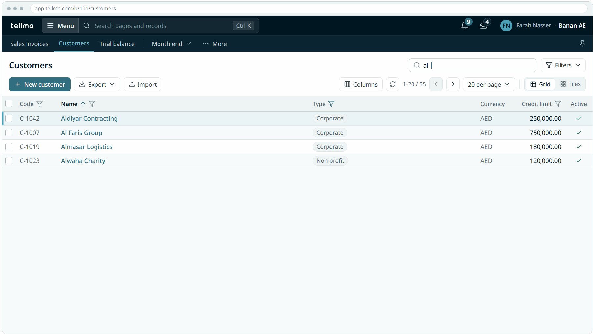

### The wordmark

On a wide screen this wordmark appears in the top left corner and is clickable.

On a narrow screen, the icon is displayed instead to conserve space:

Clicking the wordmark navigates the user to the home page (see section below).

### The menu button and global search
Those come immediately after the watermark, clicking the menu button, focusing global search bar, or typing Ctrl/Cmd-K, while the search bar is empty, sends focus to the search bar and expands the application launcher, showing the recently visited pages and all the top level pages of the current distribution organized into sections:

**The launcher sketch**

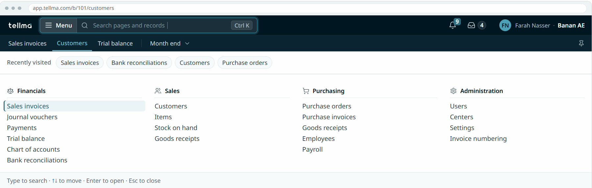

Clicking the menu button, clicking the global search bar, or typing Ctrl/Cmd-K, while the search bar contains text, highlights the text in the search bar, and expands the search results. Or if the user opened the launcher then typed in the global search bar, the launcher is replaced with search results:

**The launcher with text sketch**

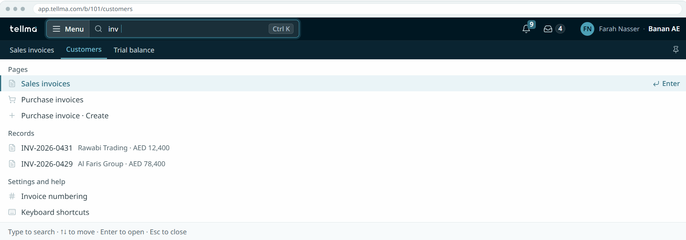

The search text if any is not auto-cleared when escaping the launcher, and the search results are cached.
In the future, the global search will cover launcher pages, records, settings, and help documentation. But for now it only searches through launcher's pages, the search is multilingual and covers an optional hardcoded list of synonyms per screen (e.g. Customers or Clients).
The launcher and the search results can be navigated keyboard only with the arrows, Enter to click a highlighted item, and Esc to close.

### The front and back nav buttons
Come after the search bar, and are only visible in PWA installed mode, since the browser's own back and forth buttons are not available there.

### The notifications bell
Details in the [In-App Notifications Research Doc](../docs/research/in-app-notifications.md)

**Notifications Panel Sketch**

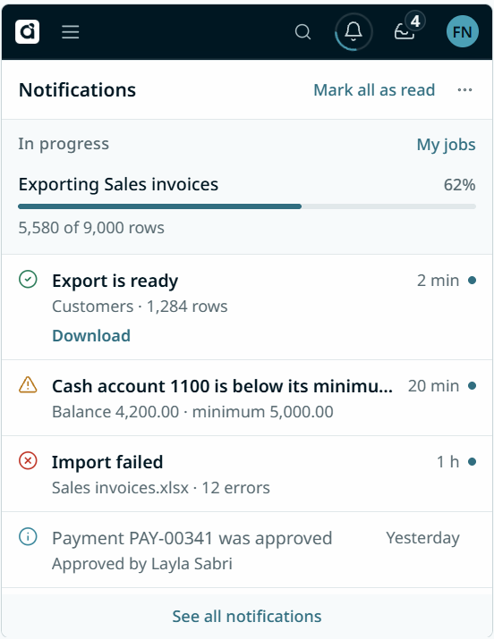

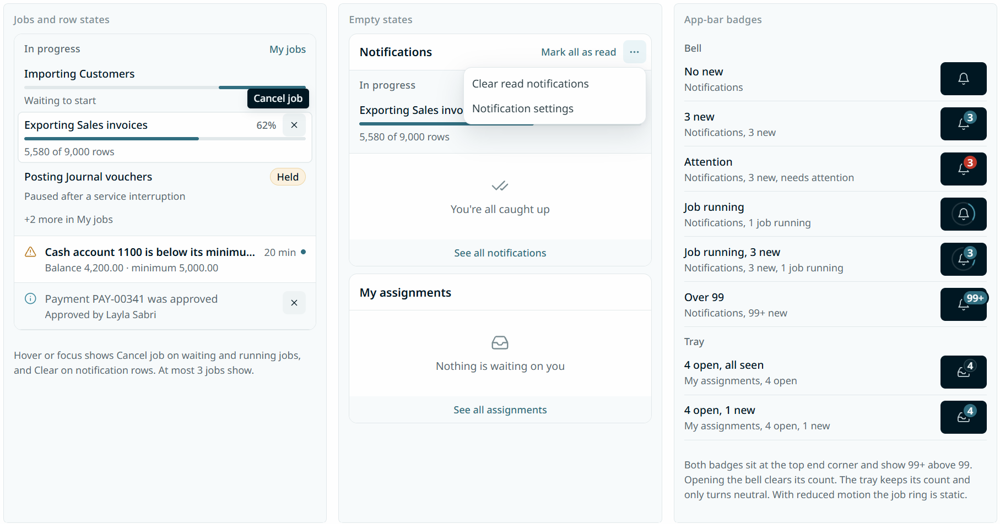

### My assignments tray
Details in the [In-App Notifications Research Doc](../docs/research/in-app-notifications.md)

**My Assignments Sketch**

The research doc keeps assignments out of scope. This brief brings assignments into scope for the next round of specs, including the full design: backend entity, DataBatch plumbing, and UI.

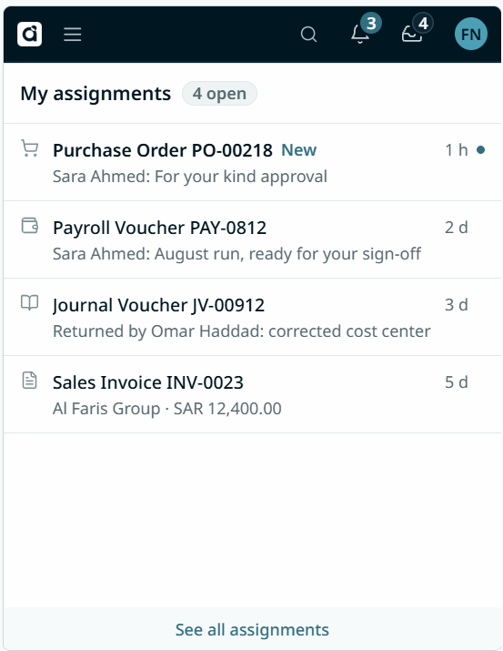

### Session info
The avatar, the user name and the tenant name are permanently visible on wide screen, the user name goes away first on a narrower screen, and finally the tenant name goes away on the narrowest screens leaving only the avatar.
Clicking the session info opens the session menu including the following controls: 
1. Switch Tenant: navigates the user back to the tenant picker
2. My account: link to identity server account management
3. Language toggle: if multi-lingual tenant, shows the tenant's configured languages.
4. Calendar toggle: if multi-calendar tenant, shows the tenant's configured calendars.
5. Theme toggle: Light, Dark, or System (default)
6. Shortcuts: launches a modal with all the system's keyboard shortcuts.
7. About (+ SPA version): launches a modal showing a brief localized description of the system, the versions of the various app components (front-end SPA, backend, core platform, referenced packs), copy right notice, and links to terms of service and privacy if configured.
8. The Sign-out button: clears the cached distro state, and sends the user to the sign out page of the identity server, all browser tabs from the same distro do the same.

**The session menu sketch**

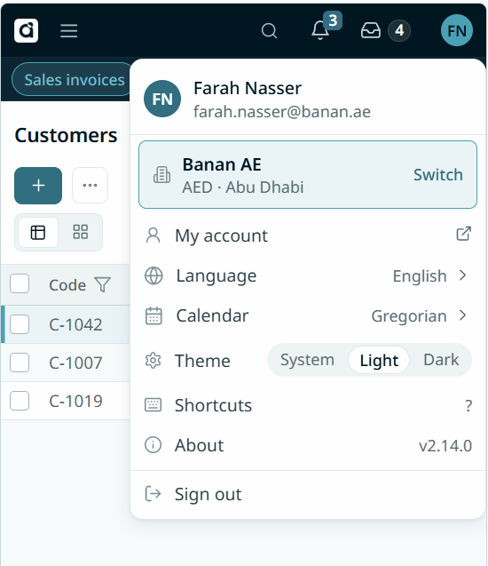

## Home Page
The home page of a tenant is where the user lands on a warm app launch, and where the user is redirected when clicking the watermark at the top left of the page.
The home page has a header font greeting the user depending on the time of day: "Good morning, Adam", with the weekday and today's date underneath.
Below that, the default shows a "work first" dashboard, showing:
- The 10 most recently assigned tasks, each linking to the assigned document
- The 10 most recent open tasks assigned by the current user
- The top Recently visited pages

In the future, the home page dashboard will be swappable per role and per user, for now the default is used for everyone.

**Default home page sketch** (ignore the report widgets)

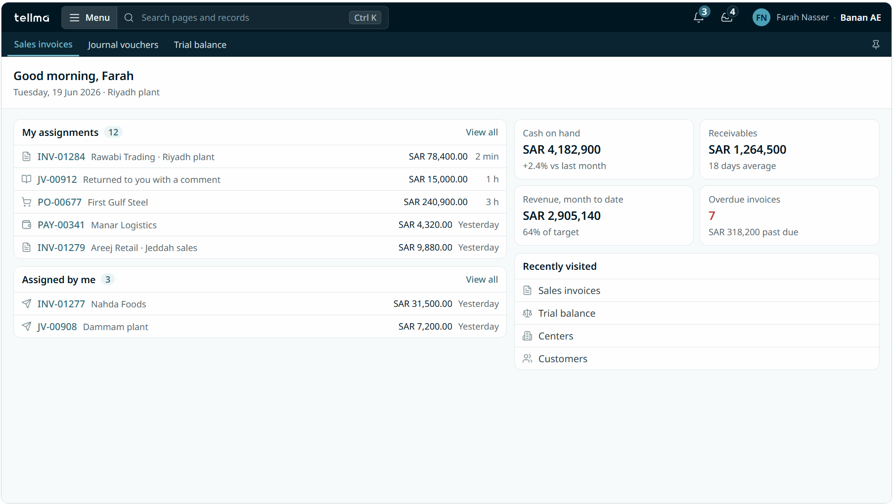

## Search Page
The search page is part of the frontend counterpart of the platform backend's CRUD stack. It supports both flat and tree entities.

**Search page sketch**

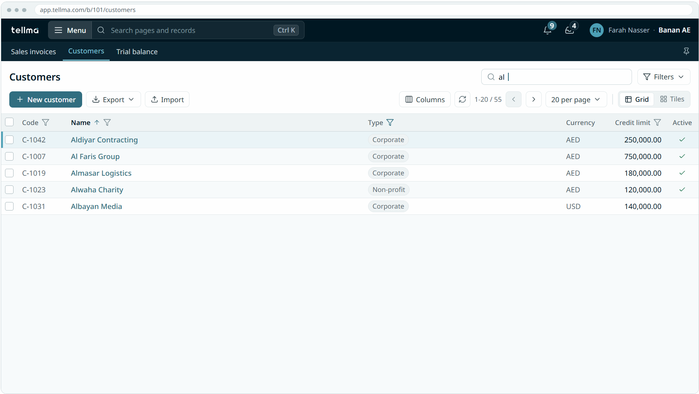

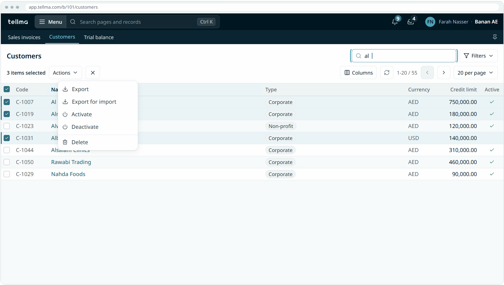

**Search page sketch (Tiles)**

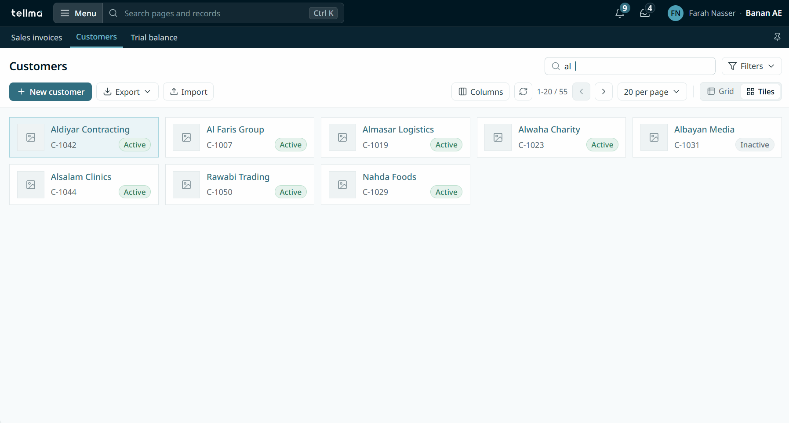

**Search page sketch (Tiles on a narrow page)**

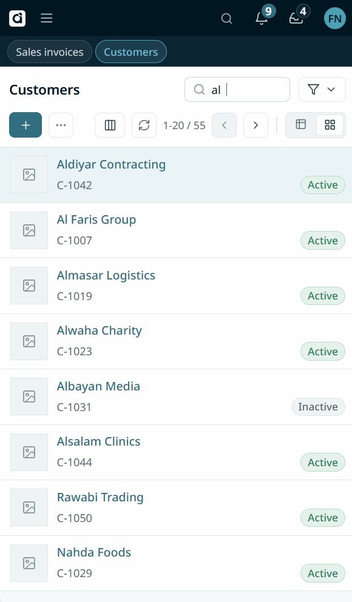

The page (within the shell) consists of 3 rows hosting the various page components:

**1st row**
1. A header font title (e.g. "Customers")
2. A search field that responds as soon as you type in it (does not trigger on blur), debounced only enough that when the user holds down a key, the keyboard auto-repeat doesn't send a request per key to the server. The visual feedback on a keypress should be instant (consult rules to live by above).
3. The filter button, which opens the advanced filter pop up (see section below)

**2nd row**
4. The create button (e.g. "+ New customer"), primary style, only visible if the entity supports it
5. The export menu (containing export grid, export for import, and import template), only the ones the entity supports
6. The import button, if the entity supports it
7. The refresh button
8. The paging status, and the paging controls
9. the grid-tiles toggle button: toggles between the data grid (default on wide screens) and the matrix of tiles (default on narrow screens) with a pre-defined tile layout per entity type.
10. The columns button, which launches the columns editing pop up
11. "N rows selected" When checkboxes in the grid are selected 
12. Actions menu when checkboxes in the grid are selected
13. Cancel button to uncheck all, when checkboxes in the grid are selected

**3rd row**
Contains the grid itself (or the tiles in tiles view). With frozen header row, stable column widths (do not change in response to loading data), zebra stripes, dense, occupying the full width of the page, checkboxes on the first column, and the data in the remaining columns.
The grid occupies the rest of the screen, adding a scrollbar when its data don't fit, the scrollbar never spans the first two rows of the search page.
Clicking a column header orders ascending, clicking the header again orders descending, clicking a third time clears the order. Order is supported by one column at a time in v1, ordering by another column removes the order from any existing column. An ordered-by column displays an indicator.
Every filterable column header comes with a filter button which reveals a filter control suited for that column's datatype: 
1. String column shows a text field and an operator option: contains (default), starts with, ends with, equals, not equals
2. Numeric columns support <, <=, =, >=, >, and between,
3. Date columns support before, after and between in v1, later we will add advanced date filters like year equals or month equals
4. Enum columns support a multi-selection of the enum values
5. Bool columns support true or false
6. Navigation properties show an entity picker 

**Search Grid filter sketch**

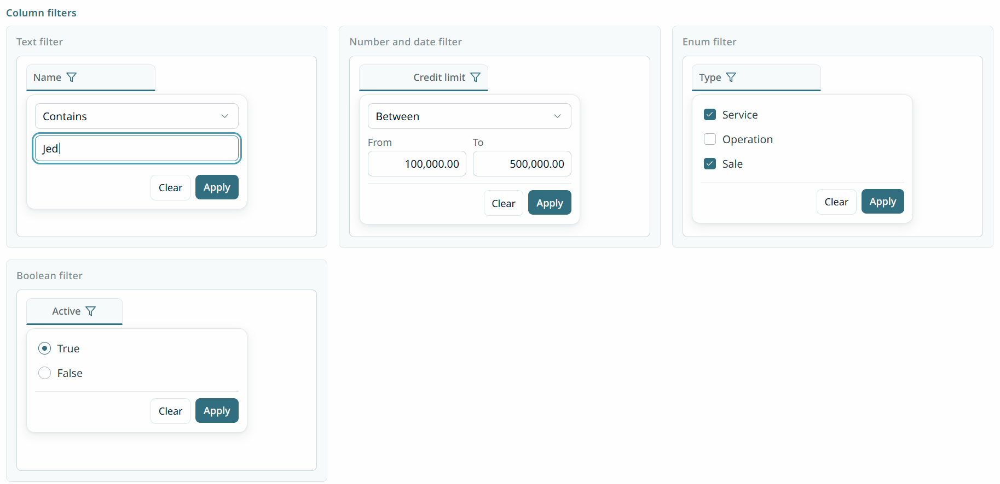

### Interaction
Typing any key while the search page is in view - while focus is not in an editable control already - sends the focus to the search field and inputs the key there filtering the data, with the first row highlighted by default.
The vertical arrow keys move the highlight up and down the grid rows. Hitting Enter opens the details page for the highlighted row.
Changes in the search or paging doesn't clear checkbox selection, so the user can select across pages.
Clicking anywhere on a grid row (except in the checkbox cell) opens the details page of that row. Leaving the checkbox cell out prevents the common annoyance of trying to check a bunch of rows and opening one of them by accident.

**Open Questions**
1. Which is considered the better UX for the search data grid: A. Clicking anywhere on the row opens the details page, or B. clicking only on a value in a specific column (e.g. Name) where the values are rendered as links? The latter approach (B) allows us to render nav properties also as links to other entity details pages (e.g. the Accounts search grid can render the account name column as links to the account details, and the account Center column as links to the center details), but the downside is more machinery (a designated link column), and by far the most common use case of opening the root entity itself (e.g. opening the Account) is now a tad more effort and precision because you have to click a small link rather than anywhere on the row.

**Grid vs Tiles**
The grid/tiles toggle switches between:
- Grid view, default on wide monitors: Is a data grid with a frozen 
- Tiles view, the default on narrow mobile devices, since it's easier to finger-tap on tiles than on grid rows. The tiles are are a row of equal size tiles with margins between them that overflows to the next line forming a 2D lattice, on very narrow devices the margins collapse and only one tile fits per row so it effectively becomes a tile list with no margins. Tiles have an option image on the left and 2 rows where up to 4 values can be arranged in the 4 corners.

### Advanced filter popup
This allows the user to:
1. Specify a free text queryex filter, and shows the user the validation errors if the server response indicates an invalid input.
2. Toggle between Active only (for activatable entities)
3. Use any other custom filters per entity type that the packs or the distro add, often common filters that cannot be easily expressed with the column filter controls.

### Column editing pop up
This presents to the user a GUI for editing the grid columns, listing all available columns of the current root entity, and every entity reachable from it via a navigation property, and every entity reachable from those via their navigation properties etc, in a potentially infinite tree. The user can expand and select the columns they want (they can select the navigation properties themselves, or add a custom expression), this adds the columns in an adjacent list where the user can reorder them. A default set of columns is specified in the code per page. The user selection is stored in their cached user preferences and used whenever they come back to the same search page. The column label is slash separated labels (e.g. "Center / Code")

When selecting a navigation property, the query includes the default related select of that entity and displays it in the current user language, when the user changes the language, the displayed labels change without a server round trip. For example, if the user adds "Center" nav property, the select query includes Center.Id, Center.Name, Center.Name2, Center.Name3, and displays the correct name.

**Column editor sketch**

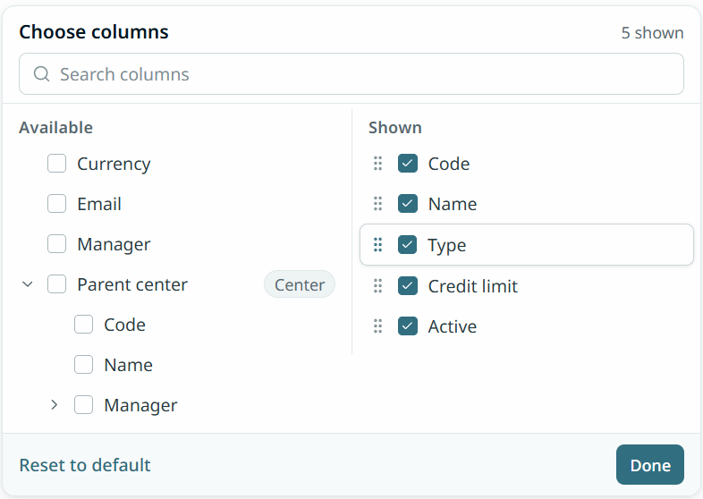

### State
The search page state (search, filter, orderby and selected columns + the data + grid scrollbar position) survive navigating away from the page and navigating back, returning to the page should not refresh the data unless the cached state is evicted, that state can be stored in an LRU to keep it bounded.
Search, filter, selected columns, and order by parameters are also encoded in the search page URL, so a user copying the URL and sharing it with a colleague, shows the same datagrid to that colleague
Changing the columns from the UI stores them in user preferences, a future navigation without explicit URL params lands on that column selection by default.

### Trees
A tree entity is rendered in a tree grid by default, and a Tree|List toggle is added that allows the user to switch back to list view (i.e. rendering like a non-tree entity).
The tree grid shows the roots by default, and every node the user expands lazily loads the children and remembers the expanded parents in the browser's persisted storage. The next navigation by that user in the same session to the same page from any tab fetches the data with those same parents already expanded.
A search returns the rows and all their ancestors so that the search results are rendered within the tree structure, and kept visually distinct, so that a matching row can be told apart from a row that is only rendered because it is the parent of a match.

On narrow devices, a tree of tiles is rendered rather than a tree grid.

**Open Question**
1. export grid to Excel currently relies on the "select" parameter to render the Excel columns. But the select parameter does not match the displayed columns because of navigation properties unpacking into multiple select terms (e.g. "Center" becomes "Center.Name, Center.Name2, Center.Code"), and the mandatory root Id always included even if not displayed. Should the page send a different select parameter to the Excel export API from the one used to query the grid data itself?

## Details Page
Shows all the details of a specific entity and all its related extras. And allows creating, cloning, and editing records if Save is supported on that entity's stack. Extras are entity specific, and include things like workflow state history, edit history, data for embedded widgets, related documents, posted entries, etc.

The page consists of 3 rows:
**1st row**
1. A header font title, followed by the item's display name (e.g. "Customers / Olive Inc.")

**2nd row**
1. Edit button, which turns the page into edit mode (if supported), this operation is instant, nothing is needed from the server to go from view mode to edit mode.
2. Create button, which creates a new record (if supported), this operation is also instant, and the "create" state of the page is in the URL, so that a refresh lands back on the create page.
3. Actions menu, under which there is Deactivate, Delete, and Clone (if supported) 
4. Then right justified (in LTR): the refresh button
5. The paging stats (e.g. 5 / 355), only if the search page was loaded before coming to the details page, and the displayed record is one of the rows in the search page
6. The paging arrows, only if the paging stats are visible, moves to the next record in the order of the search page, if this is the last record on the search page, it loads the next page first before moving to the first record on the next page. Navigating back to the search page shows the new page.

**3rd row**
This fills the rest of the page with a light grey background, over which the details and extras are laid out in white areas (cards or panels) in a responsive layout that reflows based on the page width. The entity fields and child collections are displayed on the main form card.

The details page main form layout is designed per entity, not auto-generated. The platform ships default page layouts for the entities it owns, a distro that changes the entities (or wishes to customize the UI) re-implements the details layout from scratch.
A distro also implements the details layout for its own entities.
This may seem like a departure from the "low-code for standard stuff" principle, but details layouts are one area where no "standard" exists, every entity page is different, and auto-generated UI is rarely acceptable. The boilerplate building blocks of interactivity and state management should still live in the platform and be reusable by every details page, such that distros have a high degree of flexibility in designing their entity details layout, but have access to plenty of reusable primitives that keep the amount of code moderate if they are not departing from the platform's layout design language.

### State
The scrollbar position of the details page, the selected tab within the details card, and the scroll position of every extras panel should all survive navigating away and navigating back within the SPA. If I click a link to another entity anywhere in the details page, and then click return, I am back exactly where I was.
The data in the edit form fields should survive a browser tab refresh, but not opening the same url in a new tab.
Navigating away from an edit form shows a confirmation dialog "Leave without saving?"

**Open Questions**
1. How to capture the view, create, save, clone cycle and state management in the platform, while allowing every details page to have a fully custom layout without having to repeat the boilerplate code per details page?
2. How do capture the concept of a "display name" of an entity type, i.e. a way to represent any entity as a string given the current locale, this would be used in the details page title, and also in entity pickers and navigation properties.
3. Refreshing the SPA doesn't lose the edit form data, but navigating away to another domain will, can the SPA distinguish between the two and not show the "you will lose your data" warning in the former? If not what is the best compromise?

## Signal-R
Azure signal-R cost increases with the ceiling of required active connections. Users typically keep many Tellma tabs open in the browser, can we leverage cross-tab communication to designate one tab per logged-in tenant as the Signal-R connection owner/leader and keep it in charge of notifying the other tabs of new notifications? The mechanism should work correctly when that owner tab is closed or crashes, a new tab is takes ownership and establishes the connection.

**Open Questions**
1. Is it worth it to have that owner browser tab also be in charge of refreshing the cache settings, permissions, and entities when the Signal-R channel fires a cache.changed event? Would it over-complicate the design. These cached settings need to live somewhere visible to all the browser tabs anyways, since they must be available instantly on a warm launch in a new browser tab (see design rules section)

## Stock CRUD pages
Those are the UIs for the entities shipped by the platform in spec 0018:
1. Users
2. Roles
3. Centers

Each comes with a search page and a details page.

**Open Questions**
1. Should we include a standard entity picker for each entity as well? Or build one generic entity picker with an "entity" parameter that every screen can use?

## Reports
A report is a read-only interactive widget of data with optional parameters.
Some reports are hard-coded either in the platform, or in the distribution codebase, other reports are ad-hoc: seeded or user authored using the report studio, and their definitions are stored in a table, and they utilize the Queryex language extensively.

Any report can either be hosted as a top-level page, or as a contextual sub-component within an entity card, or rendered by the built-in AI assistant, or all of the above.

**Open Questions**
- Is "hardcoded" the best term?
- Should hardcoded reports also have special readonly rows in the report table to simplify things like access control logic?

### Hardcoded reports
Those are developed as part of the platform or the distro code base, from the parameters, to the shape of the displayed data, to the backend API invoked, to the drill-through behavior. Hardcoded reports provide the escape hatch for the minority of reporting requirements that are not expressible by the ad-hoc reporting engine.

### Ad-hoc reports
Those are authored by the users or agents from a "report studio", or seeded by deployments. Their definitions are stored in a table as JSON documents.
They fall into 4 categories based on how the data is queried and rendered:
1. Non-aggregate
2. Aggregate flat
3. Aggregate pivot
4. Chart

The report studio is a designer surface where you get a dark panel on the left to edit the report definition, and a preview surface on the right occupying most of the screen by default that shows the resulting report with its parameters and output. The divider between the two allows resizing. 

The editor panel also shows a searchable list of all fields on the root entity including nav properties which appear as lazily expandible sub-trees, the report author can drag any field onto:
1. The list of dimensions, rows, or columns to add its path as a Queryex expression
2. The list of measures, to add the Sum of its path (by default) as a Queryex expression
3. The Filter or Having fields to paste their path in the expression where the drop pointer lands

The report and report studio components are designed for reusability so that they can be later hosted in-context of an embedded assistant that authors reports on the fly, or e.g. as a another view in the search page (grid, tiles, pivot).

Every report comes with a required root entity, and optional Code, Title, Title2, and Title3 (depending on tenant languages), as well as Description, Description2, Description3 (depending on tenant languages).
Every report also stores a list of parameters, each with a Key, Label, Label2, Label3 (depending on tenant languages), Requirement Level (Required/Optional), Default Expression, and a field to override the data type in a way that is compatible with the parameter's use in the report expressions. The list of parameters is auto-populated from the Queryex expressions as the user types them, when the user types PostingDate < @StartDate, a parameter is automatically added to the list.

#### Non-aggregate
Defined as a list of Queryex select terms (custom expressions supported), as well as filter, order by and top. Each select term has a Label (and optionally Label2 and Label3 to make it multi-lingual) and a field to override its data type and formatting in a way that is compatible with the underlying data type. 
The report displays individual rows, the report's header row is frozen when scrolling., clicking on a row navigates to the details page of a record. If the report is based on child entities, clicking navigates to the details page of the parent root entity, with the child row's tab opened, the row scrolled to and flashed once with a highlighting color.

**Open Questions**
1. What is the best mechanism to implement the drill-through to a child row within a parent's page on a platform level, given that layouts are customized per entity and per distro. If it complicates the platform too much we can leave it out and simply drill-through to the parent, or make it opt-in for commonly used entity type child collection.

#### Aggregate flat
Defined as a list of a Queryex select terms (custom expressions supported), as well as filter, order by, having, and top. Each select term with a Label (and optionally Label2 and Label3 to make it multi-lingual) and a field to override its data type and formatting in a way that is compatible with the underlying data type of the expression. 
The query is marked aggregate. The report displays the results of the aggregate query as a flat table, clicking on a row drills through to a list page with the filter set to scope the records to the constituents of the clicked row. The header row is frozen when scrolling.

#### Aggregate pivot
The most complicated but useful report type: defined as a list of Queryex row dimensions, column dimensions, and measures. As well as a filter, and having. 
Each select term has optional Label, Label2, Label3 (depending on tenant languages), order direction, auto-expand toggle, and a field to override its data type and formatting in a way that is compatible with the underlying data type. If a row dimension is added, an option appears to "Show Rows Total". IF a column dimension is added an option appears to "Show Columns Total", specifying whether the root totals are included.

The query is marked aggregate. The report displays the results as an Excel-style pivot table with collapsible tree row and column dimensions, a dimension is expanded or collapsed by default depending on the auto-expand toggle, clicking on a cell drills through (same as the aggregate flat report). The results are aggregated in SQL for every (row, column) pair at every level, the client does not perform any aggregations of its own. If there is a single row dimension, then row dimension attributes can be added (e.g. Account code on Account dimension) which appear as their own columns before the measures. Selecting a navigation property that has a tree entity as a row or column dimension renders that dimension as a full tree by default (with an option to render it as a flat dimension), with parents aggregating their children (and appearing themselves as a phantom child alongside their children to report their own measure values distinct from their children's aggregate, and to keep parent nodes visually always as aggregates of their children). Totals of every dimension level appear with up to 3-4 unique styles to make them visually distinct (like Excel). Grand totals for all rows and all columns are optionally added. Column and row headers are frozen when scrolling.

Same as flat and non-aggregate queries, a navigation property can be used in an expression, and the engine translates it to Id + the 3 labels, so that a language switch does not require reloading the report.

#### Chart
Defined as 0, 1, or 2 dimensions, and exactly 1 numeric measure + simple chart specific customizations like colors and whether to show a legend or line markers etc.
Shows the result of an aggregate query as a chart, every chart type supports a specific number of dimensions and certain customizations. Clicking on a chart data point drills through same as the aggregate reports.

Refer to the [chart research document](../docs/research/chaating-library-analysis.md) for analysis of open source libraries we can use to implement charts.

### Export to Excel
The results on all report types (including Chart) can be exported to Excel, the flat reports are straightforward, the pivot table is exported with all rows and columns fully expanded, the chart's underlying data are exported in a flat table.

### Visibility model
The launcher has one item "Reports" that gives access to all the system reports in one searchable menu with filtered categories:
- My reports
- Shared with me
- All reports

Reports can be pinned to the pinned bar for quick access just like any other page.
Every user can create an ad-hoc report, and reports are visible to their authors by default.
Every user can share a report they have authored with any other user, the other user gets a notification about it. The permissions of the other user - including all RLS filters - continue to apply, sharing a report is not a grant of permission on the underlying entity.
A user (usually admin) with report read permission can see all reports on the system authored by any user from a regular search page on ReportDefinitions.
A user with report publish permission can "publish" a report by sharing it with one or more roles, this shares it automatically with members of these roles. Again this is not a security feature, just a usability one, so that users are only see reports relevant to them, a user can always reconstruct any report they want if they have access to the underlying entity.

Given a report, the system should be able to answer the admin's question: Which concrete list of users can see it, and why (e.g. direct share by John, via role X, etc).

**Open Questions**
1. What are the correct technical names for the 4 categories of ad-hoc reports?
2. For aggregate drill-through, should we re-direct to the entity's search page OR to a dynamic list page (implemented on the non-aggregate report component) that doesn't have the search and title etc? Some entities that support reports (e.g. invoice lines or other child collections) do not necessarily have a dedicated search page, so converging on the dynamic list page for everyone might be a more consistent and easier to implement experience.
3. For aggregate report drill-through, should we add an option to specificy what columns appear in the drilled through list
4. What modifications (if any) are needed on the Queryex engine to support server-side aggregations of pivot table measures?
5. How much would it complicate the design to support the concept of a "running total" in the non-aggregate and/or the aggregate-flat reports?
6. For report sharing, what happens to a published report when its author deletes it?

## Dashboards
A dashboard is a collection of 1 or more reports organized in a grid layout that reflows on narrow screens. 
Dashboards have Code, Title, Title2, and Title3 (depending on tenant languages), a refresh rate in minutes, and a list of reports, each with an optional Title, Title2, Title3, Description, Description2, and Description3 (dependeing on tenant languages), together with the size and positioning metadata on the dashboard, and refresh rate override per report.
Reports on dashboards:
1. Hide their parameters, if any report parameter is required and doesn't have a default expression, that's a validation error
2. Refresh automatically and silently (without showing the spinner, new data is instantly swapped with the old)
3. Indicate under the title when the data was last refreshed.

The user can force refresh the entire dashboard, in which case the old data is cleared instantly and all the spinners appear as usual.
Dashboards may have dashboard level parameters that are input to every report.

**Open Questions**
1. How do we implement dashboard-level parameters? Do we just require that all the reports use the same parameter key? Or do we add a mapping from dashboard param to each report's param?

## Settings

All the tenant settings are accessible in a single tabbed interface, where each tab is a settings category.
The user sees only the tab categories they have access to.

## Observability
**Open Questions**
1. What are a good set of logs, traces and usage instrumentation to collect from a UI client? What should be the guiding principles for designing client side observability?
2. How are these data points sent to application insights on Azure? Especially UI error logging.

## Supportability
1. Upon request from support, the user should be able to view and copy the current UI version from the session dropdown, the UI version is either the git commit hash or a value that can be easily mapped to one by support.
2. Unknown server errors are always returned with trace id that the user should be able to copy and send to support.
3. Slow server requests don't show any error, but still need to make the trace id available to the user to help support troubleshoot "the system is slow" complaints.
4. It would be great if the user can download a complete snapshot of the UI state to send to support if requested.
5. If supported in web standards, it would be also great if the user can take a screenshot of the current UI to send to support if asked. Using computer screenshot facility, users have a habit of screenshotting only a tiny portion of the screen (e.g. just the error dialog), denying the support personnel essential context to troubleshoot, and the support request often has to go back and forth multiple times before the user understands that support need a full page high-res screenshot.
6. It would be great if the state dump and/or the screenshot can be sent directly to support through Tellma, instead of a separate channel. This feature is opt in by the distribution, e.g. standalone or on-prem may not support it. Sending data to support is of course gated by a warning dialog first.

**Open Questions**
1. How to make the slow request trace id accessible to the user? log it to the browser console? Add a keyboard short-cut to copy the last 10 requests and their durations and trace ids to the clipboard? Any existing best practices out there?
2. Do modern browsers support a "screenshot the current page" capability? I don't want to hack it in.
3. Where should the state dump and/or screen go via Tellma? Updated to the distro's blob storage? Or sent to the control plane API? The later makes it accessible to support personnel, the former requires less config, but only devops can reach it.
4. What value can be used as the current UI version.

## User Help and Documentation (Out of scope)

This is out of scope in v1, and the design below may change, but it is included as a heads up to plan for so the design doesn't fight it.

Documentation is linked from context: pages, fields, buttons, and values can have an adjacent help icon or an information icon which snaps-in a documentation drawer from the right side of the page (in LTR), the drawer renders the documentation article in the current language, and may contain rich text, images, or animated gifs. The documentation is not part of the eagerly loaded SPA bundle, every documentation article is lazy loaded on demand. Some documentation articles owned by the platform while others are owned by the distro. A documentation article - especially platform ones - may accept context parameters and render dynamic content based on those provided parameters. The articles can be technical and also domain related (e.g. Accounting concepts relevant to data entry), in single tenant distros, the documentation can also be tailored to the internal language and conventions of that specific customer.
All the documentation lives with the code that owns it and is updated in lock-step with that code.

**Open Questions**
1. In what format should the documentation exist in the source code so that it easy to write and keep up-to-date by agents, but also support all the rich formatting, dynamic rendering etc.
2. Is it better to merge the built-in AI assistant and the documentation drawer into a single interface?

## Changes to existing specs
**Open Questions**
1. Specs 0001-0009 are implemented and their text frozen, they can be amended by a later spec. Specs 0010+ are not implemented yet and up to change if needed. What amendments and changes are necessary to support the new round of front end specs.
