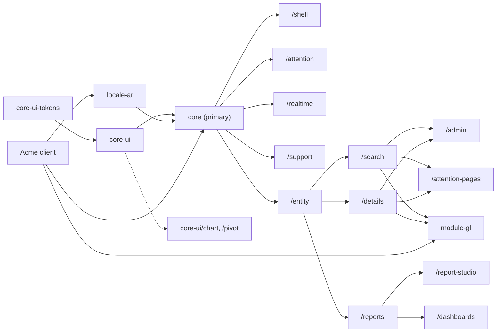
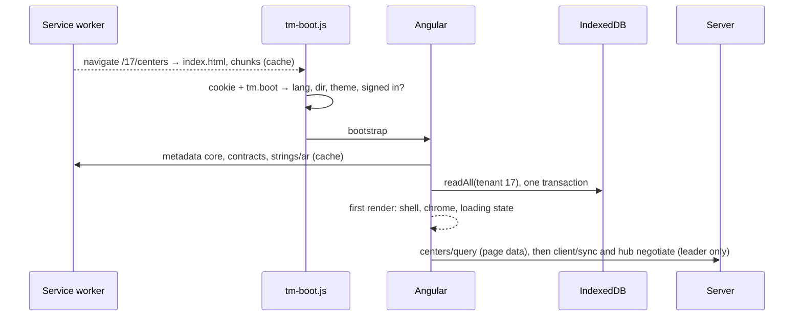
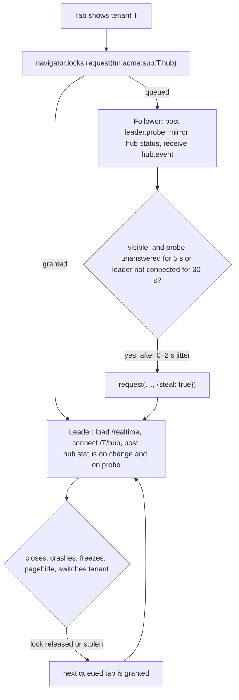

# Round-2 architecture skeleton

The cross-cutting skeleton the thirteen round-2 spec designers build on. Its names, owners,
routes, seams and open-question answers are binding (designer brief); a designer who disagrees
follows it and raises a challenge. It merges two independent drafts. Where they disagreed, the
section decides and records the losing option under **Alternatives rejected**.

Contract blocks are TypeScript and C# sketches: names and shapes are normative; imports,
documentation comments, bodies and cancellation tokens are omitted.

## 0. The decisions in one page

1. **Deployment facts ship in the bundle; tenant and user facts ship over the wire.** Entity
   metadata, securables, setting keys, notification types, languages, calendars, contract
   fingerprints and server string packs are emitted at build time as hashed JSON chunks, the
   **client metadata** (§5.2).
2. **A distribution declares data, never plumbing.** One `provideTellma` call lists languages and
   features; each entity, page and coded report is declared once (`tmEntity`, `tmPage`,
   `tmCodedReport`); routes, launcher entries, deep links, pickers, permissions, page context and
   telemetry are derived (§3). Overrides are explicit (`overrides`, member by member).
3. **Lazy boundaries are entry points.** `@tellma/core` splits along the lazy-loading lines; its
   primary entry point is the warm-launch bundle (§2).
4. **Warm launch reads one IndexedDB transaction and zero network** before the chrome renders,
   from the moment the service worker's first install completes; the first network call is the
   page's data (§7.2).
5. **One revalidation call, one refresh path.** `client/sync` returns only what changed; headers,
   `cache.changed` and launch feed one single-flight `TmCacheRefresher` (§7.3, §7.4).
6. **One hub connection per browser per tenant**, held by a Web Lock leader with automatic
   failover; a visible tab takes over only from a hung or disconnected leader, never from a
   healthy hidden one (§7.8).
7. **Reads are cancellable by type; writes are not** (§7.9).
8. **Sign-out is a broadcast that clears drafts in every tab after one confirmation;
   re-authentication and step-up are same-tab redirects across which drafts persist.** A session
   that ends, by sign-out or expiry, takes the user's stored data with it (§7.6, §7.7).
   **Updates never interrupt:** a banner, then the next reload (§7.5).
9. **One page-context registry and one action model** serve the toolbar, Actions menu, shortcuts,
   the support dump and the future assistant, published by the page frameworks (§5.10).
10. **SPA entity routes are API resource segments.** `/tenants` is the picker, `/` the launch
    redirect, `/{t}` the tenant home (§8).

## 1. Spec map

The README map stands. Six scope moves, one line each, follow the table.

| Spec | File (`docs/specs/`) | Title | Owns | Consumes | Depends on |
|---|---|---|---|---|---|
| 0010 | `0010-amendments-to-implemented-specs.md` (renamed) | Amendments to Implemented Specs | Part A (0003, existing text + account URL); Part B (0002); Part C (0004); Part D (0005); Part E (0006); Part F (0008, incl. the seven amendments moved from 0012 §11.2 and the report amendments) | requests from every round-2 spec | — |
| 0023 | `0023-component-library-additions.md` | Component Library Additions | the generic `@tellma/core-ui` components of §2.3, harnesses, budgets, strings | 0002 conventions | 0010 B–D |
| 0024 | `0024-client-app-foundation.md` | Client App Foundation | packages and workspace, `@tellma/core-tools`, the distribution API and merge rule, client metadata container and emit, PWA and service worker, SPA hosting rules, boot script, session and sign-out, route grammar and launch redirect, deep links and the search-query codec, HTTP layer, error presentation, localization and theme loading, update flow, budgets | 0023, 0025 store, 0026 telemetry | 0010 A–D, 0011, 0013, 0016 |
| 0025 | `0025-client-state-and-cross-tab-sync.md` | Client State and Cross-Tab Sync | client store and boot record, launch cache, `client/sync`, refresher, tab bus, leader election, hub client, preferences client and key registry, page state, drafts, tree expansion memory, recents | 0024 HTTP and session | 0013, 0014, 0021 |
| 0026 | `0026-client-observability-and-support.md` | Client Observability, Support and Page Context | telemetry API and relay endpoint, error logging, UI version, request log and trace ids, state dump, screenshot, support requests (entity and page), page-context registry, page actions | 0024, 0025 | 0011, 0016, 0017 |
| 0027 | `0027-shell-launcher-and-tenant-picker.md` | Shell, Launcher and Tenant Picker | tenantless shell, tenant picker, signed-out page, tenant shell (app bar, pinned bar, slots, tenant markers, banner slot position, layout constants), launcher and global search, session menu with About and Shortcuts dialogs, navigation registry, shortcut registry | 0024–0026, 0028 badges | 0023 |
| 0028 | `0028-assignments-and-attention-surfaces.md` | Assignments and Attention Surfaces | `core.Assignments` end to end, tray, bell panel, toast policy, banner host and precedence, Notifications page, Notification settings page, Assignments page, Jobs page | 0025 leader and store, 0030 search page | 0015, 0016, 0020, 0021 |
| 0029 | `0029-client-entity-model.md` | Client Entity Model | the entity section of the client metadata, entity registry and descriptors, `tmEntity` shape, display names, navigation expansion, client permissions, client Queryex, `queryex/discover`, expression editor, path tree picker, typed value and filter controls, generic entity picker binding, typed entity codegen | 0024 metadata, 0025 store | 0008, 0012, 0015, 0016 |
| 0030 | `0030-search-page.md` | Search Page | search page host, grid and tiles, search field, ordering, column and advanced filters, column editor, selection and bulk actions, query-state precedence and history, trees, export menu, import dialog | 0029, 0025 page state, 0024 codec | 0010 C, 0019 |
| 0031 | `0031-details-page.md` | Details Page | details host and lifecycle, `TmDetailsKit`, save and error flow, clone, drafts, leave guard, paging, child-row deep link, concurrency dialog | 0029, 0025 drafts | 0015, 0016 |
| 0032 | `0032-stock-pages.md` | Stock Pages | Users, Roles, Settings, My profile, Schedules, Outgoing emails, Exports, Imports (Core) and Centers (`@tellma/module-gl`) | 0030, 0031 | 0013, 0014, 0018, 0019, 0020, 0022 |
| 0033 | `0033-report-definitions-and-engine.md` | Report Definitions and Engine | `core.ReportDefinitions`, JSON schema, kinds, parameters, coded-report server contract, sharing model (reports and dashboards), audience resolver, execution, report export, Queryex extensions (written into 0010 Part F) | 0014, 0015, 0029 | 0008, 0012, 0019 |
| 0034 | `0034-report-renderers-and-studio.md` | Report Renderers and Studio | renderers, `tm-chart` and `tm-pivot` (shipped in `@tellma/core-ui`), report host and parameter bar, drill-through list page, coded-report client declaration, reports page, report studio | 0029, 0030, 0033 | 0023 |
| 0035 | `0035-dashboards-and-home-page.md` | Dashboards and Home Page | `core.Dashboards`, widget registry, dashboard grid, refresh scheduler, dashboard parameters, home page and greeting, the `home` replacement hatch | 0028, 0033, 0034 | — |

- **The client metadata container and its emit belong to 0024**; each section's shape stays with
  its domain owner (entities 0029, securables 0014, setting keys 0013, notification types 0021).
- **`client/sync` belongs to 0025**: it is the warm-launch cache's revalidation, not a settings
  feature.
- **Page actions belong to 0026 with the page context**, so the assistant, the shortcuts dialog and
  the details Actions menu share one action model.
- **`tm-chart` and `tm-pivot` are designed by 0034 and ship as `@tellma/core-ui` entry points**,
  so the docs pipeline and MCP server cover them and ECharts stays out of `@tellma/core`.
- **Unowned pages get owners.** 0028: Notifications, Notification settings, Assignments, Jobs (one
  page; a member's rows are self-scoped by 0020 §11.2, so "My jobs" is a filter, not a page).
  0032: My profile, Schedules, Outgoing emails, Exports, Imports. 0026: Support requests.
- **Typed entity codegen belongs to 0029**, generated by 0024's emit from the entity section.

**Out of scope this round:** user help content and format (seams only, §10); operator
announcements (0028 builds the banner host; the model waits); running totals (§10); per-role and
per-user home swapping (a distribution replaces the home page through the `home` hatch, §3.6); records, actions and help buckets in global
search (0027 builds the provider seam; pages only in v1); impersonation (no tenant-side spec).

**Alternatives rejected:** the Jobs page in 0032 with a "My jobs" view in 0028 (one page would
have two owners).

## 2. Client packages

### 2.1 The package family

| Package | Folder (`client/projects/`) | Kind | Holds | Owner |
|---|---|---|---|---|
| `@tellma/core-ui` (+ `-tokens`, `-testing`, `-mcp`) | `core/…` (exists) | ng-packagr | domain-free `tm-*` components; gains 0023's entry points, `chart` and `pivot` (0034) and 0010's amendments; knows nothing of BFF, tenants or entities | 0002 family |
| `@tellma/core` | `core/tellma-core` (new) | ng-packagr | the app framework (§2.2); ARCHITECTURE.md's name | 0024 (package), each entry point's spec |
| `@tellma/core-testing` | `core/tellma-core-testing` (new) | ng-packagr | page harnesses, fake `TmApi`, fake hub, fake clock, metadata fixtures, Playwright helpers (multi-tab, offline, network hang) | 0024 |
| `@tellma/core-tools` | `core/tellma-core-tools` (new) | Node, bin `tellma-client` | `serve`, `build`, `check`; ESLint preset; `tsconfig` base | 0024 |
| `@tellma/locale-ar` | `locale/tellma-locale-ar` (exists) | ng-packagr | Arabic strings for `@tellma/core-ui` and `@tellma/core`, Arabic fonts, `tmArabic()` | 0002 family |
| `@tellma/module-gl` | `module/tellma-module-gl` (new) | ng-packagr | `tmGlFeature()`, the `gl.Center` declaration and layout, `TmGlCenterFields` | 0032 |

- **Build tooling leaves the runtime package.** ARCHITECTURE.md put `bin` scripts in
  `@tellma/core`; they move to `@tellma/core-tools` so the package an SPA imports carries no Node
  code. This is the one naming deviation.
- **Packs depend on `@tellma/core` and `@tellma/core-ui` directly** (peer dependencies). The C#
  "Abstractions only" rule protects the server runtime; on the client the public API of
  `@tellma/core`, gated by API goldens, is the contract. No npm `-abstractions` packages.
- **Pack client code lives in the pack's package:** the Centers pages ship in `@tellma/module-gl`
  because `Center` is a GL entity.

### 2.2 `@tellma/core` entry points

Entry points follow the lazy-loading lines, so API goldens, budgets and the boundary lint see the
units the router loads. They do not bound chunking: `@defer` and `import()` inside an entry point
stay valid, and the app's budgets (§11) verify what the initial bundle holds. "Eager" means in the
initial bundle. Every chunk, eager or lazy, sits in the service worker's `shell` group except those
named in §6.6, so a warm launch reads lazy routes from the cache too.

| Entry point | Holds (owner) | Loaded |
|---|---|---|
| `@tellma/core` | `provideTellma`, `bootstrapTellma`, `tmFeature`, `tmEntity`, `tmPage`, `tmCodedReport`, `tmEnglish`, `TM_CLIENT_METADATA`, `TmApi`, `TmSession`, `TmLocalization`, `TmErrorPresenter`, `TmUrls`, `TmUpdates` (0024); `TmClientStore`, `TmLaunchCache`, `TmCacheRefresher`, `TmTabBus`, `TmLeader`, `TmPreferences`, `TmPageState`, `TmDrafts`, `TmTreeExpansion`, `TmRecents` (0025); `TmTelemetry`, `TmRequestLog`, `TmPageContexts`, `TmPageActions` (0026); `TmNavigation`, `TmShortcuts` (0027); `TmBanners` (0028); `TmEntities`, `TmDisplayNames`, `TmPermissions` (0029) | eager |
| `/shell` | tenantless shell, tenant picker, signed-out page, tenant shell, app bar, pinned bar, session menu; launcher, About and Shortcuts panels `@defer`red (0027) | eager |
| `/attention` | bell and tray buttons with badges, toast policy; panels `@defer`red (0028) | eager |
| `/realtime` | `TmHub` over `@microsoft/signalr` (0025) | lazy, leader tab only |
| `/support` | state dump, screenshot, send-to-support dialog, support-request layout (0026) | lazy, on demand |
| `/entity` | full descriptors, client Queryex, expression editor, path tree picker, value and filter controls, picker binding (0029) | lazy, shared |
| `/search` | search page host, column editor, tiles and tree views (0030) | lazy route |
| `/details` | details host, `TmDetailsKit` (0031) | lazy route; layouts import it |
| `/admin` | Users, Roles, Settings, My profile, Schedules, Outgoing emails, Exports, Imports (0032) | lazy route, one chunk |
| `/attention-pages` | Notifications, Notification settings, Assignments, Jobs pages (0028) | lazy route |
| `/reports` | report host, parameter bar, list and summary renderers, drill-through list, reports page (0034) | lazy route |
| `/report-studio` | report studio (0034) | lazy route |
| `/dashboards` | dashboard page, grid, widget host, refresh scheduler, home page (0035) | lazy route |
| `/private` | shared unstable wiring (no goldens, never for app code) | — |



- **Import rule.** Entry points import each other only through `@tellma/core/<ep>`, never `../`.
  The primary imports no other entry point; `/attention` imports only the primary; `/shell` imports
  the primary and `/attention`; no eager entry point statically imports a lazy one. An ESLint
  boundary rule enforces this in the editor, and the package build fails on an entry-point cycle
  in CI. A service the primary's code calls therefore lives in the primary, whichever spec owns it
  (`TmBanners`, 0028).
- **Third-party weight sits behind lazy edges:** `@microsoft/signalr` (~14 KB gzip) loads in the
  leader tab after first render; ECharts only with `core-ui/chart`.

**Alternatives rejected:** splitting the eager core into `/http`, `/session`, `/store`, `/observe`
entry points (no lazy gain, more goldens; the boundary lint gives the same discipline).

### 2.3 Generic versus feature components

- **0023 (one `@tellma/core-ui/<ep>` each, with harness, budget and Arabic strings):** `icon` (+
  `TmIconRegistry`, Lucide default), `badge`, `avatar` (image or initials), `toast` (+ `TmToasts`),
  `banner`, `drawer`, `splitter`, `segmented`, `radio`, `switch`, `chips` (+ multi-select input),
  `skeleton`, `pager`, `search-field`, `card` and `page-header` layouts, `busy-overlay`, `confirm`
  and `error-dialog` contents (copy button for a trace id), `empty-state`, `date-range`,
  `relative-time`, `reorder-list`, `tree` (aria `tree`, drag sources), `drag-drop`, `kbd`,
  `accordion`, `progress` (bar and ring), `tiles` (virtualised lattice: image and four corners, a
  divided list below `sm`, a tree of tiles), `description-list`.
- **Feature components stay with their feature:** launcher list and pinned bar (0027); bell and
  tray panels, toast policy, banner precedence (0028); expression editor, path tree picker, filter
  popovers (0029, Queryex-aware); column editor (0030); details kit (0031); parameter bar and studio
  panels (0034); dashboard grid (0035). **`tm-chart` and `tm-pivot`** are 0034's designs shipped as
  `@tellma/core-ui/chart` and `/pivot` (domain-free: a data cube or series in, not a report).

### 2.4 Workspace and the reference distribution

- **One pnpm workspace at the repo root** lists `client` and `distributions/*/src/*.Client`, with
  shared versions in a pnpm catalog. One virtual store resolves `@angular/*`, `rxjs` and
  `@jsverse/*` to one real path: one Angular instance. `client/` keeps its scripts.
- **The reference distribution compiles platform sources** by mapping `@tellma/*` to
  `client/projects/**/public-api.ts` through `tsconfig` paths, as the showcase does. A real
  distribution uses the same specifiers against published packages, so its code is identical.
- **One client location:** `distributions/<slug>/src/Tellma.Distro.<Slug>.Client/` (an esproj, 0011
  §1.2). The showcase stays the library's story host; Acme is the e2e target above the library.
- **Tooling generalises:** `tools/workspace.mjs`, the docs extractor, lint scopes, API goldens and
  budgets cover every `projects/<area>/tellma-*` package and the distribution app (prefix `acme`).

**Alternatives rejected:** the Acme app as a member of the `client/` workspace through a `../`
glob (pnpm documents only globs under the root); separate workspaces with path mappings (two
Angular copies, broken DI identity).

## 3. What a distribution writes

The reference distribution adds `acme.Customer` (with a `Contacts` child collection), a sales
invoice, a coded report (`acme-aging`) and an extended Center (`MyCenter : Center` adds
`ManagerId`). Everything else is the platform's.

### 3.1 The file tree

```text
distributions/acme/src/Tellma.Distro.Acme.Client/
  Tellma.Distro.Acme.Client.esproj   scaffolded; its build runs `tellma-client build`
  package.json, angular.json         ~20 + ~25 lines; plain @angular/build:application, serviceWorker off
  tsconfig.json, eslint.config.mjs   extend @tellma/core-tools presets (~8 + 1 lines)
  public/                            manifest.webmanifest (~20 lines), icons/, optional brand/ wordmark overrides
  src/
    index.html                       ~12 lines; <tm-app>, manifest link, tm-boot.js
    main.ts                          3 lines: bootstrapTellma(appConfig)
    app.config.ts                    ~15 lines (§3.2)
    styles.css                       ~4 lines: @tellma/core and @tellma/locale-ar styles, @layer tm.theme deltas
    app/acme.feature.ts              the distribution's one feature (§3.4)
    app/customers/customers.entity.ts, customer-details.ts   declaration + layout (default export)
    app/reports/aging.report.ts      coded report
    app/centers/centers.override.ts, my-center-details.ts    stock-page override
  generated/                         gitignored, written by the emit (§5.2): tellma-metadata.ts,
                                     metadata/*.json, strings/<lang>.json, tellma-entities.d.ts
```

- **Absent on purpose:** `app.routes.ts`, `proxy.conf.js`, `aspnetcore-https.js`,
  `ngsw-config.json`, `i18n/*.json`, interceptors, guards, stores.
- **`tellma-client serve`** runs the emit, exports the dev certificate, binds the port from
  `.dev-ports.local` (else 4200, matching 0011's development `PublicOrigin`) and proxies the
  reserved prefixes and `/{t}/{api,hub,blobs,mcp}` to the Web project. **`tellma-client build`**
  runs the emit, `ng build`, injects font preloads and `tm-boot.js`, then generates `ngsw.json`
  over the final files (so hashes match) and checks budgets and the drift rules of §5.2.
- **Strings live in the distribution's `Strings.resx` / `Strings.ar.resx`** (needed anyway for
  entity labels and validation) and reach the client through the emitted string pack.

### 3.2 `app.config.ts`

```ts
import { ApplicationConfig } from '@angular/core';
import { provideTellma, tmEnglish } from '@tellma/core';
import { tmArabic } from '@tellma/locale-ar';
import { tmGlFeature } from '@tellma/module-gl';
import { tellmaMetadata } from '../generated/tellma-metadata';
import { acmeFeature } from './app/acme.feature';

export const appConfig: ApplicationConfig = {
  providers: [
    provideTellma({
      metadata: tellmaMetadata,                                // emitted at build (§5.2)
      languages: [tmEnglish(), tmArabic({ locale: 'ar-SA' })], // ar formats as ar-SA (Arabic-Indic digits)
      features: [tmGlFeature(), acmeFeature],                  // packs first, the distribution last
    }),
  ],
};
```

- **Calendars are not configured:** the platform lazy-imports `@tellma/core-ui/calendar-*` by the
  tenant's codes. **Languages are declared** because their code must be bundled; the build fails
  when an offered server language has no client definition, so nothing drifts at runtime.

### 3.3 An entity's search and details pages (the common case)

```ts
// customers/customers.entity.ts — search page, details page, launcher entry, deep links, picker
import { tmEntity } from '@tellma/core';
import type { AcmeCustomer } from '../../../generated/tellma-entities';

export const customers = tmEntity<AcmeCustomer>('acme.Customer', {
  section: 'sales',
  columns: ['Code', 'Name', 'CustomerType', 'Currency', 'CreditLimit', 'IsActive'],
  tile: { image: 'ImageId', title: 'Name', subtitle: 'Code', badge: 'IsActive' },
  details: () => import('./customer-details'),
});
```

```ts
// customers/customer-details.ts — markup only; lifecycle, modes, save, errors, drafts are the host's
import { Component } from '@angular/core';
import { TmDetailsKit } from '@tellma/core/details';

@Component({
  selector: 'acme-customer-details',
  imports: [TmDetailsKit],
  template: `
    <tm-details-card>
      <tm-field path="Name" />          <!-- the multilingual group: one field per tenant language -->
      <tm-field path="Code" />
      <tm-field path="CustomerType" />
      <tm-field path="Currency" />      <!-- navigation: picker in edit mode, link in view mode -->
      <tm-field path="CreditLimit" />
    </tm-details-card>
    <tm-details-card titleKey="Acme_Customer_Contacts">
      <tm-child-grid collection="Contacts" [columns]="['Name', 'Email', 'Mobile']" />
    </tm-details-card>`,
})
export default class CustomerDetails {}
```

- **Derived by the platform:** routes `/{t}/customers`, `/new`, `/{id}` from the resource segment
  (§8); a launcher entry `Acme_Customer_Plural` under `sales`, gated by `acme.Customer × Read`;
  Create, Export, Import, Activate and Delete from operations, capabilities and cached access;
  column labels, filter controls and formats; the tile view; the picker for every navigation to
  `acme.Customer`; the title from the display name; Actions-menu entries for zero-argument entity
  actions; page context; telemetry.
- **Typed paths:** the emitted `tellma-entities.d.ts` makes `columns: ['Cod']` a compile error;
  the type parameter is optional. `tm-field path="Name2"` addresses one slot and renders nothing
  on a tenant without a second language.
- **One column default.** `columns` (declared, else the display-name columns, the other natural
  keys and `IsActive` when activatable) is the default of every grid-like surface: search page,
  drill-through list, picker advanced search and Excel export. The SPA always sends an explicit
  select; the server's `DefaultSelect` serves API and MCP callers only.

### 3.4 A launcher section, a coded report, a stock-page override

```ts
// acme.feature.ts — the distribution's single contribution (imports of its own files omitted)
export const acmeFeature = tmFeature({
  key: 'acme',                                                    // = the server feature name
  sections: [{ id: 'sales', labelKey: 'Acme_Nav_Sales', icon: 'users', order: 20 }],
  entities: [customers, salesInvoices],
  reports: [agingReport],
  overrides: [centersOverride],
});

// reports/aging.report.ts — data-only coded report; the platform renders parameters, table, export
export const agingReport = tmCodedReport('acme-aging', {          // kebab key with a hyphen (§8)
  titleKey: 'Acme_Report_Aging',
  section: 'sales',
  securable: ['acme.AgingReport', 'Read'],
  parameters: { AsOf: { type: 'date', required: true, default: 'today()' }, Customer: { entity: 'acme.Customer' } },
  kind: 'summary',                                                // list | summary | pivot | chart
  run: (api, args, signal) => api.read('acme-reports/aging', args, { signal }), // its own [ApiRoute]
});

// centers/centers.override.ts — patches @tellma/module-gl's declaration member by member
export const centersOverride = tmEntity('gl.Center', {
  columns: ['Code', 'Name', 'CenterType', 'Manager', 'IsActive'],
  details: () => import('./my-center-details'),
});

// centers/my-center-details.ts — reuses the stock fields, adds one
@Component({
  selector: 'acme-center-details',
  imports: [TmDetailsKit, TmGlCenterFields],
  template: `<tm-details-card><tm-gl-center-fields /><tm-field path="Manager" /></tm-details-card>`,
})
export default class MyCenterDetails {}
```

### 3.5 Line counts

| Artifact | Authored client lines | Server lines it pairs with |
|---|---|---|
| Boilerplate (main, config, styles, index, manifest, angular, package, tsconfig, eslint) | ~110, scaffolded once | `Program.cs` 3, composition 1 per feature |
| New entity: search, launcher entry, picker, deep links | 7 | entity class ~25, `Entity<T>()` 1, resx labels |
| Its details page | 17 (one card, one child grid) | — |
| Launcher section | 1 inside the feature | 1 resx key per language |
| Coded report, data only / full custom UI | 10 / 5 + a component | one `[ApiAction]` + securable |
| Stock-page override | 4 (declaration) + 6 (layout) | `UseEntity<Center, MyCenter>()` 1 |
| Feature | 7 | — |

### 3.6 Escape hatches (common → simple; uncommon → hatch)

| Need | Hatch | Owner |
|---|---|---|
| A cell that renders differently | `columns: [{ path, display: () => import(…) }]` | 0030 |
| A tile that is not image and four corners | `tile: { component: () => import(…) }` | 0030 |
| A search page that is not a list | `search: () => import(…)` replaces the body; URL and page state stay the platform's | 0030 |
| A different home page | `home: () => import(…)` on `tmFeature` (the last feature that sets it wins); `/{t}` renders it instead of the default | 0035 |
| An extra advanced-filter control | `filters: [{ key, labelKey, component \| queryex }]` (URL `x.<key>`) | 0030 |
| A page with no entity | `tmPage('bank-reconciliation', { component, titleKey, section?, securable? })` | 0024 |
| A details page that is not a form | `details: { page: () => import(…) }`; `injectTmDetails()` still gives the lifecycle | 0031 |
| A field the kit cannot render | raw core-ui controls bound with `[formField]="details.form.X"` | 0031 |
| Custom clone, validation or pre-save | `clone`, `validate` (Signal Forms schema), `beforeSave` members | 0031 |
| An entity action with arguments | `actions: [{ name, dialog: () => import(…) }]`; zero-argument actions need nothing | 0031 |
| A page-level action of its own | `inject(TmPageActions).register(action, destroyRef)` | 0026 |
| A hand-mapped endpoint | `inject(TmApi).read(…)` / `.write(…)` | 0024 |
| A report the engine cannot express | `tmCodedReport` with `run`, or with `component` for a fully custom UI | 0034 |
| A different menu | redeclare sections or entries in `overrides`; `hide: ['core.roles']` | 0027 |
| A settings category with its own editor | `settingsTabs: [{ category: 'acme', component }]` | 0032 |
| An app-bar item | `appBar: [{ id, icon, labelKey, badge?, panel }]`, at most three | 0027 |
| Branding and colours | `manifest.webmanifest`, icons, `public/brand/`, `@layer tm.theme` deltas | 0024 |
| Anything Angular | `providers` on `tmFeature`, or extra providers in `appConfig` | 0024 |
| Telemetry of its own | `inject(TmTelemetry).event('acme.aging.run', props)` | 0026 |

**Alternatives rejected:** a fluent builder chain per feature (one long expression is harder for
agents to diff and split across files than one declaration per file); declaring languages and
calendars on both sides with runtime drift checks (the emit makes the server's set known at build).

## 4. Concept ownership map

One row per shared concept; consumers cite the owner and never restate it. "New" means the owner
creates the section; an existing spec number means the concept lives there (edits in §6).

### 4.1 Client concepts

| Concept | Owner | Consumers |
|---|---|---|
| Distribution API: `provideTellma`, `TmAppConfig`, `bootstrapTellma`, `tmFeature`, merge rule, `tmPage` | 0024 (new) | distributions, 0027–0035 |
| `tmEntity` declaration shape (members' meaning cited from 0027, 0030, 0031) | 0029 (new) | 0027, 0030, 0031, 0032 |
| `tmCodedReport` declaration | 0034 (new) | distributions, 0027, 0035 |
| `settingsTabs` declaration | 0032 (new) | distributions |
| Packages, entry points, workspace, `@tellma/core-tools` | 0024 (new) | all |
| Client metadata: container, emit, chunks, build-time drift rules | 0024 (new) | 0025–0035, 0011 |
| Language definitions and localization runtime (`TmLocalization`: language, direction, calendar, content slot, string loading, scopes) | 0024 (new) | 0027, all pages |
| Theme runtime and the boot script `tm-boot.js` | 0024 (new) | 0025 boot record, 0027 |
| PWA manifest rules, service-worker config, `TmUpdates` | 0024 (new) | 0028 update banner |
| SPA hosting rules (cache headers, CSP, fallback) | 0024 (new); 0011 §5.1–§5.3 implement | 0011 |
| Session: `TmSession`, auth guard, sign-in redirect, step-up, sign-out, expiry and changed-user paths, the per-request user check | 0024 (new) | 0025, 0027 |
| Route grammar, launch redirect, deep-link resolver `TmUrls`, `TmSearchQuery` and its URL codec | 0024 (new) | 0018, 0021, 0022, 0027–0035 |
| HTTP layer: `TmApi`, headers, cancellation, retries, lossless JSON, contract header | 0024 (new) | all |
| Error classification and presentation (`TmErrorPresenter`, shared 400 and 5xx dialogs) | 0024 (new) | 0030, 0031, 0034 |
| App bundle budgets, installability and Lighthouse gates | 0024 (new) | all |
| Client store (IndexedDB partitions, sweeps, format versions, write guard) and boot record | 0025 (new) | 0024, 0026–0035 |
| Launch documents, `client/sync` client, `TmCacheRefresher` | 0025 (new) | all |
| Tab bus | 0025 (new) | 0024, 0028 |
| Leader election, `TmHub`, reconnect policy, realtime-disabled polling | 0025 (new) | 0028, 0035 |
| Preferences client, flush policy, platform key registry | 0025 (new) | 0027, 0030, 0034, 0035 |
| Page state, drafts, tree expansion memory | 0025 (new) | 0030, 0031, 0034 |
| Recently visited pages (`TmRecents`) | 0025 (new) | 0027, 0035 |
| Telemetry API, event naming, transport, error logging | 0026 (new) | all |
| UI version identity | 0026 (new) | 0024 headers, 0027 About |
| Request log and trace ids | 0026 (new) | 0024 dialogs, 0027 About |
| State dump, screenshot, support requests | 0026 (new) | 0027 session menu |
| Page-context registry and page actions | 0026 (new) | 0027, 0030–0035 |
| Tenantless shell, tenant picker, signed-out page | 0027 (new) | 0024 |
| Tenant shell: app bar, slots (`help`, `assistant` reserved), tenant markers, banner slot position, layout constants, drawer host | 0027 (new) | 0028, pages |
| Pinned bar and the pins model (`nav.pinned`) | 0027 (new) | 0035 |
| Launcher, global search and its provider seam | 0027 (new) | 0034 reports |
| Navigation registry (sections, entries, synonyms, permission filter) | 0027 (new) | features |
| Shortcut registry and reserved keys | 0027 (new) | all pages |
| Session menu, About and Shortcuts dialogs | 0027 (new) | — |
| Toast policy (what toasts, which tab, timings) | 0028 (new) | 0030, 0031 |
| Banner service `TmBanners` (primary entry point), precedence, input-idle gate | 0028 (new) | 0024 (offline, update) |
| Bell panel, tray, attention badges, job ring | 0028 (new) | 0027 |
| Notifications, Notification settings, Assignments and Jobs pages | 0028 (new) | 0027, 0035 |
| Entity registry and descriptors (metadata merged with declarations) | 0029 (new) | 0027, 0030–0035 |
| Display-name rendering and cache (`TmDisplayNames`) | 0029 (new) | 0027, 0028, 0030–0035 |
| Navigation expansion (`Center` → `Center.Id` + display-name columns, shape-aware) | 0029 (new) | 0030, 0033, 0034 |
| Client permissions (`TmPermissions`: `can`, `filtered`, `sensitive`, `reachable`) | 0029 (new) | all pages |
| Client Queryex (lexer, printer, builder), expression editor, path tree picker | 0029 (new) | 0030, 0032, 0034 |
| Typed value controls, display formatters, filter controls | 0029 (new) | 0030, 0031, 0034 |
| Generic entity picker binding | 0029 (new) | 0030, 0031, 0032, 0034 |
| Typed entity codegen | 0029 (new) | distributions |
| Client blob-kind policies (accept, size, variants) | 0029 (new; data from 0017) | 0031 |
| Search page host, query-state precedence and history, column preferences, tiles, trees, export menu, import dialog | 0030 (new) | 0028, 0032, 0034 |
| Details host, `TmDetailsKit`, save flow, clone, leave guard, paging, child-row deep link, concurrency dialog | 0031 (new) | 0032, 0034 |
| Stock pages | 0032 (new) | — |
| Renderers, `tm-chart`, `tm-pivot`, parameter bar, drill-through list, report host, reports page, studio | 0034 (new) | 0035 |
| Dashboard grid, widget registry, refresh scheduler, home page, greeting | 0035 (new) | 0027 |
| Generic components | 0023 (new) | all |
| Breakpoints (`TM_BREAKPOINTS`, `TmBreakpoints`, lint rule), `TmTheme`, Transloco loader seam | 0010 Part B | 0023, 0024, 0027–0035 |
| Changes to existing grid, menu, modal, popover, select, l10n, client cache, picker | 0010 Parts B–E | 0023, 0025, 0027–0035 |

### 4.2 Server concepts the front end needs

| Concept | Owner | Consumers |
|---|---|---|
| Entity section of the client metadata (properties, types, label keys, ownership, enums, navigations, children, display name, related select, operations, capabilities, actions, limits, blob kinds); replaces 0015 §1.2's "SPA schema" | 0029 (new) | 0030–0035 |
| Display-name annotation `[DisplayNameSource]` and the related-projection rule | 0012 §2.2, §2.5 (edited; requested by 0029) | 0016, 0019, 0029, 0033 |
| Securables section (incl. `IsSensitive`, `FilterRoot`) | 0014 §10 (edited) | 0029, 0032 |
| Setting-key section, offered languages, registered calendars | 0013 §5.4, §7, §8 (edited) | 0024, 0027, 0032 |
| Notification types and channels section | 0021 §2.5 (edited) | 0028 |
| Emitted string packs and the UI-language rule | 0013 §10.4 (edited) | 0024 |
| Label-key conventions (actions, setting categories) | 0013 §10.1 (edited) | all |
| Contract fingerprints (framework-free computation, header, 412) | 0016 §3.10 (edited) | 0024 |
| Version tags: composite `permissions` wire tag, `cache.changed` payload and recipients, migrator bumps | 0013 §2 (edited) | 0025 |
| `client/sync` and `TenantFacts` | 0025 (new) | 0024, 0027, 0028 |
| Settings save concurrency and result | 0013 §6.3 (edited) | 0032 |
| Preference bag, caps, warm-writer rule | 0014 §3.4 (edited) | 0025 |
| Preference key grammar | 0018 §3.5 (edited) | 0025 |
| `MeResult`, `AccessSummary` | 0016 §3.4, 0018 §3.5 (existing) | 0025, 0029 |
| `users/me/locale` | 0018 §3.1 (new action; requested by 0027) | 0027 |
| Background-request header `Tellma-Activity: background` | 0016 §6.1 + 0014 §7 (edited; requested by 0024) | 0025, 0028, 0035 |
| Problem codes `unauthenticated`, `route-not-found`; trace id on tenantless responses | 0016 §6.2, §7 (edited) | 0024, 0026 |
| Inbound `traceparent` honoured | 0011 §9 (edited; requested by 0026) | 0024 |
| Query wire: separate filter leaves, default order, tree requests, child-entity query routes | 0016 §3.3 + 0015 §5 (edited) | 0030, 0033 |
| `queryex/discover` | 0029 (new) | 0030, 0032, 0034 |
| Aggregate and pivot execution (grouping sets, tree rollups) | 0033 (new) + 0010 Part F (engine) | 0034, 0035 |
| Report definitions, kinds, parameters, sharing, audience, coded-report server contract | 0033 (new) | 0034, 0035 |
| Dashboards | 0035 (new) | 0027 |
| Assignments (`core.Assignments`, summary, seen, `assignments.changed`) | 0028 (new) | 0027, 0035 |
| Notifications server contract (inbox, catalogue, events) | 0021 (existing; client protocol cites 0025 and 0028) | 0028 |
| Job display label and progress cadence | 0020 §2.3, §5.2 (edited; requested by 0028) | 0028 |
| Export column model | 0019 §2.1, §4.1 (edited; requested by 0030) | 0030, 0034 |
| BFF endpoints, profile cookie v2 and its renewal rule, logout result, post-sign-in redirect | 0011 §5.5 (edited; designed by 0024) | 0024 |
| `DistributionInfo` additions | 0011 §5.9 (edited) | 0024, 0026, 0027 |
| Telemetry relay `POST /api/client-telemetry` | 0026 (new) | — |
| Support requests (`core.SupportRequests`, blob kind `support-bundle`, admin listing) | 0026 (new) | 0011 admin surface |
| Identity account-management URL | 0010 Part A | 0011 §5.9, 0027 |

**Alternatives rejected:** `SecurableSummary.IsSensitive` in `me` (sensitivity is a deployment
fact, so the metadata carries it); bar heights as 0002 tokens (they are shell constants, not
library tokens); the toast host in 0028 (stacking, timers and live regions are generic).

### 4.3 Must-address findings

Every finding of the architecture brief, its decision and its owner.

| Finding | Decision | Owner |
|---|---|---|
| ~25 generic components missing; changes to existing ones; which feature components stay in feature specs | §2.3; §6.4 Parts B–E | 0023, 0010, §2.3 owners |
| Unowned pages (Notifications, notification settings, Jobs, Schedules, Outgoing emails, Exports, Imports, My profile) | §1 last bullet; all on the CRUD framework | 0028, 0032 |
| 0012 §11.2 amends frozen 0008 in place | moves to 0010 Part F; 0012 cites | 0010 |
| Post-sign-in redirect vs `/tenants`; logout not drivable; no cross-tab sign-out; profile cookie lacks `sub` and `email` and outlives the session | `returnUrl ?? "/"` with the skip rule in the SPA; `200 { redirectUrl }`; bus broadcast (§7.6); cookie v2 expiring with the idle session | 0024 (0011 §5.5), 0025 bus |
| No SPA hosting rules; the catch-all answers 200 for API typos | §6.6 | 0024 (0011 §5.1–§5.3) |
| No telemetry ingestion; `sendBeacon` lacks the CSRF header | `POST /api/client-telemetry` over `fetch` with `keepalive` | 0026 |
| No "My account" URL | stable account URL with `return_url`, published in `DistributionInfo` | 0010 Part A, 0011 §5.9 |
| No client entity metadata; no display name; `Name2`/`Name3` per tenant | emitted entity section; `[DisplayNameSource]` + `TmDisplayNames`; shape-gated descriptors | 0024 container, 0029, 0012 §2.2 |
| Column editor can 403 a whole query | `TmPermissions.reachable` filters offered paths | 0029 |
| No securables catalogue; no `IsSensitive`; user-level permissions tag never reaches the browser | securables section of the metadata; composite `permissions` wire tag | 0014 §10, 0013 §2.7 |
| No subtotals, rollups, grand totals; no `GROUPING SETS`; optional parameters compare false; no default evaluation; only `gc` | Part F: grouping sets, tree rollup, omitted-parameter folding, constant evaluation, `uq` month map | 0033 → 0010 Part F |
| No query over child entities; navigation properties don't expand; no column aliases | child-entity `query` routes; expansion before the engine; labels in definitions | 0033, 0029 |
| No Validate/Discover endpoint | `queryex/discover` | 0029 |
| `get-by-parent-ids` cannot return roots plus expanded nodes | `IncludeRoots` + `OrderBy` | 0030 (0015 §5.4, 0016 §3.3) |
| Export `Select` "exactly as the grid uses it"; no import-template operation; no import UI | `ExportColumn` model; the template stays `export-for-import` with `Ids = []`; the import dialog on the search page | 0030 (0019) |
| Four hub events, none for assignments, permissions, preferences; toasts and badges assume every tab connects | `assignments.changed`; wider `cache.changed`; leader relay; toast once in the focused tab | 0028, 0025, 0013 §2.4 |
| Jobs: no human label, coarse progress, requester-only events | `Job.LabelKey`; progress events every ≥ 5 points; admin pages refresh by button | 0028 (0020) |
| Settings: entries-only save needs `General`; cross-category 409s; no new stamp; language-list conflict | per-category stamps, save returns them; session menu = content languages, tenantless shell = offered languages | 0032 (0013 §6.3), 0024 (0013 §10.4) |
| Every `migrate` bumps every tag; `cache.changed` carries the name; `settings/client` "unchanged" undefined | bump only when a step applied; `{ tag, value? }`; the SPA uses `client/sync` | 0025 (0013 §2, §6.1) |
| Preference-key grammar; write-behind flush policy | widened grammar (0018 §3.5); §5.7 | 0025 |
| Nothing of the app exists; two client locations; two Angulars; font preloads break the SW hash; tooling knows only core-ui | §2, §3.1; repo-root workspace; `ngsw.json` after injection; tooling generalises | 0024 |
| Design vs brief; research vs brief | §10.2 | owners there |

## 5. Shared client seams

Services are injectable `Tm*` classes used with `inject(TmX)`; context-scoped accessors are
`injectTm…()` functions; providers are `provideTellma…()`. Sketches bind names and shapes; the
owner completes them. Everything is in the `@tellma/core` primary entry point unless noted.

### 5.1 Distribution API (0024; consumers: distributions, packs, 0027–0035)

```ts
interface TmAppConfig {
  metadata: TmMetadataLoaders;                   // generated/tellma-metadata.ts (§5.2)
  languages: readonly TmLanguageDefinition[];    // first = distribution default
  features: readonly TmFeature[];                // packs first, the distribution last
}
interface TmLanguageDefinition { code: string; locale: string; dir: 'ltr' | 'rtl'; strings: () => Promise<TmStringTable> }
declare function provideTellma(config: TmAppConfig): EnvironmentProviders;
declare function bootstrapTellma(appConfig: ApplicationConfig): Promise<ApplicationRef>; // tm-app, router, SW, zoneless

interface TmFeatureDefinition {
  key: string;                                   // 'gl', 'acme'; equals the server feature name
  sections?: readonly TmNavSection[]; entries?: readonly TmNavEntry[]; // entries: not entities, pages or reports
  entities?: readonly TmEntityDeclaration[];     // new keys only
  overrides?: readonly TmEntityDeclaration[];    // patches of keys an earlier feature declared
  pages?: readonly TmPageDeclaration[]; reports?: readonly TmCodedReportDeclaration[];
  settingsTabs?: readonly TmSettingsTabDeclaration[]; appBar?: readonly TmShellSlot[]; // appBar: ≤ 3 in total
  hide?: readonly string[];                      // keys of earlier declarations to drop
  home?: TmLazyComponent;                        // replaces the home page; the last feature that sets it wins
  providers?: readonly (Provider | EnvironmentProviders)[];
}
declare function tmFeature(definition: TmFeatureDefinition): TmFeature;
declare function tmPage(path: string, page: { component: TmLazyComponent; titleKey: string; section?: string; securable?: TmSecurableRef }): TmPageDeclaration;
type TmLazyComponent = () => Promise<Type<unknown> | { default: Type<unknown> }>;
type TmSecurableRef = readonly [resource: string, action: string];
```

- **Merge rule.** Keys: entities by name, pages by path, reports by key, sections and entries by
  id, settings tabs by category. `entities` must be new keys; `overrides` must name an earlier key
  and replace it member by member (unset members inherit); `hide` removes a key. A duplicate or a
  dangling override fails in development and in `tellma-client build`.
- **The platform's own feature (`core`) is implicit and first:** Users, Roles, Settings, My
  profile, Jobs, Schedules, Notifications, Assignments, Exports, Imports, Outgoing emails, Support
  requests, Reports, Dashboards; sections `administration` and `analysis`. `tmGlFeature()` adds
  `gl.Center` under `administration` and the section `financials`.

### 5.2 Client metadata (0024 container; section shapes per §4.2)

```ts
interface TmClientMetadata {                       // the eager "core" chunk
  formatVersion: 1;
  distribution: { slug: string; displayName: string; version: string; platformVersion: string }; // version = UI version
  features: readonly { key: string; version: string }[];
  languages: readonly { code: string; nativeName: string; rtl: boolean }[];  // offered (0013)
  calendars: readonly string[];                    // registered codes: 'gc', 'uq', 'et'
  entities: readonly TmEntitySummary[];            // name, segment, label keys, operations
  securables: readonly TmSecurableMetadata[];      // 0014: resource, action, filterRoot, isSensitive
  settingKeys: readonly TmSettingKeyMetadata[];    // 0013
  notificationTypes: readonly TmNotificationTypeMetadata[]; notificationChannels: readonly string[]; clientEvents: readonly string[]; // 0021
}
interface TmMetadataLoaders {                      // the emitted module; every chunk is a hashed JSON asset
  core: () => Promise<TmClientMetadata>;
  entities: () => Promise<readonly TmEntityMetadata[]>;      // full shapes (0029); loaded with /entity
  contracts: () => Promise<Readonly<Record<string, string>>>; // 'POST /{tenantId}/api/web/centers/query' → fingerprint
  strings: Readonly<Record<string, () => Promise<TmStringTable>>>; // the 0013 string pack per offered language
}
declare const TM_CLIENT_METADATA: InjectionToken<TmClientMetadata>;
```

- **Emit.** `dotnet run --project <Migrator> -- emit-client-assets <dir>` composes the distribution
  as the web host does (no database, no Kestrel) and writes `generated/`. The esproj and both
  `tellma-client` commands run it. The Migrator is the existing composition host with no ASP.NET
  dependency, so the esproj references it without a Web → Client → Web cycle; the fingerprint
  computation moves to `Tellma.Core` (0016 §3.10 edit).
- **Loading.** `core`, `contracts` and the active language's `strings` load at boot; `entities`
  loads with `/entity`. Every chunk is in the worker's `shell` group (§6.6), so all of them come
  from the cache on a warm launch.
- **Tenant shape.** The metadata is tenant-independent; `TmEntities` drops `Name2`/`Name3` twins
  the tenant's languages do not admit (0012 §11.1).
- **Build-time drift rules** (`tellma-client build` fails): an offered language without a client
  definition; a registered calendar without a `@tellma/core-ui/calendar-*` entry point
  (`calendar-umalqura`, `calendar-ethiopic`); a client feature key the server does not compose; a
  dangling override; a page path or report key colliding with a segment or reserved word (§8).
- **It replaces** `GET /api/strings/{language}`, `GET /api/notification-catalogue`, the missing
  securables route, 0015 §1.2's "SPA schema" and the embedded `contracts.json` (the checked-in
  snapshot stays as the review artifact). Bundle and metadata are one version; a mismatch with the
  server is caught by the 412 of §7.5.

**Alternatives rejected:** a runtime `GET /api/client-metadata?v=<build>` cached by a service-worker
data group (a network dependency for deployment facts; languages and contracts still declared
twice); keeping the string-pack and catalogue routes (two caches of build facts).

### 5.3 API client (0024; consumers: all)

```ts
interface TmReadOptions { signal: AbortSignal; background?: boolean; tenantId?: number } // signal required
interface TmWriteOptions { tenantId?: number }                                          // no signal: never aborted
declare class TmApi {
  read<T>(route: string, body: unknown, options: TmReadOptions): Promise<T>;    // POST; retried per 0016 §2.2
  write<T>(route: string, body: unknown, options?: TmWriteOptions): Promise<T>; // POST; never retried
  download(route: string, body: unknown, options: TmReadOptions): Promise<TmDownload>; // Excel streams
  send(route: string, body: unknown): void;      // fetch keepalive, response unread: telemetry, pagehide flushes
  readonly online: Signal<boolean>;              // false: navigator.onLine is false or a request failed at the network level
}
type TmApiErrorKind = 'cancelled' | 'offline' | 'unauthenticated' | 'step-up' | 'forbidden'
  | 'not-found' | 'tenant-not-found' | 'tenant-unavailable' | 'read-only' | 'validation'
  | 'query-invalid' | 'bad-request' | 'conflict' | 'limit' | 'client-outdated'
  | 'unavailable' | 'partial-failure' | 'server';
declare class TmApiError extends Error {
  readonly kind: TmApiErrorKind; readonly status: number; readonly code: string;
  readonly traceId: string; readonly problem: TmProblem | null;
}
```

- **Routes** like `'centers/query'` are relative to `/{t}/api/web/`; tenantless routes start with `/`.
- **Over `fetch`, not `HttpClient`:** native `AbortSignal`, `keepalive`, streamed downloads, and
  raw text for the lossless parser 0016 §3.2 requires (`TmDecimal` beyond 15 digits; `modifiedAt`
  stays the raw string). The platform provides `TM_BLOB_FETCHER` over `TmApi`.
- **Headers on every call:** `Tellma-Client: web/<version>`; `Tellma-Contract`; `Accept-Language`
  = the formatting locale (`ar-SA`); `Tellma-Calendar`; a client-generated `traceparent`;
  `Tellma-Activity: background` when set. No `Tellma-Time-Zone`: the server's
  preference-then-tenant rule decides, and the client formats instants in the same zone.
- **The user check.** Before sending an authenticated call and again on its response, `TmApi`
  reads the profile cookie. Missing, it does not send and runs the expiry path; with another `sub`
  than the tab's `TmSession.profile().sub`, it discards the response and runs the changed-user path
  (§7.7). Only a checked response reaches the observers, so one user's data never lands in
  another's partition. `TmHub` runs the same check before every negotiate.
- **Observers:** every checked response feeds `Tellma-Version-Tags` to `TmCacheRefresher` and a
  record to `TmRequestLog`. `TmApi` itself handles 401 (§7.7), 412 and `404 route-not-found`
  (§7.5), and 503 with `Retry-After` on reads; everything else rejects with `TmApiError`.

**Alternatives rejected:** entity-aware `query`/`get`/`save` methods on the base client (the page
frameworks wrap them; the base client's job is cancellation by type).

### 5.4 Session and localization (0024; consumers: 0025, 0027, all pages)

```ts
interface TmProfile { v: 2; sub: string; sh: string; name: string; email: string; locale: string | null } // tellma.profile
declare class TmSession {
  readonly profile: Signal<TmProfile | null>;
  readonly state: Signal<'active' | 'expired' | 'signing-out'>;
  signIn(options?: { returnUrl?: string; stepUp?: TmStepUpChallenge }): Promise<never>; // top-level /bff/login
  signOut(): Promise<never>;                                                          // every tab (§7.6)
}
declare class TmLocalization {
  readonly language: Signal<string>; readonly locale: Signal<string>; readonly dir: Signal<'ltr' | 'rtl'>;
  readonly calendar: Signal<TmCalendar>;
  readonly contentSlot: Signal<1 | 2 | 3>;       // which Name slot the active language reads (0013 §9.2)
  setLanguage(code: string): void;               // instant; persisted through users/me/locale
  setCalendar(code: string): void;
}
```

- **A language switch re-renders in place** with no reload and no round trip: labels re-resolve,
  `dir` flips through the live-direction amendment (0010 Part D), display names read the new slot.

### 5.5 Client store and boot record (0025; consumers: 0024–0035)

```ts
type TmPartition =
  | { kind: 'device' }                                        // no user data; survives sign-out
  | { kind: 'user'; sub: string }                             // tenant list, distribution info
  | { kind: 'tenant'; sub: string; tenantId: number }         // launch documents
  | { kind: 'session'; sub: string; sessionHandle: string };  // tree expansion; dies with the session
interface TmStoredDoc<T> { readonly tag: string | null; readonly savedAt: number; readonly formatVersion: number; readonly data: T }
declare class TmClientStore {
  readAll(partition: TmPartition): Promise<ReadonlyMap<string, TmStoredDoc<unknown>>>; // one transaction
  doc<T>(partition: TmPartition, name: string): Signal<TmStoredDoc<T> | undefined>;   // live across tabs
  put<T>(partition: TmPartition, name: string, doc: TmStoredDoc<T>): Promise<void>;   // posts store.changed; refused unless the partition's sub is the cookie's
  sweep(rule: 'session-ended' | 'other-users' | { sessionOtherThan: string }): Promise<void>; // session-ended: all but device, plus tm-images-v1
  readonly boot: { read(): TmBootRecord; patch(delta: Partial<TmBootRecord>): void };  // the app's only writer of tm.boot
}
interface TmBootRecord {                        // localStorage 'tm.boot', ~1 KB, read synchronously by tm-boot.js
  v: 1; theme: 'system' | 'light' | 'dark'; lang: string; dir: 'ltr' | 'rtl';  // device-level
  sub: string | null; lastTenantId: number | null;                             // cleared when the session ends
}
```

- **One IndexedDB database `tm-app`**, one object store keyed `[partitionKey, name]`. Partition
  keys begin with the `sub` (the device partition's is `device`), so one user's data, or every other
  user's, is one key-range delete. `localStorage` holds only `tm.boot`; `sessionStorage` only drafts.
- **A session's data ends with it.** Sign-out (§7.6), a 401 or a missing cookie mid-session (§7.7)
  run `'session-ended'`; a page load with no profile cookie and `tm.boot.sub` set means the session
  expired, and `tm-boot.js` runs the same delete before redirecting to `/bff/login`. Drafts are
  exempt: they stay in their tab, keyed by `sub` (§5.8). A sign-in after expiry is a cold launch.
- **A document whose `formatVersion` differs** from the code's, or whose `savedAt` is older than the
  7-day idle window, is treated as absent. **A different `sub` at boot** sweeps every other user's
  partitions first. **Page data is never written to disk;** cacheable lists are, under `entity:*`.
- **Boot-record writers** go through `boot.patch`: `TmLocalization` (`lang`, `dir`), the theme glue
  (`theme`, from `TmTheme.setting`), the tenant route (`lastTenantId`), `TmSession` (`sub`).

### 5.6 Tab bus and leader (0025; consumers: 0024, 0028)

```ts
type TmBusMessage =
  | { type: 'store.changed'; partition: string; names: readonly string[] }
  | { type: 'hub.event'; tenantId: number; event: TmClientEvent }
  | { type: 'hub.status'; tenantId: number; status: 'connecting' | 'connected' | 'reconnecting' | 'offline'; since: number } // on change, and answering a probe
  | { type: 'leader.probe'; tenantId: number }    // a follower asks; the leader answers with hub.status
  | { type: 'session.signing-out' | 'session.signed-out' | 'session.expired' | 'session.started' | 'session.changed'; sub: string } // device channel
  | { type: 'drafts.query'; replyTo: string } | { type: 'drafts.reply'; replyTo: string; dirty: number }
  | { type: 'prefs.changed'; tenantId: number; keys: readonly string[] };
declare class TmTabBus { readonly tabId: string; post(message: TmBusMessage): void; readonly messages: Observable<TmBusMessage> }
declare class TmLeader {
  readonly isLeader: Signal<boolean>;            // for the tenant this tab shows
  readonly hubStatus: Signal<TmHubStatus>;       // the leader's, mirrored in every tab
  events(name: string): Observable<TmClientEvent>; // hub events, delivered in every tab
}
```

- **Names:** the device channel `BroadcastChannel('tm:<slug>')` carries `session.*` messages, so
  a tab of one user hears another user's sign-in; the user channel `tm:<slug>:<sub>` carries the
  rest. Locks `tm:<slug>:<sub>:<tenantId>:hub` and `…:sync`. `TmHub` (the SignalR wrapper) lives
  in `/realtime`.

### 5.7 Launch cache, refresher, preferences (0025; consumers: all)

```ts
interface TmLaunchDocs {                         // tenant partition; refreshed by header, cache.changed, sync
  settings: TenantSettingsForClient;             // tag `settings`
  me: MeResult;                                  // tags `preferences` + `permissions`; own writes adopt the result
  tenant: TmTenantFacts;                         // every sync; session.ended {tenant-unavailable}
  inbox?: InboxSummary; assignments?: AssignmentsSummary; // event-driven by the leader
  [list: `entity:${string}`]: TmCachedEntitySet; // tag `entity:<Name>`; refetched lazily through {segment}/all
}
declare class TmLaunchCache {
  readonly docs: { readonly [K in keyof TmLaunchDocs]: Signal<TmLaunchDocs[K] | undefined> };
  readonly warm: Signal<boolean>;                // settings + me + tenant present in current formats
}
declare class TmCacheRefresher {
  observe(tenantId: number, tags: Readonly<Record<string, string>>): void; // headers, hub events
  refresh(tenantId: number, docs: readonly string[]): Promise<void>;       // client/sync under the sync lock
}
interface TmPreferenceKey<T> { readonly key: string; readonly kind: 'curated' | 'write-behind'; readonly fallback: T }
declare function tmPreferenceKey<T>(key: string, kind: 'curated' | 'write-behind', fallback: T): TmPreferenceKey<T>;
declare class TmPreferences {
  get<T>(key: TmPreferenceKey<T>): Signal<T>;
  set<T>(key: TmPreferenceKey<T>, value: T): void; // applied locally at once; broadcast; flushed per kind
}
```

- **User partition:** `tenants` (`/bff/user`) and `distribution` (`distribution-info`),
  stale-while-revalidate. **Session partition:** tree expansion.
- **Platform keys (registry in 0025):** `nav.pinned` (curated), `nav.pinnedBarVisible`, `nav.recent`,
  `search.<entity>.columns`, `.view`, `.pageSize`, `report.<id|key>.params`,
  `announcements.dismissed` (reserved), under the widened 0018 §3.5 grammar.
- **Theme is device-level** (boot record, never synced); language and calendar are the user's
  `PreferredLanguage` and `PreferredCalendar` through `users/me/locale`.
- **Reports are not launch documents.** The launcher has one Reports entry (the reports page) and
  lists coded reports under their sections from the client registry; stored definitions are reached
  through the reports page and pins, so report saves bump no version tag.
- **Flush.** `set` posts `prefs.changed`, which other tabs apply at once. Curated keys write at
  once. Write-behind keys coalesce per key and flush 2 s after the last change, at most every 10 s,
  and on `visibilitychange: hidden`, through `TmApi.write`: the tab stores the returned bag
  (overlaid with keys still unflushed) and `preferences` tag in `me`, so no tab syncs for its own
  write. On `pagehide` the remaining dirty keys go through `TmApi.send`, unread (the next header in
  another tab costs one `client/sync`). Each tab flushes only its own dirty keys and the server
  sets keys one by one, last writer wins, so tabs never coordinate. A flush body stays under
  16 KB, so several closing tabs fit the 64 KiB keepalive budget.

### 5.8 Page state, drafts, tree expansion, recents (0025; consumers: 0027, 0030, 0031, 0034, 0035)

```ts
declare class TmPageState {                      // memory only, per tab, LRU of 20
  remember<T>(key: TmPageStateKey, state: T): void; // key = route template + normalized params
  recall<T>(key: TmPageStateKey): T | undefined;    // query, data, scroll, selection, active tab
}
declare class TmDrafts {                         // sessionStorage: survives reload, not a new tab
  save(key: string, value: TmJson): void;        // 'tm.draft:<sub>:<t>:<entity>:<id|new>', written continuously
  load(key: string): TmJson | undefined; clear(key: string): void; readonly dirtyCount: Signal<number>;
}
declare class TmTreeExpansion {                  // session partition: any tab, same sign-in session
  expanded(page: string): Signal<ReadonlySet<number>>; toggle(page: string, id: number, open: boolean): void;
}
declare class TmRecents { readonly pages: Signal<readonly TmRecentPage[]> } // nav.recent; by route template; 2 s dwell; cap 10
```

### 5.9 Telemetry and request log (0026; consumers: all)

```ts
declare class TmTelemetry {
  event(name: string, props?: Readonly<Record<string, string | number | boolean>>): void;
  timing(name: string, ms: number, props?: Readonly<Record<string, string>>): void;
  error(error: unknown, context?: Readonly<Record<string, string>>): void; // also Angular's ErrorHandler
}
interface TmErrorRecord { errorClass: string; kind?: TmApiErrorKind; code?: string; status?: number; traceId?: string;
  routeTemplate: string; stack: string; message?: string } // what error() ships
interface TmRequestRecord { traceId: string; route: string; startedAt: number; durationMs: number | null;
  outcome: 'ok' | 'cancelled' | 'error'; status?: number; slow: boolean }
declare class TmRequestLog { readonly recent: Signal<readonly TmRequestRecord[]>; copy(): Promise<void> } // ring of 100
```

- **Error envelope.** The stack's URLs are reduced to chunk names. A `TmApiError` never ships its
  `message` (a 422 or `query-invalid` can quote filter text or field values); any other message is
  capped at 200 characters after a redaction pass that masks digits, e-mail addresses and quoted
  text.

### 5.10 Page context and page actions — the assistant seam (0026; consumers: 0027, 0030–0035)

```ts
type TmPageKind = 'home' | 'search' | 'details' | 'report' | 'studio' | 'dashboard' | 'settings' | 'custom';
interface TmPageContext {
  readonly kind: TmPageKind; readonly routeTemplate: string; // '/:t/centers/:id'
  readonly entity?: string; readonly title: Signal<string>;  // 'gl.Center'; localized, as displayed
  readonly helpKey?: string;                         // reserved for the help drawer
  readonly state: Signal<TmJson>;                    // query, mode, tab, selected ids
  readonly visible?: Signal<TmVisibleData>;          // columns + displayed rows, capped at 200
  readonly form?: TmFormContext;                     // details edit mode
  readonly errors: Signal<readonly TmContextError[]>;// validation, request and render errors on screen
  readonly actions: Signal<readonly TmPageAction[]>;
}
interface TmFormContext {
  readonly fields: Signal<readonly { path: string; labelKey: string; value: TmJson; errors: readonly string[]; editable: boolean }[]>;
  propose(path: string, value: TmJson): void;        // writes the model, marks the field "assisted"; never saves
}
interface TmPageAction {
  readonly id: string;                               // 'details.save', 'search.export', 'gl.center.activate'
  readonly labelKey: string; readonly icon?: string; readonly enabled: Signal<boolean>; readonly destructive: boolean;
  readonly shortcut?: string;                        // registered with TmShortcuts
  readonly params?: TmJsonSchema;
  invoke(args: TmJson, origin: 'user' | 'shortcut' | 'launcher' | 'assistant'): Promise<TmActionResult>;
}
declare class TmPageContexts {
  readonly current: Signal<TmPageContext | null>;     // the routed page
  readonly overlays: Signal<readonly TmPageContext[]>;// open dialogs that publish context
  register(context: TmPageContext, destroyRef: DestroyRef): void;
}
declare class TmPageActions { register(action: TmPageAction, destroyRef: DestroyRef): void } // adds to the current context
```

- **The frameworks publish, pages do not:** search, details, report, studio and dashboard hosts
  register a context from state they already hold; a distribution layout writes nothing.
- **One action model:** toolbar buttons and the Actions menu are views of `TmPageAction`s, as are
  shortcuts and future assistant tools, which therefore share the permission and confirmation
  path. An `assistant` origin on a destructive action always confirms; `propose` never saves.
- **AG-UI (future):** the context maps to a `STATE_SNAPSHOT` with `STATE_DELTA` changes; actions
  map to frontend tools. **Today** the support dump serializes `current`, `overlays`, the request
  log and the version, and the Shortcuts dialog lists actions with shortcuts.

### 5.11 Shell registries and slots (0027; consumers: features, pages)

```ts
interface TmNavSection { id: string; labelKey: string; icon: string; order: number }
interface TmNavEntry { id: string; section: string; labelKey: string; url: (t: number) => string; icon?: string;
  order?: number; synonymsKey?: string; requires?: TmSecurableRef; helpKey?: string } // synonyms: comma list per language
declare class TmNavigation { readonly sections: Signal<readonly (TmNavSection & { entries: readonly TmNavEntry[] })[]> } // permission-filtered
declare class TmShortcuts { register(s: { id: string; keys: string; labelKey: string; scope: 'global' | 'page'; run: () => void }, destroyRef: DestroyRef): void }
interface TmShellSlot { id: string; icon: string; labelKey: string; badge?: Signal<number | null>; panel: TmLazyComponent }
```

- **Reserved slot ids** `help` and `assistant` sit between the tray and the session button with
  zero width until registered, so adding them later moves nothing.

### 5.12 Entities, display names, permissions (0029; consumers: 0027, 0028, 0030–0035)

```ts
interface TmEntityDescriptor {                     // metadata merged with the declaration, gated by tenant shape
  readonly name: string; readonly segment: string; // 'gl.Center', 'centers'
  readonly properties: readonly TmPropertyDescriptor[]; readonly navigations: readonly TmNavigationDescriptor[];
  readonly children: readonly TmChildDescriptor[]; readonly capabilities: ReadonlySet<string>;
  readonly operations: ReadonlySet<'query' | 'details' | 'save' | 'delete' | 'import' | 'export'>;
  readonly displayName: TmDisplayNameRule; readonly relatedSelect: readonly string[];
  readonly limits: { maxTake: number; countCap: number; maxSkipWindow: number; maxSearchLength: number; maxIds: number };
  readonly actions: readonly TmEntityActionDescriptor[];
  readonly declaration: TmEntityDeclaration;       // columns, tile, details, picker, …
}
declare class TmEntities { get(name: string): TmEntityDescriptor; bySegment(segment: string): TmEntityDescriptor | undefined }
declare class TmDisplayNames {
  of(entity: string, row: TmJson): Signal<string>;   // active content slot, fallback to slot 1
  select(entity: string, navigation?: string): readonly string[]; // the columns a query must select
}
declare class TmPermissions {
  can(resource: string, action: string): Signal<boolean>;      // from the cached access summary
  filtered(resource: string, action: string): Signal<boolean>;
  sensitive(resource: string, action: string): boolean;        // securables metadata: step-up ahead
  reachable(root: string, path: string): Signal<boolean>;      // 0015 §5.2 traversal rule: no query 403s
}
```

### 5.13 URLs, errors, updates, page frameworks (0024; 0030, 0031, 0034)

```ts
interface TmSearchQuery {                               // 0024; the §8 query-state grammar
  q?: string; columnFilters?: Readonly<Record<string, string>>; filter?: string; inactive?: boolean;
  custom?: Readonly<Record<string, string>>; order?: string; cols?: readonly string[];
  page?: number; size?: number; view?: 'grid' | 'tiles' | 'tree' | 'list';
}
declare class TmUrls {                                  // 0024
  home(tenantId?: number): string;
  search(entity: string, query?: TmSearchQuery): string;
  parseSearch(params: URLSearchParams): TmSearchQuery;  // the codec's other half; 0030 reads the page's query with it
  details(entity: string, id: number, child?: { collection: string; id: number }): string;
  target(resource: string, id: number): string | null;  // a notification's TargetResource + TargetId
}
declare class TmErrorPresenter {                        // 0024; all but 422, which 0031 maps onto fields
  present(error: TmApiError, context: { kind: 'read' | 'save' | 'action'; retry?: () => void }): Promise<void>;
}
declare class TmUpdates { readonly available: Signal<string | null>; reload(): void } // 0024; version from appData
declare function injectTmSearch<T>(): TmSearchContext<T>;     // 0030, @tellma/core/search
declare function injectTmDetails<T>(): TmDetailsContext<T>;   // 0031, @tellma/core/details
declare function injectTmReportHost(): TmReportHost;          // 0034, @tellma/core/reports
interface TmDetailsContext<T> {
  readonly entity: Signal<T | undefined>; readonly form: FieldTree<T>;  // view value; Signal Forms tree over the copy
  readonly mode: Signal<'view' | 'edit' | 'create'>; readonly descriptor: TmEntityDescriptor;
  readonly related: TmRelated; readonly extras: Signal<Readonly<Record<string, unknown>>>; readonly busy: Signal<boolean>;
  edit(): void; cancel(): void; save(): Promise<boolean>; refresh(): void;
}
```

- **`TmErrorPresenter`** owns the 5xx dialog (trace id with copy), the 400 dialog,
  `tenant-not-found` (picker with a notice), `tenant-unavailable` (tenant-state page) and
  `client-outdated` (§7.5); `forbidden` on reads is an inline state; `cancelled` is silent.
- **`TmReportHost`** is the one contract for hosting a report as a page, in a details card, on a
  dashboard or in the assistant: a definition id or coded key, parameters, a refresh mode
  (`spinner | silent`) and drill-through outputs.

### 5.14 Library and attention seams (breakpoints and theme 0010 Part B; toasts 0023; banners 0028)

```ts
type TmBreakpoint = 'xs' | 'sm' | 'md' | 'lg' | 'xl' | 'xxl';
declare const TM_BREAKPOINTS: { readonly sm: 576; readonly md: 768; readonly lg: 992; readonly xl: 1200; readonly xxl: 1440 };
declare class TmBreakpoints { readonly current: Signal<TmBreakpoint>; atLeast(b: TmBreakpoint): Signal<boolean> }
declare class TmTheme { readonly setting: Signal<'system' | 'light' | 'dark'>; readonly effective: Signal<'light' | 'dark'>; set(value: 'system' | 'light' | 'dark'): void }
declare class TmToasts { show(toast: TmToast): TmToastRef }   // 0023: stacking, timers, live region
declare class TmBanners { show(banner: TmBanner): TmBannerRef } // 0028, primary entry point: precedence 1–5, one at a time, pager, input-idle gate (§9)
```

## 6. Server additions and edits

### 6.1 New and changed endpoints

| Route | Verb | Purpose | Owner |
|---|---|---|---|
| `/{t}/api/web/client/sync` | POST | revalidate the launch documents in one round trip | 0025 |
| `/api/client-telemetry` | POST | client telemetry relay; tenantless, `Tellma.Web` policy, `Tellma-Client` required, ≤ 32 KB per batch, rate policy `tellma-telemetry` | 0026 |
| `/{t}/api/web/queryex/discover` | POST | validate and discover a draft query (diagnostics, parameters with compared-with paths, path uses); cancellable per keystroke | 0029 |
| `/{t}/api/web/users/me/locale` | POST | `{ language?, calendar? }` without `me/save`'s three round trips; bumps `PreferencesTag`; no stamp | 0018 edit, for 0027 |
| `/{t}/api/web/assignments/{query,get,summary,seen}` | POST | assignments stack and tray protocol; `summary` carries `NoActivityStampMetadata` | 0028 |
| `/{t}/api/web/reports/…` | POST | report definitions stack (segment `reports`) + `share`, `publish`, `transfer`, `audience`, `run`, `export`, `export/start` | 0033 |
| `/{t}/api/web/{child-segment}/query` | POST | query over a child entity (`sales-invoice-lines/query`) under the owner's `Read`, rebased with `FilterTree.Via` | 0033 (0015, 0016 edits) |
| `/{t}/api/web/dashboards/…` | POST | dashboards stack | 0035 |
| `/{t}/api/web/support-requests/{query,get,submit}`, `/{t}/blobs/support-bundle` | POST | opt-in "send to support": staged dump and screenshot, then a member-only `submit` | 0026 |
| `/api/admin/v1/tenants/{id}/support-requests` | GET | Tellma support lists a tenant's support requests over the admin surface | 0026 (0011 §5.9) |
| `/bff/logout` | POST | now answers `200 LogoutResult` (below) | 0024 (0011 §5.5) |
| `/api/strings/{language}`, `/api/notification-catalogue` | GET | **removed**: emitted into the bundle (§5.2) | 0024 (0013, 0021) |

```csharp
[ApiRoute("client")]
public sealed class ClientSyncService
{
    // MemberOnly, Idempotent, Mutation = false, NoActivityStampMetadata; one Read batch
    [ApiAction("sync", MemberOnly = true, Idempotent = true, Mutation = false)]
    public Task<ClientSyncResult> SyncAsync(ClientSyncRequest request);
}
public sealed record ClientSyncRequest(IReadOnlyDictionary<string, string> Held); // document → wire tag held; empty = cold
public sealed record ClientSyncResult(
    TenantFacts Tenant,                            // always
    IReadOnlyDictionary<string, string> Tags,      // settings, permissions, preferences, entities
    TenantSettingsForClient? Settings,             // only when the held settings tag differs
    MeResult? Me,                                  // only when preferences or permissions differ
    IReadOnlyList<string> StaleEntities);          // cacheable lists to refetch lazily through {segment}/all
public sealed record TenantFacts(int Id, TenantCategory Category, TenantState State, int? LiveTenantId);

public sealed record LogoutResult(string RedirectUrl);  // end-session URL ("global") or "/signed-out" ("local")

public sealed record ClientTelemetryBatch(string Version, string TabId, int? TenantId, IReadOnlyList<ClientTelemetryItem> Items);
public sealed record ClientTelemetryItem(string Kind, string Name, DateTimeOffset At, string? TraceId,
    IReadOnlyDictionary<string, JsonElement>? Properties);   // Kind: event | timing | error

// 0012 §2.2: renders an entity as one string; not [DisplayName] (System.ComponentModel owns that name)
[AttributeUsage(AttributeTargets.Class)]
public sealed class DisplayNameSourceAttribute(string property) : Attribute { public string? Prefix { get; init; } }
```

**Alternatives rejected:** `/api/telemetry` (ambiguous with server telemetry); a support blob kind
without a `core.SupportRequests` row (support could neither list nor quote requests); keeping
`settings/client` with `ifTag` as the SPA's revalidation (superseded by `client/sync`).

### 6.2 New tables and columns (designed by their owners)

| Table or column | Owner | Notes for the cross-cutting design |
|---|---|---|
| `core.Assignments` | 0028 | system-written; self-scoped criterion; bumps no tag; publishes `assignments.changed` to the old and new assignee; MCP `ReadOnly` |
| `core.UserStamps.AssignmentsSeenAt` | 0028 (0014 §3.3 edit) | tray "new" state, distinct from `InboxSeenAt` |
| `core.ReportDefinitions`, `core.ReportDefinitionShares` | 0033 | segment `reports`; bumps no version tag (the client caches no definitions, §5.7) |
| `core.Dashboards`, `core.DashboardWidgets`, `core.DashboardShares` | 0035 | same share shape as 0033's; bumps no version tag |
| `core.SupportRequests` | 0026 | message, UI version, trace ids, dump and screenshot blob refs; the id is the reference the user quotes |
| `core.Jobs.LabelKey`, `LabelArgumentsJson` | 0028 (0020 §2.3 edit) | "Exporting Sales invoices" |

### 6.3 Edits to specs 0010–0022 (applied in place, logged in `round-2-spec-changes.md`)

| Target | Delta | Why | Needed by |
|---|---|---|---|
| 0011 §3.2, §5.5 | After the callback the BFF redirects to `returnUrl ?? "/"`; the single-membership skip rule moves to the SPA launch redirect; "company picker" becomes "tenant picker" | one owner of the landing decision, using the SPA's cache; `/` is not the picker | 0024 |
| 0011 §5.5 profile cookie | v2 = `base64url(JSON { v: 2, sub, sh, name, email, locale })`; `sh` is the session handle (a name, not a credential, §7.4); re-issued whenever the session cookie is (sliding renewal, a refresh that changes `name` or `locale`); expires with the session's idle expiry, capped by the absolute one; a request carrying `Tellma-Activity: background` renews neither (`OnCheckSlidingExpiration` sets `ShouldRenew = false`), so cookie life and server idle life move together | synchronous signed-in signal that matches the 7-day session; partitions per user and per session; the tenantless shell shows the email | 0024, 0025 |
| 0011 §5.5, §4.5 logout | `POST /bff/logout` answers `200 LogoutResult`, clears `tellma.profile`, sends `Clear-Site-Data: "cache"` (belt and braces: the client deletes its own caches), and calls `ISessionTerminationListener.SessionsTerminatedAsync(subject, [ownHandle])`; the post-logout redirect lands on `/signed-out` | `fetch` cannot follow the end-session redirect; cached private blobs leave the HTTP cache; the hub closes this session's connections | 0024 |
| 0011 §5.5 | delete the client-caching sentence and cite 0025; "falls back to the picker on 403 or 404" narrows to `404 tenant-not-found` | 0025 owns client caching; 403 has many meanings | 0024, 0025 |
| 0011 §5.1–§5.3 hosting | the rules of §6.6; static assets anonymous (`TenantlessEndpointMetadata("spa-assets")`); SPA first segments `tenants`, `signed-out`; SPA tenant second segments `settings`, `me`, `list`; the startup audit refuses a stack segment or hand-mapped route using a reserved word | signed-out browsers must load the bundle; API typos must not answer `200 index.html` | 0024 |
| 0011 §5.9, §8 | `DistributionInfo` gains `identity.accountUrl`, `links { terms?, privacy? }` (`Tellma:Links:*`), `support { enabled }` (`Tellma:Support:Enabled`); the admin surface gains the support-request listing | About dialog, My account, support opt-in; runtime configuration, not build facts | 0026, 0027 |
| 0011 §1.2, §6.6 | client project tree per §3.1; the esproj references the Migrator and runs `tellma-client build`; repo-root pnpm workspace; dev server and proxy from `tellma-client serve` | rule 1; one Angular instance | 0024 |
| 0011 §9 | honour an inbound same-origin `traceparent` trace id on the web surface (sampling stays server-side); relay instruments for client telemetry | trace id known before the response and for cancelled calls | 0026 |
| 0012 §2.2, §2.5 | add `[DisplayNameSource(property, Prefix?)]` (default: the `Name` group, else the first natural key, else `Id`); the related projection always contains `Id`, the display-name columns and `Code` when present; startup rejects a `[RelatedSelect]` that drops them | Details Q2; navigation expansion needs it in every projection | 0029 |
| 0012 §6.1, 0015 §14.1 | the scope token is `HttpContext.RequestAborted` for Read and Validate batches, the cold prologue and retry delays; a Persist round trip, once sent, runs to completion | rule 2C without ambiguous save outcomes | 0024 |
| 0012 §11.2 | moves to 0010 Part F; 0012 cites it | one amendment home for frozen 0008 | 0010 |
| 0013 §2.3, §2.4, 0021 §6.3 | `cache.changed` also fires for the tenant `permissions` tag (tenant group) and user-level `permissions` and `preferences` bumps (that user's group); payload `{ tag, value? }`, with `value` only for `settings` and `entity:*` | idle tabs learn of role, membership and preference changes; tabs that already hold a value skip the refetch | 0025 |
| 0013 §2.7, 0016 §6.2 | the `permissions` wire tag folds the caller's `PermissionsTag` into the tenant tag: `"{fv}.{tenant}{user}"` | a membership change reaches the member's browser (f03 C4) | 0025 |
| 0013 §2.8 | `migrate` bumps tags only when it applied a migration or provisioning step | no refetch burst after deployments that change no data | 0025 |
| 0013 §5.3, §10.1 | category label key `SettingCategory_<category>` and an order; `SettingKeyDescriptor` gains `DescriptionKey` and `EnumType`; action label key `<Schema>_<Entity>_Action_<Name>` | settings tabs and Actions menus render from data | 0029, 0032 |
| 0013 §6.1 | the SPA stops calling `settings/client`; it always answers the full document; `ifTag` is removed; `client/sync` composes the same bytes | the "unchanged" result was undefined | 0025 |
| 0013 §6.3 | `ExpectedModifiedAt` is required only when typed members are listed; entries carry per-category expected stamps; `save` answers the new stamps | entries-only saves without `General` read; no cross-category 409 | 0032 |
| 0013 §10.4, 0021 §2.5 | string packs and the notification catalogue are emitted at build (§5.2); their routes are removed; the in-tenant language switch offers the tenant's content languages; the tenantless shell offers the offered languages; server keys merge at the Transloco root scope | one cache of build facts; resolves f03 C2 | 0024 |
| 0014 §2 | `CoreResources` adds `core.Assignment`, `core.ReportDefinition`, `core.Dashboard`, `core.SupportRequest`; `AccessActions` adds `Share`, `Publish`, `Transfer` | new stacks | 0026, 0028, 0033, 0035 |
| 0014 §3.4 | the write-behind policy and the platform key registry cite 0025; the warm-writer rule becomes "adopt the returned bag, overlay unflushed keys" | f03 C6, G19 | 0025 |
| 0014 §7, 0016 §4.3, §6.1 | a request carrying `Tellma-Activity: background` (reads and idempotent actions only) does not stamp activity; `NoActivityStampMetadata` on `client/sync` and `assignments/summary` | dashboard refresh and polling must not keep sessions alive | 0024, 0028, 0035 |
| 0014 §10, 0016 §3.4 | the securables catalogue reaches the SPA in the metadata; `MeResult.SecurablesFingerprint` is removed | the metadata is versioned by build | 0029, 0032 |
| 0015 §1.2, §2.2 | "the SPA schema" is the metadata's entity section (0029); `StackDescriptor` gains `DefaultOrderBy` and `DisplayName` | named consumer; stable paging | 0029, 0030 |
| 0015 §5.2, 0016 §3.3 | `QueryRequest.Filters: string[]?`, each a separate `FilterTree.Leaf` (diagnostic clause `filters[i]`); an absent `OrderBy` uses `DefaultOrderBy ?? "Id desc"`; child-entity roots are queryable (§6.1) | column, custom and advanced filters stay separate leaves, so diagnostic spans line up; paging needs an order | 0030, 0033 |
| 0015 §5.4, 0016 §3.3 | `ParentIdsRequest` gains `IncludeRoots` and `OrderBy`, making the "one call" claim true | restore a remembered tree in one round trip | 0030 |
| 0016 §2.1, §2.2, §2.4 | add the §6.1 routes with their retry classes (`client/sync`, `queryex/discover`, `reports/run` are retried reads); remove the two GET routes | route table completeness | all |
| 0016 §3.10 | fingerprints computed by a framework-free `Tellma.Core` service; the SPA reads them from the emitted metadata; the checked-in snapshot stays the review artifact; the contract middleware stamps `Tellma-Build` on its 412 | the emit needs the computation; the client tells server-newer from server-older | 0024 |
| 0016 §6.2, §7.5 | `Tellma-Trace-Id` also on tenantless `/api/*` and `/bff/*`; the cookie challenge's 401 carries code `unauthenticated`; a route miss under a tenant prefix is `404 route-not-found` | support on tenantless pages; tell sign-in from step-up; detect outdated clients | 0024, 0026 |
| 0016 §8.2 | rate policy `tellma-telemetry` (per user, separate bucket) | telemetry never starves user calls | 0026 |
| 0017 §2.3, §3 | kind policies reach the client in the entity section; blob kind `support-bundle` | `accept` and size pre-checks; support upload | 0026, 0029 |
| 0018 §3.1 | `users/me/locale` (§6.1) | session-menu toggles | 0027 |
| 0018 §3.5 | preference key grammar `^[a-z][a-zA-Z0-9]*(\.[a-zA-Z0-9][a-zA-Z0-9-]*)*$`, ≤ 128 | `search.gl.Center.columns`, `report.acme-aging.params` must be legal | 0025 |
| 0018 §4 | the `members` extra adds `User.ImageId`, `IsActive`, `State` | Role page member list | 0032 |
| 0018 §1.2, §6 | development seed: tenant 1 languages `en, ar`, calendars `gc, uq`; Acme adds `acme.Customer` (with `Contacts`), `acme.SalesInvoice` and `MyCenter` | the reference distribution exercises every path | 0024 |
| 0019 §2.1, §4.1 | `ExportRequest.Columns: ExportColumn[]` (`Expression`, `Header`) replaces the raw `Select`: a navigation exports one column holding its display name in the request language; `Id` only when listed; "Import template" stays `export-for-import` with `Ids = []` | Trees Q1 | 0030 |
| 0020 §2.3 | `Job.LabelKey` + `LabelArgumentsJson`, set at enqueue, carried by `InboxRunningJob` | bell "In progress", Jobs page | 0028 |
| 0020 §5.2, §10 | publish `job.changed` when reported progress moves by ≥ 5 points (at most every 5 s), and on `Append` checkpoints | a live progress bar instead of 2-minute steps | 0028 |
| 0020 §7.2 | `ScheduleStates` readable as the Schedule details extra `state` | next due and last fired on the Schedules page | 0032 |
| 0021 Context, §5.4, §8 | assignments are 0028's; the client protocol cites 0025 (leader, cache) and 0028 (presentation); the pages move to 0028 | one owner per behaviour | 0025, 0028 |
| 0021 §5.3 | `InboxSummary` carries `Related` with actors' display names and avatars | bell rows show the actor | 0028 |
| 0021 §6.3 | add `assignments.changed`; `cache.changed` per 0013 | | 0025, 0028 |
| 0021 §9.2 | `ClientTimeoutInterval` 150 s (keep-alive stays 15 s) | a hidden leader's throttled pings must not drop the connection (§7.8) | 0025 |
| 0021 §2.3 | register `core.report.shared` | "the other user gets a notification" | 0033 |
| 0022 §4, 0018 §3.3 | email and invite links use the deep-link grammar: `{PublicOrigin}/{t}/{segment}/{id}`, home `{PublicOrigin}/{t}` | a deep-link contract now exists | 0024 |
| 0022 §8 | the Outgoing emails page is 0032's, on the CRUD framework | owner | 0032 |

### 6.4 Amendments to frozen specs 0001–0009 (written into spec 0010)

Each part gets its own Definition of done, so Part A (blocking 0011) never waits for the others.

| Part | Target | Delta | Why (requested by) |
|---|---|---|---|
| A (0003) | §11.2 | a stable Account & Security entry URL that honours `return_url` against the distribution's registered origin; `DistributionInfo.identity.accountUrl` publishes it | "My account" needs a URL (0027) |
| B (0002) | §4, §8 | breakpoint constants (§9), `TM_BREAKPOINTS`, `TmBreakpoints`, stylelint `tm/allowed-breakpoints` for media and container queries | one closed set of widths (0024) |
| B (0002) | §4 | `TmTheme` (`system`, `light`, `dark`; writes `data-theme`, follows `prefers-color-scheme`, declares `color-scheme`, exposes `setting`); it never persists: `@tellma/core` seeds it from the boot record and stores changes there | the System theme (0024) |
| B (0002) | §5, §7 | `provideTellmaUi({ translations })`: a loader seam `@tellma/core` fills (client scopes, server packs at the root) and runtime `availableLangs`; a documented live-direction host | app strings, string packs, live RTL switch (0024) |
| B (0002) | §3.4 | `tm-select` multi-select and option groups | enum column filters, grouped lists (0029, 0030) |
| B (0002) | §1 lint | `tm/prefix-exports` admits `injectTm…` and covers `projects/module/**` | naming convention, packs (0024) |
| C (0004) | §5, §6, §8.2, §8.3, §8.8, Decision 18 | row activation (`rowActivation: 'none' \| 'row'`, output `rowActivate`; checkbox cell and interactive content excluded); external active row (`activeRowId` model moved by arrows while focus stays in an external input) | Search Q1, type-to-search (0030) |
| C (0004) | §6.1, §14 | sort state (`orderBy` model; header click cycles asc → desc → none; indicator; `aria-sort`); header end slot for a filter button with an active state | ordering and column filters (0030) |
| C (0004) | §8.8 | select-all toggles the current page and keeps foreign ids; the tri-state counts the page | selection across pages (0030) |
| C (0004) | §4, §7, §12, §13, §16 | `rowClass`; `scrollbar-gutter: stable`; `scrollToRow(id, { flash })`; tree `expandedIds` model and batched `loadChildren`; budget re-baselined | trees, child-row deep link, stable layout (0030, 0031, 0034) |
| C (0004) | §8.5 menu | `button[tmMenuTriggerFor]`; submenus; group headings; checkable and radio items; link items (`href`, new tab) | session, Export and Actions menus, pin folders (0027, 0030, 0031) |
| D (0005) | §2.1 | `tmCreateAnchoredOverlay` and `tmPushEscapeDismissal` move to a public `@tellma/core-ui/overlay` | shell overlays share one Escape stack (0027) |
| D (0005) | §10, §11 | `TmModal` `placement: 'center' \| 'end'` (drawer) and live `direction`; the modal's raw 600 px media query becomes `sm` (576); `tm-popover` `size` input | narrow-screen panels, RTL after a live switch, filter popups (0027, 0028, 0030) |
| D (0005) | §2.2 | closed format set gains date-time, time of day and relative time, with goldens | "2 min", "last refreshed 10:42" (0028, 0035) |
| D (0005) | §2.3, §7 | `TmClientCache.clearAll` also deletes `tm-*` IndexedDB databases and `tm.*` web-storage keys (sparing the boot record's device fields); `TM_BLOB_FETCHER` takes an `AbortSignal` | sign-out sweep; rule 2C (0024, 0025) |
| E (0006) | §2 | rich two-line options; multi-select (chosen entities as chips in the field) | generic picker binding, navigation `in:` filters (0029, 0030) |
| F (0008) | from 0012 §11.2 | the seven amendments (key-set restriction, `level`, prologue and body, paging slots, context slots, versioned leaves, `Via`) | one amendment home (0010) |
| F (0008) | §2, §13.4 | `QuerySpec.GroupingSets` emitting `GROUPING SETS` with a level-indicator column | pivot subtotals and grand totals in one statement (0033) |
| F (0008) | §10.10, §13 | a tree-rollup grouping key over the dimension's node closure (`IsDescendantOf`), the only fan-out allowed | tree dimensions aggregate their subtrees (0033) |
| F (0008) | §6, §9 | `QueryCompilationOptions` gains `OmittedParameters` (a set of declared parameter names); a comparison that names an omitted parameter folds to true | optional report parameters (0033) |
| F (0008) | §1.4 | `EvaluateConstant` (a path-free expression → one value) | parameter default expressions (0033) |
| F (0008) | §2.4 | `ParameterUse.ComparedWith` (the path a parameter meets) | the studio offers a picker for `@Customer` (0029, 0034) |
| F (0008) | §10.4 | `'uq'` through a host-provided month map | Acme's Umm al-Qura reporting (0033) |

- **Not amended:** column aliases (labels live in definitions), navigation expansion (the host
  expands), list parameters, window functions (running totals deferred).

### 6.5 ARCHITECTURE.md edits

- **§Frontend:** `@tellma/core`, `-tools`, `-testing` and the entry points; the PWA and
  service-worker decision; "deployment facts in the bundle, tenant facts over the wire"; the 7-day
  warm launch; the distribution API and merge rule; fix the stale `TmDateAdapter` paragraph (the
  seam is `TmL10n` + `TM_CALENDAR`) and the MCP tool names.
- **§Distribution repo layout, §Rollout & Phasing:** one client location (§3.1); the repo-root
  pnpm workspace replaces bare path mappings.
- **§Library architecture:** npm packs depend on `@tellma/core` directly; no npm `-abstractions`;
  `bin` scripts live in `@tellma/core-tools`.
- **§Reports — three tiers:** dashboards leave tier 3 (grids of tier-1 definitions on the OLTP
  database); add report definitions, sharing and coded reports.
- **§Guiding principles → Performance:** "optimistic UI for mutations" yields to the blocking save;
  "never a cold spinner" becomes "chrome never waits; data shows its loading state at once".
- **§Observability, §Glossary:** the client telemetry relay, trace ids, UI version; terms app shell,
  launcher, pinned bar, assignment, report definition, coded report, dashboard, client metadata,
  page context, page action, feature (client), declaration.

### 6.6 SPA hosting rules (designed by 0024, implemented in 0011's `MapTellma`)

| Response | Rule |
|---|---|
| `index.html` and the SPA fallback | `Cache-Control: no-cache`; the CSP below; `Referrer-Policy: strict-origin-when-cross-origin`; `X-Content-Type-Options: nosniff`; `Permissions-Policy: camera=(), microphone=(), geolocation=(), display-capture=(self)` |
| Hashed JS, CSS, fonts, `generated/*` chunks | `public, max-age=31536000, immutable`; anonymous |
| `ngsw.json`, `ngsw-worker.js`, `safety-worker.js`, `tm-boot.js`, `manifest.webmanifest`, icons | `no-cache`; anonymous |
| Tenant JSON | `no-store` (0016 §8.5, unchanged) |
| Fallback | only for navigations (`GET` with `Sec-Fetch-Mode: navigate` or `Accept: text/html`) outside the reserved first segments of 0016 §2.1 and the second segments `api`, `hub`, `blobs`, `mcp`; anything else unmatched answers a problem body (`404 route-not-found` under a tenant prefix) |
| CSP | `default-src 'self'; script-src 'self'; style-src 'self' 'unsafe-inline'; img-src 'self' data: blob:; font-src 'self'; connect-src 'self' <Azure SignalR https and wss origins when configured>; frame-src 'self' blob:; frame-ancestors 'none'; form-action 'self' <authority>; base-uri 'self'; object-src 'none'; worker-src 'self'; manifest-src 'self'; require-trusted-types-for 'script'; trusted-types angular angular#bundler tellma` |
| Service worker | `navigationUrls` = `/**` minus `/**/*.*`, `/bff/**`, `/api/**`, `/id/**`, `/signin-oidc`, `/signout-callback-oidc`, `/health/**`, `/.well-known/**`, `/openapi/**`, `/*/api/**`, `/*/hub/**`, `/*/blobs/**`, `/*/mcp/**`; `navigationRequestStrategy: performance`; asset group `shell` (`installMode` and `updateMode` `prefetch`): `index.html`, `tm-boot.js`, every JS chunk but the `on-demand` ones (every route, `/entity`, the distribution's layouts, the calendar entry points), styles, Latin and Arabic fonts, every metadata chunk and every language's strings; asset group `on-demand` (`lazy`, `lazy`): the chunks reachable only from `@tellma/core-ui/chart`, `/report-studio` and `/support`, none of which any page's chrome needs. `tellma-client build` assigns chunks to groups from the build's metafile. No data groups (the API is POST-only; blobs use the HTTP cache and `tm-images-v1`); `appData: { version }` |

- `'unsafe-inline'` styles are forced: Angular inserts component styles, and a cached `index.html`
  cannot carry a per-response nonce.
- Without the `navigationUrls` exclusions the worker would answer `/bff/login` with `index.html`
  and sign-in would break.
- The `shell` group downloads once, in the background after first render, and on each update only
  its changed files; Angular commits an update (`VERSION_READY`) only once its prefetch groups are
  complete, so a new tab never opens a half-cached version. Its total is budgeted (§11).

## 7. Data flows

### 7.1 Cold launch after sign-in

1. Farah opens `https://acme.app.tellma.com/` with no session. `tm-boot.js` finds no
   `tellma.profile` cookie and navigates to `/bff/login?returnUrl=/` before Angular starts (on
   every path but `/signed-out`, which renders without a session).
2. After sign-in the BFF writes the session and the v2 profile cookie and redirects to
   `returnUrl ?? "/"`.
3. The browser loads `index.html` and the initial chunks. `tm-boot.js` finds no `tm.boot` for this
   `sub` (cold) and sets `lang` and `dir` from the profile's `locale`, else the browser language if
   offered; theme `system`.
4. Angular boots with the `core` metadata, contracts and the active language's strings. At `/`,
   with no last tenant, the launch redirect waits on `GET /bff/user`: exactly one `Live`, `Active`,
   `isActive` membership → replace to `/{t}`; otherwise → `/tenants`. A `returnUrl` naming a tenant
   skips this.
5. On the tenant route, `client/sync` (empty `Held`) and the page's data request start together.
   The shell shows skeletons with final geometry until sync answers settings, `me` and tenant
   facts; the store writes the tenant partition; the shell renders.
6. After first render: the service worker registers (`registerWhenStable:30000`) and caches the
   `shell` group, after which launches are warm; leader election starts the hub (§7.8); the chunks
   of pins and recents preload at idle; `navigator.storage.persist()` is requested where browsers
   grant it silently.

### 7.2 Warm launch within 7 days — no network before chrome

| Chrome element | Source | Network |
|---|---|---|
| `index.html`, every route's JS, CSS, fonts, metadata, strings, calendars | service-worker `shell` group | no |
| `<html lang dir data-theme>` before first paint | `tm.boot`, read by the blocking `tm-boot.js` | no |
| signed-in decision | `tellma.profile` (expires with the idle session) with the same `sub` as `tm.boot` | no |
| launch target | `tm.boot.lastTenantId` | no |
| app bar: tenant and user names, avatar, Sandbox and Read-only markers | `settings`, `me`, `tenant` documents; `tm-images-v1` | no |
| bell and tray badges | last `inbox` and `assignments` summaries | no |
| pinned bar, launcher, session menu | `me.preferences`, navigation and coded-report registries, access, `settings` | no |
| page title, toolbar, column headers, filter controls, route guards | descriptors, labels, access, column preference | no |
| page data (rows, record) | network | **yes**; its loading state renders at once |



- **No initializer, guard or resolver awaits `TmApi` on the warm path.** The only awaited inputs are
  metadata and string imports (service-worker cache) and one `TmClientStore.readAll`.
- **Warm means** the worker holds the running version's whole `shell` group (true from the end of
  its first install, §6.6), the profile cookie's `sub` equals `tm.boot.sub`, and the tenant
  partition holds `settings`, `me` and `tenant` in current format versions. Without the store
  documents the cold path runs; before the first install completes, chunks may come from the
  network.
- **A dead session never renders, and leaves nothing behind.** An expired session has no profile
  cookie, so `tm-boot.js` deletes the user's stored data and redirects to `/bff/login` (§5.5). A
  revoked one is found by the first call (§7.7); a removed membership (`404 tenant-not-found` from
  sync) routes to the picker with a notice.
- **Home is the landing:** `/` replaces to `/{lastTenantId}`; a deep link always wins.
- **Pinned by tests (every PR):** `warmUp()` (`@tellma/core-testing`) signs in, waits until every
  `shell` URL of `ngsw.json` is in CacheStorage and the store is written; the context then opens
  each route family (home, search, details, report, admin, a `tmPage`) with every `/api/**`,
  `/{t}/api/**`, `/bff/**` and hub request held open, and the app bar, pinned bar, page title,
  toolbar and data loading state must show within 1 s; the same offline, plus the "Connection
  lost" banner; an ordering probe asserts the first request starts after `tm-app-shell` renders.
- **Storage loss** is a cold launch. `persist()` is never requested where it prompts (Firefox).
  Safari's 7-day cap on script-writable storage matches the warm window.

**Alternatives rejected:** a client `lastSeenAt` idle stamp beside a 90-day profile cookie (the v2
cookie expiring with the idle session gives the same signal with no client bookkeeping).

### 7.3 A stale cache detected (response header)

Farah has three tabs on tenant 17; an admin changes her pins from his browser.

1. Tab B's `centers/query` response carries a new `preferences` tag in `Tellma-Version-Tags`.
2. `TmCacheRefresher.observe` finds `me` stale and calls `refresh(17, ['me'])`, which takes the
   `…:17:sync` lock with `ifAvailable`; if another tab holds it, tab B waits for its
   `store.changed`.
3. The holder calls `client/sync` with the tags it holds; the result carries only `Me`.
4. The store writes `me` and posts `store.changed ['me']`; all three pinned bars re-render.

- **Throttle:** one sync per tenant per browser every 2 s; changes seen during a sync queue one
  follow-up. **Own writes need no sync:** `me/preferences/set` returns the bag and the new tag,
  which the writing tab stores in `me` for every tab (§5.7).
  **Cacheable lists refresh lazily** through `{segment}/all` when next needed.

### 7.4 `cache.changed` arriving over the hub

1. An admin saves settings; post-commit, the hub sends `cache.changed { tag: 'settings', value }`
   to the tenant group.
2. Farah's leader tab compares `value` with the stored tag; if different it runs
   `refresh(17, ['settings'])` after a 0–3 s jitter (§7.3 steps 3–4).
3. Followers never fetch on hub events; they re-read the shared store (SignalR Q1).

- **Valued events** (`settings`, `entity:*`) refresh only when the value differs, so a tab that
  already refreshed through a header does nothing. **Name-only events** (`permissions` to the
  tenant group; `preferences` and user-level `permissions` to one user) always refresh, after a
  random 0–10 s delay that spreads a tenant-wide role change.

### 7.5 A new deployment: service-worker update and the contract fingerprint

1. The worker checks `ngsw.json` at start and on navigations; `TmUpdates` also checks when a tab
   becomes visible after an hour hidden, and every 6 hours. A new version downloads in the
   background; `VERSION_READY` names it through `appData`.
2. The banner "A new version of Tellma is available. Reload" shows (precedence 3, dismissible for
   the session). Running tabs keep their version; a reload or a new tab gets the new one; drafts
   survive in session storage. `unrecoverable` reloads at once.
3. Before the user reloads, a call to a changed endpoint answers `412 client-outdated` before
   anything runs. `TmApi` asks the worker to check for an update:
   - **found (server newer):** a read shows the inline "Tellma was updated" state with Reload; a
     save shows "Tellma was updated. Reload to continue; your changes are kept", and the reload
     restores edit mode from the draft;
   - **none (an N−1 instance during a slot swap):** "Tellma is being updated. Try again in a
     minute"; reads retry once after 30 s; writes never retry automatically.
4. `404 route-not-found` under a tenant prefix takes the same path. A deploy that applied no
   migration bumps no tag (0013 §2.8 edit); one that did refetches once, and the new bundle ignores
   old document formats.

**Alternatives rejected:** activating the update on the next navigation by reloading into the
target (a click would cost a full reload, against rule 2B).

### 7.6 Sign-out in one tab signs out every tab

```mermaid
sequenceDiagram
  participant A as Tab A (Sign out)
  participant O as Other tabs
  participant BFF as BFF
  participant IdS as Identity server
  A->>O: drafts.query
  O-->>A: drafts.reply (dirty counts) → confirm if any
  A->>O: session.signing-out (abort reads, show overlay)
  A->>BFF: POST /bff/logout {scope: global}
  BFF-->>A: 200 {redirectUrl}, profile cleared, Clear-Site-Data: "cache"
  A->>A: sweep 'session-ended'; tm-* caches; drafts; boot-record user fields
  A->>O: session.signed-out → drop memory state and drafts, go to /signed-out
  A->>IdS: location.assign(redirectUrl) → … → /signed-out
```

- **Signed out elsewhere:** the hub's `session.ended {session-terminated}` reaches the leader,
  which posts `session.signed-out`; every tab sweeps, clears its drafts and deletes the stale
  profile cookie itself.
- **Tabs re-check the cookie** on `visibilitychange` and on `pageshow` with `persisted` (the
  back/forward cache gets no broadcast): a missing cookie runs the expiry path, another `sub` the
  changed-user path (§7.7).
- **What survives:** the boot record's device fields and the service-worker app cache (no user
  data), so the next sign-in is not a cold download.

### 7.7 A 401 mid-session, and step-up

1. **Expiry path.** `401 unauthenticated` (session expired or revoked) or a missing profile cookie
   (§5.3): the tab sweeps the store (`'session-ended'`) and posts `session.expired`; every tab of
   that `sub` keeps its drafts and shows "Your session ended. Sign in to continue; your work is
   kept."
2. The button navigates that tab to `/bff/login?returnUrl=<its URL>`. Back, the tab boots cold
   (the store was swept), restores its draft in edit mode and posts `session.started`; the other
   tabs of that `sub` reload in place and restore theirs.
3. `401 step-up-required` affects only the calling tab: it saves the draft and navigates to
   `/bff/login?returnUrl&acr_values&max_age`; back on the page the user presses Save again (a
   failed write is never replayed). `TmPermissions.sensitive()` warns in advance.
4. **Changed-user path.** A profile cookie with another `sub` than the tab's, seen by `TmApi` or
   `TmHub` (§5.3), by the cookie re-check (§7.6) or as `session.started` on the device channel,
   makes the tab discard what it was receiving, clear its drafts, post `session.changed` and reload
   at `/`, where the boot sweeps every other user's partitions (§5.5).

**Alternatives rejected:** a re-authentication popup reporting over the bus (iOS home-screen apps
keep cookies and storage apart from Safari, so the popup's session may never reach the app; two
code paths).

### 7.8 Leader election and the single hub connection



- **Failover is free:** Web Locks release a document's locks when it unloads or its agent
  terminates, and queued requests are granted. A leader releases the lock on `freeze` and
  `pagehide` and re-requests on `resume` and `pageshow`.
- **A healthy hidden leader keeps the connection.** Chrome aligns a hidden tab's timers to once a
  minute after 5 minutes, but WebSocket and BroadcastChannel handlers still run, so a hidden leader
  receives, relays and answers probes at once; only its own pings and backoff timers slow down,
  and `ClientTimeoutInterval` rises to 150 s to cover the pings. A follower probes when it starts
  and whenever it becomes visible, and steals only while visible: from a hung leader (no answer in
  5 s) or one not connected for 30 s (a visible tab's backoff runs unthrottled). Hidden followers
  never steal, and nothing moves when the user switches tabs.
- **The leader** reconnects at 0, 2, 10, 30 s, then up to 5 min with jitter, never giving up; relays
  every event as `hub.event`; refreshes `inbox` and `assignments` on their events and on every
  (re)connect; runs `client/sync` on reconnect; publishes `hub.status`.
- **Hub loss is not connectivity loss.** Realtime is an optimisation: a disconnected hub shows no
  banner, only a "Live updates paused" line in the bell panel. The "Connection lost.
  Reconnecting…" banner (precedence 1) follows `TmApi.online` after 5 s.
- **Toasts show once,** in the tab that is visible and focused (`document.hasFocus()`); otherwise
  the badge suffices. **Cost:** connections = browsers × open tenants. **Realtime disabled, or the
  hub down for over 60 s:** the leader polls `client/sync`, `inbox/summary`, `assignments/summary`
  every 60 s while a tab is visible.

**Alternatives rejected:** timer heartbeats with a steal on silence (a hidden leader's timers
slow to once a minute, so leadership would move on every tab switch, each move costing a
reconnect, a sync and two summaries, with two live connections during the steal).

### 7.9 Cancellation end to end

- **Sources:** a page's `DestroyRef` (navigation away); `resource()` supersession (new text,
  filter, sort, page); a visible Cancel on long reads (Excel, report run); typing (the search field
  fires per non-repeat key with a 50 ms sliding debounce and holds while `KeyboardEvent.repeat`).
- **Path:** `abort()` cancels the `fetch` → Kestrel raises `RequestAborted` → the batch carries it
  → SqlClient sends an attention (0016 §8.3). The server writes and logs nothing; the client logs
  `cancelled`, shows nothing and never retries.
- **Never cancelled:** writes (no signal; the details page blocks navigation during a save); a sent
  persist round trip (it completes even if the tab closes); preference flushes (writes) and
  telemetry (`keepalive`).
- **Hosting caveat:** abort forwarding on App Service is undocumented; a staging smoke test
  aborts a slow query and asserts the cancelled counter moved (0024).

## 8. Route grammar

One grammar serves the router, `TmUrls`, pins, recents, notification targets and server-built
email links. `{t}` is the integer tenant id; `{segment}` is the stack's resource segment
(`centers`, `users`, `sales-invoices`), the same word the API uses; `{id}` is an integer.

| Route | Page | Shell | Owner |
|---|---|---|---|
| `/` | launch redirect (renders nothing): warm → replace to `/{lastTenantId}`; cold → §7.1 step 4 | — | 0024 |
| `/tenants` | tenant picker; never redirects; `?q=` filters | tenantless | 0027 |
| `/signed-out` | "You signed out" with "Sign in"; renders without a session (the one path `tm-boot.js` does not send to sign-in) | tenantless | 0027 |
| `/{t}` | tenant home (the wordmark's target) | tenant | 0035 |
| `/{t}/{segment}` | search page of the entity with that segment | tenant | 0030 |
| `/{t}/{segment}/new` | details in create mode; `?clone={id}` pre-fills a clone | tenant | 0031 |
| `/{t}/{segment}/{id}` | details in view mode; edit mode returns from a draft after a reload | tenant | 0031 |
| `/{t}/{segment}/{id}?child={Collection}:{childId}` | details with the child row's tab opened, scrolled to and flashed | tenant | 0031 |
| `/{t}/settings`, `/{t}/settings/{category}` | settings, one tab per readable category | tenant | 0032 |
| `/{t}/me` | My profile (`me/save`) | tenant | 0032 |
| `/{t}/me/notifications` | Notification settings | tenant | 0028 |
| `/{t}/notifications` | Notifications page (search over `core.Notification`; the bell's "See all") | tenant | 0028 |
| `/{t}/assignments` | Assignments page; `?tab=to-me\|by-me` | tenant | 0028 |
| `/{t}/jobs` | Jobs page; members see their own rows; `?mine=1` is the bell's "My jobs" | tenant | 0028 |
| `/{t}/schedules`, `/{t}/outgoing-emails`, `/{t}/exports`, `/{t}/imports` | stock admin search and details pages | tenant | 0032 |
| `/{t}/support-requests` | support requests (tenant admins) | tenant | 0026 |
| `/{t}/reports` | reports page, the launcher's one Reports entry: a `search` hatch body in which coded reports (client registry) head the server-paged definitions; `?tab=mine\|shared\|all` | tenant | 0034 |
| `/{t}/reports/{id}` | stored report view (the definition's details page); `?p.{Key}=` parameters | tenant | 0034 |
| `/{t}/reports/{key}` | coded report view (`acme-aging`); `?p.{Key}=` | tenant | 0034 |
| `/{t}/reports/new?root={entity}`, `/{t}/reports/{id}/studio` | report studio | tenant | 0034 |
| `/{t}/list/{segment}` | drill-through list (child segments included); `?filter=&cols=&from={reportId\|key}`; the heading is the entity's plural label, the subtitle the source report's title when the user can read it, and the filter shows as read-only chips; no free text from the URL is rendered | tenant | 0034 |
| `/{t}/dashboards`, `/{t}/dashboards/{id}` | dashboards search page; the details page is the dashboard view, edit mode edits the layout; `?p.{Key}=` | tenant | 0035 |
| `/{t}/{page-path}` | a distribution's `tmPage` (`/17/bank-reconciliation`) | tenant | 0024 |

- **Reserved words.** First segments: server prefixes (0016 §2.1) plus SPA `tenants`, `signed-out`.
  Tenant second segments: server `api`, `hub`, `blobs`, `mcp`; SPA `settings`, `me`, `list`. Below
  an entity segment: `new`. The server's startup audit refuses a stack segment or hand-mapped
  route that uses one; `tellma-client build` refuses a `tmPage` path or coded-report key that
  collides with a segment or reserved word.
- **No dots in route paths.** The Angular service worker's default `navigationUrls` exclude a last
  segment with an extension, so the worker would not serve the app for `/17/reports/acme.aging`.
  Coded-report keys and page paths are therefore kebab-case, and a coded-report key always
  contains a hyphen (`<feature>-<name>`), so it never collides with `new` or a numeric id. Query
  strings may contain dots (`cols=Parent.Code`).
- **Edit mode is not in the URL.** Pins, recents and shared links always open view mode; a reload
  restores edit mode from the tab's draft. The studio is a separate page, so it has its own route.
  Import is a dialog on the search page, not a route; a background import continues as a job (0028).
- **Tenant picker Q1:** `/tenants`; `/` stays the launch redirect, so "open the app" and "show me the
  picker" are different URLs (0011 §5.5 edit). **Q2:** `/{t}`, with no `/home`; invitations,
  welcome emails and notification emails already link there (0018 §3.3, 0022 §4).

**Query state on search and drill-through pages** (the grammar and its codec, `TmSearchQuery` and
`TmUrls`, are 0024's; precedence and history are 0030's):

| Parameter | Meaning | Example |
|---|---|---|
| `q` | search text | `q=jed` |
| `f.{path}` | one column filter, `{op}:{value}` | `f.Name=contains:jed`, `f.CreditLimit=between:100000,500000`, `f.CenterType=in:Service,Sale`, `f.Parent=in:1012,1015` |
| `filter` | advanced Queryex text | `filter=CreditLimit%20%3E%20100000` |
| `inactive` | include inactive rows | `inactive=1` |
| `x.{key}` | a distribution's custom filter | `x.overdue=1` |
| `order` | the one sort column; `:desc` for descending | `order=Name:desc` |
| `cols` | columns, written whenever they differ from the code default (a navigation means its display name) | `cols=Code,Name,Parent,Parent.Code` |
| `page`, `size` | 1-based page, page size | `page=2&size=50` |
| `view` | `grid`, `tiles`, `tree` or `list` | `view=tree` |

**Example —** `/17/centers?q=jed&f.CenterType=in:Service,Sale&order=Code&cols=Code,Name,Parent&page=2`
shows a colleague the same tree, filter, columns and page.

- **Precedence:** URL, then page state (returning within the SPA), then preferences (columns, view,
  page size), then the code default. Changing columns writes the preference and the URL.
- **History:** query changes use `replaceUrl`; page changes push. In installed mode the back and
  forward buttons read the Navigation API's `canGoBack` and `canGoForward`.

**Alternatives rejected:** `/{t}/home` (a longer URL and a second spelling of an existing link);
`/{t}/{segment}/{id}/edit` (a pinned or shared link would open a form in edit mode); dotted
coded-report keys (the service worker would not serve them); a `/tools/` prefix for distribution
pages (the build-time collision check gives clean URLs safely); `/{t}/reports/drill` (the entity
belongs in the path).

## 9. Breakpoints and layout constants

One closed set of min-width thresholds, matching the design canvases. Every component and page
uses only these; custom properties cannot appear in media queries, so a stylelint rule enforces the
literals in media and container queries.

| Name | Min width (px) | Band | Typical changes |
|---|---|---|---|
| `xs` | 0 | < 576 | phone: tiles as a divided list; avatar-only session button; 44 px touch height for controls in page content; launcher full screen; panels as drawers |
| `sm` | 576 | 576–767 | tiles lattice; labels on primary buttons; icon-only secondary buttons |
| `md` | 768 | 768–991 | grid is the default search view; the wordmark replaces the mark; session button shows the tenant name; search field collapses to an icon in the app bar; details cards in two columns |
| `lg` | 992 | 992–1199 | search field inline in the app bar; panels anchor as popovers instead of drawers |
| `xl` | 1200 | 1200–1439 | full toolbar labels; the user name joins the tenant name; `Ctrl K` key cap; pins overflow into "More" below this |
| `xxl` | 1440 | ≥ 1440 | wider search field and studio panel |

- **Rule.** Page layout uses media queries with exactly these values; components use container
  queries with the same values. The 390 px design frame is a test width, not a threshold. The
  modal's raw 600 px query moves to `sm` (0010 Part D).
- **Owner.** Values here; tokens, `TM_BREAKPOINTS`, `TmBreakpoints` and the lint rule in 0010
  Part B; consumers 0023 and 0027–0035.
- **Shell constants (0027):** app bar 40 px; pinned bar 32 px (0 when the user hides it); banner
  row 32 px, between the app bar and the pinned bar, only while a banner shows. The shell publishes
  `--tm-shell-top` (their sum); pages fill `main` with `block-size: 100%` and never compute chrome
  heights. The brief and the design agree on 40 + 32; the shell research's 48 + 40 is not adopted.
- **Stable layout.** A banner enters or leaves the row only after 2 s without key, pointer or
  wheel input (the user's own dismiss excepted; 0028's `TmBanners` holds it until then), so the
  page never moves under a keystroke or a click. Grids
  reserve their scrollbar gutter (0010 Part C). Badges have fixed boxes,
  so a count going from 9 to 10 moves nothing. Reserved app-bar slots have zero width until used.
- **Tests.** Every page e2e spec runs at 390, 768, 992 and 1440, in LTR and RTL.

## 10. Open questions

### 10.1 The brief's questions

Each owner answers its questions in its Decisions record, with the alternatives. Confidence: H
high, M medium.

| Question | Owner | Recommended answer | Conf. |
|---|---|---|---|
| Tenant picker Q1: base URL or `/tenants` | 0024 | `/tenants` is the picker; `/` is the launch redirect; 0011 §5.5 redirects to `returnUrl ?? "/"` | H |
| Tenant picker Q2: `/{t}/home` or `/{t}` | 0024 | `/{t}`; existing invite and email links already target it | H |
| Search Q1: row click or link column | 0030 | Click anywhere except the checkbox cell opens the row; Enter opens the highlighted row. The display-name cell and every navigation cell are also real `<a href>` links (new tab, copy link, other entity). Needs the 0004 row-activation amendment | H |
| Trees Q1: Excel `select` vs displayed columns | 0030 (+0019 edit) | Send the displayed column model (`ExportColumn[]`), not the grid's select; a navigation exports its display name in the user's language; `Id` only when shown | H |
| Details Q1: lifecycle without boilerplate | 0031 | The host owns load, modes, form, save, errors, drafts, guard, paging, actions and page context; the layout is a markup-only component that composes `TmDetailsKit` and reads `injectTmDetails()` (§3.3) | H |
| Details Q2: display name | 0029 | `[DisplayNameSource(property, Prefix?)]` on the server (default `Name` group, else natural key, else `Id`) travels in metadata; `TmDisplayNames` renders it in the active content slot with fallback to slot 1; the related projection always carries its columns | M |
| Details Q3: refresh vs leaving | 0031 | The browser cannot tell them apart (`beforeunload` shows a fixed text and needs sticky activation). Drafts persist continuously to session storage, which survives reload, Back from another site and "reopen closed tab"; no `beforeunload` prompt; the in-app guard asks "Leave without saving?" | M |
| SignalR Q1: leader also refreshes caches on `cache.changed` | 0025 | Yes, with no extra machinery: the leader calls the same single-flight `TmCacheRefresher` every tab uses for header-detected staleness; followers re-read the shared store (§7.4) | H |
| Stock pages Q1: picker per entity or generic | 0029 | One generic binding (`<tm-entity-field entity="gl.Center">`, and the same in grid cells) driven by the target's descriptor: search, display name, advanced search = the target's search page in a modal, create = its details page in a modal; per-entity tweaks in the declaration's `picker` member | H |
| Reports: the term "hardcoded" | 0033 | **Coded report** (in code) vs **report definition** (stored); "ad-hoc" stays an informal synonym | M |
| Reports: rows for coded reports | 0033 | No rows. A coded report is a client declaration plus its own securable; the reports page merges stored definitions with the coded-report registry, filtered by `TmPermissions` | M |
| Non-aggregate Q1: drill to a child row in a custom page | 0031 | Opt-in by convention: `?child=Lines:42` opens the tab whose `tm-child-grid` binds `Lines`, which calls `scrollToRow(42, { flash })`; a layout without one opens the parent and shows a notice | M |
| Visibility Q1: names of the four kinds | 0033 | `list`, `summary`, `pivot`, `chart` (UI: List, Summary, Pivot, Chart), as the design names them | H |
| Visibility Q2: drill-through destination | 0034 | Always the drill-through list `/{t}/list/{segment}` (the List renderer with a derived heading and a back link), child entities included; each row opens its details (the parent's, with `?child=`) | M |
| Visibility Q3: drill-through columns | 0033 | Optional `drillColumns` per definition; default = the root's column default (§3.3) | H |
| Visibility Q4: Queryex changes for pivots | 0033 (→ 0010 Part F) | Grouping sets with a level indicator, a tree-rollup key, omitted-parameter folding, constant evaluation, `ComparedWith`, the `uq` month map; navigation expansion and labels stay in the host | M |
| Visibility Q5: running totals | 0033 | Not in v1; the measure schema leaves room; a later window-function amendment is additive | M |
| Visibility Q6: a published report whose author deletes it | 0033 | Delete removes it for everyone after a warning naming its reach; refused while a dashboard uses it; admins may transfer ownership instead; deactivating the author changes nothing | M |
| Dashboards Q1: dashboard-level parameters | 0035 | Same-key binding by default (zero configuration); an explicit per-widget mapping overrides it. The host passes each report only the parameters its clauses mention (0008 §6.3) | M |
| Observability Q1: what to collect, principles | 0026 | Principles: no tenant content or free text; closed, low-cardinality names; bounded volume; every item carries version, route template, tenant id, tab id and the last trace ids. Collect: errors, launch timing (warm or cold, time to chrome, time to data), web vitals per route, request outcomes (count, p95, cancelled), service-worker and hub lifecycle, leader changes, a few usage events | H |
| Observability Q2: transport, UI error logging | 0026 | `POST /api/client-telemetry`, batched, `fetch` with `keepalive` on page hide; the server forwards through its OpenTelemetry pipeline to Application Insights. No browser SDK (the App Insights SDK is ~75 KB gzip) and no connection string in the bundle; works on-prem | H |
| Supportability Q1: slow-request trace ids | 0026 | Client-generated `traceparent`; a 100-entry request log in About › Diagnostics with Copy and a "Copy diagnostics" shortcut; requests over 3 s also go to telemetry, so support finds them by user and time | H |
| Supportability Q2: screenshot | 0026 | `getDisplayMedia({ preferCurrentTab: true })` (Chromium, after a gesture and the browser's prompt) grabbing one frame to PNG; other browsers show their picker; no DOM rasterising | M |
| Supportability Q3: where dump and screenshot go | 0026 | Always downloadable. With `support.enabled`, "Send to support" stages blobs (`support-bundle`) and submits a `core.SupportRequests` row in the tenant; tenant admins see it in a stock page and Tellma support lists it over the admin surface, so no outbound control-plane client is needed | M |
| Supportability Q4: UI version | 0026 | The distribution version `X.Y.Z+<sha>`, stamped by the emit, shown in About and the session menu, sent in `Tellma-Client` | H |
| User help Q1 (format), Q2 (merge with the assistant) | deferred; seams 0027, 0026 | Out of scope. Reserved: app-bar slots `help` and `assistant` (adjacent, so merging later is a one-slot change), an inline-end drawer host in the shell, optional `helpKey` on nav entries, `tm-field` and page contexts, and a lazy article-loader token; nothing loads | H |
| Changes to existing specs | all | §6.3 and §6.4 | — |

**Alternatives rejected:** a native `beforeunload` prompt while dirty (Details Q3; it also fires on
reload, which the brief wants silent); a display-name template language (Details Q2; one group or
scalar plus an optional prefix covers the cases without a parser); the tenant blob store alone
for support bundles (Supportability Q3; only devops could reach them).

### 10.2 Conflicts settled (design, research and brief)

Behaviour follows the brief unless the design or research is clearly better; visual style follows
the design.

| Topic | Decision | Owner |
|---|---|---|
| URL `app.tellma.com/b/101/…` in the design | `<slug>.app.tellma.com/{t}/…` (the design URL is illustrative) | 0024 |
| 422 on save: brief's modal vs design's inline banner | Inline error summary at the top of the page (capped; each item focuses its field) plus field borders; non-field errors listed there too; 400 and 5xx keep the shared dialogs (review flag) | 0031 |
| Clone and Delete: design's buttons vs brief's Actions menu | Brief: Edit and New are buttons; Clone, Activate or Deactivate, Delete and custom actions live in Actions; a custom action may be promoted to a button | 0031 |
| Home lists: 5 and 2 rows vs 10 | up to 10 each, with "View all" | 0035 |
| Report kind names | List, Summary, Pivot, Chart | 0033 |
| Designed but unbriefed: tenant markers, banners with precedence, toast timings, attention badge, job ring | adopt all | 0027 markers, 0028 the rest |
| Designed: page-size selector; concurrency-conflict dialog ("Reload theirs" / "Overwrite") | adopt (0015 §8 already supports overwrite) | 0030, 0031 |
| Warm landing: home (brief) vs last-page restore (shell D12) | home; deep links win | 0024 |
| Bar heights 40 + 32 vs 48 + 40 | 40 + 32 | 0027 |
| Dashboard sharing (home research vs sharing research) | the sharing research's model for reports and dashboards: owner, user and role shares at View or Edit; dashboards read through to their widgets' definitions | 0033 owns, 0035 reuses |
| Dashboards in ARCHITECTURE.md tier 3 | they leave tier 3 (§6.5) | 0035 |
| Admin pages' live refresh (`job.changed` reaches only the requester) | no push on admin pages; a Refresh button | 0028, 0032 |
| Arabic digits (design mixes Latin and Arabic-Indic) | `ar-SA` formatting everywhere (Arabic-Indic digits), including grid cells and paging | 0024 |
| Brief: a successful save "reloads the entity" | adopt the save's read-back (0015 §6.9 returns it in the same transaction); no second round trip | 0031 |
| Brief: "every Lighthouse PWA check" | Lighthouse dropped its PWA category; the gate is Chrome's installability check (§11) | 0024 |
| Brief: "on a cold load after sign-in the user lands on the tenant picker" | only without exactly one live membership; otherwise straight to `/{t}` (§7.1) | 0024 |

## 11. Conventions

- **Selectors:** `tm-` for every platform package, packs included (`tm-gl-center-fields`); a
  distribution uses its slug (`acme-`).
- **Exports:** types and classes `Tm…`; constants `TM_…`; factories `tm…` (`tmFeature`,
  `tmGlFeature`); context accessors `injectTm…`; providers `provideTellma…`. Services are `Tm*`
  classes used with `inject(TmX)`. `tm/prefix-exports` extends to `projects/module/**`.
- **Storage names:** IndexedDB `tm-app`; web-storage keys `tm.*`; CacheStorage `tm-*`; locks and
  the user channel `tm:<slug>:<sub>:…`, the device channel `tm:<slug>`. The Angular service
  worker's `ngsw:*` caches survive sign-out.
  Only `TmClientStore`, `TmDrafts`, `TmPreferences` and `tm-boot.js` touch browser storage; ESLint
  `tm/no-web-storage` and `tm/no-raw-http` apply to distributions.
- **Vocabulary:** "tenant picker" (never "company picker"), "coded report", "report definition",
  "client metadata", "launch documents", "leader tab", "page context", "page action",
  "drill-through list", "reports page", "showcase" (never "sandbox", which is a tenant category).
- **Angular:** signals, zoneless, standalone, OnPush; signal inputs, `model()`, `output()`; page
  data through `resource()` with its `abortSignal`. Every page is a lazy route; heavy parts and
  every overlay panel use `@defer` (on interaction for panels, on viewport below the fold).
- **Instant feedback:** preload a route's chunk on link hover and focus; preload home, pins and
  recents at idle; render the target page's chrome in the click's frame (route skeleton or `@defer`
  placeholder with final geometry); no enter or exit animation on anything the user waits for.
- **Errors:** every API failure is a `TmApiError`. Reads show inline states (empty, no match,
  invalid filter, forbidden, server error with a "Reference" trace-id chip); saves show the inline
  summary and field errors (0031); unknown failures show the shared dialog with a copyable trace
  id. Only `TmApi` handles 401, step-up, 412 and 503 retries.
- **i18n keys:** server keys (resx, emitted) are `PascalCase_Underscored` at the root
  (`Gl_Center_Name`, `Acme_Nav_Sales`); distributions and packs add server keys only. Client keys
  are scoped: `tmUi.*` (library), `tm.*` (`@tellma/core`), Arabic for both in `@tellma/locale-ar`.
  Merge order: server pack, `tmUi`, `tm`; the build fails on a collision. UI copy is sentence case.
- **Telemetry names:** `<scope>.<area>.<event>`, lower case, segments kebab-case
  (`tm.launch.warm`, `tm.page.chrome-rendered`, `tm.realtime.leader-acquired`, `acme.aging.run`).
  Properties are camelCase with closed values; no free text, field values or filter text. Version
  and tenant id are log properties, never metric tags. Each spec lists its events.
- **Every page spec states** the `TmPageContext` its framework publishes and the `TmPageAction`s it
  adds; its telemetry; how it meets rules 2A–2F, each with the pinning test; what Acme adds.
- **The reference distribution** (English and Arabic, Gregorian and Umm al-Qura, `ar-SA`) is the
  only e2e target above the library and the example agents copy; it ships no code a real
  distribution would not.

**Alternatives rejected:** telemetry names without a scope segment (distribution events would mix
with the platform's); client JSON string files in distributions (two translation homes); pack
selectors with the pack's own prefix (`gl-`; packs are platform packages).

**Test tiers and gates**

| Tier | Runs | Pins |
|---|---|---|
| Unit (vitest, browser mode) | PR | services, URL codecs, refresher and leader logic |
| Harness (`@tellma/core-testing`) | PR | page behaviour with fake `TmApi`, hub and clock |
| Playwright on the Acme host (in-proc identity, real SQL) | PR | §7 flows: multi-tab (one context, several pages), network hang, offline, 412, sign-out broadcast, expiry sweep, a second user signing in beside the first user's hidden tab, service-worker update |
| axe (light and dark, LTR and RTL, open popups) | PR | WCAG AA floor |
| Bundle budgets | PR | per entry point (existing ratchets) and the app's initial transfer |
| Installability and Lighthouse (cold and warm, "Slow 4G") | nightly | no DevTools installability errors; manifest lint (name, short name, 192, 512 and maskable icons, `start_url` and `scope` `/`, `display: standalone`, `id`); warm chrome ≤ 300 ms |
| Staging smoke | deploy | abort propagation, hub through Azure SignalR, cache headers, CSP |

**Starting budgets** (gzip transfer, ratchets owned by 0024): initial JS 230 KB warn / 260 KB
error; `@tellma/core` primary self-weight 30 KB; initial CSS 40 KB (fonts excluded); search route
110 KB (incl. `/entity` and the grid); details route 80 KB; `core-ui/chart` 170 KB; the
service worker's `shell` group, the one-time background install, 1.5 MB warn. The client CI
job runs on Ubuntu and Windows; every script is Node, never shell.

## 12. Risks and review-flag candidates

| # | Judgment call | Alternative | Would flip it |
|---|---|---|---|
| 1 | Build-time client metadata and string packs; two GET routes removed (§5.2) | runtime metadata and packs over HTTP with version keys | distributions needing client and server from different builds, or tenant-specific metadata (custom fields) |
| 2 | The emit runs through the Migrator; fingerprint computation moves to `Tellma.Core` | an emit mode of the Web project | the fingerprint description proving hard to compute without ASP.NET |
| 3 | `client/sync` as a composite endpoint | keep `settings/client`, `entity-tags`, `users/me` and fix their gaps | a server preference for no composite |
| 4 | Composite `permissions` wire tag and wider `cache.changed` | a separate user tag; no push for permissions | hub fan-out cost on large tenants |
| 5 | No heartbeats: a visible follower steals only from a hung or disconnected leader; `ClientTimeoutInterval` 150 s | timer heartbeats with a steal on silence | a browser that throttles WebSocket or BroadcastChannel handlers in hidden tabs; Azure SignalR not honouring the timeout |
| 6 | Same-tab redirect for re-authentication and step-up | a popup reporting over the bus | identity flows proving reliable in popups on installed apps |
| 7 | A sent persist round trip ignores the client abort | cancel and roll back | tab-close commits surprising users |
| 8 | Updates by banner and natural reload | activate on the next clean navigation | users ignoring the banner for days |
| 9 | Inline save-error summary instead of the brief's 422 modal | the modal | a preference for a blocking acknowledgement |
| 10 | No `beforeunload` prompt; continuous session-storage drafts | prompt whenever dirty (also on reload) | data-loss reports from closed tabs |
| 11 | Session-menu languages = tenant content languages | every offered language | users needing a UI language that is not a content language |
| 12 | Display zone = `PreferredTimeZone ?? tenant zone`; no `Tellma-Time-Zone` | the browser's zone | travelling users expecting local times |
| 13 | Theme is device-level, not synced | a bag key | users expecting their theme on every device |
| 14 | Coded reports have no definition rows | read-only rows per coded report | sharing or publishing coded reports to roles |
| 15 | Telemetry relay, no Application Insights SDK | the web SDK | needing session replay or rich RUM |
| 16 | Profile cookie expiry tracks the idle session | keep 90 days plus a client idle stamp | identity-mode constraints on re-issuing cookies |
| 17 | BFF skip rule moves into the SPA | keep it in the BFF | non-SPA clients needing the skip |
| 18 | Entity routes are API resource segments; no client slugs | free client slugs | distributions wanting localized or vanity URLs |
| 19 | Drill-through always lands on the drill-through list | the entity's search page | users wanting the full search toolbar after a drill |
| 20 | `GROUPING SETS` and tree rollup as engine amendments | one query per pivot level in one round trip | amendment cost vs measured performance |
| 21 | Repo-root pnpm workspace with source path mappings | Acme inside `client/`, or a local registry | an early spike failing to prove one Angular instance |
| 22 | No npm `-abstractions` split for packs | an abstractions package per pack | a pack needing to build without `@tellma/core` |
| 23 | `ar-SA` formatting gives Arabic-Indic digits in grids | Latin digits in data, Arabic-Indic in prose | customer feedback from the Saudi market |
| 24 | Unverified hosting facts: abort propagation on App Service; Trusted Types with ECharts (0034 may need report-only mode); Azure SignalR and the raised client timeout | — | staging smoke results |
| 25 | Announcements, running totals, home swapping deferred | design them now | a customer need this round |
| 26 | Session expiry deletes the user's stored data (a sign-in after expiry is a cold launch); drafts survive in their tab | keep `settings`, `me`, `tenant` across expiry for a warm relaunch | users finding the relaunch after a week away slow |
| 27 | Banners wait for 2 s of input idleness, then push the page down | an overlay over the page top; a permanently reserved row | users missing the "Connection lost" banner for those seconds |
| 28 | Stored report definitions never appear in the launcher (one Reports entry; coded reports by section) | cached menu entries under a `reports` tag | users wanting published reports listed in launcher sections |
| 29 | The whole app except chart, studio and support is prefetched by the service worker | lazy caching of route chunks | the `shell` install proving too heavy on metered links |

## 13. Brief coverage

| Brief heading | Requirement | Owner |
|---|---|---|
| Design rule 1 | plumbing in the platform; escape hatches | 0024 (§3), every page spec's distribution section |
| Design rule 2A | instant warm launch | 0024 (boot, service worker), 0025 (store, §7.2), 0027 (shell from cache) |
| Design rule 2B | instant feedback | 0023 skeletons, 0024 preloading (§11), every page spec |
| Design rule 2C | non-blocking, cancelled queries | 0024 `TmApi` (§7.9), 0012/0015 edits |
| Design rule 2D | stable layout | 0010 Part C (gutter), 0023, 0027 (§9) |
| Design rule 2E, 2F | full RTL, WCAG AA | every UI spec; 0010 Part D (live direction); axe gate |
| Design rule 3 | AI-native | 0026 (page context, actions), 0031 (`TmFormContext`), 0034 (`TmReportHost`), 0027 (slot) |
| The App project | Angular app, esproj, packages, service worker, installable, responsive, closed thresholds, bundle monitoring | 0024; thresholds 0010 Part B |
| Reference distribution note | Acme: en + ar, Gregorian + Umm al-Qura, `ar-SA` | 0024 (+0018 seed edit), every spec (§11) |
| Authentication | guard on the profile cookie, `/bff/login` on 401 or a missing cookie; warm render never waits | 0024 (+0011 edits) |
| Server API | cancel abandoned reads; breaking deploys via fingerprints | 0024, 0016 §3.10 edit |
| Tenant picker | route, names in all tenant languages, Connect, search, tenantless shell, Q1, Q2 | 0027; routes 0024 |
| Tenant shell: app bar | wordmark and icon, menu, search, back and forward (installed mode), help and assistant slots, bell, tray, session info | 0027; bell and tray 0028 |
| Pinned bar | pins, one-level folders, pin the current page, hide-bar preference | 0027 |
| Menu button and global search | launcher, Ctrl/Cmd-K, recents, sections, typed results, synonyms, cached results, keyboard | 0027; recents 0025 |
| Notifications bell; My assignments tray | panels, badges, assignments back end | 0028 |
| Session info and menu | collapse by width; Switch tenant, My account, language, calendar, theme, shortcuts, About, sign-out of every tab | 0027; sign-out 0024 |
| Home page | greeting, weekday and date in the user's calendar, 10 assigned to me, 10 assigned by me, recents; future swapping | 0035 |
| Search page | rows, grid and tiles, ordering, column filters by type, interaction, Q1, advanced filter, column editor, state and URL, export, import, trees, Trees Q1 | 0030; controls 0029; state 0025; URL codec 0024 |
| Details page | rows, edit, create in URL, clone, save outcomes, shared error dialogs, state, drafts, guard, Q1–Q3 | 0031; Q2 0029; dialogs 0024 |
| SignalR | one connection per tenant, failover, Q1 | 0025 |
| Stock CRUD pages | Users, Roles, Centers; Q1 | 0032; Q1 0029 |
| Reports | coded and stored, hosting (page, card, assistant), four kinds, parameters, studio, drill-through, export, visibility, questions | 0033 (back end), 0034 (front end) |
| Dashboards | grid, titles, refresh, silent swap, last refreshed, force refresh, parameters, Q1 | 0035 |
| Settings | one tabbed page, readable categories only | 0032 |
| Observability | Q1, Q2 | 0026 |
| Supportability | UI version, trace ids, slow requests, state dump, screenshot, send to support, Q1–Q4 | 0026; About 0027 |
| User help (out of scope) | seams only | 0027, 0026 (deferred: format, drawer content, merge with the assistant) |
| Changes to existing specs | the full list | §6.3, §6.4; 0010 consolidation |

- **Deliberately deferred:** help articles and their format (the brief marks them out of scope);
  operator announcements (0028 reserves banner levels 2, 4 and 5); running totals (Q5);
  per-role and per-user home swapping (0035 ships one default home and the distribution's `home`
  hatch);
  records, actions and help buckets in global search (0027 designs the provider seam, ships pages
  only, as the brief says); impersonation (no tenant-side spec).

## Verified facts

| Fact the design relies on | Source |
|---|---|
| Web Locks: a document's locks are released when it unloads or its agent terminates; queued requests are then granted; `steal` preempts a holder; `ifAvailable` fails instead of queuing | https://w3c.github.io/web-locks/ , https://developer.mozilla.org/en-US/docs/Web/API/LockManager/request |
| Chrome intensive throttling: after 5 minutes hidden, chained timers align to once a minute (only WebRTC exempts a page); it throttles timers, not WebSocket event handlers, so a hidden page still receives messages while its timer-driven pings slow down | https://developer.chrome.com/blog/timer-throttling-in-chrome-88 , https://redirect.github.com/electron/electron/commit/2a6d10c1592f83d2c57301f3c6bf4dcdaaeaac47 (Chromium's `AllowAggressiveThrottlingWithWebSocket` comment) |
| Angular service worker: `installMode: prefetch` caches a group up front, `lazy` caches nothing until requested; `updateMode: lazy` fetches changed files only when next requested; an update is committed only after `initializeFully` has cached its prefetch groups, while a first install caches them at idle after activation | https://angular.dev/ecosystem/service-workers/config , https://github.com/angular/angular/blob/main/packages/service-worker/worker/src/driver.ts |
| ASP.NET Core cookie authentication raises `OnCheckSlidingExpiration` before a sliding renewal; `ShouldRenew = false` cancels it for that request | https://learn.microsoft.com/dotnet/api/microsoft.aspnetcore.authentication.cookies.cookieslidingexpirationcontext |
| SignalR defaults: `KeepAliveInterval` 15 s, `ClientTimeoutInterval` 30 s | https://learn.microsoft.com/aspnet/core/signalr/configuration |
| `@microsoft/signalr` browser build ~14 KB gzip; Application Insights `ai.3.gbl.min.js` ~75 KB gzip | measured from jsDelivr and `js.monitor.azure.com` (draft B, 2026-10-20) |
| Lighthouse removed its PWA category; the install prompt still needs a `fetch` handler, menu install does not | https://developer.chrome.com/blog/update-install-criteria |
| Angular service worker: default `navigationUrls` exclude a last segment with an extension or `__`; `dataGroups` cache GET and HEAD only; `appData` rides update events; `navigationRequestStrategy` `performance` or `freshness` | https://angular.dev/ecosystem/service-workers/config |
| Angular service worker: a running tab keeps its version; a new tab or a reload gets the newest; a hash mismatch invalidates the version (safe mode) | https://angular.dev/ecosystem/service-workers/devops |
| Navigation API with `canGoBack` is Baseline since January 2026 (Firefox 147, Safari 26.2) | https://web.dev/blog/baseline-navigation-api , https://developer.mozilla.org/docs/Web/API/Navigation/canGoBack |
| `beforeunload` cannot tell reload from close or navigation; it shows a browser-fixed text and needs sticky activation | https://developer.mozilla.org/en-US/docs/Web/API/BeforeUnloadEvent , https://developer.mozilla.org/docs/Glossary/Sticky_activation |
| Session storage survives "reopen closed tab" in Chrome and Firefox | https://bugzilla.mozilla.org/show_bug.cgi?id=1198772 |
| `getDisplayMedia({ preferCurrentTab })` is non-standard, Chromium only (94+); a gesture and a prompt are needed each time | https://developer.mozilla.org/en-US/docs/Web/API/MediaDevices/getDisplayMedia |
| `Clear-Site-Data` is Baseline as a header, but its `"cache"` directive was unsupported in Firefox 94–137 and Safari before 17; the design deletes its own caches and sends the header as belt and braces | https://developer.mozilla.org/docs/Web/HTTP/Headers/Clear-Site-Data , https://caniuse.com/mdn-http_headers_clear-site-data_cache |
| `navigator.storage.persist()`: Chromium decides silently by engagement and installation; Firefox prompts; eviction is per origin, least recently used | https://web.dev/articles/persistent-storage , https://developer.mozilla.org/docs/Web/API/Storage_API/Storage_quotas_and_eviction_criteria |
| Safari erases script-writable storage after 7 days without use; home-screen web apps have their own cookies and storage, separate from Safari | https://webkit.org/blog/10218/full-third-party-cookie-blocking-and-more/ , https://wwdcnotes.com/documentation/wwdc23-10120-whats-new-in-web-apps/ |
| `sendBeacon` cannot set headers (so it fails the `Tellma-Client` CSRF rule); `fetch` with `keepalive` can; keepalive bodies share a 64 KiB in-flight budget | https://github.com/w3c/beacon/issues/42 , https://blog.huli.tw/2025/01/06/en/navigator-sendbeacon-64kib-and-source-code/ |
| pnpm documents workspace globs only under the workspace root | https://pnpm.io/pnpm-workspace_yaml |
| App Service: Linux workers (Kestrel behind YARP) forward request cancellation, per Microsoft staff; not documented officially | https://learn.microsoft.com/en-us/answers/questions/1722078/cancellation-token-signal-not-being-received-by-th |
| AG-UI: state as `STATE_SNAPSHOT` and JSON-Patch `STATE_DELTA`; frontend tools run in the client | https://docs.ag-ui.com/concepts |

## 14. Orchestrator rulings (binding; added after the review)

1. **Drawer.** A modal side sheet is `TmModal` with `placement: 'end'` (0010 Part D). Spec 0023
   ships no separate `drawer` component. The shell's non-modal inline-end panel host (reserved
   for help) is a 0027 layout concern.
2. **Spec 0010's amendment parts are designed by dedicated designers**, not by the consumer specs:
   - `design/0010-BE.md` — Parts B (0002), C (0004), D (0005), E (0006): every change to an
     existing component-library entry point, checked against the implemented code.
   - `design/0010-F.md` — Part F (0008 Queryex): the seven amendments moved from 0012 §11.2 plus
     the report engine's needs, checked against `src/core/Tellma.Core.Queryex`.
   - Part A (0003, the account URL) is small; the 0024 designer details it in its section 6.
   Consumer specs state what they need (their note's section 6) and cite the part; they never
   define the amendment.
3. **Boundary between 0023 and 0010.** A new `@tellma/core-ui` entry point is 0023's. A change to
   an entry point that already exists is 0010's.
4. **Review flags.** Every row of §12 is a review-flag candidate for the spec that owns the
   decision; the owning designer keeps it (with the alternative and what would flip it) unless
   the design note settles it with evidence.
