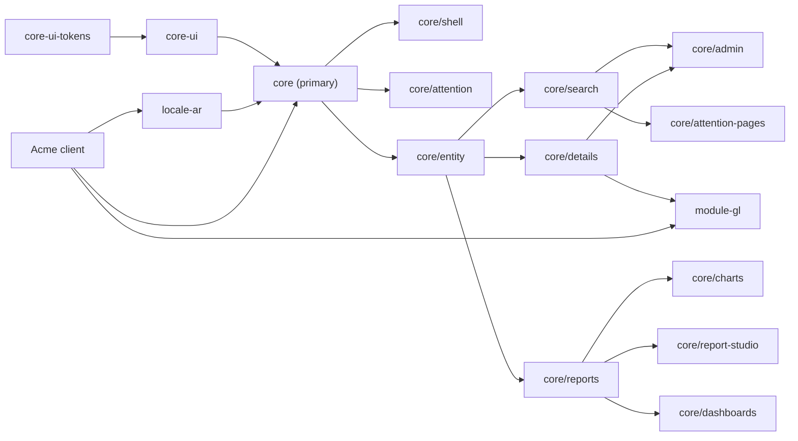

# Architecture skeleton for round 2 (draft A)

Draft A of two. Emphasis: design rule 1, "plumbing lives in the platform". Sections follow
`design/architecture-brief.md`. Names chosen here are meant to be binding once merged into
`00-architecture.md`. Contract blocks are TypeScript and C# sketches: names and shapes are
normative; imports, documentation comments, bodies and cancellation tokens are omitted.

## 0. The ten decisions that shape everything else

1. **One declaration per thing.** A distribution describes an entity, a page, a coded report or a
   launcher section once, as data (`tmEntity`, `tmPage`, `tmCodedReport`, `tmFeature`). The platform
   derives routes, launcher entries, deep links, pickers, permissions and page context from it.
2. **One override rule: same key, later wins.** Declarations merge by key in feature order
   (platform, then packs, then the distribution). Overriding a stock page is redeclaring its key.
3. **Server metadata fills every gap.** Labels, types, capabilities, actions, limits and display
   names come from one cached client metadata document, so a declaration names only what is a
   genuine UI choice (default columns, tile layout, details layout).
4. **A distribution writes no plumbing.** No routes file, no HTTP code, no stores, no translation
   files, no service worker config, no proxy or certificate scripts. The build, dev server, proxy,
   service worker, budgets and checks ship in `@tellma/core-tools` (logic, not configuration).
5. **Lazy boundaries are entry points.** An ng-packagr entry point is one FESM module, so it is one
   chunk. `@tellma/core` is split into entry points along exactly the lazy-loading lines.
6. **Warm launch reads only local state.** A boot record (web storage, synchronous) plus one
   IndexedDB snapshot render the shell and page chrome; the first network call is the page's data.
7. **One coordinated refresh.** Every cache kind refreshes through one function guarded by a Web
   Lock, whether triggered by a hub event (leader tab) or a response header (any tab).
8. **One pipeline for telemetry.** The browser posts to a platform endpoint; the server forwards
   through its existing OpenTelemetry pipeline. No browser SDK, no connection string in the bundle.
9. **SPA entity routes are API resource segments.** `/{t}/centers/5` is both the page URL and what
   the server builds for emails and notifications, with no client knowledge.
10. **One page action model.** The toolbar, Actions menu, keyboard shortcuts and the future
    assistant all invoke the same `TmPageAction` objects that each page publishes.

## 1. Spec map

The README map stands, with four scope moves (marked ◆). Each keeps one owner per concept.

| Spec | File (`docs/specs/`) | Title | Owns (short) | Depends on |
|---|---|---|---|---|
| 0010 | `0010-amendments-to-implemented-specs.md` | Amendments to Implemented Specs | Part A: identity (0003, existing text + account URL). Parts: 0002, 0004, 0005, 0008 (incl. the seven 0012 §11.2 amendments, moved) | — |
| 0023 | `0023-component-library-additions.md` | Component Library Additions | New generic `@tellma/core-ui` components (§5.4 list), harnesses, budgets, strings | 0010 |
| 0024 | `0024-client-app-foundation.md` | Client App Foundation | Packages, workspace, `@tellma/core-tools`, the distribution API (`provideTellma`, features, merge rule), PWA and service worker, budgets, localization runtime, BFF session and sign-out, route grammar, launch redirect, deep links, HTTP layer, error presentation, SPA hosting rules | 0010, 0023 |
| 0025 | `0025-client-state-and-cross-tab-sync.md` | Client State and Cross-Tab Sync | Boot record, client store, warm-launch cache and revalidation, tab bus, leader, refresh coordination, hub client, connectivity, preferences client and key registry, page state, drafts, tree expansion, recents | 0024 |
| 0026 | `0026-client-observability-and-support.md` | Client Observability, Support and Page Context | Telemetry API and ingestion endpoint, error logging, UI version, request log, state dump, screenshot, support requests, page context, ◆ page actions model | 0024, 0025 |
| 0027 | `0027-shell-launcher-and-tenant-picker.md` | Shell, Launcher and Tenant Picker | Tenantless shell, tenant picker, signed-out page, tenant shell, app bar (markers, reserved slots), pinned bar, session menu, About and Shortcuts dialogs, launcher and global search, navigation registry, shortcut registry | 0024–0026 |
| 0028 | `0028-assignments-and-attention-surfaces.md` | Assignments and Attention Surfaces | `core.Assignments` end to end, tray, bell panel, toast policy, banner slot and precedence, Notifications page, notification preferences page, ◆ Jobs page (members see "my jobs", admins all) | 0025, 0027, 0030 |
| 0029 | `0029-client-entity-model.md` | Client Entity Model | Client metadata endpoint and document, entity registry and `tmEntity`, display names, navigation expansion, client permissions, Queryex client (lexer, builder, expression editor), typed value controls, filter controls, path tree picker, entity picker binding, ◆ entity type codegen | 0024, 0025 |
| 0030 | `0030-search-page.md` | Search Page | Search page host, grid and tiles, search field, ordering, column and advanced filters, column editor, selection and bulk actions, URL state, trees, export menu | 0029, 0027 |
| 0031 | `0031-details-page.md` | Details Page | Details host and lifecycle, details kit (`tm-field`, cards, child grids, tabs, extras), save and error flow, clone, drafts, leave guard, paging, child-row deep link, concurrency dialog | 0029, 0030 |
| 0032 | `0032-stock-pages.md` | Stock Pages | Users, Roles, Centers (in `@tellma/module-gl`), Settings, ◆ Schedules, Outgoing emails, Exports, Imports, My profile | 0030, 0031 |
| 0033 | `0033-report-definitions-and-engine.md` | Report Definitions and Engine | `core.ReportDefinitions`, JSON schema, kinds, parameters, sharing model (reused by dashboards), audience resolver, coded-report server contract, execution, export, studio validation endpoint | 0010, 0029 |
| 0034 | `0034-report-renderers-and-studio.md` | Report Renderers and Studio | Renderers (list, summary, pivot, chart facade), report host and parameter bar, drill-through, coded-report client declaration, reports catalog page and launcher entry, studio | 0033, 0030 |
| 0035 | `0035-dashboards-and-home-page.md` | Dashboards and Home Page | `core.Dashboards`, grid layout, refresh scheduler, dashboard parameters, home page and greeting, home resolution seam | 0034, 0028 |

- **Why the moves.** One Jobs page serves both audiences because the server's self-scope criterion
  already decides the rows. The admin pages named by 0019–0022 needed owners and are cheap search
  and details pages. Codegen and typed controls belong with the entity model their types come from.
  The page actions model is the assistant seam's other half.
- **Out of scope this round.** User help and documentation (seams in §10.1), announcements (0028
  reserves the banner level; model deferred), running totals (§10), per-role home swapping (0035
  designs the seam only).

## 2. Client packages

### 2.1 The package family

| Package | Folder (`client/projects/`) | Kind | Holds |
|---|---|---|---|
| `@tellma/core-ui` (+ `-tokens`, `-testing`, `-mcp`) | `core/…` (exists) | ng-packagr | Generic `tm-*` components. Gains 0023's components and 0010's amendments. Knows nothing of BFF, tenants or entities |
| `@tellma/core` | `core/tellma-core` (new) | ng-packagr | The app framework: distribution API, HTTP, session, state, shell, entity model, pages, reports, dashboards. ARCH already names it |
| `@tellma/core-testing` | `core/tellma-core-testing` (new) | ng-packagr | Page harnesses, a fake `TmApi`, metadata fixtures. Sibling of `@tellma/core-ui-testing` |
| `@tellma/core-tools` | `core/tellma-core-tools` (new) | Node package, bin `tellma-client` | Build, serve, proxy, dev certificate, service worker generation, font preloads, version stamp, budgets, installability check, codegen, ESLint preset. Separate so the runtime package carries no Node code |
| `@tellma/locale-ar` | `locale/tellma-locale-ar` (exists) | ng-packagr | Arabic strings for `@tellma/core-ui` and `@tellma/core`, Arabic fonts, `tmArabic()` language definition |
| `@tellma/module-gl` | `module/tellma-module-gl` (new) | ng-packagr | `tmGlFeature()` (declarations for `gl.Center`) and the Centers details layout |

- **Pack packages depend on `@tellma/core` directly** (peer dependency). The C# rule "modules
  reference only Abstractions" protects the server runtime; on the client the public API of
  `@tellma/core` is the contract and API goldens gate it. ARCH misalignment: ARCH §Library
  architecture states the split for NuGet only; record "no npm `-abstractions` packages".
- **Pack client code lives in the pack's package.** The Centers pages ship in `@tellma/module-gl`
  because `Center` is a GL entity (f11 contradiction 10), never in `@tellma/core`.
- **Naming.** Exports in every platform package carry `Tm`/`TM_`/`tm`; injection helpers are
  `injectTm…`; providers are `provideTellma…` (§11). Extend `tm/prefix-exports` to `module/**`.

### 2.2 `@tellma/core` entry points (the lazy boundaries)

Each row is one FESM module, hence one chunk. "Initial" means it is in the warm-launch bundle.

| Entry point | Holds (owner spec) | Loaded |
|---|---|---|
| `@tellma/core` | `provideTellma`, `bootstrapTellma`, `tmFeature`, declaration factories (`tmEntity`, `tmPage`, `tmCodedReport`), `tmEnglish`; HTTP layer and `TmApi` (0024); session and auth (0024); localization runtime (0024); boot record, client store, tab bus, leader, preferences, page state, drafts, recents (0025); telemetry and page-context registry (0026); navigation and shortcut registries (0027); entity registry, display names, permissions (0029) | Initial |
| `@tellma/core/shell` | Tenant shell, tenantless shell, app bar, pinned bar, session menu, tenant picker page, signed-out page (0027). The launcher panel is `@defer`red inside | Initial |
| `@tellma/core/attention` | Bell and tray buttons with badges, toast and banner wiring (0028). Panels `@defer`red | Initial |
| `@tellma/core/home` | Home page (0035), the default "work first" layout | Lazy route, prefetched at idle |
| `@tellma/core/entity` | Queryex client, typed value controls, filter controls, path tree picker, expression editor, entity picker binding (0029) | Lazy, shared by search, details, reports |
| `@tellma/core/search` | Search page host, column editor, tiles view, tree view (0030) | Lazy route |
| `@tellma/core/details` | Details host and `TmDetailsKit` (0031) | Lazy route; distribution layouts import it |
| `@tellma/core/reports` | Report host, parameter bar, list, summary and pivot renderers, drill-through, reports catalog (0034) | Lazy route |
| `@tellma/core/charts` | `TmChartSpec` facade and ECharts adapter (0034) | Lazy, only when a chart renders |
| `@tellma/core/report-studio` | Report studio (0034) | Lazy route |
| `@tellma/core/dashboards` | Dashboard page, grid, widget host, refresh scheduler (0035) | Lazy route |
| `@tellma/core/attention-pages` | Notifications page parts, notification preferences page, Jobs page parts (0028) | Lazy route |
| `@tellma/core/admin` | Users, Roles, Settings, Schedules, Outgoing emails, Exports, Imports, My profile (0032) | Lazy route (one chunk; rarely used) |
| `@tellma/core/support` | Support dialog, state dump, screenshot capture (0026) | Lazy, on demand |
| `@tellma/core/private` | Shared unstable wiring (no goldens, never for app code) | — |



- **Rule.** An entry point imports others only through `@tellma/core/<ep>` specifiers, never `../`
  (existing core-ui rule). The ESLint boundary rule forbids `core` (primary) from importing any
  lazy entry point, so the initial bundle cannot grow by accident.
- **Third-party weight sits behind lazy edges.** `@microsoft/signalr` (about 14 KB gzip) is a
  dynamic import made by the leader tab after first render. `echarts/core` loads only with
  `@tellma/core/charts`.

### 2.3 Workspace and the reference distribution

- **One pnpm workspace at the repo root.** `/pnpm-workspace.yaml` lists `client` and
  `distributions/*/src/*.Client`; shared versions come from a pnpm catalog. Every package then
  resolves `@angular/*`, `rxjs` and `@jsverse/*` to one physical copy, which fixes the "two copies
  of Angular" trap of ARCH's path-mapping plan (f11 contradiction 2).
- **The reference distribution compiles platform sources.** `Tellma.Distro.Acme.Client` maps
  `@tellma/*` to `client/projects/**/public-api.ts` through tsconfig `paths`, as the showcase does.
  A real distribution repo uses the same import specifiers against published packages, so its code
  is identical.
- **The distribution client has one location:** `src/Tellma.Distro.<Slug>.Client/` (an esproj, as
  0011 §1.2 says). ARCH edit: delete the `client/projects/app/` variant.
- **Tooling generalises.** `tools/workspace.mjs`, the docs extractor, ESLint and stylelint scopes,
  API goldens and budgets cover every `projects/<area>/tellma-*` package, not only `core-ui`.

### 2.4 Bundle budgets (owner 0024; numbers are starting ratchets)

| Measure | Ceiling (gzip transfer) | Notes |
|---|---|---|
| Initial JS of the reference distribution | 230 KB warn, 260 KB error | Angular, CDK pieces, Transloco, `@tellma/core`, shell, attention |
| `@tellma/core` primary entry point | 30 KB | Self-weight, platform packages external (existing method) |
| Search route chunk set | 110 KB | Incl. `core/entity` and grid |
| Details route chunk set | 80 KB | Excl. a distribution layout |
| Charts chunk | 170 KB | ECharts tree-shaken |
| Initial CSS | 40 KB | Tokens, fonts CSS, shell |

- **Gate.** `tellma-client check` measures the built app (not only library entry points) and a
  Lighthouse performance run on a "Slow 4G" profile for cold and warm launch. Library ceilings stay
  in each `package.json` `"tellma".budgetsInKb`.

## 3. What a distribution writes

### 3.1 The file tree of `Tellma.Distro.Acme.Client`

The reference distribution adds one entity of its own (`acme.Customer` with a `Contacts` child
collection), a coded report (`acme.aging`) and an extended Center leaf (`MyCenter : Center` adds
`ManagerId`). Everything else is the platform's.

```text
src/Tellma.Distro.Acme.Client/
  Tellma.Distro.Acme.Client.esproj     scaffolded; passes the build version to tellma-client
  package.json                         ~25 lines; scripts call tellma-client
  angular.json                         ~25 lines; plain @angular/build:application
  tsconfig.json                        ~10 lines; extends @tellma/core-tools/tsconfig.app.json
  eslint.config.mjs                    1 line; re-exports @tellma/core-tools/eslint
  contracts.json                       generated by Tellma.Distro.Acme.Web.Tests (0016 §3.10)
  public/
    manifest.webmanifest               ~20 lines; name, colours, icons (branding = configuration)
    icons/                             192, 512 and maskable PNGs, favicon
  src/
    index.html                         ~12 lines; <tm-app>, manifest link, tm-boot.js
    main.ts                            3 lines
    app.config.ts                      ~20 lines
    styles.css                         ~6 lines; imports + token deltas
    generated/tellma-entities.ts       generated by tellma-client codegen (not authored)
    app/
      acme.feature.ts                  the distribution's tmFeature
      customers/customers.entity.ts    entity declaration
      customers/customer-details.ts    details layout
      reports/aging.report.ts          coded report declaration
      centers/centers.override.ts      stock-page override
      centers/my-center-details.ts     extended layout
```

- **Absent on purpose.** No `app.routes.ts`, `proxy.conf.js`, `aspnetcore-https.js`,
  `ngsw-config.json`, `i18n/*.json`, interceptor, guard or store. `tellma-client serve` exports the
  dev certificate, binds the port from `.dev-ports.local` (else 4200, matching 0011's
  `PublicOrigin`), and proxies every reserved prefix to the Web project. `tellma-client build` runs
  `ng build`, injects font preloads and the build version, regenerates `ngsw.json` *after* the
  injection (so hashes match; f11 contradiction 3), copies `tm-boot.js`, and checks budgets.
- **Strings live in one place.** A distribution's labels and UI text are server resource keys in
  its `Strings.resx` / `Strings.ar.resx` (needed anyway for entity labels and validation) and reach
  the client through the string pack (0013 §10.4). Distribution client code ships no translation
  files.

### 3.2 Boilerplate (scaffolded once, rarely touched)

```ts
// main.ts
import { bootstrapTellma } from '@tellma/core';
import { appConfig } from './app.config';
bootstrapTellma(appConfig);
```

```ts
// app.config.ts
import { ApplicationConfig } from '@angular/core';
import { provideTellma, tmEnglish } from '@tellma/core';
import { tmGregorianCalendar } from '@tellma/core-ui/l10n';
import { tmUmalquraCalendar } from '@tellma/core-ui/calendar-umalqura';
import { tmArabic } from '@tellma/locale-ar';
import { tmGlFeature } from '@tellma/module-gl';
import contracts from '../contracts.json';
import { acmeFeature } from './app/acme.feature';

export const appConfig: ApplicationConfig = {
  providers: [
    provideTellma({
      contracts,
      languages: [tmEnglish(), tmArabic({ region: 'SA' })], // ar formats as ar-SA
      calendars: [tmGregorianCalendar(), tmUmalquraCalendar()],
      features: [tmGlFeature(), acmeFeature],
    }),
  ],
};
```

```css
/* styles.css */
@import '@tellma/core/styles/tellma.css';   /* tokens, Latin fonts, directive styles, shell */
@import '@tellma/locale-ar/fonts.css';
@layer tm.theme { :root { /* distribution token deltas, if any */ } }
```

- **Drift guards for the inherent duplicates.** Languages, calendars and features are declared on
  both sides because the client must bundle their code. In development `provideTellma` compares
  them with `/api/distribution-info` (`languages`, `features`) and logs a `tm.config.drift`
  error; the reference distribution's e2e suite fails on it.

### 3.3 An entity's search and details pages (the common case)

```ts
// customers/customers.entity.ts — search page, details page, launcher entry, deep links, picker
import { tmEntity } from '@tellma/core';
import type { AcmeCustomer } from '../../generated/tellma-entities';

export const customers = tmEntity<AcmeCustomer>('acme.Customer', {
  section: 'sales',
  columns: ['Code', 'Name', 'CustomerType', 'Currency', 'CreditLimit', 'IsActive'],
  tile: { title: 'Name', subtitle: 'Code', badge: 'IsActive', image: 'Image' },
  details: () => import('./customer-details').then((m) => m.CustomerDetails),
});
```

```ts
// customers/customer-details.ts — the layout; lifecycle, modes, save, errors, drafts are the host's
import { Component } from '@angular/core';
import { TmDetailsKit } from '@tellma/core/details';

@Component({
  selector: 'acme-customer-details',
  imports: [TmDetailsKit],
  template: `
    <tm-details-card>
      <tm-field path="Name" />          <!-- expands to Name (E), Name (ع) per tenant languages -->
      <tm-field path="Code" />
      <tm-field path="CustomerType" />
      <tm-field path="Currency" />      <!-- navigation: picker in edit, link in view -->
      <tm-field path="CreditLimit" />
    </tm-details-card>
    <tm-details-card titleKey="Acme_Customer_Contacts">
      <tm-child-grid collection="Contacts" [columns]="['Name', 'Phone', 'IsPrimary']" />
    </tm-details-card>
  `,
})
export class CustomerDetails {}
```

- **What the platform derives.** Route `/{t}/customers` (the stack's resource segment, §8);
  launcher entry labelled `Acme_Customer_Plural` with the `Read` securable; create, export, import,
  activate buttons from `StackOperations` and capabilities; column labels, filter controls and
  formats from metadata; the tile view; the entity picker used by any navigation to `acme.Customer`;
  title from the display name; Actions menu entries for every zero-argument `[EntityAction]`; page
  context for the assistant; telemetry.
- **Typed paths.** `tellma-client codegen` turns the checked-in OpenAPI snapshot (0016 §12.1) into
  `generated/tellma-entities.ts`, so `columns: ['Cod']` is a compile error. Untyped strings stay
  legal (the type parameter is optional) and get a development warning.

### 3.4 A launcher section, a coded report, a stock-page override

Imports of the distribution's own files are omitted below.

```ts
// acme.feature.ts — the distribution's single contribution
import { tmFeature } from '@tellma/core';

export const acmeFeature = tmFeature({
  key: 'acme',
  sections: [{ id: 'sales', labelKey: 'Acme_Nav_Sales', icon: 'users', order: 20 }],
  entities: [customers, centersOverride],
  reports: [agingReport],
});
```

```ts
// reports/aging.report.ts — data-only coded report; the platform renders parameters, table, export
import { tmCodedReport } from '@tellma/core';

export const agingReport = tmCodedReport('acme.aging', {
  titleKey: 'Acme_AgingReport',
  section: 'financials',
  securable: ['acme.AgingReport', 'Read'],
  parameters: {
    AsOf: { type: 'date', required: true, default: 'today()' },
    Customer: { entity: 'acme.Customer' },
  },
  kind: 'summary',                                   // renderer: list | summary | pivot | chart
  // the distribution's own [ApiRoute("acme-reports")] service; answers a row page
  run: (api, args, signal) => api.action('acme-reports', 'aging', args, { signal }),
});
```

```ts
// centers/centers.override.ts — same key as @tellma/module-gl's declaration, so these members win
export const centersOverride = tmEntity('gl.Center', {
  columns: ['Code', 'Name', 'CenterType', 'Manager', 'IsActive'],
  details: () => import('./my-center-details').then((m) => m.MyCenterDetails),
});

// centers/my-center-details.ts — reuses the stock fields, adds one
@Component({
  selector: 'acme-center-details',
  imports: [TmDetailsKit, TmGlCenterFields],
  template: `<tm-details-card><tm-gl-center-fields /><tm-field path="Manager" /></tm-details-card>`,
})
export class MyCenterDetails {}
```

### 3.5 Line counts

| Artifact | Authored lines (client) | Server lines it pairs with |
|---|---|---|
| Boilerplate (main, config, styles, index, manifest, angular, package, tsconfig, eslint) | ~140, scaffolded once | `Program.cs` 3, composition 1 per feature |
| New entity: search + launcher entry + picker + deep links | 8 | entity class ~25, `Entity<T>()` 1, resx labels |
| Its details page | 18 (one card, one child grid) | — |
| Launcher section | 1 inside the feature | 1 resx key per language |
| Coded report, data only | 13 | one `[ApiAction]` or hand-mapped endpoint + securable |
| Coded report, full custom UI | 3 + a component | same |
| Stock-page override | 4 (declaration) + 7 (layout) | `UseEntity<Center, MyCenter>()` 1 |
| Feature | 8 | — |

### 3.6 Escape hatches (common → simple; uncommon → hatch)

| Need | Hatch | Owner |
|---|---|---|
| A cell that renders differently | `columns: [{ path, display: () => import(…) }]` component per column | 0030 |
| A search page that is not a list | `search: () => import(…)` replaces the host's body; URL and page state stay platform's | 0030 |
| An extra advanced-filter control | `filters: [{ key, labelKey, component \| queryex }]` on the entity declaration | 0030 |
| A page with no entity | `tmPage('tools/reconcile', { component, titleKey, section?, securable? })` | 0024 |
| A field the kit cannot render | Raw core-ui controls bound with `[formField]="details.form.X"` inside a layout | 0031 |
| Custom save, clone or validation | `clone`, `validate` (Signal Forms schema), `beforeSave` members of the declaration | 0031 |
| An entity action with arguments | `actions: [{ name, dialog: () => import(…) }]`; zero-argument actions need nothing | 0031 |
| A call to a hand-mapped endpoint | `injectTmApi().post(path, body, { signal })` | 0024 |
| A report the engine cannot express | `tmCodedReport` with `run`, or with `component` for a fully custom UI | 0034 |
| A different menu | Redeclare sections/entries by id; `hide: ['core.roles']`; `navigation: (entries) => entries` as the last resort | 0027 |
| A settings category with its own editor | `settingsTabs: [{ category: 'acme', component }]` | 0032 |
| Branding and colours | `manifest.webmanifest`, icons, `@layer tm.theme` token deltas | 0024 |
| An app-bar item | `appBar: [{ id, icon, labelKey, panel }]`, at most three (shell D20) | 0027 |
| Anything Angular | `providers: [...]` on `tmFeature` | 0024 |
| Telemetry of its own | `injectTmTelemetry().event('acme.<area>.<event>', props)` | 0026 |

## 4. Concept ownership map

One row per shared concept. "New" means the section is created by that spec; an existing spec
number means the concept already lives there (edits in §6). Consumers cite the owner.

### 4.1 Client concepts

| Concept | Owner (section) | Consumers |
|---|---|---|
| Distribution API (`provideTellma`, `TmAppConfig`, `bootstrapTellma`), features and the merge rule, `tmPage` | 0024 (new) | every distribution, 0027–0035 |
| `tmEntity` declaration shape (members' meaning cited from the specs marked in §5.2) | 0029 (new) | 0027, 0030, 0031 |
| Client packages, entry points, workspace, `@tellma/core-tools` | 0024 (new) | all |
| Language definitions (`tmEnglish`, `tmArabic`), app strings in locale packs | 0024 (new) | 0027 session menu |
| Localization runtime (language, calendar, direction, string-pack loading, key scopes) | 0024 (new) | all pages |
| Transloco loader seam in `provideTellmaUi` | 0010 Part 0002 | 0024 |
| Breakpoints and layout constants (values in §9) | 0010 Part 0002 | 0023, 0027–0035 |
| System theme (`TmTheme`) | 0010 Part 0002 | 0024 boot record, 0027 session menu |
| PWA manifest rules, service worker config, update flow | 0024 (new) | 0028 (update banner) |
| App bundle budgets (library budgets stay in 0002 §8) | 0024 (new) | 0023, all |
| Session: signed-in signal, auth guard, sign-out, 401 and step-up flows | 0024 (new) | 0025, 0027 |
| Route grammar, launch redirect, deep-link resolver (`TmUrls`) | 0024 (new) | 0018, 0022, 0027, 0028, 0030–0035 |
| HTTP layer: `TmApi`, headers, cancellation, retries, lossless JSON, contract header | 0024 (new) | all |
| Error presentation policy (status and code → inline, dialog, retry) | 0024 (new) | 0030, 0031, 0034 |
| SPA hosting rules (cache headers, CSP, fallback exclusions) | 0024 (new); 0011 §5.1 cites | 0011 implementation |
| Boot record (synchronous web storage), client store (IndexedDB), warm-launch snapshot and revalidation by version tags | 0025 (new) | 0024, 0026–0035 |
| Tab bus, leader election, refresh coordination, connectivity signal | 0025 (new) | 0024 sign-out, 0028 toasts and banner |
| Hub client and client-event fan-out (event catalogue stays 0021 §6.3) | 0025 (new) | 0028, 0029, 0035 |
| Preferences client, write-behind policy, platform key registry (bag stays 0014 §3.4) | 0025 (new) | 0027, 0030, 0034, 0035 |
| Page state LRU, session drafts, tree expansion memory, recently visited pages | 0025 (new) | 0027 launcher, 0030, 0031, 0035 home |
| Telemetry API, event-name grammar, transport | 0026 (new) | all (each spec names its own events) |
| UI version identity (stamped by 0024's tool), request log, state dump, screenshot, support requests | 0026 (new) | 0027 About and session menu |
| Page context registry (assistant seam) and page actions model (`TmPageAction`) | 0026 (new) | 0030, 0031, 0034, 0035 publish; 0027 shortcuts |
| Tenantless shell, tenant picker, signed-out page | 0027 (new) | 0024 launch redirect |
| Tenant shell, app bar, reserved help and assistant slots, tenant markers, session menu, About and Shortcuts dialogs | 0027 (new) | 0028 badges |
| Pinned bar and the pins model (`nav.pinned`) | 0027 (new) | 0035 |
| Navigation registry (sections, entries, synonyms, permission filter) and shortcut registry (reserved keys) | 0027 (new) | 0029–0031, 0034, 0035 |
| Toast policy (what toasts, timings); banner slot and precedence (components 0023) | 0028 (new) | 0024 (412 banner), 0025 (offline), 0031 |
| Bell panel, tray, Notifications page, notification preferences page, Jobs page | 0028 (new) | 0027 app bar |
| Client metadata document and its cache | 0029 (new) | 0030–0035 |
| Entity registry and descriptors (metadata merged with declarations) | 0029 (new) | 0027, 0030–0035 |
| Display names (rendering, cache, fallback) | 0029 (new) | 0028, 0030, 0031, 0034 |
| Navigation expansion (`Center` → `Center.Id` + display-name columns in the tenant's shape) | 0029 (new) | 0030, 0033, 0034 |
| Client permissions (`TmPermissions`) | 0029 (new) | 0027, 0030–0035 |
| Queryex client (lexer, builder, printer), expression editor, path tree picker (with drag sources) | 0029 (new) | 0030 advanced filter and column editor, 0034 studio |
| Typed value controls, display formatters and filter controls per data type | 0029 (new) | 0030 filters, 0031 `tm-field`, 0034 parameters |
| Entity picker binding (one generic picker, parameterised by target entity) | 0029 (new) | 0030, 0031, 0034 |
| Entity type codegen | 0029 (new) | distributions |
| Search page host, URL query state, column preferences, tiles, trees, export menu | 0030 (new) | 0028, 0032, 0034 |
| Details host, `TmDetailsKit`, `tm-field`, save flow, clone, leave guard, paging, child-row deep link | 0031 (new) | 0032, 0034 |
| Stock pages | 0032 (new) | — |
| Coded-report client declaration and the report host | 0034 (new) | distributions, 0035 |
| Report renderers, chart facade (`TmChartSpec`), parameter bar, drill-through, reports catalog | 0034 (new) | 0035 |
| Dashboard grid, refresh scheduler, home page, greeting | 0035 (new) | 0027 (wordmark target) |
| Generic components (§5.4) | 0023 (new) | all |
| Changes to existing components (grid, menu, modal, popover, select, overlay, l10n, client cache) | 0010 Parts 0002, 0004, 0005 | 0023, 0027–0035 |

### 4.2 Server concepts the front end needs

| Concept | Owner (section) | Consumers |
|---|---|---|
| Client metadata endpoint `GET /api/client-metadata` and its document | 0029 (new); replaces 0015 §1.2's unnamed "SPA schema" | 0030–0035 |
| Display-name annotation `[DisplayNameSource]` and the related-projection rule | 0029 (new); 0012 §2.5 edited to cite | 0016, 0019, 0033 |
| Client permission summary (`MeResult.Access`; `SecurableSummary` gains `IsSensitive`) | 0016 §3.4 (edited) | 0029 |
| Securables catalogue for the role editor (inside the metadata document) | 0029 (new) | 0032 |
| Entity-action metadata and its label-key convention | 0029 (new) | 0030, 0031 |
| Label-key conventions (extended with actions, setting categories, nav sections) | 0013 §10.1 (edited) | all |
| String pack and the UI-language rule | 0013 §10.4 (edited) | 0024 |
| Version tags, `Tellma-Version-Tags`, `cache.changed` | 0013 §2 (edited) | 0025 |
| Settings for the client and settings save | 0013 §5–§6 (edited) | 0025, 0032 |
| Preference bag, key grammar, caps | 0014 §3.4 (edited) | 0025 |
| `me` (`MeResult`) | 0016 §3.4, 0018 §3.5 | 0025, 0029 |
| `users/me/locale` (the language and calendar toggle write) | 0018 §3.5 (new action) | 0027 |
| Contract fingerprints and `contracts.json` | 0016 §3.10 (edited) | 0024 |
| Problem codes, validation paths, error mapping | 0016 §7 (edited: `unauthenticated`, `route-not-found`) | 0024, 0031 |
| Query wire shape: separate filter leaves, default order, tree requests | 0016 §3.3, 0015 §5 (edited) | 0030 |
| Aggregate and pivot queries (grouping levels, tree rollups) | 0033 (new) + 0010 Part 0008 (engine) | 0034, 0035 |
| Child-entity query surface for reports | 0033 (new); 0015 §5.2 edited to admit child roots | 0034 |
| Report definitions, kinds, parameters, sharing, audience ("who can see it and why") | 0033 (new) | 0034, 0035 |
| Coded-report server contract (securable, endpoint answering a row page) | 0033 (new) | 0034 |
| Dashboards and home resolution | 0035 (new) | 0027 |
| Assignments (`core.Assignments`, summary, seen, `assignments.changed`) | 0028 (new) | 0027 tray, 0035 home |
| Notifications server contract (inbox, catalogue, events) | 0021 (existing; client protocol moves to 0028) | 0028 |
| A human label for jobs | 0020 §2.3 (edited) | 0028 |
| Export column model for the display export | 0019 §2.1, §4.1 (edited) | 0030, 0034 |
| BFF endpoints, profile cookie, post-sign-in redirect | 0011 §5.5 (edited) | 0024 |
| `DistributionInfo` (languages, account URL, links, support flag, features) | 0011 §5.9 (edited) | 0024, 0027 |
| Telemetry ingestion `POST /api/telemetry` | 0026 (new); 0011 route list cites | — |
| Support requests (`core.SupportRequests`, blob kind `support-bundle`) | 0026 (new) | 0032 admin list |
| Background-request marker `Tellma-Activity: background` | 0025 (new); 0014 §7 and 0016 §4.3 edited | 0028, 0035 polling |
| Identity account-management URL contract | 0010 Part A (amends 0003) | 0027 "My account" |

## 5. Shared client seams

Each seam lives in the `@tellma/core` primary entry point unless noted. The sketches bind names
and shapes; the owner spec completes them.

### 5.1 Distribution API (0024)

```ts
interface TmAppConfig {
  contracts: TmContracts;                        // contracts.json: "POST /{tenantId}/api/web/centers/query" -> fingerprint
  languages: readonly TmLanguageDefinition[];    // first = distribution default
  calendars: readonly TmCalendar[];              // bundled calendars; the tenant's pair picks among them
  features: readonly TmFeature[];                // packs first, distribution last
}
interface TmLanguageDefinition { code: string; formattingLocale: string; dir: 'ltr' | 'rtl'; strings: TmStringLoaders }
declare function provideTellma(config: TmAppConfig): EnvironmentProviders;
declare function bootstrapTellma(config: ApplicationConfig): Promise<ApplicationRef>;

interface TmFeatureDefinition {
  key: string;                                   // 'gl', 'acme'; mirrors the server feature name
  sections?: readonly TmNavSection[];
  entries?: readonly TmNavEntry[];               // launcher entries that are not entities, pages or reports
  entities?: readonly TmEntityDeclaration[];
  pages?: readonly TmPageDeclaration[];
  reports?: readonly TmCodedReportDeclaration[];
  settingsTabs?: readonly TmSettingsTabDeclaration[];
  appBar?: readonly TmAppBarItem[];
  hide?: readonly string[];                      // keys of earlier declarations to drop
  navigation?: (entries: readonly TmNavEntry[]) => readonly TmNavEntry[]; // last-resort rewrite
  providers?: readonly (Provider | EnvironmentProviders)[];
}
declare function tmFeature(definition: TmFeatureDefinition): TmFeature;
declare function tmPage(path: string, page: { component: TmLazyComponent; titleKey: string; section?: string; securable?: TmSecurableRef }): TmPageDeclaration;
type TmLazyComponent = () => Promise<Type<unknown>>;
type TmSecurableRef = readonly [resource: string, action: string];
```

- **Merge rule.** Declarations are keyed: entities by name, pages by path, reports by key, sections
  and entries by id, settings tabs by category. A later feature's declaration replaces the earlier
  one member by member (unset members inherit). `hide` removes a key. Two declarations of one key
  inside one feature are a development-time error.
- **The platform's own feature** (`core`) is implicit and first: Users, Roles, Settings, Jobs,
  Schedules, Notifications, Assignments, Exports, Imports, Outgoing emails, Report definitions,
  Dashboards, and the sections `administration` and `analysis`. `tmGlFeature()` adds `gl.Center`
  under `administration` and the section `financials`.

### 5.2 Entity declaration (0029; members owned as marked)

```ts
interface TmEntityDeclaration<T = unknown> {
  name: string;                                  // server entity name, 'acme.Customer'
  // navigation members (0027)
  section?: string;                              // launcher section; absent = no launcher entry
  order?: number; icon?: string; synonymsKey?: string; // synonyms: a comma list in each language
  // search members (0030)
  columns?: readonly TmColumn<T>[];              // absent = DefaultSelect minus audit columns
  orderBy?: string;                              // absent = the stack's default order
  tile?: TmTileLayout<T>;                        // absent = display name, Code, IsActive
  filters?: readonly TmCustomFilter[];
  search?: TmLazyComponent;
  // details members (0031)
  details?: TmLazyComponent;                     // absent = rows open nothing (a list-only entity)
  include?: readonly string[];                   // extras the layout shows
  clone?: (copy: T) => T;
  validate?: SchemaFn<T>;
  actions?: readonly TmEntityActionDeclaration<T>[];
  // picker members (0029)
  picker?: { columns?: readonly TmPath<T>[]; filter?: string };
}
type TmColumn<T> = TmPath<T> | { path: TmPath<T>; display?: TmLazyComponent; width?: number };
declare function tmEntity<T = unknown>(name: string, declaration: Omit<TmEntityDeclaration<T>, 'name'>): TmEntityDeclaration<T>;
```

### 5.3 Runtime services

```ts
// HTTP layer (0024). Promise-based so Angular resource() loaders pass their abortSignal through.
interface TmApi {
  query(entity: string, request: TmQueryRequest, options?: TmCallOptions): Promise<TmRowPage>;
  get<T>(entity: string, id: number, options?: TmCallOptions & { select?: string; include?: readonly string[] }): Promise<TmEntitiesResult<T>>;
  save<T>(entity: string, entities: readonly T[], options?: TmSaveOptions): Promise<TmEntitiesResult<T>>;
  action<R>(resourceOrRoute: string, name: string, body?: unknown, options?: TmCallOptions): Promise<R>;
  post<R>(path: string, body?: unknown, options?: TmCallOptions): Promise<R>; // hatch: hand-mapped routes
}
interface TmCallOptions { signal?: AbortSignal; background?: boolean } // background: no activity stamp
interface TmProblem extends Error { status: number; code: string; traceId: string; errors?: readonly TmProblemError[]; arguments?: Readonly<Record<string, unknown>> }
declare function injectTmApi(): TmApi;

// Session (0024)
interface TmSession {
  readonly user: Signal<TmSessionUser | null>;   // from the profile cookie: sub, name, email, locale
  readonly tenantId: Signal<number | null>;
  signOut(): Promise<never>;                     // every tab, caches cleared, navigates away
  stepUp(challenge: TmStepUpChallenge): Promise<never>; // drafts persist, top-level /bff/login
}

// Client store (0025): one IndexedDB database 'tm-store'; keys carry sub and tenant id
interface TmClientStore {
  read<T>(kind: string, key?: string): Promise<TmStored<T> | undefined>;
  write<T>(kind: string, value: T, tag: string, key?: string): Promise<void>;
  remove(kind: string, key?: string): Promise<void>;
}
interface TmStored<T> { value: T; tag: string; savedAt: string; build: string }

// Refresh coordination (0025): one function for every cache kind, deduplicated across tabs
interface TmRefresher { refresh(kind: TmCacheKind, reason: 'header' | 'hub' | 'launch'): Promise<void> }
type TmCacheKind = 'settings' | 'me' | 'metadata' | 'entity-tags' | `entity:${string}` | 'inbox' | 'assignments' | 'home' | 'tenants';

// Tab bus and leader (0025)
interface TmTabBus { publish(message: TmTabMessage): void; readonly messages: Observable<TmTabMessage>; readonly isActiveTab: Signal<boolean> }
interface TmLeader { readonly isLeader: Signal<boolean> }  // Web Lock 'tm:{sub}:{tenantId}:leader'

// Hub client (0025): events from the leader's single connection, fanned out to every tab
interface TmRealtime { events(name: string): Observable<TmClientEvent>; readonly state: Signal<'connected' | 'reconnecting' | 'down'> }

// Preferences (0025)
interface TmPreference<T> { readonly value: Signal<T>; set(value: T): void; reset(): void }
declare function injectTmPreference<T>(key: string, options: { default: T; kind: 'curated' | 'write-behind' }): TmPreference<T>;

// Page state and drafts (0025)
declare function injectTmPageState<T>(key: string, init: () => T): WritableSignal<T>;  // memory LRU keyed by URL
interface TmDrafts { load<T>(scope: string): T | undefined; save<T>(scope: string, value: T): void; discard(scope: string): void } // sessionStorage

// Localization (0024)
interface TmLocalization {
  readonly language: Signal<string>; readonly dir: Signal<'ltr' | 'rtl'>; readonly calendar: Signal<TmCalendar>;
  readonly contentIndex: Signal<1 | 2 | 3>;      // which Name slot the active language reads
  setLanguage(code: string): void; setCalendar(code: string): void; // instant locally, written behind
  text(key: string, args?: Record<string, unknown>): Signal<string>; // a client key or a server key
}

// Entity model (0029)
interface TmEntities { descriptor(name: string): Signal<TmEntityDescriptor | undefined>; bySegment(segment: string): Signal<TmEntityDescriptor | undefined> }
interface TmDisplayNames { of(entity: string, row: unknown): Signal<string>; select(entity: string, navigationPath?: string): string }
interface TmPermissions { can(resource: string, action: string): Signal<boolean>; filtered(resource: string, action: string): Signal<boolean>; sensitive(resource: string, action: string): boolean }

// URLs (0024): the deep-link resolver used by notifications, assignments, reports, pins and emails
interface TmUrls {
  home(tenantId?: number): string;
  search(entity: string, query?: TmSearchQuery): string;
  details(entity: string, id: number, child?: { collection: string; id: number }): string;
  target(resource: string, id: number): string | null; // a notification's TargetResource + TargetId
}

// Telemetry and page context (0026)
interface TmTelemetry { event(name: string, props?: TmTelemetryProps): void; error(error: unknown, props?: TmTelemetryProps): void; timing(name: string, ms: number, props?: TmTelemetryProps): void }
interface TmPageContext { kind: string; titleKey?: string; entity?: string; ids?: readonly number[]; state?: () => unknown; actions?: Signal<readonly TmPageAction[]> }
interface TmPageAction { id: string; labelKey: string; icon?: string; enabled: Signal<boolean>; destructive?: boolean; shortcut?: string; run(args?: unknown): Promise<void> | void }
declare function provideTmPageContext(factory: () => TmPageContext): Provider;

// Shell registries (0027)
interface TmNavSection { id: string; labelKey: string; icon?: string; order: number }
interface TmNavEntry { id: string; section: string; labelKey: string; url: string; icon?: string; order?: number; synonymsKey?: string; securable?: TmSecurableRef }
interface TmShortcuts { register(shortcut: { id: string; keys: string; scope: 'global' | 'page'; labelKey: string; run(): void }): () => void }

// Error presentation (0024): the one place where status and code map to UI
interface TmErrorPresenter { present(problem: TmProblem, context: 'read' | 'save' | 'action'): Promise<void> }

// Breakpoints (0010 Part 0002, in @tellma/core-ui)
type TmBreakpoint = 'xs' | 'sm' | 'md' | 'lg' | 'xl' | 'xxl';
declare const TM_BREAKPOINTS: Readonly<Record<TmBreakpoint, number>>;
declare function injectTmBreakpoint(): Signal<TmBreakpoint>;

// Page contexts for layouts (0030, 0031, 0034), in lazy entry points
declare function injectTmSearch<T>(): TmSearchContext<T>;     // @tellma/core/search
declare function injectTmDetails<T>(): TmDetailsContext<T>;   // @tellma/core/details
declare function injectTmReportHost(): TmReportHost;          // @tellma/core/reports
interface TmDetailsContext<T> {
  readonly entity: Signal<T | undefined>;        // the loaded value (view mode)
  readonly form: FieldTree<T>;                   // Signal Forms tree over the editable copy
  readonly mode: Signal<'view' | 'edit' | 'create'>;
  readonly descriptor: TmEntityDescriptor;
  readonly related: TmRelated;                   // related entities from the get, by name and id
  readonly extras: Signal<Readonly<Record<string, unknown>>>;
  readonly busy: Signal<boolean>;
  edit(): void; cancel(): void; save(): Promise<boolean>; refresh(): void;
}
```

- **Errors.** `TmApi` rejects with `TmProblem`. It handles 401, step-up, 412 and 503 with
  `Retry-After` itself (§7). Everything else reaches the caller; an unhandled `TmProblem` reaching
  Angular's `ErrorHandler` gets the shared error dialog (0024).
- **Cancellation.** Reads take their owner's `AbortSignal`. Page resources pass Angular
  `resource()`'s `abortSignal`, so leaving the page or superseding a query aborts the fetch, which
  aborts the server pipeline and its SQL command (0016 §8.3). Mutations are never aborted by
  navigation; the save flow blocks navigation instead (0031).
- **Headers on every call.** `Tellma-Client: web/<build>`; `Tellma-Contract` (looked up by route
  template); `Accept-Language` = the active language's formatting locale; `Tellma-Calendar` = the
  active calendar; `Tellma-Activity: background` when `background` is set. No `Tellma-Time-Zone`
  (§12 flag 7).
- **Lossless JSON.** `TmApi` parses bodies with a lossless parser. Numbers beyond 15 significant
  digits arrive as decimal strings; `modifiedAt` stays the raw string (0015 §8).
- **Reachable columns (0029).** A path into entity `E` may use every column of `E` only when
  `TmPermissions.filtered(E, 'Read')` is false; otherwise only `E`'s related select (from
  metadata). The column editor, studio and filters offer only reachable paths, so the 0015 §5.2
  traversal rule never 403s a whole query.
- **Write-behind preferences (0025).** Changes apply locally at once, are broadcast on the tab bus
  (other tabs apply them without a fetch), coalesce per key, and flush 2 s after the last change
  and on `visibilitychange: hidden` (`fetch` with `keepalive`) by the tab that made them. Last
  writer wins per key. Curated keys (`nav.pinned`) write at once.
- **Toasts show in one tab (0028).** Every tab receives events; only the tab where
  `TmTabBus.isActiveTab()` is true pops a toast. Badges update everywhere.

### 5.4 Component library additions (0023) and what stays in feature specs

- **0023 (generic, one `@tellma/core-ui/<ep>` each).** `icon` (+ `TmIconRegistry`, Lucide default),
  `badge`, `avatar` (image or initials), `toast` (+ host service), `drawer`, `banner`, `splitter`,
  `segmented`, `radio`, `switch`, `chips`, `skeleton`, `pager`, `search-field`, `card` and
  `page-header` layouts, `busy-overlay`, `confirm` and `error-dialog` contents (with a copy-trace-id
  button), `empty-state`, `date-range`, `relative-time`, `reorder-list`, `tree` (on aria `tree`,
  with drag sources), `drag-drop` utilities, `kbd`, `accordion`, `progress` (bar and ring), `tiles`
  (virtualised card lattice: image and four corners; a divided list below `sm`).
- **Stay in feature specs.** Launcher list and pinned bar (0027); bell and tray panels (0028);
  filter controls, path tree picker, expression editor (0029); column editor (0030); details kit
  (0031); pivot, chart facade, parameter bar, studio panels (0034); dashboard grid (0035).
- **Amendments to existing components** are 0010 parts (§6.3).

## 6. Server additions and edits

### 6.1 New endpoints, entities and tables

| Route (`POST` under `/{tenantId}/api/web/` unless stated) | Purpose | Owner |
|---|---|---|
| `GET /api/client-metadata?v=<build>` (tenantless, session cookie) | Entities (properties, types, label keys, ownership, enum values, navigations, children, display name, related select, capabilities, operations, actions with argument schemas, limits, blob kinds) and the securables catalogue. `private, max-age=31536000, immutable` when `v` equals the deployment's build, else `no-store` | 0029 |
| `POST /api/telemetry` (tenantless, session cookie, `Tellma-Client`) | Batched client events, errors and timings → server OpenTelemetry → Application Insights; ≤ 60 KB per batch; own rate policy `tellma-telemetry` | 0026 |
| `users/me/locale` | `{ language?, calendar? }` → bumps `PreferencesTag`; no stamp, last writer wins; 1 round trip | 0018 (requested by 0027) |
| `assignments/summary`, `assignments/seen`; stack `assignments/query`, `get` | Tray and home lists; summary carries `NoActivityStampMetadata` | 0028 |
| `report-definitions/*` stack + `share`, `publish`, `transfer`, `audience`, `validate` | Stored definitions, sharing actions, "who can see it and why", studio discovery and diagnostics | 0033 |
| `reports/run`, `reports/export`, `reports/export/start` | Execute a stored definition (parameters, pivot levels) and export it | 0033 |
| `dashboards/*` stack + `home` | Dashboards; resolved home layout | 0035 |
| `support/submit` + blob kind `support-bundle` (`POST /{tenantId}/blobs/support-bundle`) | Opt-in "send to support" | 0026 |

```csharp
// 0029: the client metadata document (deploy-scoped; the client filters twins by tenant shape)
public sealed record ClientMetadata(string Build, IReadOnlyList<ClientEntity> Entities, IReadOnlyList<SecurableDescriptor> Securables);
public sealed record ClientEntity(string Name, string? Segment, string LabelKey, string PluralLabelKey, bool IsTopLevel,
    IReadOnlyList<ClientProperty> Properties, IReadOnlyList<ClientNavigation> Navigations, IReadOnlyList<ClientChildCollection> Children,
    string DisplayName, IReadOnlySet<string> RelatedSelect, string DefaultSelect, string? DefaultOrderBy,
    StackOperations Operations, IReadOnlyList<string> Capabilities, IReadOnlyList<ClientAction> Actions, StackLimits Limits);
// 0029 + 0012 §2.2: one multilingual group or scalar renders an entity as a string
[AttributeUsage(AttributeTargets.Property)] public sealed class DisplayNameSourceAttribute : Attribute; // not [DisplayName]: System.ComponentModel owns that name
```

| New table or column | Owner |
|---|---|
| `core.Assignments` (one open assignment per target; assignee, assigner, comment, timestamps) and `UserStamps.AssignmentsSeenAt` | 0028 (+ 0014 edit) |
| `core.ReportDefinitions`, `core.ReportDefinitionShares` | 0033 |
| `core.Dashboards`, `core.DashboardWidgets`, `core.DashboardShares` (same share shape as 0033) | 0035 |
| `core.SupportRequests` (message, UI version, trace ids, bundle and screenshot blobs) | 0026 |
| `Jobs.LabelKey`, `Jobs.LabelArgumentsJson` | 0020 edit (requested by 0028) |

### 6.2 Edits to specs 0010–0022 (applied in place, logged in `round-2-spec-changes.md`)

| Target | Delta | Why | Needed by |
|---|---|---|---|
| 0011 §3.2, §5.5 | After the callback the BFF redirects to `returnUrl ?? "/"`; the single-membership skip rule moves to the SPA's launch redirect | One owner of the landing decision; the SPA can use its cache | 0024 |
| 0011 §5.5 | `tellma.profile` becomes base64url JSON `{ v: 2, sub, name, email, locale }`; it is re-issued with the session cookie and expires with the session's idle expiry | Synchronous signed-in signal that matches the 7-day session; cache partition by `sub`; the tenantless shell shows email | 0024, 0025 |
| 0011 §5.5 | `POST /bff/logout` answers `200 { redirectUrl }` (authority end-session URL for `global`, `/signed-out` for `local`) and `Clear-Site-Data: "cache"`; local logout calls `ISessionTerminationListener.SessionsTerminatedAsync` for its own handle | `fetch` cannot follow the cross-origin redirect; private blob responses leave the HTTP cache; hub connections of the signed-out session close | 0024 |
| 0011 §5.5 | Delete the client-caching sentence ("caches both per tenant in local storage …") and cite 0025; "falls back to the picker on 403 or 404" narrows to `404 tenant-not-found` | 0025 owns client caching; `403` has many meanings | 0024, 0025 |
| 0011 §5.1–§5.3 | Static assets are anonymous (`TenantlessEndpointMetadata("spa")`); fallback never answers under reserved prefixes or second segments; an unknown `/{t}/api/…` path is `404 route-not-found`; first segments `tenants` and `signed-out` are SPA-reserved; cache and security headers per 0024 | Signed-out browsers must load the bundle; API typos must not return HTML | 0024 |
| 0011 §5.9, §8 | `DistributionInfo` gains `languages` (offered), `features` (composed keys), `identity.accountUrl`, `links { terms?, privacy? }` (`Tellma:Links:*`), `support { enabled }` (`Tellma:Support:Enabled`) | Tenantless language list, About dialog, drift checks, support opt-in | 0024, 0026, 0027 |
| 0011 §1.2, §6.6 | Client project tree per §3.1; `pnpm install` at the repo root; the dev server and proxy come from `tellma-client` | Rule 1; one Angular instance | 0024 |
| 0012 §11.2 | Move the seven Queryex amendments to 0010 Part 0008; 0012 cites them | Frozen-spec amendments have one home | 0010 |
| 0012 §2.2, §2.5 | Add `[DisplayNameSource]` (one multilingual group or scalar; default: `Name` group, else first natural key, else `Id`). The related projection always contains `Id`, the display-name columns and `Code` when present; startup rejects a `[RelatedSelect]` that drops them | Details Q2; navigation expansion needs it in every projection | 0029 |
| 0013 §2.4, 0021 §6.3 | `cache.changed` also fires for the tenant `permissions` tag (tenant-wide) and for user-level `permissions`/`preferences` bumps (to that user only); payload `{ tag, value }` with the new wire value | Idle tabs learn of role and preference changes; tabs that already hold the value skip the refetch | 0025 |
| 0013 §6.2 | `settings/client` body `{ ifTag? }` answers `{ tag, settings? }` (`settings` omitted when unchanged) | The "unchanged" result was undefined | 0025 |
| 0013 §6.3 | `ExpectedModifiedAt` is required only when typed members are listed; entries carry per-entry expected stamps; `save` answers the new stamps | Entries-only saves without `General` read; no cross-category 409s | 0032 |
| 0013 §5.3, §10.1 | Category label key `SettingCategory_<category>` and order; `SettingKeyDescriptor` gains `DescriptionKey` and `EnumType`; label keys for actions `<Schema>_<Entity>_Action_<Name>` and nav sections `Nav_<Section>` | Settings tabs and Actions menus render from data | 0029, 0032 |
| 0013 §10.4 | The UI language a user switches among is a tenant content language; the tenantless shell offers the distribution's languages; server keys merge at the Transloco root scope | Resolves f03 C2 with the brief's session menu | 0024 |
| 0014 §3.4, 0018 §3.5 | Key grammar becomes `^[a-z][a-zA-Z0-9]*(\.[a-zA-Z0-9][a-zA-Z0-9-]*)*$` (≤ 128); the write-behind policy and the platform key registry are cited from 0025; the warm-writer rule becomes "adopt the returned bag, overlay unflushed keys" | `search.gl.Center.columns` and `report.42.params` must be legal; f03 C6 | 0025 |
| 0014 §2, §3.3 | `CoreResources` adds `core.Assignment`, `core.ReportDefinition`, `core.Dashboard`, `core.SupportRequest`; `AccessActions` adds `Share`, `Publish`, `Transfer`; `UserStamps.AssignmentsSeenAt` | New stacks | 0028, 0033, 0035, 0026 |
| 0014 §7, 0016 §4.3 | A request carrying `Tellma-Activity: background` (reads and idempotent actions only) does not stamp activity | Dashboard refresh and summary polling must not keep sessions "active" | 0025, 0035 |
| 0015 §1.2, §2.2 | "The SPA schema" becomes 0029's client metadata; `StackDescriptor` gains `DefaultOrderBy` and `DisplayName` | Named consumer; stable paging | 0029, 0030 |
| 0015 §5.2, 0016 §3.3 | `QueryRequest.Filters: string[]?` — each item a separate `FilterTree.Leaf` (diagnostic clause `filters[i]`); absent `OrderBy` uses `DefaultOrderBy ?? "Id desc"`; child-entity roots are queryable by 0033 under the owner's `Read` via `FilterTree.Via` | Column filters, advanced filter and custom filters stay separate leaves (diagnostic spans line up); paging needs an order | 0030, 0033 |
| 0015 §5.4, 0016 §3.3 | `ParentIdsRequest` gains `IncludeRoots` and `OrderBy`; the "one call" claim becomes true | Restoring a remembered tree in one round trip | 0030 |
| 0015 §14.1 | The scope token is `HttpContext.RequestAborted` at every stage (prologue, validation rounds, retry delays) | Brief rule 2C, made explicit | 0024 |
| 0016 §3.4 | `SecurableSummary` gains `IsSensitive`; `MeResult.SecurablesFingerprint` is removed (the metadata document is versioned by build) | Anticipate step-up; one deploy signal | 0029 |
| 0013 §2.6, 0016 §6.2 | The `permissions` wire tag in `Tellma-Version-Tags`, `MeResult.Tags` and `AccessSummary.Tag` folds the tenant tag and the caller's `PermissionsTag` into one value | A membership change reaches the member's browser through the next response (f03 C4) | 0025 |
| 0016 §3.10 | `contracts.json` lives at `src/Tellma.Distro.<Slug>.Client/contracts.json`, written by the Web test project; the client looks fingerprints up by route template | Location was unspecified | 0024 |
| 0016 §6.2, §7.5 | `Tellma-Trace-Id` also on tenantless `/api/*` and `/bff/*` responses; the cookie challenge's 401 carries `code = unauthenticated`; a route miss under a tenant prefix is `404 route-not-found` | Support for tenantless pages; tell sign-in from step-up; detect outdated clients | 0024, 0026 |
| 0016 §2.1, §2.2, §2.4 | Add the routes of §6.1 with their retry classes | Route table completeness | all |
| 0018 §3.5 | Add `users/me/locale` | A toggle must not cost `me/save`'s 3 round trips and full replacement | 0027 |
| 0018 §4 | `members` extra adds `User.ImageId`, `IsActive`, `State` | Role page member list | 0032 |
| 0018 §1.2, §6 | Development seed: tenant 1 languages `en, ar`, calendars `gc, uq`; Acme adds `acme.Customer` and `MyCenter` | Reference distribution exercises every path | 0024 |
| 0019 §2.1, §4.1 | `ExportRequest.Columns: ExportColumn[] { path \| expression, header? }` replaces the raw `Select`: a navigation path exports one column holding the display name in the request language; `Id` only when listed | Trees Q1 | 0030 |
| 0020 §2.3 | `Job.LabelKey` + `LabelArgumentsJson`, set at enqueue (`Excel.Export.JobLabel { entity }`), carried by `InboxRunningJob` | "Exporting Sales invoices" | 0028 |
| 0020 §7.2 | `ScheduleStates` readable as the Schedule details extra `state` | Next due and last fired on the Schedules page | 0032 |
| 0021 Context, §5.4, §8 | Assignments are 0028's; the client protocol (§5.4) and the pages (§8) move to 0028; 0021 keeps the server contract | One owner | 0028 |
| 0021 §5.3, §6.3 | `InboxSummary` carries `Related` with the actors' display names and avatars; add `assignments.changed` | Bell rows show the actor; tray refresh | 0028 |
| 0022 §4 | The notification email `link` becomes `TmUrls.target`'s grammar: `{PublicOrigin}/{t}/{segment}/{id}` built from `StackDescriptor.ResourceSegment` | A deep-link contract now exists | 0024 |

### 6.3 Amendments to frozen specs 0001–0009 (all go to spec 0010)

| Part | Target | Delta | Why |
|---|---|---|---|
| A (0003) | 0003 §11.2 | A stable account-management entry `{authority}/Manage?return_url=<origin-relative>`; `distribution-info.identity.accountUrl` exposes it | "My account" needs a URL |
| 0002 | §4, §8 | Breakpoint tokens and `TM_BREAKPOINTS` (values §9); layout tokens for bar heights; stylelint rule `tm/allowed-breakpoints`; the modal's raw 600 px query becomes `< sm` | Closed set of widths |
| 0002 | §4 | `TmTheme` service: `system \| light \| dark`, writes `data-theme`, follows `prefers-color-scheme` | System theme |
| 0002 | §5, §7 | `provideTellmaUi({ translations })`: a loader seam that `@tellma/core` fills (client strings by scope, server string packs at the root); live direction via a documented root `[dir]` host | App strings, string packs, live RTL switch |
| 0002 | §3.4 | `tm-select`: multi-select and option groups | Enum column filters; grouped lists |
| 0002 | §1 lint | `injectTm…` admitted by `tm/prefix-exports` | Naming convention (§11) |
| 0004 | §8.2, §8.3, §8.8, Decision 18 | Row activation (`rowActivation: 'none' \| 'row'`, output `rowActivate`; the checkbox cell and interactive content excluded); external active row (`activeRowId` model, moved by arrows while focus stays in an external input) | Search page Q1, type-to-search |
| 0004 | §6.1, §14 | Sort state (`orderBy` model, header click cycles asc → desc → none, indicator, `aria-sort`); header end slot for the filter button with an active state | Ordering and column filters |
| 0004 | §8.8 | Select-all toggles the current page's rows and keeps foreign ids; tri-state counts the page | Selection across pages |
| 0004 | §4, §7, §12, §13 | `rowClass`; `scrollbar-gutter: stable`; `scrollToRow(id, { flash })`; tree `expandedIds` model and `loadChildren` batch; budget re-baselined | Trees, child-row deep link, stable layout |
| 0004 | §8.5 (menu) | `button[tmMenuTriggerFor]`; submenus; group headings; checkable and radio items; link items (`href`, new tab) | Session menu, export and Actions menus, pin folders |
| 0005 | §2.1 | Promote `tmCreateAnchoredOverlay` and `tmPushEscapeDismissal` to a public `@tellma/core-ui/overlay` entry point | Shell overlays share one Escape stack |
| 0005 | §10, §11 | `TmModal` `placement: 'center' \| 'end'` (drawer) and live `direction`; `tm-popover` `size` input | Narrow-screen panels; RTL after a live switch; filter popups |
| 0005 | §2.2 | Closed format set gains date-time, time of day and relative time (`tmFormatRelativeTime`) with goldens | "2 min", "last refreshed 10:42" |
| 0005 | §2.3, §7 | `TmClientCache.clearAll` also deletes `tm-*` IndexedDB databases and `tm.*` web-storage keys; `TM_BLOB_FETCHER` takes an `AbortSignal` | Sign-out; rule 2C |
| 0008 | from 0012 §11.2 | The seven amendments (key-set restriction, `level`, prologue/body, paging slots, context slots, versioned leaves, `Via`) | One home |
| 0008 | §2, §13.4 | Grouping levels: `QuerySpec.GroupingSets` emitting `GROUPING SETS` with a level indicator column | Pivot subtotals and grand totals in one statement |
| 0008 | §10.10, §13 | Tree rollup grouping key over the dimension's node closure (`IsDescendantOf`), the only fan-out allowed | Tree dimensions aggregate their subtrees |
| 0008 | §6, §9 | Omitted optional parameters: comparisons referencing a parameter listed in `OmittedParameters` fold to true | Optional report parameters |
| 0008 | §1.4 | Constant evaluation (`EvaluateConstant`, path-free expression → one value) | Parameter default expressions |
| 0008 | §2.4 | `ParameterUse.ComparedWith` (the path a parameter meets) | Studio offers an entity picker for `@Customer` |
| 0008 | §10.4 | `'uq'` through a host-provided month map | Acme's Umm Al-Qura reporting |

- **Not amended.** Column aliases (report labels live in the definition), navigation expansion
  (the host expands, 0029), list parameters (`x in (@ids)`, deferred) and window functions
  (running totals, deferred).

### 6.4 SPA hosting rules (decided here; owner 0024, implemented in 0011's `MapTellma`)

| Response | Rule |
|---|---|
| `index.html` (and every SPA fallback) | `Cache-Control: no-cache`; CSP below; `Referrer-Policy: strict-origin-when-cross-origin`; `X-Content-Type-Options: nosniff`; `Permissions-Policy: display-capture=(self), camera=(), microphone=(), geolocation=()` |
| Hashed bundles, fonts, hashed assets | `public, max-age=31536000, immutable`; anonymous |
| `ngsw.json`, `ngsw-worker.js`, `safety-worker.js`, `manifest.webmanifest`, `tm-boot.js`, icons | `no-cache`; anonymous |
| CSP | `default-src 'self'; script-src 'self'; style-src 'self' 'unsafe-inline'; img-src 'self' data: blob:; font-src 'self'; connect-src 'self' <signalr-service-origin>; frame-src 'self'; frame-ancestors 'none'; form-action 'self' <authority>; base-uri 'self'; require-trusted-types-for 'script'` (`'unsafe-inline'` styles because CDK and Angular set inline styles) |
| Fallback | Served for SPA routes only; never for the reserved first segments of 0016 §2.1 or the reserved second segments `api`, `hub`, `blobs`, `mcp`; an unknown path there answers a problem body |
| Service worker | Navigation fallback excludes `/bff`, `/id`, `/api`, `/signin-oidc`, `/signout-callback-oidc`, `/health`, `/.well-known`, `/openapi` and `/{t}/{api,hub,blobs,mcp}`; asset groups prefetch the app and fonts; `/api/strings/*`, `/api/notification-catalogue` and `/api/client-metadata` are cached by a data group keyed by `v`; blobs are never cached by the service worker (the browser HTTP cache keeps them) |

## 7. Data flows

### 7.1 Cold launch after sign-in

1. The user opens `https://acme.app.tellma.com/17/centers` with no session. The SPA (served by the
   host, or by a stale service worker) sees no `tellma.profile` cookie and navigates to
   `/bff/login?returnUrl=/17/centers`.
2. After sign-in the BFF redirects to `returnUrl`, or to `/` without one.
3. On `/` the launch redirect decides: a cached last tenant for this `sub` → `/{t}`; else it calls
   `/bff/user` → exactly one membership that is `Live`, `Active` and `isActive` → `/{t}`; else
   `/tenants`.
4. Inside a tenant with nothing cached, the shell shows skeletons while `users/me`,
   `settings/client` and `GET /api/client-metadata?v=` run in parallel (3 calls; the metadata is
   usually already in the service worker cache from another tenant). Strings packs come from the
   service worker cache or the network.
5. The snapshot is written to the client store; the shell renders; the page's data request runs.

### 7.2 Warm launch within 7 days (no network wait before chrome)

```mermaid
sequenceDiagram
  participant B as Browser
  participant SW as Service worker
  participant P as Page (tm-boot.js + Angular)
  participant DB as IndexedDB
  participant S as Server
  B->>SW: GET /17/centers (navigation)
  SW-->>B: cached index.html + bundles (no network)
  P->>P: tm-boot.js reads boot record: theme, lang, dir, sub
  P->>P: profile cookie present and sub matches
  P->>DB: read snapshot (settings, me, metadata, summaries)
  DB-->>P: snapshot
  P->>P: render shell + page chrome; grid shows its loading state
  P->>S: centers/query (the only awaited call)
  P-->>S: background: users/me (tags), hub connect (leader), SW update check
```

- **Proof.** Steps before "render" touch only the service worker cache, web storage and IndexedDB.
  Nothing in the shell or page chrome waits on `users/me`; its tags revalidate afterwards (§7.3).
- **When the snapshot is missing** (evicted storage, a tenant never opened on this device) the flow
  degrades to §7.1 step 4 with skeletons, never a blank page. On Safari the 7-day cap on
  script-writable storage can evict the snapshot; the session is then also near expiry.

### 7.3 A stale cache detected

1. Any tenant response carries `Tellma-Version-Tags`. `TmApi` compares each tag with the stored one.
2. A mismatch calls `TmRefresher.refresh(kind, 'header')`.
3. `refresh` takes Web Lock `tm:{sub}:{t}:refresh:{kind}`, re-reads the stored tag (another tab may
   have refreshed it), and fetches only if still stale: `settings` → `settings/client`;
   `permissions` or `preferences` → `users/me`; `entities` → `settings/entity-tags`, then `/all` per
   changed entity.
4. It writes the store and publishes `store.updated { kind }` on the tab bus; every tab re-reads
   that kind. Signals update; the UI re-renders in place.

### 7.4 `cache.changed` over the hub

1. The leader tab's connection receives `cache.changed { tag, value }`.
2. The leader re-broadcasts it on the tab bus. If the stored value already equals `value`, nothing
   happens. Otherwise the leader calls `refresh(kind, 'hub')` (§7.3 steps 3–4).
3. Followers never fetch on hub events (SignalR Q1, §10).

### 7.5 A new deployment

1. On launch and every 6 hours while open, the service worker checks `ngsw.json` (served
   `no-cache`). A new version downloads in the background.
2. `VERSION_READY` raises the banner "A new version of Tellma is available. Reload" (precedence 3,
   0028). Reload activates the new version; drafts survive in session storage.
3. Before the user reloads, an open tab may call a changed endpoint. The server answers
   `412 client-outdated` before running anything. `TmApi` does not show an error dialog: it saves
   the draft, asks the service worker to check now, and shows a blocking prompt "This page needs
   the new version. Reload to continue." A `404 route-not-found` under the tenant prefix takes the
   same path.
4. Every migrating deploy bumps every version tag (0013 §2.8), so caches refetch once on the next
   response. The metadata document's `v` changes with the build, so the new bundle fetches it.

### 7.6 Sign-out in one tab signs out every tab

```mermaid
sequenceDiagram
  participant A as Tab A (initiator)
  participant Bus as Tab bus
  participant B as Tab B
  participant S as BFF
  A->>Bus: session.ending { sub }
  Bus-->>B: session.ending
  B->>B: blocking "Signing out…" overlay; abort reads
  A->>S: POST /bff/logout { scope: global }
  S-->>A: 200 { redirectUrl } + Clear-Site-Data: "cache"
  A->>A: clear client store, tm-* caches, boot record user fields
  A->>Bus: session.ended
  Bus-->>B: session.ended → navigate to /signed-out
  A->>A: location.assign(redirectUrl)
```

- **Sign-out elsewhere** (another distribution, the identity server) reaches tabs through the hub's
  `session.ended { session-terminated }` or the next request's 401. Tabs also re-check the profile
  cookie on `visibilitychange`; a missing cookie or a different `sub` signs the tab out locally.

### 7.7 A 401 mid-session

1. A call answers `401 unauthenticated`. `TmApi` publishes `session.expired` on the tab bus.
2. Every tab flushes its drafts to session storage and shows the overlay "Your session ended. Sign
   in to continue" with one button. One tab (the one that saw the 401, else the active tab)
   navigates to `/bff/login?returnUrl=<its URL>`; the others reload after the bus reports
   `session.started`.
3. **Step-up is different.** `401 step-up-required` affects only the calling tab: it saves the
   draft and navigates to `/bff/login?returnUrl&acr_values&max_age`. Back on the page, the draft is
   restored in edit mode and the user saves again. `TmPermissions.sensitive()` lets pages say in
   advance that saving will ask for verification.

## 8. Route grammar

| Route | Page | Shell | Owner |
|---|---|---|---|
| `/` | Launch redirect (no UI) | — | 0024 |
| `/tenants` | Tenant picker | tenantless | 0027 |
| `/signed-out` | "You signed out" with "Sign in" (no guard) | tenantless | 0027 |
| `/{t}` | Tenant home | tenant | 0035 |
| `/{t}/{segment}` | Search page of the entity whose `ResourceSegment` is `segment` | tenant | 0030 |
| `/{t}/{segment}/new` | Details in create mode | tenant | 0031 |
| `/{t}/{segment}/new?clone={id}` | Create pre-filled from a clone of `id` | tenant | 0031 |
| `/{t}/{segment}/{id}` | Details (view; edit mode returns from a draft after refresh) | tenant | 0031 |
| `/{t}/{segment}/{id}?child={Collection}:{childId}` | Details, child row opened, scrolled to and flashed | tenant | 0031 |
| `/{t}/settings`, `/{t}/settings/{category}` | Settings, one tab per category | tenant | 0032 |
| `/{t}/my/profile` | My profile (`me/save`) | tenant | 0032 |
| `/{t}/my/notification-preferences` | Notification preferences | tenant | 0028 |
| `/{t}/notifications`, `/{t}/jobs`, `/{t}/assignments` | Search pages of `core.Notification`, `core.Job`, `core.Assignment` (self-scoped rows) | tenant | 0028 |
| `/{t}/reports` | Reports catalog (My reports, Shared with me, All reports) | tenant | 0034 |
| `/{t}/reports/{id}` | Stored report view | tenant | 0034 |
| `/{t}/reports/{key}` (non-numeric, e.g. `acme.aging`) | Coded report view | tenant | 0034 |
| `/{t}/reports/new`, `/{t}/reports/{id}/studio` | Report studio | tenant | 0034 |
| `/{t}/reports/drill?…` | Drill-through list | tenant | 0034 |
| `/{t}/report-definitions` | Admin search page over every stored definition | tenant | 0034 |
| `/{t}/dashboards`, `/{t}/dashboards/{id}` | `core.Dashboard`'s search page; its details page *is* the dashboard view (edit mode = layout editing) | tenant | 0035 |
| `/{t}/tools/{path}` | Distribution `tmPage` routes | tenant | 0024 |

- **Coded-report keys** are `<feature>.<name>` (always dotted), so they never collide with `new`,
  `drill` or numeric definition ids.
- **Tenant picker Q1.** `/tenants` (explicit) and `/` (the launch redirect) are different routes,
  so an explicit visit never redirects. **Q2.** Home is `/{t}`; there is no `/home`. Invitations,
  welcome emails and notification emails already link to `/{t}` (0018, 0022).
- **Reserved second segments.** Server: `api`, `hub`, `blobs`, `mcp`. SPA: `settings`, `my`,
  `reports`, `tools`. Startup (server) refuses a stack whose resource segment is one of them.
  Reserved child segment under an entity: `new`. Platform pages that are entity pages (Jobs,
  Notifications, Assignments, Dashboards) use their stack's segment and need no reservation.
- **Export menu.** "Export grid" (`Export` op), "Export for import" and "Import template"
  (`export-for-import` with `Ids = []`; both need the `Import` op) appear only when supported.
- **Search query state** (0030 owns the encoding detail):

  | Param | Meaning | Example |
  |---|---|---|
  | `q` | search text | `q=al` |
  | `filter` | advanced Queryex filter | `filter=CreditLimit%20%3E%20100000` |
  | `f.<path>` | one column filter, `<op>:<value>` | `f.CenterType=in:Service,Sale` |
  | `inactive` | include inactive rows | `inactive=1` |
  | `cols` | columns (paths; a navigation means its display name) | `cols=Code,Name,Parent` |
  | `order` | one column and direction | `order=Name:desc` |
  | `page`, `size` | 1-based page, page size | `page=3&size=50` |
  | `view` | `grid`, `tiles`, `tree`, `list` | `view=tiles` |

- **Precedence.** URL params win; absent params come from page state (returning within the SPA),
  then preferences (columns, view, size), then the declaration's defaults.
- **Example.** `/17/centers?q=ware&view=tree&cols=Code,Name,IsActive` — a colleague opening it sees
  the same tree, columns and search.

## 9. Breakpoints and layout constants

| Name | Min width (px) | Typical use |
|---|---|---|
| `xs` | 0 | Phone: one-column tiles as a list, avatar-only session button, touch-height controls (44 px) |
| `sm` | 576 | Small tablet: icon-only secondary buttons |
| `md` | 768 | Tablet: two-column detail grids, wordmark replaces the mark, launcher three columns |
| `lg` | 992 | Laptop: panels anchor instead of opening as sheets; grid becomes the default view |
| `xl` | 1200 | Desktop: full button labels, user name in the session button, launcher four columns |
| `xxl` | 1440 | Wide desktop: wider search field and studio panel |

- **Rule.** Page layout uses media queries with exactly these values; components use container
  queries with the same values. The 390 px design frame is a test width, not a threshold.
- **Constants.** App bar 40 px; pinned bar 32 px; chrome total 72 px plus at most one banner row
  (32 px). The brief and the design agree; the shell research's 48 + 40 is superseded.
- **Owner.** Values here; tokens and the lint rule in 0010 Part 0002; consumers 0023 and 0027–0035.
- **Tests.** Every page e2e spec runs at 390, 768, 992 and 1440 in LTR and RTL.

## 10. Open questions

### 10.1 The brief's questions

| Question | Owner | Recommended answer | Confidence |
|---|---|---|---|
| Tenant picker Q1: base URL or `/tenants` | 0024 | `/tenants` is the picker; `/` is the launch redirect. 0011 §5.5 changes (§6.2) | High |
| Tenant picker Q2: `/{t}/home` or `/{t}` | 0024 | `/{t}`; existing invite and email links already target it | High |
| Search Q1: row click or link column | 0030 | Click anywhere except the checkbox cell opens the row; Enter opens the highlighted row. The root's display-name cell and every navigation cell are also real `<a href>` links (new tab, copy link). Needs the 0004 row-activation amendment | High |
| Trees Q1: Excel `select` vs displayed columns | 0030 (+0019 edit) | Send the displayed column model (`ExportColumn[]`); a navigation exports its display name in the user's language; `Id` only when shown | High |
| Details Q1: lifecycle without boilerplate | 0031 | The host owns load, modes, form, save, errors, drafts, guard, paging, actions; the layout is a plain component reading `injectTmDetails()` and composing the kit (§3.3) | High |
| Details Q2: display name | 0029 | `[DisplayNameSource]` on the server (default `Name` group, else natural key, else `Id`) travels in metadata; `TmDisplayNames` renders it in the active content language with fallback to the primary slot | Medium-high |
| Details Q3: refresh vs leaving | 0031 | The browser cannot tell them apart (`beforeunload` shows a fixed text and needs sticky activation). Persist the draft continuously to session storage: it survives refresh, Back from another site, and "reopen closed tab". No `beforeunload` prompt; the in-app guard asks "Leave without saving?" | Medium |
| SignalR Q1: leader refreshes caches on `cache.changed` | 0025 | Yes, without extra machinery: the leader calls the same `refresh(kind)` every tab uses for header-detected staleness; one Web Lock per kind deduplicates; followers re-read the shared store | High |
| Stock pages Q1: picker per entity or generic | 0029 | One generic picker bound to the target entity's descriptor (search, display name, advanced search = the target's search page in a modal, create = its details page in a modal); per-entity tweaks in `picker` | High |
| Reports: the term "hardcoded" | 0033 | **Coded report** (in code) vs **report definition** (stored). "Ad-hoc" stays an informal synonym for stored | Medium-high |
| Reports: rows for coded reports | 0033 | No rows. A coded report is a code declaration plus its own securable; the catalog merges stored definitions (server) with coded reports (client registry, filtered by `TmPermissions`) | Medium |
| Non-aggregate Q1: drill to a child row in a custom page | 0031 | `?child=Lines:42`. The host opens the tab whose `id` equals the collection name (a naming convention, no code), and `tm-child-grid` calls the grid's `scrollToRow(id, { flash })`. Without such a tab the grid is assumed visible | Medium |
| Visibility Q1: names of the four kinds | 0033 | `list`, `summary`, `pivot`, `chart` (UI: List, Summary, Pivot, Chart), as the design names them | High |
| Visibility Q2: drill-through destination | 0034 | A drill-through list (the List renderer under `/{t}/reports/drill`) for every root, child entities included; each row opens its details (the parent's, with `?child=`) | Medium |
| Visibility Q3: drill-through columns | 0033 | Optional `drillColumns`; default = the root's declared default columns | High |
| Visibility Q4: Queryex for pivot aggregation | 0033 (+0010 Part 0008) | Grouping sets with a level indicator, tree rollup grouping, omitted optional parameters, constant evaluation, `uq` month map (§6.3). Navigation expansion stays outside the engine | Medium |
| Visibility Q5: running totals | 0033 | Not in v1. A later window-function amendment (`runningSum(x)` with the order of the report) is additive | Medium |
| Visibility Q6: a published report whose author deletes it | 0033 | Delete removes it for everyone after a warning naming its reach; it is refused while a dashboard uses it; admins may transfer ownership instead; deactivating the author changes nothing | Medium |
| Dashboards Q1: dashboard-level parameters | 0035 | Same-key binding by default (zero configuration); an explicit per-widget mapping overrides. The host passes each report only the parameters its clauses mention (0008 §6.3) | Medium-high |
| Observability Q1: what to collect, principles | 0026 | Principles: no tenant content; closed, low-cardinality names; bounded volume; every event carries build, route template, tenant id, a session hash and the last trace ids. Collect: errors, launch timing (warm or cold, cache hit, time to chrome, time to data), web vitals per route, request summaries (count, p95, cancelled), service worker and hub lifecycle, a few usage events | High |
| Observability Q2: transport to Application Insights | 0026 | `POST /api/telemetry` (batched, `fetch` with `keepalive` on page hide); the server forwards through its OpenTelemetry pipeline. No browser SDK (about 60 KB gzip for OTel web), no connection string in the bundle, works on-prem | Medium-high |
| Supportability Q1: slow-request trace ids | 0026 | A 100-entry request log (operation, status, duration, trace id) in About → Diagnostics with "Copy"; requests over 3 s are also sent as telemetry, so support finds them by user and time | Medium |
| Supportability Q2: screenshot | 0026 | `getDisplayMedia` with `preferCurrentTab` (Chromium) grabbing one frame to PNG; other browsers show their picker. No DOM rasterisation | Medium |
| Supportability Q3: where dump and screenshot go | 0026 | Always downloadable. When `support.enabled`, "Send to support" stores a `core.SupportRequests` row with blobs in the tenant's storage, readable by tenant admins and by Tellma support through the admin surface | Medium |
| Supportability Q4: UI version value | 0026 | `DistributionVersion` (`X.Y.Z+<sha>`), the same value as `Tellma-Build`; About shows both when they differ (N/N−1 rollout) | High |
| User help: seams to reserve | 0027, 0026 | App-bar slots `help` and `assistant`; an inline-end drawer host in the shell; optional `helpKey` on nav entries, `tm-field` and page contexts; nothing loads | High |
| Changes to existing specs | all | §6 | — |

### 10.2 Conflicts settled (design, research and brief)

| Topic | Decision | Why |
|---|---|---|
| URL shape (`app.tellma.com/b/101/…` in the design) | `<slug>.app.tellma.com/{t}/…` | Architecture, not visual style |
| 422 on save: brief's modal vs design's inline banner | Inline error summary at the top of the page (capped, each item focuses its field) plus field borders; 5xx keeps the shared modal with trace id | The list stays visible while the user fixes it (flag 4) |
| Clone and Delete: buttons vs Actions menu | Brief: Edit and New as buttons; Clone, Activate or Deactivate, Delete and custom actions in Actions; the design's responsive collapse applies | Data-driven actions keep the toolbar stable |
| Home lists: 5 and 2 rows vs 10 | Up to 10 each, "View all" links | Brief |
| Report kind names | List, Summary, Pivot, Chart | Design names are clearer |
| Designed but unbriefed: tenant markers, banners with precedence, toast timings, attention badge, job ring, page-size menu, concurrency dialog | Adopt all | Consistent with the brief's rules; 0015 already supports overwrite |
| Warm landing: home (brief) vs last-page restore (shell D12) | Home; deep links win | Brief; simpler |
| Bar heights 40 + 32 vs 48 + 40 | 40 + 32 | Brief and design agree |
| Dashboard sharing models (home vs sharing research) | The sharing research's model for both reports and dashboards: owner, `IsPublic`, user and role shares at View or Edit; dashboards read through to their widgets' definitions | One model (0033 owns, 0035 reuses) |
| Dashboards in ARCH tier 3 | Dashboards leave tier 3: they are grids of tier-1 report definitions on the OLTP database | ARCH edit (§10.3) |

### 10.3 ARCHITECTURE.md edits

- **§Frontend:** add `@tellma/core` (entry points, §2.2), `@tellma/core-tools`, the PWA and service
  worker decision, the warm-launch rule (7-day session, local snapshot), the distribution API and
  merge rule; fix the stale `TmDateAdapter` paragraph (the seam is `TmL10n` + `TM_CALENDAR`).
- **§Distribution repo layout:** one client location (`src/Tellma.Distro.<Slug>.Client/`), the file
  tree of §3.1.
- **§Rollout & Phasing:** the repo-root pnpm workspace replaces bare path mappings.
- **§Library architecture:** npm pack packages depend on `@tellma/core` directly; no npm
  `-abstractions` packages.
- **§Reports — three tiers:** dashboards move out of tier 3; add report definitions, sharing and
  coded reports (tier 2 with a client declaration).
- **§Guiding principles → Performance:** "optimistic UI for mutations" yields to the blocking save
  of the details page; "never a cold spinner" becomes "chrome never waits; data shows its loading
  state at once".
- **§Observability:** client telemetry through `POST /api/telemetry`.
- **§Glossary:** app shell, launcher, pinned bar, assignment, report definition, coded report,
  dashboard, page context, page action, feature (client), declaration.

## 11. Conventions

- **Naming.** Selectors `tm-` (platform), `<slug>-` (distribution); types `Tm…`; tokens `TM_…`;
  declaration factories `tm…`; injection helpers `injectTm…`; providers `provideTellma…`. Pack
  exports follow the platform rule (`tmGlFeature`, `TmGlCenterFields`).
- **Signals and zoneless.** Signal inputs, `model()`, `output()`; state as signals; async data
  through Angular `resource()` with the loader's `abortSignal`; no zone.js; OnPush by default.
- **Lazy loading.** Every route is `loadComponent`; heavy page parts and every overlay panel use
  `@defer` (on interaction for panels, on viewport for below-the-fold cards); the router preloads
  the home chunk and the chunks of the user's pins at idle. A click always changes the UI at once
  (route skeleton or `@defer` placeholder).
- **Errors.** Reads show inline states (empty, no match, invalid filter, server error with a
  "Reference" trace-id chip). Saves show the inline summary and field errors. Unknown failures show
  the shared dialog with copyable trace id. Only `TmApi` handles 401, step-up, 412 and 503 retries.
- **Storage.** Only `TmClientStore`, `TmDrafts`, the boot record and preferences touch browser
  storage. ESLint `tm/no-web-storage` and `tm/no-raw-http` (use `TmApi`) apply to distributions.
- **i18n keys.** Client strings by scope: `tmUi.*` (core-ui), `tmApp.*` (core), `<pack>.*`
  (`gl.*`). Server keys (`Gl_Center_Name`, `Problem_concurrency_conflict`) merge at the root scope
  and never collide with dotted scopes. Distributions add server keys only.
- **Telemetry names.** `<scope>.<area>.<event>`, lowercase, dot-separated: `tm.launch.warm`,
  `tm.http.problem`, `tm.search.export`, `acme.aging.run`. Properties camelCase, closed values; no
  free text, no field values, no filter text.
- **Test tiers.** Unit (vitest in a real browser); harness (TestBed, `@tellma/core-testing`);
  Playwright end to end on the reference distribution against a real host and SQL, including
  multi-tab (two pages in one context), offline and service worker update; axe on every page in
  LTR and RTL, light and dark; bundle budgets on the built app; Lighthouse performance and
  accessibility (cold and warm); an installability check (manifest fields, icons, service worker
  fetch handler).
- **The reference distribution** demonstrates every feature and is the only e2e target. Each spec
  states what Acme adds; Acme ships no code a real distribution would not.

## 12. Risks and review-flag candidates

| # | Judgment call | Alternative | Would flip it |
|---|---|---|---|
| 1 | Repo-root pnpm workspace so Acme and `client/` share one Angular copy | Acme as an app inside `client/angular.json`, or a local registry | pnpm or the Angular builder failing to resolve one copy in practice |
| 2 | Lazy boundaries = entry points; `@tellma/core` has 15 entry points | Fewer, bigger entry points | Build time or golden churn outweighing chunk savings |
| 3 | Distribution strings only in server `Strings.resx` | Client JSON files per distribution | Distributions needing strings before tenant data loads |
| 4 | Inline save-error summary instead of the brief's 422 modal | The modal | Ahmad's preference for a blocking acknowledgement |
| 5 | No `beforeunload` prompt; drafts in session storage | Prompt whenever dirty (also on refresh) | Data loss reports from closed tabs |
| 6 | Session-menu languages = tenant content languages | Every offered language | Tenants whose users need a UI language that is not a content language |
| 7 | Display zone = `PreferredTimeZone ?? tenant zone`; the SPA never sends `Tellma-Time-Zone` | The browser's zone | Users who travel and expect local times |
| 8 | Theme is device-level (boot record), not synced | A bag key per tenant | Users expecting their theme on every device |
| 9 | Client metadata tenantless, session-only, versioned by build | Per tenant under `settings` tag | Tenant-specific metadata appearing (custom fields) |
| 10 | Coded reports have no rows | Read-only rows per coded report | Sharing or publishing coded reports to roles |
| 11 | Telemetry through a platform endpoint, no Application Insights SDK | The App Insights web SDK | Needing session replay or rich RUM |
| 12 | Profile cookie expiry tracks the idle session | Keep 90 days; add a client idle stamp | Identity-mode constraints on re-issuing cookies |
| 13 | BFF skip rule moves into the SPA | Keep it in the BFF | Non-SPA clients needing the skip |
| 14 | SPA entity routes are API resource segments; no client override | Free client slugs | Distributions wanting localized or vanity URLs |
| 15 | Drill-through lands on a drill-through list, not the search page | The entity search page | Users wanting the full search toolbar after a drill |
| 16 | Generated entity types from the OpenAPI snapshot | Hand-written interfaces or untyped paths | Codegen friction in distribution CI |
| 17 | Budgets in §2.4 | Tighter or looser | First measurements of the reference distribution |
| 18 | `GROUPING SETS` and tree rollup as engine amendments | One query per pivot level batched in one round trip | Amendment cost vs performance tests |
| 19 | One Jobs page for members and admins | Separate "My jobs" and "Background jobs" pages | Admin features cluttering the member view |
| 20 | Safari's 7-day storage cap makes some Safari warm launches cold | `navigator.storage.persist()` and installed-app guidance only | Safari share in target markets |
| 21 | Announcements and running totals deferred | Design them now | A customer need this round |
| 22 | Jobs page: no live events for other users' jobs (`job.changed` goes to the requester only); progress updates every lease renewal (up to 2 min) | A tenant-wide admin event and per-page flushes | Admins watching long imports |

## 13. Brief coverage

| Brief heading | Requirement | Owner |
|---|---|---|
| Design rule 1 | Plumbing in the platform; escape hatches | 0024 (§3 here), every spec's distribution section |
| Design rule 2A | Instant warm launch | 0025 (snapshot), 0024 (service worker, boot), 0027 (shell from cache) |
| Design rule 2B | Instant feedback (`@defer`, skeletons) | 0024 conventions; every page spec |
| Design rule 2C | Non-blocking, cancelled reads | 0024 (`TmApi`), 0015/0016 edits |
| Design rule 2D | Stable layout | 0010 Part 0004 (`scrollbar-gutter`), 0023, every page spec |
| Design rule 2E, 2F | Full RTL, WCAG AA | every UI spec; 0010 Part 0002/0005 (live direction) |
| Design rule 3 | AI-native | 0026 (page context, page actions) |
| The App project | Angular app, esproj, packages, service worker, installable, responsive, closed breakpoints, bundle monitoring | 0024; breakpoints 0010 Part 0002 |
| Note: reference distribution | Acme: en + ar, Gregorian + Umm Al-Qura, ar-SA | 0024 (+0018 seed edit) |
| Authentication | Guard on the profile cookie, `/bff/login` on 401 or missing cookie; never wait on warm launch | 0024 (+0011 edits) |
| Server API | Cancel abandoned reads; breaking deploys via fingerprints | 0024, 0016 §3.10 |
| Tenant picker | Route, tenant list in all languages, Connect, search, tenantless shell, Q1, Q2 | 0027; routes 0024 |
| Tenant shell: app bar | Wordmark, menu, search, back/forward (installed mode), help and assistant slots, bell, tray, session info | 0027; bell and tray 0028 |
| Pinned bar | Pins, one-level folders, pin current page, hide-bar preference | 0027 |
| Menu button and global search | Launcher, Ctrl/Cmd-K, recents, sections, typed results, synonyms, keyboard | 0027; recents 0025 |
| Notifications bell, My assignments tray | Panels, badges, assignments back end | 0028 |
| Session info and menu | Collapse by width; Switch tenant, My account, language, calendar, theme, shortcuts, About, sign-out of every tab | 0027; sign-out 0024 |
| Home page | Greeting, date, 10 assigned to me, 10 assigned by me, recents; future swapping | 0035 |
| Search page | Three rows, grid and tiles, column filters by type, interaction, Q1, advanced filter, column editor, state and URL, trees, Trees Q1 | 0030; controls 0029 |
| Details page | Rows, edit, create, clone, save flow and errors, state, drafts, guard, Q1–Q3 | 0031; Q2 0029 |
| SignalR | Leader tab, failover, Q1 | 0025 |
| Stock CRUD pages | Users, Roles, Centers; Q1 | 0032; Q1 0029 |
| Reports | Coded and stored, hosting (page, card, assistant), studio, four kinds, parameters, export, visibility, Qs | 0033 (back end), 0034 (front end) |
| Dashboards | Grid, titles, refresh, silent swap, last refreshed, force refresh, parameters, Q1 | 0035 |
| Settings | Tabbed, permission-filtered | 0032 |
| Observability | Q1, Q2 | 0026 |
| Supportability | UI version, trace ids, slow requests, state dump, screenshot, send to support, Q1–Q4 | 0026 |
| User help (out of scope) | Seams only | 0027, 0026 (deferred: format and drawer content) |
| Changes to existing specs | Full list | §6; 0010 consolidation |

- **Deliberately deferred.** Help articles and their format (no owner this round; seams reserved);
  announcements (0028 reserves banner levels 2, 4, 5); running totals (§10.1); per-role and
  per-user home swapping (0035 designs the seam, ships the default for everyone); record and
  action buckets in global search (0027 designs the provider seam, ships pages only, as the brief
  says).

## Verified facts

| Fact the design relies on | Source |
|---|---|
| Lighthouse dropped its PWA category; installability is Chrome's criteria; the automatic install prompt still needs a service worker `fetch` handler (menu install does not since Chrome 108/112). The brief's "every Lighthouse PWA check" becomes §11's installability check | https://developer.chrome.com/blog/update-install-criteria |
| Navigation API is Baseline newly available (Chrome 102, Firefox 147, Safari 26.2): `canGoBack`/`canGoForward` for the installed-mode buttons, with a router-history fallback | https://web.dev/blog/web-platform-01-2026 , https://infoq.com/news/2026/05/navigation-api-browser |
| Web Locks are Baseline widely available since March 2022 (Safari 15.4); a lock is released when its context closes | https://developer.mozilla.org/docs/Web/API/Web_Locks_API |
| `beforeunload` shows a browser-fixed message and needs sticky user activation | https://developer.mozilla.org/docs/Glossary/Sticky_activation , https://docs.w3cub.com/dom/window/beforeunload_event |
| Session storage survives "reopen closed tab" in Chrome and Firefox | https://blog.guya.net/2015/08/25/the-never-ending-browser-sessions , https://bugzilla.mozilla.org/show_bug.cgi?id=1198772 |
| `getDisplayMedia` `preferCurrentTab` is Chromium-only (94+) and non-standard; a prompt and a gesture are needed each time; Element Capture can restrict a self-capture to one element (Chrome) | https://developer.mozilla.org/en-US/docs/Web/API/MediaDevices/getDisplayMedia , https://blog.addpipe.com/screen-sharing-a-single-tab-with-getviewportmedia-or-getdisplaymedia/ , https://developer.chrome.com/docs/web-platform/element-capture |
| Angular service worker: default `navigationUrls` exclude paths with an extension or `__`; `navigationRequestStrategy` is `performance` or `freshness`; `dataGroups` cache GET and HEAD only (POST-only data needs the app's store); a hash mismatch degrades the version | https://angular.dev/ecosystem/service-workers/config , https://angular.dev/ecosystem/service-workers/devops , https://github.com/angular/angular-cli/issues/28224 |
| Eviction is per origin, least recently used, unless persistent; Chromium and Safari grant `persist()` by heuristics without a prompt; Safari 17 supports the Storage API | https://developer.mozilla.org/docs/Web/API/Storage_API/Storage_quotas_and_eviction_criteria , https://webkit.org/?p=14403 , https://web.dev/articles/persistent-storage |
| Safari deletes script-writable storage (IndexedDB, web storage, service worker registrations) after 7 days of use without interaction; home-screen apps count their own days | https://searchengineland.com/what-safaris-7-day-cap-on-script-writeable-storage-means-for-pwa-developers-332519 , https://bugs.webkit.org/show_bug.cgi?id=237350 |
| `sendBeacon` cannot set headers; `fetch` with `keepalive` can; both share a 64 KiB in-flight budget | https://github.com/w3c/beacon/issues/42 , https://blog.huli.tw/2025/01/06/en/navigator-sendbeacon-64kib-and-source-code/ |
| `Clear-Site-Data` is Baseline widely available (since September 2023), HTTPS only | https://developer.mozilla.org/docs/Web/HTTP/Headers/Clear-Site-Data |
| `@microsoft/signalr` is about 54 KB minified, 14 KB gzip | https://mcp.depscope.dev/pkg/npm/@microsoft/signalr |
| OpenTelemetry browser auto-instrumentation is about 60 KB gzip; the Application Insights JS SDK publishes sizes only as badges (not retrieved; measure before quoting) | https://signoz.io/blog/reduce-opentelemetry-bundle-size-for-browser-frontend , https://microsoft.github.io/ApplicationInsights-JS/ |
