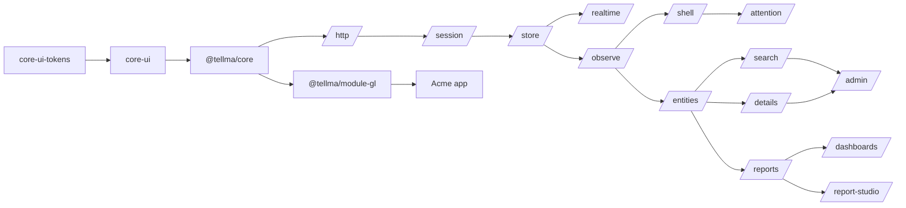
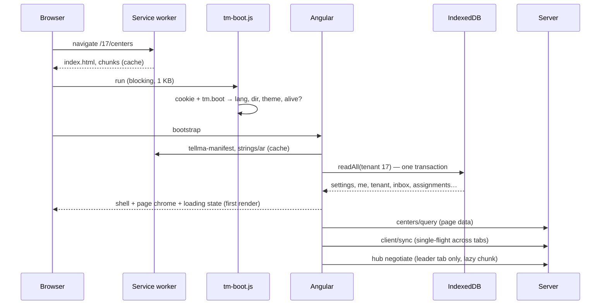
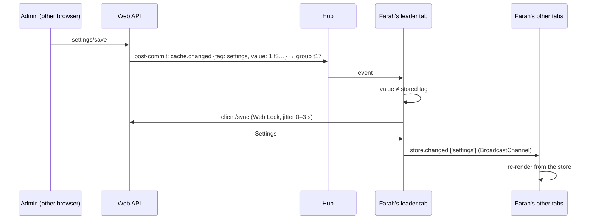
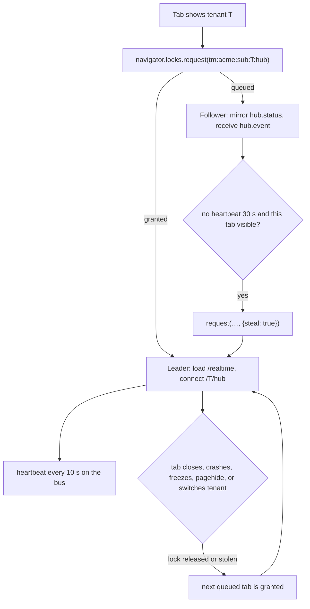

# Round-2 architecture skeleton — draft B

Draft B of two. All 13 sections are covered. The deepest parts serve design rules 2 (fast and
smooth UI) and 3 (AI-native): the warm-launch data model, the refresh paths, cross-tab
leadership, cancellation, the service worker, sign-out, routes, the page context, and the server
additions these need.

Contract blocks are TypeScript and C# sketches: names and shapes are normative; imports,
documentation comments, bodies and cancellation tokens are omitted.

## 0. The decisions in one page

1. **Deployment facts ship in the bundle; tenant and user facts ship over the wire.** Entity
   metadata, securables, setting keys, notification types, offered languages, calendars, contract
   fingerprints and the server string packs are emitted at build time into the SPA (the *client
   manifest*, §5.2). No request is ever needed to learn what the deployment is.
2. **Warm launch reads one IndexedDB transaction and zero network.** The shell and page chrome
   render from the bundle (service worker), `localStorage` (a 1 KB boot record) and one IndexedDB
   read of the tenant partition. Network starts after the first render (§7.2).
3. **One revalidation call.** `POST /{t}/api/web/client/sync` takes the tags the browser holds and
   returns only what changed (settings, `me`, tenant facts, stale cacheable lists). It replaces
   the SPA's use of `settings/client`, `settings/entity-tags` and `users/me` at launch (§6.1).
4. **One refresh path.** Response headers, `cache.changed` events and `client/sync` all feed one
   `TmCacheRefresher`, single-flight across tabs through a Web Lock. Whichever tab hears of a
   change refreshes the shared store; every tab re-renders from it (§7.3, §7.4).
5. **One hub connection per browser per tenant.** Web Locks elect the leader. Failover on close or
   crash is automatic. A visible tab steals leadership from a throttled or hung leader (§7.8).
6. **Reads are cancellable by type; writes are not.** `TmApiClient.read()` takes an `AbortSignal`;
   `write()` has no signal parameter. On the server, reads observe `RequestAborted`; a persist
   round trip, once sent, runs to completion (§7.9).
7. **Updates apply at the next navigation, never mid-task.** The service worker downloads a new
   version in the background; the tab switches to it on its next clean navigation. A
   `412 client-outdated` keeps the draft and reloads into it (§7.5).
8. **Re-authentication happens in a popup.** Session expiry and step-up open `/bff/login` in a
   popup that reports back over the tab bus, so no in-memory state is lost (§7.7).
9. **Sign-out is a broadcast.** One tab signs out; every tab of the origin wipes its user data and
   lands on `/signed-out` (§7.6).
10. **The page context registry is the single description of "what is on screen".** The future
    assistant, the support dump, the launcher's Actions bucket and the shortcuts dialog all read
    it. Pages publish it through the page frameworks, not by hand (§5.10).
11. **Routes:** `/tenants` is the picker; `/` is the launch redirect; `/{t}` is tenant home;
    `/{t}/{segment}[/{id}[/edit]]` are entity pages, with `segment` equal to the API's resource
    segment (§8).

## 1. Spec map

The README map stands with five scope adjustments, listed under the table.

| Spec | File | Title | Owns | Consumes | Depends on |
|---|---|---|---|---|---|
| 0010 | `0010-amendments-to-implemented-specs.md` | Amendments to Implemented Specs | Part A identity (0003, existing text + Account URL). Part B foundation (0002: breakpoints, System theme, Transloco loader seam, storage sweep, public overlay helpers). Part C grid (0004). Part D basics (0005). Part E picker (0006). Part F Queryex (0008: the seven amendments now in 0012 §11.2, plus the report amendments of 0033) | requests from every round-2 spec | — |
| 0023 | `0023-component-library-additions.md` | Component Library Additions | ~25 generic components (§2.3), their harnesses, budgets, strings | 0002 conventions | 0010 Part B |
| 0024 | `0024-client-app-foundation.md` | Client App Foundation | packages, app config and client features, client manifest and its emit, PWA and service worker, SPA hosting rules, BFF session and sign-out, re-auth popup, routes and launch redirect, HTTP layer, error presentation, localization and theme loading, budgets | 0023, 0025 store, 0026 telemetry | 0010 B–D, 0011, 0016 |
| 0025 | `0025-client-state-and-cross-tab-sync.md` | Client State and Cross-Tab Sync | client store, warm-launch documents, `client/sync`, refresh path, tab bus, leader election, hub client, preferences client and key registry, page-state cache, drafts, tree expansion memory, recents | 0024 HTTP and session | 0013, 0014, 0021 |
| 0026 | `0026-client-observability-and-support.md` | Client Observability, Support and Page Context | telemetry API and relay endpoint, error logging, UI version, request log and trace ids, support dump, screenshot, support upload, page context registry and page actions | 0024, 0025 | 0011, 0016, 0017 |
| 0027 | `0027-shell-launcher-and-tenant-picker.md` | Shell, Launcher and Tenant Picker | tenantless shell and picker page, tenant shell (app bar, pinned bar, slots, tenant markers, banner slot position), launcher and global search, session menu with About and Shortcuts dialogs, shortcut registry, navigation registry | 0024–0026, 0028 badges | 0023 |
| 0028 | `0028-assignments-and-attention-surfaces.md` | Assignments and Attention Surfaces | `core.Assignments` end to end, tray, bell panel, toast host and rules, banner host and precedence, Notifications and notification-settings pages, Assignments page, the "My jobs" view | 0025 leader and store, 0030 search page | 0015, 0016, 0020, 0021 |
| 0029 | `0029-client-entity-model.md` | Client Entity Model | entity descriptors (the manifest's entity section and the client registry), display names, navigation expansion, client access checks, client Queryex (lexer, builder, printer), expression editor, path tree picker, typed filter controls, generic entity picker binding, the Discover/Validate endpoint | 0024 manifest, 0025 store | 0008, 0012, 0015, 0016 |
| 0030 | `0030-search-page.md` | Search Page | search page, tiles, trees, column editor, URL state, bulk actions, export column model | 0029, 0025 page state | 0010 Part C, 0019 |
| 0031 | `0031-details-page.md` | Details Page | details lifecycle, layouts and primitives, paging through results, drafts and leave guard, child-row deep links, save error presentation | 0029, 0025 drafts | 0015, 0016 |
| 0032 | `0032-stock-pages.md` | Stock Pages | Users, Roles, Settings, My profile, Jobs, Schedules, Outgoing emails, Exports, Imports pages (Core) and Centers (`@tellma/module-gl`) | 0030, 0031 | 0013, 0014, 0018, 0020, 0022 |
| 0033 | `0033-report-definitions-and-engine.md` | Report Definitions and Engine | `ReportDefinitions`, JSON schema, kinds, parameters, coded reports, sharing (for reports and dashboards), execution, Queryex extensions (to 0010 Part F), report export | 0014, 0015 | 0008, 0012, 0019 |
| 0034 | `0034-report-renderers-and-studio.md` | Report Renderers and Studio | renderers, `tm-chart` and `tm-pivot` (shipped as `@tellma/core-ui` entry points), parameter bar, drill-through list page, report hosting, studio, reports catalog | 0029, 0033 | 0023 |
| 0035 | `0035-dashboards-and-home-page.md` | Dashboards and Home Page | dashboards, widget registry, dashboard grid, home page and its seams | 0028, 0033, 0034 | — |

Adjustments to the README map, one line each:

- **The client manifest and its emit belong to 0024.** Each section's shape stays with its domain
  owner (entities 0029, securables 0014, settings keys 0013, notification types 0021).
- **`client/sync` belongs to 0025**, because it is the warm-launch cache's revalidation, not a
  settings feature.
- **Page actions belong to 0026 with the page context**, so the assistant, the launcher's
  Actions bucket (0027) and the details Actions menu (0031) share one action model.
- **`tm-chart` and `tm-pivot` are designed by 0034 but ship in `@tellma/core-ui`**, so the docs
  pipeline, `components.json` and the MCP server cover them (the extractor scans core-ui only).
- **The unowned pages get owners:** Notifications, notification settings, Assignments and the
  "My jobs" view go to 0028. Jobs, Schedules, Outgoing emails, Exports, Imports and My profile go
  to 0032. "My jobs" is the Jobs search page, whose rows a member sees self-scoped anyway (0020
  §11.2), so it costs no new page.

## 2. Client packages

### 2.1 The packages

| Package | Folder (`client/projects/…`) | Holds | Owner |
|---|---|---|---|
| `@tellma/core-ui` (existing) | `core/tellma-core-ui` | domain-free components; new entry points from 0023, plus `chart` and `pivot` (0034) | 0002 family, 0023 |
| `@tellma/core-ui-tokens`, `-testing`, `-mcp`, `@tellma/locale-ar` (existing) | as built | unchanged roles; tokens gain breakpoints (0010 Part B) | 0002 |
| `@tellma/core` (new) | `core/tellma-core` | the app runtime and every platform page | 0024 (package), each EP's spec |
| `@tellma/core-testing` (new) | `core/tellma-core-testing` | page harnesses, Playwright helpers (multi-tab, offline, network hang, fake hub, fake clock) | 0024 |
| `@tellma/core-tools` (new, Node) | `core/tellma-core-tools` | `tellma-build`, the dev proxy config, font preload injection, `ngsw.json` generation, app budgets, port reading | 0024 |
| `@tellma/module-gl` (new) | `module/tellma-module-gl` | Centers pages, GL navigation entries | 0032 |

`@tellma/core` keeps ARCHITECTURE.md's name. Build and dev tooling moves out of it into
`@tellma/core-tools`, so the runtime package an SPA imports carries no Node code (ARCHITECTURE.md
put `bin` scripts in `@tellma/core`; that is the one deviation).

### 2.2 `@tellma/core` entry points

| Entry point | Holds | Owner | Loaded |
|---|---|---|---|
| `@tellma/core` | `tmAppConfig`, `bootstrapTellma`, `tmFeature`, feature contracts, `TM_MANIFEST`, `TmUrls`, `TmUpdates` | 0024 | eager |
| `/http` | `TmApiClient`, `TmApiError`, contract fingerprints, retry | 0024 | eager |
| `/session` | `TmSession`, profile cookie, guards, sign-out, re-auth popup | 0024 | eager |
| `/store` | `TmClientStore`, `TmTabBus`, `TmLeader`, `TmLaunchCache`, `TmCacheRefresher`, `TmPreferences`, `TmPageState`, `TmDrafts`, `TmRecents` | 0025 | eager |
| `/realtime` | `TmHub` over `@microsoft/signalr` | 0025 | lazy, leader tab only |
| `/observe` | `TmTelemetry`, `TmRequestLog`, `TmPageContexts`, `TmPageActions` | 0026 | eager (small) |
| `/support` | state dump, screenshot, send to support | 0026 | lazy |
| `/shell` | tenantless shell, picker, tenant shell, launcher, pinned bar, session menu, `TmShortcuts`, `TmNavigation` | 0027 | eager (launcher body preloaded at idle) |
| `/attention` | bell, tray, toast host, banner host; their panels and pages | 0028 | buttons eager, panels lazy |
| `/entities` | `TmEntities`, display names, `TmQx`, expression editor, path tree picker, filter controls, picker binding | 0029 | lazy |
| `/search`, `/details` | page frameworks | 0030, 0031 | lazy |
| `/admin` | Core stock pages | 0032 | lazy, per page |
| `/reports`, `/report-studio` | renderers, catalog, drill list; studio | 0034 | lazy |
| `/dashboards` | dashboards and home | 0035 | lazy |

Dependency direction (no cycles; lint-enforced by entry-point import rules like core-ui's):



- **Initial chunk** = primary, `/http`, `/session`, `/store`, `/observe`, `/shell` buttons and
  bars, `/attention` buttons. Budget in §11.6.
- **Lazy by route** = every page entry point. **Lazy by role** = `/realtime` (leader only),
  `/support`, `/report-studio`, `@tellma/core-ui/chart` (ECharts).

### 2.3 Generic versus feature components

0023 owns every domain-free primitive: icon and registry, badge, avatar, toast (the visual),
drawer, splitter, segmented control, radio group, switch, chips and multi-select, skeleton,
pager, search field, card and page-header layout, busy overlay, confirm and error dialog
contents, empty state, date range, relative time, reorderable list, tree (aria `tree`), drag
and drop, key hints, accordion, progress bar, tiles lattice (including a tree of tiles),
description list. Feature components stay in their feature's entry point: launcher list (0027),
bell and tray panels and the toast *host* (0028), dashboard grid (0035), expression editor and
path tree picker (0029, Queryex-aware), filter popovers (0029). `tm-chart` and `tm-pivot` are
0034's, shipped in core-ui (§1).

### 2.4 Where pack client code lives

- **One npm package per pack**, mirroring the NuGet module: `@tellma/module-gl` holds the Centers
  search and details pages and the GL launcher entries, registered through a `TmClientFeature`
  (§3).
- **Packs depend on `@tellma/core` and `@tellma/core-ui` as peer dependencies.** The C# rule
  "modules never reference Core" does not carry to npm: TypeScript types erase, and the core
  entry points are already the contract. ARCHITECTURE.md must state this npm rule.
- **Strings stay server-side.** A pack's labels are its resx keys, delivered in the emitted
  string pack (§5.2); a pack ships client strings only for client-only text.

### 2.5 Phase-1 workspace

- **The Acme client is a member of the `client/` pnpm workspace** (one lockfile, one virtual
  store), while living at `distributions/acme/src/Tellma.Distro.Acme.Client/` as 0011 §1.2 says.
- **It consumes platform packages from source** through the same `tsconfig` path mappings the
  showcase uses. Every bare `@angular/*` import then resolves to one real path in the shared pnpm
  store, so there is one Angular instance (the failure f11 §7.2 predicts arises only with two
  workspaces).
- **The showcase stays** as the library's story host; the Acme app becomes the e2e target for
  everything above the library.
- `tools/workspace.mjs`, the ESLint scoping and the docs extractor learn the new areas
  (`core/tellma-core`, `module/*`, the distribution app with its own `acme` prefix).

## 3. What a distribution writes

### 3.1 The file tree

```text
distributions/acme/src/Tellma.Distro.Acme.Client/
  Tellma.Distro.Acme.Client.esproj   # JS SDK esproj (0011 §1.2); also references the Migrator (§5.2, §6.3)
  package.json                       # @tellma/core, @tellma/core-ui, @tellma/module-gl, @tellma/locale-ar; dev: @tellma/core-tools
  angular.json                       # one application "acme"; serviceWorker off (tellma-build owns it)
  tsconfig.json, tsconfig.app.json
  proxy.conf.js                      # module.exports = require('@tellma/core-tools/proxy')();
  public/
    manifest.webmanifest             # name, short_name, icons, colours (distribution branding)
    icons/…, brand/wordmark-*.svg
  src/
    index.html                       # scaffolded once; loads tm-boot.js before the bundle
    main.ts                          # bootstrapTellma(appConfig);
    app.config.ts
    acme.feature.ts                  # entities, navigation, reports, overrides
    customers/customer-details.ts    # one file per custom details layout
    reports/aging-report.ts          # coded reports only
    i18n/en.json, i18n/ar.json       # client-only strings, scope "acme"
  generated/                         # gitignored: tellma-manifest.json, strings/<lang>.json (§5.2)
```

### 3.2 `app.config.ts` and `main.ts` (8 lines)

```ts
export const appConfig = tmAppConfig({
  distribution: 'acme',
  locales: { en: 'en-US', ar: 'ar-SA' },        // UI language → formatting locale (digits, separators)
  features: [glClientFeature, acmeClientFeature],
  strings: { en: () => import('./i18n/en.json'), ar: () => import('./i18n/ar.json') },
});

bootstrapTellma(appConfig);                      // main.ts: providers, routes, service worker, shell
```

Everything else (routes, the shell, the store, the hub, telemetry, theme, languages, calendars)
comes from the platform. Languages and calendars are tenant settings plus the manifest's offered
set; the distribution declares only the formatting locale per language, which also fixes the
reference distribution's `ar-SA` digits without hand-written providers.

### 3.3 A feature: entity pages, a launcher section, a coded report, an override (22 lines)

```ts
export const acmeClientFeature = tmFeature('acme', f => f
  .entity<Customer>('acme.Customer', {                       // entity name = server EntityMetadata.Name
    search: {
      columns: ['Code', 'Name', 'CustomerType', 'Currency', 'CreditLimit', 'IsActive'],
      tile: { image: 'ImageId', title: 'Name', subtitle: 'Code', badge: 'IsActive' },
    },
    details: () => import('./customers/customer-details'),   // default export: the layout component
  })
  .entity('acme.SalesInvoice', { search: { columns: ['Code', 'Date', 'Customer', 'Total'] },
                                  details: () => import('./invoices/invoice-details') })
  .section('sales', { labelKey: 'Acme_Nav_Sales', icon: 'users', order: 20 }, s => s
    .entity('acme.Customer', { synonymKeys: ['Acme_Nav_Clients'] })
    .entity('acme.SalesInvoice')
    .report('acme-aging'))
  .codedReport('acme-aging', {                  // key: slug-prefixed kebab, no dots (URL-safe for the service worker)
    titleKey: 'Acme_Report_Aging',
    securable: ['acme.AgingReport', 'Read'],
    component: () => import('./reports/aging-report'),
  })
  .override('core.User', { details: () => import('./users/acme-user-details') }));
```

- **Routes come from the entity name.** `acme.Customer` maps to its resource segment
  (`customers`) through the manifest, so `/{t}/customers`, `/{t}/customers/42`, `/new` and
  `/edit` exist without a route table (§8).
- **Capabilities come from the manifest.** Create, Import, Export, Activate and Delete appear when
  the stack has the operation and the user's cached access allows it.
- **Labels come from the server pack.** `Acme_Nav_Sales` is a resx key in the distribution's
  `Strings.resx`; column labels are the `<Schema>_<Entity>_<Property>` keys of 0013 §10.1.

### 3.4 A details layout (13 lines)

```ts
@Component({
  selector: 'acme-customer-details',
  imports: [TmDetailsCard, TmField, TmChildGrid],
  template: `
    <tm-details-card>
      <tm-field path="Name" /> <tm-field path="Name2" /> <tm-field path="Code" />
      <tm-field path="CustomerType" /> <tm-field path="Currency" /> <tm-field path="CreditLimit" />
    </tm-details-card>
    <tm-details-card labelKey="Acme_Customer_Contacts">
      <tm-child-grid collection="Contacts" [columns]="['Name', 'Email', 'Mobile']" />
    </tm-details-card>`,
})
export default class CustomerDetails {}
```

The layout holds markup only. View, edit, create, clone, save, errors, drafts, paging, the leave
guard, state restoration and the page context belong to the framework (0031), reached through DI
by `tm-field` and `tm-child-grid`. `tm-field path="Name2"` renders nothing on a tenant without a
second language.

**Line count for a new entity, end to end:** 7 lines in the feature, 13 for the layout, no route
or service code: about 20 lines. A launcher entry adds 1. A coded report adds 5 plus its
component.

### 3.5 Escape hatches (rule 1: uncommon → escape hatch)

| Need | Hatch | Owner |
|---|---|---|
| A search page unlike the standard one | `search: { component }` replaces the page, keeping the URL-state helpers | 0030 |
| A details page that is not a form | `details: { page }` replaces the whole page; `tmDetailsPage()` gives the lifecycle without the chrome | 0031 |
| Any other page | `.route(path, loadComponent)` under the tenant shell; gets guards, page context and telemetry | 0024 |
| A report the engine cannot express | coded report over a hand-mapped endpoint (0016 §4.5) | 0033, 0034 |
| Change a platform page or entry | `.override(key, …)` | 0024 |
| A custom cell or filter | per-column `cell` template; `filters: [...]` in the advanced filter | 0030 |
| App-bar items | at most 3 `TmShellSlot` items | 0027 |
| Hand-mapped API calls | `TmApiClient` directly; an `HttpClient` interceptor for third-party code | 0024 |
| Custom actions | `TmPageActions.register(...)` from any page | 0026 |
| Branding | `manifest.webmanifest`, wordmark files, token deltas | 0024 |

## 4. Concept ownership map

Every shared concept appears once. Section names are by topic where the owning spec's numbering is
not fixed yet; existing-spec sections are those the edit lands in (§6).

| Concept | Owner | Consumers |
|---|---|---|
| App config, client features, overrides, `TmUrls` | 0024 app config | every page spec, Acme |
| Client manifest: container, emit command, versioning | 0024 manifest | 0025–0035 |
| Manifest entity section (client entity metadata) | 0029 descriptors | 0030–0035 |
| Manifest securables section (role editor catalogue, `IsSensitive`, `FilterRoot`) | 0014 §10 (edited) | 0029 access, 0032 roles |
| Manifest setting keys, offered languages, registered calendars | 0013 §5.4, §7, §8 (edited) | 0027, 0032 settings |
| Manifest notification types and channels | 0021 §2.3–§2.5 (edited) | 0028 |
| Emitted server string packs | 0013 §10.4 (edited) | 0024 localization |
| Contract fingerprints (computation, header, 412) | 0016 §3.10 (edited) | 0024 HTTP |
| Service worker, PWA manifest, update flow | 0024 PWA | 0028 banner host |
| SPA hosting rules (cache headers, CSP, fallback, static assets) | 0011 §5.1–§5.3 (edited; designed in 0024) | — |
| BFF profile cookie v2, logout contract, post-sign-in redirect | 0011 §5.5 (edited; designed in 0024) | 0024 session |
| Client session, sign-out broadcast, re-auth popup | 0024 session | all |
| Route grammar, launch redirect, deep links | 0024 routes | 0021 targets, 0022 email links, all pages |
| HTTP layer: `TmApiClient`, headers, retry, cancellation | 0024 HTTP | all |
| Error classification and shared error dialogs | 0024 errors | all; 0031 save errors |
| Localization loading, language and theme switching | 0024 localization | 0027 session menu |
| Breakpoint token set, `TmBreakpoints` | 0010 Part B (amends 0002) | all |
| Shell layout constants (bar heights, banner slot) | 0027 layout | pages, through CSS variables |
| Client store: IndexedDB partitions and sweeps | 0025 store | 0024, 0026–0035 |
| Warm-launch documents and `client/sync` | 0025 launch cache | 0024, 0027, 0028 |
| Refresh path, `TmCacheRefresher` | 0025 refresh | all |
| `cache.changed` payload and recipients | 0013 §2.4 (edited) | 0025 |
| Tab bus | 0025 bus | 0024, 0028 |
| Leader election, hub client, reconnect policy | 0025 leader | 0028 |
| Hub event catalogue and envelope | 0021 §6.3 | 0025, 0028 |
| `assignments.changed` | 0028 (registered in 0021 §6.3) | 0025 |
| Preferences client, flush policy, key registry | 0025 preferences | 0027 pins, 0030 columns, 0034 parameters |
| Preference key grammar | 0018 §3.5 (edited) | 0025 |
| Page-state cache, tree expansion memory | 0025 page state | 0030, 0031, 0034 |
| Drafts | 0025 drafts | 0031, 0034 studio |
| Recently visited pages | 0025 recents | 0027, 0035 |
| Client telemetry API, event naming, relay endpoint | 0026 telemetry | all |
| UI version identity | 0026 version | 0024 headers, 0027 About |
| Request log and trace ids | 0026 request log | 0024 error dialogs, 0027 About |
| Support dump, screenshot, upload | 0026 support | 0027 session menu |
| Page context registry and page actions | 0026 page context | 0027, 0030–0035 |
| Tenant facts in the tenant shell (category, state) | 0025 (`client/sync`) | 0027 markers, 0031 read-only mode |
| Tenantless shell, tenant picker | 0027 picker | 0024 routes |
| App bar, pinned bar, slots, tenant markers | 0027 shell | 0028 |
| Launcher, global search, search providers | 0027 launcher | 0034 reports bucket |
| Navigation registry (sections, entries, synonyms) | 0027 navigation | features |
| Keyboard shortcut registry | 0027 shortcuts | all pages |
| Session menu, About and Shortcuts dialogs | 0027 session menu | — |
| Lightweight locale write `users/me/locale` | 0018 §3.1 (edited; requested by 0027) | 0027 |
| Assignments: entity, `IAssignments`, summary, seen | 0028 assignments | 0035 home |
| Bell and tray panels, toast host and rules, banner host and precedence | 0028 attention | 0024 outdated banner, 0025 offline banner |
| Notifications page, notification settings, Assignments page, My jobs view | 0028 pages | 0027 links |
| Entity registry and descriptors (client) | 0029 descriptors | 0030–0035 |
| Display names | 0029 display names | 0027, 0028, 0030–0035 |
| Navigation expansion (`Center` → `Center.Id` + name group) | 0029 expansion | 0030, 0033, 0034 |
| Client access checks `TmAccess` | 0029 access | all pages |
| Client Queryex: lexer, builder, printer | 0029 Queryex | 0030, 0034 |
| Discover/Validate endpoint | 0029 (server part) | 0030, 0034 |
| Expression editor, path tree picker, typed filter controls | 0029 | 0030, 0034 |
| Generic entity picker binding | 0029 picker | 0031, 0032, 0034 |
| Blob kind policies on the client | 0029 descriptors (data from 0017) | 0031 |
| Search page, tiles, column editor, URL query state | 0030 | 0028, 0032, 0034 drill list |
| Export column model | 0019 §2.1, §4.1 (edited; requested by 0030) | 0030 |
| Details lifecycle, layouts, child-row deep link | 0031 | 0032, 0034 drill |
| Stock pages | 0032 | — |
| Report definitions, kinds, parameters, coded reports | 0033 | 0034, 0035 |
| Sharing model (reports and dashboards) | 0033 sharing | 0035 |
| Report execution, aggregate shapes, report export | 0033 | 0034 |
| Queryex engine amendments | 0010 Part F (designed in 0033) | 0033 |
| Renderers, `tm-chart`, `tm-pivot`, studio, catalog, drill list | 0034 | 0035 |
| `report-menu` tenant tag | 0033 (declared; 0013 §2.3 list edited) | 0027 launcher |
| Dashboards, widget registry, home page | 0035 | 0027 wordmark |

## 5. Shared client seams

Each seam: name, sketch, owner, consumers. Services are `Tm*` classes injected with `inject()`;
per-component factories are `tm*()` functions; providers are `provideTellma*()` (§11.1).

### 5.1 App configuration and features (0024; consumers: Acme, packs)

```ts
interface TmAppConfigInput {
  distribution: string;                                   // slug, used in storage and lock names
  locales: Readonly<Record<string, string>>;              // UI language → formatting locale
  features: readonly TmClientFeature[];
  strings?: Readonly<Record<string, () => Promise<unknown>>>;  // client-only strings per language
}
interface TmClientFeature {                               // built by tmFeature (§3.3); read by 0024, 0027, 0030, 0031, 0034
  readonly name: string; readonly entities: readonly TmEntityPages[]; readonly navigation: readonly TmNavSection[];
  readonly codedReports: readonly TmCodedReport[]; readonly routes: readonly TmFeatureRoute[]; readonly overrides: readonly TmOverride[];
}
declare function tmAppConfig(input: TmAppConfigInput): TmAppConfig;
declare function tmFeature(name: string, build: (f: TmFeatureBuilder) => TmFeatureBuilder): TmClientFeature;
declare function bootstrapTellma(config: TmAppConfig): Promise<void>;
```

### 5.2 Client manifest (0024 container; section owners per §4)

The manifest is generated per build and never checked in. The app imports it, and each language's
strings, as JSON chunks, so the bundler hashes them and the service worker caches them with the
bundle.

```ts
interface TmManifest {
  formatVersion: 1;
  distributionVersion: string;                 // '1.4.0+3f2a9c1'; also the UI version (0026)
  contracts: Readonly<Record<string, string>>; // 'POST /{tenantId}/api/web/centers/query' → fingerprint
  entities: readonly TmEntityManifest[];       // 0029 owns the shape
  securables: readonly TmSecurableManifest[];  // 0014: resource, action, filterRoot, isSensitive, owner
  settingKeys: readonly TmSettingKeyManifest[];// 0013: name, category, valueType, …, labelKey
  notificationTypes: readonly TmNotificationTypeManifest[]; // 0021 descriptor fields
  notificationChannels: readonly { key: string; defaultEnabled: boolean }[];
  languages: readonly { code: string; nativeName: string; symbol: string; rtl: boolean }[]; // offered
  calendars: readonly string[];                // registered codes: 'gc', 'uq', 'et'
  clientEvents: readonly string[];             // hub event names
}
declare const TM_MANIFEST: InjectionToken<TmManifest>;
```

- **Emit.** `dotnet run --project <Migrator> -- emit-client-assets <dir>` composes the distribution
  exactly as the web host does (no database, no Kestrel) and writes `tellma-manifest.json` and
  `strings/<lang>.json` for every offered language (the 0013 string pack, verbatim). The esproj
  runs it before `ng build`, so `dotnet publish` and `pnpm start` both produce it.
- **Why the Migrator.** It is the existing composition host with no ASP.NET and no Node
  dependency, and the esproj can reference it without the Web → Client → Web cycle. The contract
  fingerprint computation moves from `Tellma.Core.AspNetCore` to `Tellma.Core` so the emit can
  run it (§6.3, 0016 §3.10).
- **Tenant shape.** The manifest is tenant-independent. `TmEntities` drops `Name2`/`Name3` twins
  the tenant's languages do not admit, mirroring the server's per-shape schema (0012 §11.1).
- **What it replaces.** `GET /api/strings/{language}` and `GET /api/notification-catalogue` are
  removed; the securables catalogue route that 0014 lacks is never needed; "the SPA schema" of
  0015 §1.2 is the `entities` section; the embedded `contracts.json` of 0016 §3.10 is the
  `contracts` section (the checked-in snapshot stays as the review artifact).
- **N/N−1.** The bundle and its manifest are one version. A bundle that meets a different server
  is caught by the 412 of §7.5.

### 5.3 API client (0024; consumers: all)

```ts
type TmJson = null | boolean | number | string | TmDecimal | readonly TmJson[] | { readonly [k: string]: TmJson };
interface TmReadOptions { signal: AbortSignal; priority?: 'page' | 'background'; tenantId?: number }
interface TmWriteOptions { tenantId?: number }               // no signal: writes are never aborted (§7.9)
declare class TmApiClient {
  read<T>(route: string, body: unknown, options: TmReadOptions): Promise<T>;   // POST, idempotent, retried
  write<T>(route: string, body: unknown, options?: TmWriteOptions): Promise<T>;// POST, never retried
  download(route: string, body: unknown, options: TmReadOptions): Promise<Blob>;// Excel streams
  beacon(route: string, body: unknown): void;                // fetch keepalive, ≤ 64 KB (telemetry, flushes)
}
type TmApiErrorKind = 'cancelled' | 'offline' | 'unauthenticated' | 'step-up' | 'forbidden'
  | 'not-found' | 'tenant-not-found' | 'tenant-unavailable' | 'read-only' | 'validation'
  | 'query-invalid' | 'bad-request' | 'conflict' | 'limit' | 'client-outdated'
  | 'unavailable' | 'partial-failure' | 'server';
declare class TmApiError extends Error {
  readonly kind: TmApiErrorKind; readonly status: number; readonly code: string;
  readonly traceId: string; readonly problem: TmProblem | null;
}
```

- **Over `fetch`, not `HttpClient`.** `fetch` gives native `AbortSignal`, `keepalive`, streamed
  downloads and raw text for the lossless JSON parser that 0016 §3.2 requires (numbers beyond 15
  digits become `TmDecimal`; `modifiedAt` stays the raw string).
- **Headers on every call:** `Tellma-Client: web/<distributionVersion>`, `Accept-Language`
  (the formatting locale, e.g. `ar-SA`), `Tellma-Calendar`, `Tellma-Contract` (from the manifest),
  `traceparent` (client-generated, so the trace id is known before the response and for
  cancelled calls), `Content-Type: application/json`. No `Tellma-Time-Zone`: the server's
  preference-then-tenant rule decides, and the client formats instants in the same zone.
- **Observers:** every response passes `Tellma-Version-Tags` to `TmCacheRefresher` (§5.6) and an
  entry to `TmRequestLog` (§5.9).

### 5.4 Client store (0025; consumers: 0024–0035)

```ts
type TmPartition =
  | { kind: 'device' }                                        // no user data; survives sign-out
  | { kind: 'user'; sub: string }                             // tenant list, distribution info
  | { kind: 'tenant'; sub: string; tenantId: number }         // warm-launch documents
  | { kind: 'session'; sub: string; sessionHandle: string };  // tree expansion; dies with the session
interface TmStoredDoc<T> { readonly tag: string | null; readonly savedAt: number; readonly validatedAt: number; readonly formatVersion: number; readonly data: T }
declare class TmClientStore {
  readAll(partition: TmPartition): Promise<ReadonlyMap<string, TmStoredDoc<unknown>>>; // one transaction
  doc<T>(partition: TmPartition, name: string): Signal<TmStoredDoc<T> | undefined>;   // live across tabs
  put<T>(partition: TmPartition, name: string, doc: TmStoredDoc<T>): Promise<void>;   // broadcasts store.changed
  sweep(rule: 'sign-out' | 'other-users' | 'expired' | { sessionOtherThan: string }): Promise<void>;
}
```

- **One IndexedDB database `tm-app`**, one object store keyed `[partitionKey, name]`, so a sweep is
  one key-range delete. `localStorage` holds only `tm.boot` (§7.2); `sessionStorage` holds only
  drafts.
- **Format versions.** A stored document whose `formatVersion` differs from the code's is treated
  as absent.

### 5.5 Tab bus and leader (0025; consumers: 0024, 0028)

```ts
type TmBusMessage =
  | { type: 'store.changed'; partition: string; names: readonly string[] }
  | { type: 'hub.event'; tenantId: number; event: TmClientEvent }
  | { type: 'hub.status'; tenantId: number; status: 'connecting' | 'connected' | 'reconnecting' | 'offline'; since: number }
  | { type: 'leader.heartbeat'; tenantId: number; tabId: string; visible: boolean; at: number }
  | { type: 'session.signing-out' | 'session.signed-out' | 'session.lost' | 'session.restored'; sub: string }
  | { type: 'drafts.query'; replyTo: string } | { type: 'drafts.reply'; replyTo: string; dirty: number };
declare class TmTabBus { readonly tabId: string; post(m: TmBusMessage): void; messages: Observable<TmBusMessage> }
declare class TmLeader {
  readonly isLeader: Signal<boolean>;                         // for the tenant this tab shows
  readonly hubStatus: Signal<TmHubStatus>;                    // the leader's, mirrored in every tab
  events(name: string): Observable<TmClientEvent>;            // hub events, delivered in every tab
}
```

The channel is `BroadcastChannel('tm:<distribution>:<sub>')`; the lock is
`tm:<distribution>:<sub>:<tenantId>:hub` (§7.8).

### 5.6 Launch cache and refresher (0025; consumers: all)

```ts
interface TmLaunchDocs {                 // the tenant partition's documents (§7.2 table)
  settings: TenantSettingsForClient; me: MeResult; tenant: TmTenantFacts;   // 0013, 0016, §6.1 shapes
  inbox?: InboxSummary; assignments?: AssignmentsSummary; home?: TmHomeResolution;
}
declare class TmLaunchCache {
  readonly docs: { [K in keyof TmLaunchDocs]: Signal<TmLaunchDocs[K] | undefined> };
  readonly warm: Signal<boolean>;        // settings + me + tenant present, current format, validated within the idle window
}
declare class TmCacheRefresher {
  observe(tenantId: number, tags: Readonly<Record<string, string>>): void; // headers, hub events, sync results
  refresh(tenantId: number, docs: readonly string[]): Promise<void>;       // client/sync under a Web Lock
}
```

### 5.7 Preferences (0025; consumers: 0027, 0030, 0034, 0035)

```ts
interface TmPreferenceKey<T> { readonly key: string; readonly kind: 'curated' | 'write-behind'; readonly codec: TmCodec<T>; readonly fallback: T }
declare function tmPreferenceKey<T>(key: string, kind: 'curated' | 'write-behind', fallback: T): TmPreferenceKey<T>;
declare class TmPreferences {
  get<T>(key: TmPreferenceKey<T>): Signal<T>;
  set<T>(key: TmPreferenceKey<T>, value: T): void;   // applied locally at once; curated flushed now, write-behind coalesced
}
```

Registered platform keys (the registry is code, in 0025): `nav.pinned`, `nav.pinsBar`,
`nav.recent`, `ui.theme`, `search.<entity>.columns`, `search.<entity>.view`,
`report.<id>.params`, `announcements.dismissed`. Flush: coalesced per key, 2 s after the last
change, at most every 10 s, and on `visibilitychange: hidden` and `pagehide` through
`TmApiClient.beacon`. One tab flushes at a time (lock `…:prefs`). Last writer wins per key; a
refetched bag is overlaid with the tab's unflushed keys.

### 5.8 Page state, drafts, recents (0025; consumers: 0030, 0031, 0034)

```ts
declare class TmPageState {                       // in memory, per tab, LRU of 20 entries
  remember<T>(key: TmPageStateKey, state: T): void; // key = route template + normalized params
  recall<T>(key: TmPageStateKey): T | undefined;     // data, scroll, selection, active tab, expansion
}
declare class TmDrafts {                          // sessionStorage: survives reload, not a new tab
  save(key: string, value: TmJson): void;         // key = 'tm.draft:<t>:<entity>:<id|new>'
  load(key: string): TmJson | undefined; clear(key: string): void; readonly dirtyCount: Signal<number>;
}
declare class TmRecents { readonly pages: Signal<readonly TmRecentPage[]>; }   // nav.recent, dwell 2 s, cap 10
```

Page data stays in memory: tenant rows are never written to disk by the page-state cache. Tree
expansion is the one persisted page memory, in the `session` partition, so another tab of the same
session reopens a tree expanded (brief, Trees).

### 5.9 Session and errors (0024), telemetry and request log (0026)

```ts
interface TmProfile { v: 2; sub: string; sh: string; name: string; email: string; locale: string | null }
declare class TmSession {
  readonly profile: Signal<TmProfile | null>;                    // the tellma.profile cookie
  readonly state: Signal<'active' | 'lost' | 'signing-out'>;
  signOut(): Promise<void>;                                      // §7.6
  reauthenticate(reason: 'expired' | TmStepUp): Promise<boolean>;// popup, §7.7
}
declare class TmErrorPresenter {                                 // all but 422, which 0031 maps onto fields
  present(error: TmApiError, context: { kind: 'read' | 'save' | 'action'; retry?: () => void }): Promise<void>;
}
declare class TmTelemetry {
  event(name: string, props?: Readonly<Record<string, string | number | boolean>>): void;
  timing(name: string, ms: number, props?: Readonly<Record<string, string>>): void;
  error(error: unknown, context?: Readonly<Record<string, string>>): void;
}
interface TmRequestRecord { traceId: string; route: string; startedAt: number; durationMs: number | null;
  outcome: 'ok' | 'cancelled' | 'error'; status?: number; slow: boolean }
declare class TmRequestLog { readonly recent: Signal<readonly TmRequestRecord[]>; copy(): Promise<void> } // ring of 100
```

`TmErrorPresenter` owns the 5xx dialog (trace id with a copy button), the 400 message dialog,
`tenant-not-found` (to the picker), `tenant-unavailable` (to the tenant-state page),
`client-outdated` (§7.5), `step-up` and `unauthenticated` (§7.7). `cancelled` is silent.

### 5.10 Page context and page actions — the assistant seam (0026; consumers: 0027, 0030–0035)

```ts
type TmPageKind = 'home' | 'search' | 'details' | 'report' | 'dashboard' | 'settings' | 'picker' | 'custom';
interface TmPageContext {
  readonly kind: TmPageKind;
  readonly routeTemplate: string;                    // '/:t/centers/:id'
  readonly entity?: string;                          // 'gl.Center'
  readonly title: Signal<string>;                    // localized, as displayed
  readonly state: Signal<TmJson>;                    // view state: query, mode, tab, selection ids
  readonly visible?: Signal<TmVisibleData>;          // columns + displayed rows, capped at 200
  readonly form?: TmFormContext;                     // details edit mode
  readonly errors: Signal<readonly TmContextError[]>;// validation, request and render errors on screen
  readonly actions: Signal<readonly TmPageAction[]>;
}
interface TmFormContext {
  readonly fields: Signal<readonly { path: string; labelKey: string; value: TmJson; errors: readonly string[]; editable: boolean }[]>;
  propose(path: string, value: TmJson): void;        // writes the model, marks the field "assisted"; never saves
}
interface TmPageAction {
  readonly id: string;                               // 'details.save', 'search.export', 'gl.center.activate'
  readonly labelKey: string; readonly enabled: Signal<boolean>; readonly destructive: boolean;
  readonly shortcut?: string;                        // registered with TmShortcuts
  readonly params?: TmJsonSchema;
  invoke(args: TmJson, origin: 'user' | 'shortcut' | 'launcher' | 'assistant'): Promise<TmActionResult>;
}
declare class TmPageContexts {
  readonly current: Signal<TmPageContext | null>;     // the routed page
  readonly overlays: Signal<readonly TmPageContext[]>;// open dialogs that publish context
  register(context: TmPageContext, destroyRef: DestroyRef): void;
}
declare class TmPageActions {                         // adds actions to the current page's context
  register(action: TmPageAction, destroyRef: DestroyRef): void;
}
```

Rules that keep rule 3 cheap:

- **The frameworks publish, pages do not.** The search, details, report and dashboard frameworks
  register a context from state they already hold; a distribution's layout writes nothing.
- **One action model.** The details Actions menu, toolbar buttons, the launcher's Actions bucket,
  keyboard shortcuts and future assistant tools are all `TmPageAction`s. A button is a view of an
  action, so an assistant can do what a user can, through the same permission and confirmation
  path.
- **Assistant safety.** `origin: 'assistant'` on a destructive action always opens the standard
  confirm dialog; `propose` never saves; the assistant sees only what `visible` already shows.
- **AG-UI mapping (future).** `TmPageContext` → the run's `context` and a `STATE_SNAPSHOT`, with
  changes as `STATE_DELTA` (JSON Patch); `TmPageAction`s → frontend tools; `errors` → context.
- **Reuse today.** The support dump (0026) serializes `current`, `overlays`, the request log and
  the version; the Shortcuts dialog lists actions with shortcuts; the help drawer (later) reads
  `kind`, `entity` and the focused field path.

### 5.11 Navigation, shortcuts, shell slots (0027; consumers: features, pages)

```ts
interface TmNavSection { id: string; labelKey: string; icon: string; order: number; entries: readonly TmNavEntry[] }
interface TmNavEntry { id: string; labelKey: string; synonymKeys?: readonly string[]; url: (t: number) => string; requires?: readonly [resource: string, action: string] }
declare class TmShortcuts { register(s: { id: string; keys: string; labelKey: string; scope: 'global' | 'page'; run: () => void }, destroyRef: DestroyRef): void }
interface TmShellSlot { id: string; icon: string; labelKey: string; badge?: Signal<number | null>; panel: () => Promise<Type<unknown>> }
```

Reserved slot ids: `help` and `assistant` (rendered by nothing today; their positions are fixed in
the app bar so adding them later moves nothing, §9).

### 5.12 Entities, display names, access (0029), breakpoints (0010 Part B)

```ts
interface TmEntityDescriptor {
  readonly name: string; readonly segment: string;          // 'gl.Center', 'centers'
  readonly properties: readonly TmPropertyDescriptor[]; readonly navigations: readonly TmNavigationDescriptor[];
  readonly children: readonly TmChildDescriptor[]; readonly capabilities: ReadonlySet<string>;
  readonly operations: ReadonlySet<'query' | 'details' | 'save' | 'delete' | 'import' | 'export'>;
  readonly relatedSelect: readonly string[]; readonly defaultSelect: readonly string[];
  readonly limits: { maxTake: number; countCap: number; maxSkipWindow: number; maxSearchLength: number; maxIds: number };
  readonly actions: readonly TmEntityActionDescriptor[];
}
declare class TmEntities {
  get(name: string): TmEntityDescriptor;                     // from the manifest, gated by tenant languages
  displayName(entity: string, row: TmJson): Signal<string>;  // current UI language, content fallback
}
declare class TmAccess {
  can(resource: string, action: string): Signal<boolean>;    // from cached me.access
  filtered(resource: string, action: string): Signal<boolean>;
  reachable(path: string, root: string): Signal<boolean>;    // navigation traversal rule (0015 §5.2 step 4)
}
type TmBreakpoint = 'xs' | 'sm' | 'md' | 'lg' | 'xl' | 'xxl';
declare const TM_BREAKPOINTS: { readonly sm: 576; readonly md: 768; readonly lg: 992; readonly xl: 1200; readonly xxl: 1440 };
declare class TmBreakpoints { readonly current: Signal<TmBreakpoint>; atLeast(b: TmBreakpoint): Signal<boolean> }
```

## 6. Server additions and edits

### 6.1 New endpoints

| Route | Verb | Purpose | Owner |
|---|---|---|---|
| `/{t}/api/web/client/sync` | POST | revalidate the warm-launch documents in one round trip | 0025 |
| `/api/client-telemetry` | POST | client telemetry relay (tenantless, session-authenticated, `fetch` keepalive) | 0026 |
| `/{t}/api/web/queryex/discover` | POST | validate and discover a draft query (diagnostics, parameters, paths) per keystroke | 0029 |
| `/{t}/api/web/users/me/locale` | POST | set `PreferredLanguage` / `PreferredCalendar` without a full `me/save` | 0027 (edits 0018) |
| `/{t}/api/web/assignments/{query,get,summary,seen}` | POST | assignments stack and tray protocol | 0028 |
| `/{t}/api/web/reports/…` | POST | report definitions stack (segment `reports`), `share`, `publish`, `transfer`, `run`, `export` | 0033 |
| `/{t}/api/web/dashboards/…`, `/{t}/api/web/home/…` | POST | dashboards stack, home resolution | 0035 |
| `/{t}/blobs/support-bundle` | POST | staged support dump and screenshot (opt-in) | 0026 (kind registered with 0017) |
| `/api/strings/{language}`, `/api/notification-catalogue` | GET | **removed**: their content is emitted into the bundle (§5.2) | 0024 |

The three contracts that §7 depends on:

```csharp
[ApiRoute("client")]
public sealed class ClientSyncService
{
    // MemberOnly, Idempotent, Mutation = false, NoActivityStampMetadata; one Read batch (warm: 1 round trip)
    [ApiAction("sync", MemberOnly = true, Idempotent = true, Mutation = false)]
    public Task<ClientSyncResult> SyncAsync(ClientSyncRequest request);
}
public sealed record ClientSyncRequest(IReadOnlyDictionary<string, string> Held); // doc name → wire tag held; empty = cold
public sealed record ClientSyncResult(
    TenantFacts Tenant,                               // always
    IReadOnlyDictionary<string, string> Tags,         // settings, permissions, preferences, entities, report-menu, entity:<Name>
    TenantSettingsForClient? Settings,                // only when the held settings tag differs
    MeResult? Me,                                     // only when preferences or permissions differ
    IReadOnlyList<string> StaleEntities);             // cacheable lists to refetch lazily through {segment}/all
public sealed record TenantFacts(int Id, TenantCategory Category, TenantState State, int? LiveTenantId);

// POST /bff/logout — body and CSRF rules unchanged (0011 §5.5)
public sealed record LogoutResult(string? EndSessionUrl);  // null for scope "local"; the SPA navigates to it

// POST /api/client-telemetry — tenantless, Tellma.Web policy, Tellma-Client required, ≤ 64 KB, rate policy tellma-telemetry
public sealed record ClientTelemetryBatch(string Version, string TabId, int? TenantId, IReadOnlyList<ClientTelemetryItem> Items);
public sealed record ClientTelemetryItem(string Kind, string Name, DateTimeOffset At, string? TraceId,
    IReadOnlyDictionary<string, JsonElement>? Properties);   // Kind: event | timing | error
```

### 6.2 New entities and tables (designed by their owners)

| Table | Owner | Notes for the cross-cutting design |
|---|---|---|
| `core.Assignments` | 0028 | system-written; self-scoped criterion; bumps nothing; publishes `assignments.changed` to the old and new assignee; `UserStamps.AssignmentsSeenAt` added to 0014 §3.3 |
| `core.ReportDefinitions` (+ shares) | 0033 | segment `reports`; `[BumpsVersionTag("report-menu")]` so the launcher's report entries cache like chrome |
| `core.Dashboards` (+ widgets, shares, parameters), home rules | 0035 | home resolution cached under `preferences`, `permissions` and a `dashboards` tag |
| `core.SupportBundles` (optional) | 0026 | only if support upload ships with a reference code row; otherwise the blob kind alone |

### 6.3 Edits to specs 0010–0022

| Target | Delta | Why | Needed by |
|---|---|---|---|
| 0011 §5.5 profile cookie | v2: `base64url(JSON { v: 2, sub, sh, name, email, locale })`; `sh` is the session handle (a name, not a credential, 0011 §7.4); rewritten when a refresh changes `name` or `locale` | partition storage per user and per session; the tenantless shell shows the email | 0024, 0025 |
| 0011 §5.5 post-sign-in redirect | `returnUrl ?? "/"`; the single-membership skip rule moves to the SPA launch redirect | one owner for "where do I land"; `/` must not double as the picker | 0024 |
| 0011 §5.5 `POST /bff/logout` | answers `200 LogoutResult`; clears `tellma.profile`; sends `Clear-Site-Data: "cache"`; calls `SessionsTerminatedAsync(subject, [ownHandle])`; post-logout redirect lands on `/signed-out` | `fetch` cannot follow the end-session redirect; the hub must close this session's connections | 0024 |
| 0011 §5.1, §5.2 hosting | static assets anonymous (`TenantlessEndpointMetadata("spa-assets")`); fallback only for navigations (`GET` with `Sec-Fetch-Mode: navigate` or `Accept: text/html`) outside reserved prefixes and second segments, else 404 problem; cache headers and security headers of §7.5 | signed-out browsers must load the bundle; API typos must not answer `200 index.html` | 0024 |
| 0011 §5.3 reserved names | SPA first segments `tenants`, `signed-out`, `auth`; SPA tenant second segments `settings`, `list`, `me` | entity segments and distribution endpoints must not shadow SPA routes | 0024 |
| 0011 §5.9 `DistributionInfo` | add `accountUrl`, `termsUrl?`, `privacyUrl?`, `support: { upload }`, `session: { idleLifetimeSeconds }`; keys `Tellma:Links:*`, `Tellma:Support:*` | About dialog, My account, the boot record's idle check | 0024, 0026, 0027 |
| 0011 §1.2, §6.6 client project | esproj references the Migrator and runs `emit-client-assets`; `proxy.conf.js` from `@tellma/core-tools`; Acme client joins the `client/` pnpm workspace | §2.5, §5.2 | 0024 |
| 0011 §9 | honour an inbound same-origin `traceparent` trace id (sampling stays server-side); client relay instruments | trace id known before the response, also for cancelled calls | 0026 |
| 0012 §6.1 | the scope token is `HttpContext.RequestAborted` for Read and Validate batches, the cold prologue and retry delays; a Persist round trip, once sent, runs to completion | rule 2C without ambiguous outcomes for saves | 0024 |
| 0012 §11.2 | moves to 0010 Part F; 0012 cites it | one amendment home for frozen 0008 | 0010 |
| 0013 §2.3, §2.4 | `cache.changed` also for `permissions` (tenant group) and user-level bumps (user group), payload `{ tag, value? }` with `value` for `settings` and `entity:*`; `report-menu` and `dashboards` join the tag lists | push for every chrome-relevant change (§7.4) | 0025 |
| 0013 §2.7 | the `permissions` wire tag folds the user's `PermissionsTag` in: `"{fv}.{tenant:N}{user:N}"` | the client sees membership changes (f03 C4) | 0025 |
| 0013 §2.8 | `migrate` bumps tags only when it applied a migration or provisioning step | no refetch burst on deployments that change no data | 0025 |
| 0013 §10.4 | string packs are emitted at build; the route is removed; the SPA's language list is the tenant's content languages | §5.2 | 0024 |
| 0013 §6.1 `settings/client` | the SPA stops calling it; its undefined "unchanged" result and `ifTag` are dropped; `client/sync` composes the same bytes | f03 G6 | 0025 |
| 0013 §6.1–§6.3 settings save | entries-only saves need no `General` stamp; per-category concurrency; `save` returns the new stamp | f03 C1, G5 | 0032 |
| 0014 §10 | the securables catalogue reaches the SPA in the manifest; no route | role editor, step-up anticipation | 0029, 0032 |
| 0014 §3.4 | the write-behind rule cites 0025's flush policy | one owner | 0025 |
| 0015 §1.2 | "the SPA schema" is the manifest's entity section (0029) | names the consumer | 0029 |
| 0015 §5.4, 0016 §3.3 `ParentIdsRequest` | add `OrderBy` and a roots-plus-these-parents form | restore remembered expansion in one call | 0030 |
| 0015 §5.2, 0016 §2.3 | project `query` for child entities (`invoice-lines/query`) under the owner's `Read` grant, rebased with `FilterTree.Via` | reports and drill lists rooted at child rows | 0033, 0034 |
| 0015 §14.1 | cancellation per 0012 §6.1 above | | 0024 |
| 0016 §2.1, §2.2, §2.4 | add the §6.1 routes; `client/sync` and `queryex/discover` are retried reads; remove the two GET routes | | 0024, 0025, 0029 |
| 0016 §3.10 | fingerprints computed by a framework-free `Tellma.Core` service; the SPA reads them from the manifest; the contract middleware stamps `Tellma-Build` on its 412 | the emit needs the computation; the client compares versions | 0024 |
| 0016 §4.3 | `NoActivityStampMetadata` on `client/sync`, `assignments/summary` | background calls must not keep sessions alive | 0025, 0028 |
| 0016 §6.2, §7.5 | header `permissions` per 0013 §2.7; cookie challenge 401 carries code `unauthenticated`; a route miss under a tenant prefix answers `404 route-not-found` | tell re-login from step-up; treat a missing route as an outdated client | 0024 |
| 0016 §8.2 | rate policy `tellma-telemetry` (per user, separate bucket) | telemetry never starves user calls | 0026 |
| 0018 §3.1 | `users/me/locale { language?, calendar? }`, member-only, 1 round trip, bumps `PreferencesTag`, no stamp | session-menu toggles without the 3-round-trip `me/save` | 0027 |
| 0018 §3.5 | preference key grammar `^[a-z][a-zA-Z0-9-]*(\.[a-zA-Z0-9][a-zA-Z0-9-]*)*$` | `search.gl.Center.columns`, `report.42.params` | 0025 |
| 0019 §2.1, §4.1 | export takes a display column model (`columns: [{ path, labelKey? }]`); navigations render as display names in the request language; no `Id` unless shown. "Import template" stays `export-for-import` with empty `Ids` | Trees Q1 | 0030 |
| 0020 §2.3 | job display label (`Jobs_Handler_<key>` resource + subject argument) | bell "In progress", My jobs | 0028 |
| 0020 §5.2, §10 | publish `job.changed` when reported progress moves by 5 points or more (at most every 5 s), not only on renewals | a live progress bar instead of 2-minute steps | 0028 |
| 0021 §2.5 | catalogue emitted into the manifest; route removed | §5.2 | 0024 |
| 0021 §5.4 | the client protocol cites 0025 (leader) and 0028 (presentation) | one owner per behaviour | 0025, 0028 |
| 0021 §6.3 | add `assignments.changed`; `cache.changed` recipients and payload per 0013 | | 0025, 0028 |
| 0021 §9.2 | `ClientTimeoutInterval` 150 s (keep-alive 15 s) | a hidden leader's pings align to one per minute in Chrome (§7.8) | 0025 |
| 0022 §4, 0018 §3.3 | email and invite links use the deep-link grammar (`{origin}/{t}/{segment}/{id}`, home `{origin}/{t}`) | | 0024 |

### 6.4 Amendments to frozen specs (to spec 0010)

| Part | Target | Delta | Why | Requested by |
|---|---|---|---|---|
| A | 0003 Account & Security | a stable "My account" URL with a `return_url` contract | session menu link | 0027 |
| B | 0002 §4 tokens | breakpoint constants (§9), `TmBreakpoints`, stylelint rule allowing only those widths in media and container queries | closed set of thresholds | 0024 |
| B | 0002 §4 themes | `system` theme: the app writes `data-theme` from `prefers-color-scheme`; `color-scheme` declared per theme | brief theme toggle | 0024 |
| B | 0002 §5 `provideTellmaUi` | a loader seam and runtime `availableLangs`, so app strings and the emitted pack merge into the one Transloco instance | f07 §5.7 | 0024 |
| B | 0002 §12, 0005 §2.3 | `TmClientCache.clearAll()` also deletes `tm-*` IndexedDB databases and `tm.*` web-storage keys, sparing the `device` partition | sign-out sweep | 0025 |
| B | 0002 §12 | `tmCreateAnchoredOverlay` and `tmPushEscapeDismissal` become public (out of `private`) | shell overlays must share the Escape stack | 0027 |
| C | 0004 | row activation mode and output; external active-row API; sort indicator and `aria-sort`; header filter slot; cross-page `selectedIds`; `rowClass`; expansion model with serialization and bulk restore; `scrollbar-gutter: stable`; `scrollToRow(id, { flash })`; budget reset | f07 §3.2 | 0030, 0031, 0034 |
| C | 0004 §8.5 menu | a button trigger directive, submenus, section headings, checkable and radio items, link items with `href` | session menu, Actions and Export menus | 0027, 0030, 0031 |
| D | 0005 | modal drawer variant; live `direction` from `Directionality`; popover size input; `TM_BLOB_FETCHER` takes an `AbortSignal`; time, date-time and relative-time formats; select multi-select and option groups | f07 §3.2 | 0023, 0024, 0028, 0030 |
| E | 0006 | rich two-line options; multi-select if 0029 needs it for navigation filters | f07 §3.2 | 0029 |
| F | 0008 | the seven amendments of 0012 §11.2; grouping sets with a grouping indicator; tree rollup key; constant-expression evaluation; parameter-to-path relation in discovery; `uq` calendar; optional-parameter semantics | f08 §3.1 | 0033 |

### 6.5 ARCHITECTURE.md edits

- **Frontend:** the PWA and service-worker decision (§7.5); `@tellma/core` versus `@tellma/core-ui`
  versus `@tellma/core-tools`; the principle "deployment facts in the bundle, tenant facts over the
  wire"; the npm dependency rule for packs (§2.4).
- **Repo layout and Phase 1:** one client location (`src/Tellma.Distro.<Slug>.Client/`); the pnpm
  workspace membership instead of cross-workspace path mappings (§2.5).
- **Guiding principles:** replace "optimistic UI … local commit before server reconciliation" with
  the brief's rule (instant feedback, blocking save spinner) and name the 7-day warm launch.
- **Reports:** dashboards leave tier 3; stored definitions and coded reports join tier 1 and 2.
- **Observability:** client telemetry relay, trace-id surfacing, UI version.
- **Stale text:** the l10n adapters sentence, the grid-engine package claim, the MCP tool names.

## 7. Data flows

### 7.1 Cold launch after sign-in

1. `/bff/login` → identity server → `/signin-oidc`. The BFF writes the session and the v2 profile
   cookie and redirects to `returnUrl ?? "/"`.
2. The browser loads `index.html` and the initial chunks over the network. The service worker
   registers once the app is stable (`registerWhenStable:30000`) and then prefetches the `shell`
   asset group (§7.5), so it never competes with the first render.
3. `tm-boot.js` finds the profile cookie but no `tm.boot` for this `sub`: a cold launch. It sets
   `lang` and `dir` from the profile's `locale` (else the browser language, if offered).
4. Angular boots with the manifest and the active language's strings (hashed assets).
5. At `/`, the launch redirect has no last tenant, so it waits on `GET /bff/user` (in parallel with
   `GET /api/distribution-info`). Exactly one `Live`, `Active`, `isActive` membership → replace to
   `/{t}`; otherwise → `/tenants`. A deep `returnUrl` that names a tenant skips this step.
6. On the tenant route, `client/sync` with an empty `Held` and the page's data request start
   together. Sync answers settings, `me` and tenant facts in one round trip; the store writes the
   tenant partition; the shell renders.
7. After the first render: the leader election starts the hub (§7.8), the idle preloader fetches
   the chunks of pinned and recent pages, and `navigator.storage.persist()` is requested where the
   browser grants it silently (§7.2).

Cold cost after the bundle: two tenantless calls (only at `/`), one `client/sync`, the page data.

### 7.2 Warm launch within 7 days — no network before chrome

**The boot record** is the only synchronous state, about 1 KB in `localStorage`, holding no tenant
data:

```ts
interface TmBootRecord {
  v: 1;
  theme: 'system' | 'light' | 'dark'; lang: string; dir: 'ltr' | 'rtl'; // device-level: survive sign-out
  sub: string | null; lastTenantId: number | null;                       // cleared on sign-out
  lastSeenAt: number;            // last authenticated 2xx, any tab
  idleLifetimeMs: number;        // from distribution-info; default 7 days
}
```

**The documents** (client store, §5.4):

| Document | Partition | Validated by | Refreshed by | Cleared when |
|---|---|---|---|---|
| `settings` (`TenantSettingsForClient`) | tenant | `settings` tag | header, `cache.changed {settings, value}`, sync | sign-out; another `sub` boots; not validated for 7 days; format change |
| `me` (`MeResult`: profile, bag, access, tags) | tenant | `preferences` + `permissions` tags | header, `cache.changed` (name only), own preference writes | same |
| `tenant` (`TenantFacts`) | tenant | every sync | sync, `session.ended {tenant-unavailable}` | same |
| `entity:<Name>` (cacheable lists) | tenant | `entity:<Name>` tag | `cache.changed {entity:X, value}`; lazy refetch through `/all` | same |
| `inbox`, `assignments` (last summaries) | tenant | none (event-driven) | leader on `inbox.changed`, `job.changed`, `assignments.changed`, hub connect | same |
| `reportMenu` (launcher report entries) | tenant | `report-menu` tag | header, sync | same |
| `home` (resolved home dashboard) | tenant | `preferences` + `permissions` + `dashboards` tags | sync | same |
| `tenants` (`/bff/user` list) | user | none (stale-while-revalidate) | picker open, cold launch | sign-out |
| `distribution` (`distribution-info`) | user | none (stale-while-revalidate) | each launch, in the background | sign-out |
| tree expansion | session | none | user action | the session ends (new `sh`) or sign-out |
| bundle, manifest, strings | service-worker cache | `ngsw.json` hashes | service-worker update | never (no user data) |
| avatars and images | CacheStorage `tm-images-v1` | ETag | `tm-image` | sign-out |

**What the chrome needs, and where it comes from:**

| Chrome element | Input | Source | Network |
|---|---|---|---|
| `index.html`, JS, CSS, fonts | assets | service worker `shell` group | no |
| `<html lang dir data-theme>` before first paint | language, direction, theme | `tm.boot` read by the blocking `tm-boot.js` | no |
| every label | server pack, client strings | bundle (emitted, §5.2) | no |
| signed-in decision | session alive | `tellma.profile` cookie + `tm.boot.lastSeenAt` | no |
| launch target | last tenant | `tm.boot.lastTenantId` | no |
| app bar: tenant name, user name, avatar | `settings.names`, `me.user`, image | store, `tm-images-v1` | no |
| tenant markers (Sandbox, Read-only) | tenant facts | store | no |
| bell and tray badges | last summaries | store | no |
| pinned bar | `nav.pinned` in `me.preferences` | store | no |
| launcher | navigation registry, access, report entries | bundle, store | no |
| session menu | languages, calendars | `settings`, manifest | no |
| page title, toolbar, column headers, filter controls | descriptor, labels, access, column preference | manifest, bundle, store | no |
| route guards | access summary | store | no |
| page data | rows, record | network | **yes**: the loading state renders at once |

**The boot sequence:**



**Rules that make "no wait" provable:**

- **No initializer, guard or resolver awaits `TmApiClient` on the warm path.** The only awaited
  inputs are the manifest and strings imports (service-worker cache) and one
  `TmClientStore.readAll` (IndexedDB).
- **Warm means:** profile cookie present, same `sub` as `tm.boot`, `now − lastSeenAt` under
  `idleLifetimeMs`, and the tenant partition holds `settings`, `me` and `tenant` in the current
  format versions. Otherwise the route takes the cold path, which may wait.
- **A dead session never renders.** When `lastSeenAt` is past the idle lifetime, `tm-boot.js`
  redirects to `/bff/login?returnUrl=…` before Angular starts. This closes the days-8-to-90 gap
  of the 90-day profile cookie (f01 §5.3).
- **Renders survive surprises.** A revoked session discovered by the first call follows §7.7; a
  removed membership (`404 tenant-not-found` from sync) routes to the picker with a notice.

**The tests that pin it (0024 and 0025, run on every PR):**

- **Network hang.** A warmed Playwright context reloads with every `/api/**`, `/{t}/api/**`,
  `/bff/**` and hub request held open forever. The app bar, pinned bar, page title, toolbar and
  the grid's loading state must be visible within 1 s.
- **Offline.** The same with `context.setOffline(true)`, plus the "Connection lost" banner.
- **Ordering probe.** A test hook records the first request's start time; it must follow the first
  render of `tm-app-shell`.

**Shared machines and storage loss:**

- **Another user.** A different `sub` at boot sweeps every other user's partitions before reading.
- **Persistence.** `navigator.storage.persist()` is called only where browsers decide silently
  (Chromium heuristics, installed apps); never where it prompts (Firefox). Without it, storage is
  best-effort; an evicted store is just a cold launch.
- **Safari.** Script-writable storage is erased after 7 days without use in Safari tabs, which is
  the warm window anyway; home-screen apps keep their own counter.

### 7.3 A stale cache detected (response header)

Farah has three tabs on tenant 17. An admin changes her pins from his own browser.

1. Tab B calls `centers/query`; the response carries `Tellma-Version-Tags` with a new
   `preferences` tag.
2. `TmApiClient` passes the tags to `TmCacheRefresher.observe(17, tags)`, which finds `me` stale.
3. `refresh(17, ['me'])` requests the Web Lock `tm:acme:<sub>:17:sync` with `ifAvailable`. If
   another tab holds it, tab B waits for that tab's `store.changed` instead.
4. The holder calls `client/sync` with the tags it holds; the result carries only `Me`.
5. The store writes `me` and posts `store.changed ['me']`; the pinned bar of all three tabs
   re-renders from its `doc()` signal.

- **Throttle.** At most one sync per tenant per browser every 2 s; changes seen during a sync queue
  exactly one follow-up.
- **Own writes need no sync.** A `me/preferences/set` response carries the full bag and the new tag
  (0018 §3.5); the writing tab stores both and overlays its unflushed keys.
- **Cacheable lists refresh lazily.** A changed `entities` tag makes sync return `StaleEntities`;
  each stale list keeps serving until a picker or cell next needs it, then refetches through
  `{segment}/all`.

### 7.4 `cache.changed` arriving over the hub



- **Valued events** (`settings`, `entity:*`) sync only when the value differs from the stored tag,
  so a tab that already refreshed through a header does nothing.
- **Name-only events** (`permissions` to the tenant group, `preferences` and user-level
  `permissions` to the user group) always sync, after a random 0–10 s delay that spreads a
  tenant-wide role change over the hub's audience.
- **SignalR Q1, answered.** The leader hears the event and refreshes, but through the same
  single-flight `TmCacheRefresher` that header-detected staleness uses in any tab. Caches already
  live in shared IndexedDB, so leadership adds no second mechanism.

### 7.5 A new deployment: service worker update and the contract fingerprint

**Service worker configuration** (generated by `tellma-build`, not distribution-authored):

- `navigationUrls`: `/**`, excluding `/**/*.*`, `/bff/**`, `/api/**`, `/id/**`, `/signin-oidc`,
  `/signout-callback-oidc`, `/health/**`, `/.well-known/**`, `/openapi/**`, `/*/api/**`,
  `/*/hub/**`, `/*/blobs/**`, `/*/mcp/**`. Without these exclusions the worker would answer
  `/bff/login` with `index.html` and sign-in would break.
- `navigationRequestStrategy: performance`; asset groups `shell` (prefetch, prefetch: `index.html`,
  `tm-boot.js`, initial chunks, styles, Latin and Arabic fonts, the manifest and every language's
  strings) and `pages` (lazy, prefetch: every other chunk and asset). No data groups: the API is
  POST-only and images have their own cache.
- `appData: { distributionVersion }`, so a `VERSION_READY` event names the incoming version.
- **Built after the index rewrite.** `tellma-build` runs `ng build` with the Angular service worker
  off, injects font preloads into `index.html`, then runs the package's `ngsw-config` binary to
  hash the final files. This fixes the stale-hash conflict of f11 §7.3.

**Update flow:**

1. The worker checks `ngsw.json` at start and on navigations; `TmUpdates` also checks when a tab
   becomes visible after an hour hidden, and every 6 hours.
2. The new version downloads in the background; `VERSION_READY` arrives.
3. On the tab's next user navigation between pages with no dirty draft, `TmUpdates` calls
   `activateUpdate()` and loads the target URL fresh. The user sees an ordinary warm launch into
   the page they asked for.
4. If no such navigation happens within a day, the banner "A new version of Tellma is available"
   offers Reload (precedence 3, dismissible for the session).
5. `unrecoverable` (an evicted chunk) reloads at once with the same banner after the reload.

**The 412 path (0016 §3.10):**

1. A call answers `412 client-outdated` with `Tellma-Build: <server version>`.
2. The HTTP layer compares it with `manifest.distributionVersion`:
   - **Server newer:** `checkForUpdate()`. A read shows the page's inline "Tellma was updated"
     state with Reload. A save shows "Tellma was updated. Reload to continue; your changes are
     kept." The draft is already in `sessionStorage`, so the reload restores edit mode with it.
   - **Server older** (an N−1 instance during a slot swap): "Tellma is being updated. Try again in
     a minute." Reads retry once after 30 s; writes never retry automatically.
3. `404 route-not-found` under a tenant prefix is treated as "server newer".

**Hosting rules** (0011 §5.1 edits):

| Response | `Cache-Control` |
|---|---|
| `index.html` and the SPA fallback | `no-cache` (carries the security headers) |
| `ngsw.json`, `ngsw-worker.js`, `safety-worker.js`, `tm-boot.js`, `manifest.webmanifest`, icons | `no-cache` |
| hashed JS, CSS, fonts, `generated/*` | `public, max-age=31536000, immutable` |
| tenant JSON | `no-store` (0016 §8.5) |

- **CSP on the document:** `default-src 'self'; script-src 'self'; style-src 'self' 'unsafe-inline';
  img-src 'self' data: blob:; font-src 'self'; connect-src 'self' [Azure SignalR https and wss
  origins when configured]; frame-src 'self' blob:; frame-ancestors 'none'; form-action 'self';
  base-uri 'self'; object-src 'none'; worker-src 'self'; manifest-src 'self';
  require-trusted-types-for 'script'; trusted-types angular angular#bundler tellma`.
  `'unsafe-inline'` for styles is forced: Angular inserts component styles, and a cached
  `index.html` cannot carry a per-response nonce.
- **Other headers:** `Referrer-Policy: strict-origin-when-cross-origin`,
  `X-Content-Type-Options: nosniff`, `Permissions-Policy: camera=(), microphone=(), geolocation=(),
  display-capture=(self)`.
- **Installability.** Lighthouse no longer has a PWA category (the brief's check is outdated). The
  gate is Chrome's own: a Playwright test asserts that the DevTools protocol reports no
  installability errors, plus a manifest lint (name, short name, 192 and 512 px icons including a
  maskable one, `start_url: "/"`, `scope: "/"`, `display: "standalone"`, `id`).

### 7.6 Sign-out in one tab signs out all tabs

```mermaid
sequenceDiagram
  participant A as Tab A (clicks Sign out)
  participant O as Other tabs
  participant BFF as BFF
  participant IdS as Identity server
  A->>O: drafts.query
  O-->>A: drafts.reply (dirty counts)
  A->>A: confirm if any draft is dirty
  A->>O: session.signing-out (stop requests, show overlay)
  A->>BFF: POST /bff/logout {scope: global}
  BFF-->>A: 200 {endSessionUrl}, profile cleared, Clear-Site-Data: "cache"
  A->>A: sweep user, tenant, session partitions; tm-* caches; drafts
  A->>O: session.signed-out
  O->>O: drop memory state, go to /signed-out
  A->>IdS: navigate endSessionUrl
  IdS-->>A: /signout-callback-oidc → /signed-out
```

- **Signed out elsewhere.** A back-channel logout reaches the browser as `session.ended
  {session-terminated}` on the hub; the leader broadcasts `session.signed-out` and every tab runs
  the same sweep, deleting the stale profile cookie itself (it is readable by script).
- **Tabs in the back/forward cache** get no broadcast. On `pageshow` with `persisted`, a tab
  re-reads the profile cookie and `tm.boot`; a changed or missing session sends it to
  `/signed-out`.
- **What survives sign-out:** the `device` partition (theme) and the service-worker app cache,
  neither of which holds user data, so the next sign-in is not a slow cold download.

### 7.7 A 401 mid-session, and step-up

| Response | Meaning | Client reaction |
|---|---|---|
| `401` code `unauthenticated` | session gone (expired, revoked) | pause this tab's queue; post `session.lost`; re-authenticate |
| `401` code `step-up-required` | sensitive action, assurance too low | re-authenticate with `acr_values` and `max_age` from the challenge |

The re-authentication popup:

1. The tab shows "Your session ended. Sign in to continue; your work is kept." (or the step-up
   text) with one button. The click opens `/bff/login?returnUrl=/auth/complete[&acr_values…]` in
   a popup (allowed: it follows a user gesture).
2. The popup completes the identity flow. `/auth/complete` (a tenantless SPA route) posts
   `session.restored` on the bus and closes itself.
3. Every paused tab resumes: reads re-run; the failed write is not replayed. The save button is
   live again with the form intact, and the user presses it.
4. **Popup blocked or closed:** fall back to a top-level redirect with `returnUrl` = the current
   URL. The draft in `sessionStorage` survives the round trip in the same tab.
5. **Other tabs** show a non-blocking "You were signed out. Sign in" banner, not N popups; the
   first completed sign-in resumes them all.
6. **A different person signs in** (new `sub` in the restored profile): every tab sweeps the old
   user's partitions and reloads at `/`.

### 7.8 Leader election and the single hub connection



- **Failover is free.** The Web Locks spec releases a document's locks when it unloads or its
  agent terminates, and queued requests are then granted; no timers are involved.
- **Hung or throttled leaders.** Chrome's intensive throttling aligns a hidden tab's timers to one
  per minute after 5 minutes hidden, and WebSockets do not exempt it. The leader's heartbeat then
  goes quiet, and a *visible* follower steals the lock; hidden followers never steal (they are
  throttled too). The server's `ClientTimeoutInterval` rises to 150 s (§6.3) so a hidden leader
  survives while no tab is visible.
- **Freeze and bfcache.** A leader releases the lock on `freeze` (Chromium) and `pagehide`, and
  re-requests it on `resume` or `pageshow`.
- **What the leader does:** holds the connection with automatic reconnect (0, 2, 10, 30 s, then up
  to 5 min with jitter, never giving up); relays every event as `hub.event`; refreshes `inbox` and
  `assignments` on their events and on every (re)connect; runs `client/sync` on reconnect to cover
  missed events; publishes `hub.status`. After 5 s disconnected, every tab shows "Connection lost.
  Reconnecting…" (banner precedence 1).
- **Toasts show once.** Each tab receives the arrival list; only the tab that is visible and has
  focus (`document.hasFocus()`) shows the toast. No focused tab, no toast: the badge suffices.
- **Cost.** Connections equal browsers × open tenants, not tabs. The SignalR client (about 14 KB
  gzipped) loads only in leader tabs.
- **Realtime disabled** (`Tellma:Realtime:Enabled = false`): the leader polls `client/sync`,
  `inbox/summary` and `assignments/summary` every 60 s while any tab is visible.

### 7.9 Cancellation end to end

**Client sources of an abort** (every read gets a signal; reads without one do not compile):

- **Navigation away:** the page's `DestroyRef` aborts its readers.
- **Supersession:** Angular `resource()` aborts the previous loader when its params change (a new
  search text, filter, sort or page).
- **Explicit cancel:** a user-visible Cancel on long reads (Excel download, report run).
- **Typing:** the search field fires on every non-repeat key with a 50 ms sliding debounce, and
  holds requests while `KeyboardEvent.repeat` is true until the repeat ends. Each new request
  aborts the last.

**On the wire and the server:**

1. `AbortController.abort()` cancels the `fetch`; the browser resets the HTTP/2 stream or closes
   the HTTP/1.1 connection.
2. Kestrel raises `HttpContext.RequestAborted`; the pipeline's batch carries it; SqlClient sends an
   attention and the statement stops (0016 §8.3).
3. The server writes nothing and logs nothing; `crud.outcome = cancelled` counts it.
4. The client records `outcome: 'cancelled'` in the request log, never shows an error and never
   retries.

**What never cancels:**

- **Writes.** `TmApiClient.write()` takes no signal. The details page blocks navigation during a
  save (busy overlay).
- **A sent persist round trip.** It runs to completion even if the tab closes, so the outcome and
  the post-commit effects are deterministic (§6.3, 0012 §6.1).
- **Flushes and telemetry**, which use `fetch` with `keepalive` (≤ 64 KB) so they outlive the page.

**Hosting caveat.** Whether App Service's front end forwards a client abort to the app is not
documented; Microsoft staff state that Linux workers (Kestrel behind YARP) do. 0024 pins it with a
staging smoke test that aborts a slow query and asserts the `cancelled` counter moved.

## 8. Route grammar

One grammar serves the router, `TmUrls`, pins, recents, notification targets and server-built
email links. `{t}` is the integer tenant id; `{segment}` is the stack's resource segment
(`centers`, `users`, `sales-invoices`), the same word the API uses.

| Route | Page | Owner | Notes |
|---|---|---|---|
| `/` | launch redirect (renders nothing) | 0024 | warm: replace to `/{lastTenantId}`; cold: §7.1 step 5 |
| `/tenants` | tenant picker | 0027 | never redirects; `?q=` filters |
| `/signed-out` | signed-out landing | 0024 | renders without a session |
| `/auth/complete` | re-authentication popup end | 0024 | §7.7 |
| `/{t}` | tenant home | 0035 | the wordmark's target |
| `/{t}/{segment}` | entity search page | 0030 | query state below |
| `/{t}/{segment}/new` | create | 0031 | `?clone={id}` for clone |
| `/{t}/{segment}/{id}` | details, view mode | 0031 | `?child={Collection}:{childId}` opens, scrolls and flashes a child row |
| `/{t}/{segment}/{id}/edit` | details, edit mode | 0031 | a reload restores the draft |
| `/{t}/settings`, `/{t}/settings/{category}` | settings | 0032 | tabs the user can read |
| `/{t}/me` | my profile | 0032 | `me/save` |
| `/{t}/me/notifications` | notification settings | 0028 | |
| `/{t}/notifications` | notifications page (search over `core.Notification`) | 0028 | the bell's "See all" |
| `/{t}/assignments` | assignments page | 0028 | `?tab=to-me\|by-me` |
| `/{t}/jobs?mine=1` | my jobs (search over `core.Job`) | 0028 view, 0032 page | members see their own rows only |
| `/{t}/reports` | reports catalog (search over report definitions, plus coded reports) | 0034 | `?tab=mine\|shared\|all` |
| `/{t}/reports/{id}` or `/{t}/reports/{key}` | report view | 0034 | numeric id = stored; kebab key (`acme-aging`) = coded; `?p.{Key}=` parameters |
| `/{t}/reports/{id}/edit`, `/{t}/reports/new?root={entity}` | report studio | 0034 | the studio is the report's edit mode |
| `/{t}/list/{segment}` | drill-through list page | 0034 | `?filter=&cols=&title=` |
| `/{t}/dashboards`, `/{t}/dashboards/{id}[/edit]` | dashboards | 0035 | view mode renders the dashboard |
| `/{t}/{feature route}` | distribution escape hatch | features | must avoid reserved words |

- **Reserved tenant second segments:** `api`, `hub`, `blobs`, `mcp` (server), `settings`, `list`,
  `me` (SPA). The server's startup audit refuses an entity segment or distribution route that
  uses one (§6.3, 0011 §5.3). `new` and `edit` are reserved below an entity segment; ids are
  integers, so `new` never collides.
- **No dots in route paths.** The service worker treats a dotted last segment as a file
  (`!/**/*.*`) and would not serve the app for it, so coded report keys and feature routes are
  kebab-case. Query strings may contain dots (`w.Name`, `cols=Parent.Code`).
- **Tenant picker Q1:** `/tenants`. `/` stays the launch redirect, so "open the app" and "show me
  the picker" are different URLs; 0011 §5.5 changes accordingly.
- **Tenant picker Q2:** `/{t}`. Invitations, welcome emails and notification emails already link to
  `{origin}/{t}` (0018 §3.3, 0022 §4); a shorter home URL also reads better when pinned.
- **Warm launch lands on home**, as the brief says. The shell research's last-page restore (D12)
  is not adopted (§12, flag 9).

**Query state on search and list pages** (0030 owns the details):

| Parameter | Meaning | Example |
|---|---|---|
| `q` | search box text | `q=jed` |
| `w.{path}` | one column filter, `{op}:{value}` | `w.Name=contains:jed`, `w.CreditLimit=between:100000,500000`, `w.CenterType=in:Service,Sale`, `w.IsActive=eq:true`, `w.Parent=in:1012,1015` |
| `filter` | advanced Queryex text | `filter=CreditLimit%20%3E%20100000` |
| `inactive` | include inactive rows | `inactive=1` |
| `x.{key}` | a distribution's custom filter | `x.overdue=1` |
| `order` | the one sort column; `-` for descending | `order=-Name` |
| `cols` | columns, only when they differ from the default | `cols=Code,Name,Parent,Parent.Code` |
| `page`, `size` | 1-based page, page size | `page=2&size=50` |
| `view` | `grid`, `tiles`, `tree` or `list` | `view=tiles` |

**Example —** `/17/centers?q=jed&w.CenterType=in:Service,Sale&order=Code&cols=Code,Name,Parent&page=2`

- **Precedence:** URL, then the page-state cache, then preferences (columns, view), then the
  code default. Changing columns writes the preference and the URL, so a copied URL shows the
  same grid to a colleague.
- **History:** query changes use `replaceUrl`; page changes push. In installed mode the back and
  forward buttons read `navigation.canGoBack` and `canGoForward` (Navigation API, Baseline since
  January 2026).

## 9. Breakpoints and layout constants

One closed set of min-width thresholds, matching the design canvases. Every component and page
uses only these; a stylelint rule enforces the literals in media and container queries, because
custom properties cannot appear in media queries.

| Breakpoint | Min width | Band | Typical changes |
|---|---|---|---|
| `xs` | 0 | < 576 | tiles as a list; toolbar icons only; 44 px touch controls in page content |
| `sm` | 576 | 576–767 | tiles lattice; labels on primary buttons |
| `md` | 768 | 768–991 | search defaults to the grid; details cards in one column below this |
| `lg` | 992 | 992–1199 | search field shows inside the app bar; panels anchor as popovers, not sheets |
| `xl` | 1200 | 1200–1439 | full toolbar labels; the user name joins the tenant name in the session button |
| `xxl` | 1440 | ≥ 1440 | wide layouts |

- **Owner.** The token set, `TM_BREAKPOINTS`, `TmBreakpoints` and the lint rule are a 0002
  amendment in 0010 Part B. The modal's raw 600 px query moves to `sm`.
- **Shell constants (0027):** app bar 40 px; pinned bar 32 px (0 when the user hides it); banner
  slot 32 px when a banner shows. The shell publishes `--tm-shell-top` (their sum); pages fill
  `main` with `block-size: 100%` and never compute chrome heights. These follow the brief and the
  design (40 + 32); the shell research's 48 + 40 is not adopted.
- **Stable layout.** Banners appear on state changes (offline, update), never in response to a
  click or key press. The grid reserves its scrollbar gutter (0010 Part C). Badges have fixed
  boxes, so a count going from 9 to 10 moves nothing.
- **Reserved app-bar positions:** `help` and `assistant` slots sit between the tray and the
  session button with zero width until something registers them.

## 10. Open questions

Confidence: H high, M medium, L low.

| Question | Owner | Recommended answer | Conf. |
|---|---|---|---|
| Tenant picker Q1: base URL or `/tenants` | 0024 | `/tenants`; `/` is the launch redirect; 0011 §5.5 redirects to `returnUrl ?? "/"` | H |
| Tenant picker Q2: `/{t}/home` or `/{t}` | 0024 | `/{t}` | H |
| Search Q1: row click or link column | 0030 | Row click anywhere except the checkbox cell, plus real links in cells: the name cell links to the row, navigation cells link to their entity. Needs the 0004 row-activation amendment | M |
| Trees Q1: export `select` vs displayed columns | 0030 | Send the displayed column model, not the grid's select (edit 0019 §2.1, §4.1) | H |
| Details Q1: boilerplate-free lifecycle | 0031 | A framework page owns the state machine; the layout is markup bound through DI (§3.4) | H |
| Details Q2: display name | 0029 | A per-entity template in the manifest (default: the name group in the user's language, with fallback; `Code` prepended where declared), rendered by `TmEntities.displayName`; a client override hook | M |
| Details Q3: refresh vs leaving | 0031 | No browser exposes the reason. Drafts survive reload anyway, so: custom dialog for in-app navigation, native `beforeunload` only while dirty (it also shows on reload, unavoidably) | M |
| SignalR Q1: leader refreshes caches? | 0025 | Yes, through the single-flight refresher every tab uses (§7.4); no extra complexity | H |
| Stock pages Q1: picker per entity or generic | 0029 | One generic binding `<tm-entity-field entity="gl.Center">`, customized per entity in the registry (advanced search and create pages) | H |
| Reports: the term "hardcoded" | 0033 | "Coded report" | M |
| Reports: rows for coded reports? | 0033 | No rows; the catalog merges the code registry with stored definitions; each coded report has its own securable | M |
| Non-aggregate Q1: drill to a child row | 0031 | Opt-in, generic: `?child=` opens the tab whose `tm-child-grid` binds that collection, scrolls and flashes the row (0004 `scrollToRow`); layouts without it drill to the parent | M |
| Visibility Q1: names of the four kinds | 0033 | List, Summary, Pivot, Chart (`'list' \| 'summary' \| 'pivot' \| 'chart'`) | H |
| Visibility Q2: drill destination | 0034 | Always the drill-through list page `/{t}/list/{segment}`, child entities included | M |
| Visibility Q3: drill-through columns | 0033 | Optional per definition; default = the root entity's default search columns | M |
| Visibility Q4: Queryex for pivots | 0033 | Grouping sets with a grouping indicator, a tree-rollup key, host-side navigation expansion and labels (0010 Part F) | M |
| Visibility Q5: running totals | 0033 | Defer; leave room in the measure schema; a window construct later | M |
| Visibility Q6: author deletes a published report | 0033 | Delete is real and warns with its reach; blocked while a dashboard uses it; transfer offered | M |
| Dashboards Q1: dashboard parameters | 0035 | Explicit per-widget bindings, auto-bound by matching key when absent | M |
| Observability Q1: what to collect, principles | 0026 | Errors, request outcomes and durations, page and chrome timings (warm-launch render, input-to-paint), cancellations, leader and hub health, feature use; bounded names, no tenant content, sampling by the server | M |
| Observability Q2: transport to App Insights | 0026 | Server relay `POST /api/client-telemetry` into the server's OpenTelemetry pipeline; no browser SDK (the App Insights SDK is ~75 KB gzipped) and no browser connection string | H |
| Supportability Q1: slow-request trace ids | 0026 | Client-generated `traceparent`; a request log of the last 100 calls in About › Diagnostics with copy, and a "copy diagnostics" shortcut | H |
| Supportability Q2: page screenshot | 0026 | `getDisplayMedia` with `preferCurrentTab` (Chromium and Edge only) after a user gesture and the browser's own prompt; elsewhere the standard picker; no DOM-rasterizing libraries | M |
| Supportability Q3: where dumps go | 0026 | The tenant's blob store through a `support-bundle` kind, opt-in by configuration, with a reference code to quote; control-plane forwarding later | M |
| Supportability Q4: UI version | 0026 | `DistributionVersion` with its `+sha`, stamped by the emit, shown in About and sent in `Tellma-Client` | H |
| User help (out of scope): seams | 0027, 0026 | Reserved `help` slot and an inline-end drawer host in the shell; help keys on page and field descriptors; a lazy article loader token; context from `TmPageContexts` | M |
| Changes to existing specs | all | §6.3, §6.4 | — |

**Reconciliations.** Behaviour follows the brief unless the design or research is clearly better;
visual style follows the design.

| Topic | Brief | Design or research | Decision | Owner |
|---|---|---|---|---|
| Warm-launch landing | tenant home | shell research D12: last page | home | 0024 |
| Bar heights | 40 + 32 | research 48 + 40 | 40 + 32 (design agrees) | 0027 |
| Save errors | 422 modal, capped | inline banner + field borders | recommend an inline error summary with links to fields; flagged (§12) | 0031 |
| Clone, Delete, Deactivate | Actions menu | visible buttons collapsing into More | design (responsive collapse) | 0031 |
| Home lists | 10 rows each | 5 and 2 rows with View all | 10 rows each, with View all | 0035 |
| Report kinds | non-aggregate, flat, pivot, chart | List, Summary, Pivot, Chart | design names | 0033 |
| Tenant markers, banners with precedence, toast timings, attention badge, job ring | absent | designed | adopt all | 0027 markers, 0028 the rest |
| Page-size selector | absent | designed | adopt | 0030 |
| Concurrency-conflict dialog | absent | designed | adopt ("Reload theirs" / "Overwrite", 0015 §8 `Override`) | 0031 |
| URL `app.tellma.com/b/101/…` | `<slug>.app.tellma.com/<t>/…` | design chip | brief and 0011 (illustrative only) | 0024 |
| Dashboard sharing | — | home research: `OwnerId = null` + roles; sharing research: owner + share rows | one model, the sharing research's, for reports and dashboards | 0033 |
| Dashboards in ARCHITECTURE.md tier 3 | — | tier-1 reports on the OLTP database | move out of tier 3 (§6.5) | 0035 |
| Admin pages' live refresh | — | `job.changed` reaches only the requester | no push on admin pages; Refresh button | 0032 |

## 11. Conventions

### 11.1 Naming

- **Selectors:** `tm-` for platform components and directives; distributions use their slug
  (`acme-`); packs use theirs (`gl-`).
- **Types and classes:** `Tm*`. **Functions:** `tm*()` factories (`tmFeature`, `tmQuery`,
  `tmDetailsPage`); providers `provideTellma*()`. This is the existing `tm/prefix-exports` rule,
  extended to `projects/module/**`.
- **Storage names:** IndexedDB `tm-app`; `localStorage` and `sessionStorage` keys `tm.*`;
  CacheStorage `tm-*`; locks and channels `tm:<distribution>:<sub>:…`.

### 11.2 Angular

- Signals, zoneless, standalone, signal inputs; `resource()` with `abortSignal` for page data.
- Every page is a lazy route; heavy parts of a page use `@defer (on idle)` or `(on viewport)`.
- **Instant feedback techniques:** preload a route's chunk on link hover and focus; preload pinned
  and recent pages at idle; render the target page's chrome in the same frame as the click; show
  skeletons with the final geometry; no enter or exit animation on anything the user waits for.

### 11.3 Errors

- Every API failure is a `TmApiError`; pages handle `validation` and `query-invalid` in place and
  hand everything else to `TmErrorPresenter`.
- Unhandled exceptions reach Angular's `ErrorHandler`, which logs through `TmTelemetry` and adds a
  page-context error.

### 11.4 i18n keys

- **Server keys** (resx, emitted pack) stay `PascalCase_Underscored` at the root (`Gl_Center_Name`).
- **Client keys** are scoped and dotted: `tmUi.*` (library), `tm.*` (`@tellma/core`), `gl.*` (pack
  client strings), `acme.*` (distribution). `tellma-build` fails on a duplicate key.
- **Merge order:** server pack, then library, then core, then packs, then the distribution.

### 11.5 Telemetry names

Dotted lower-case kebab segments: `<area>.<event>`, e.g. `shell.launcher.opened`,
`page.chrome-rendered`, `http.request.completed`, `realtime.leader.acquired`. Properties are
closed sets; no tenant content and no free text. The relay adds `tellma.client.version` and the
tenant id as log properties, never as metric tags.

### 11.6 Tests and budgets

| Tier | Runs | Pins |
|---|---|---|
| Unit (vitest, browser mode) | PR | services, reducers, URL codecs, refresher logic |
| Harness (`@tellma/core-testing`) | PR | page behaviour with fake API, fake hub, fake clock |
| Playwright against the Acme host (in-proc identity, real SQL) | PR | flows of §7, multi-tab (one context, several pages), network hang, offline, 412, sign-out broadcast |
| axe (light, dark, LTR, RTL, open popups) | PR | WCAG AA floor |
| Bundle budgets | PR | per entry point (existing ratchets) plus the app's initial transfer: ≤ 220 KB gzipped JS + CSS, fonts excluded |
| Installability and warm-launch timing | nightly | DevTools installability errors empty; warm chrome ≤ 300 ms on the CI machine |
| Staging smoke | deploy | abort propagation, hub through Azure SignalR, cache headers |

The client CI job runs on Ubuntu and Windows (AGENTS.md); every script is Node, never shell.

### 11.7 The reference distribution

`Tellma.Distro.Acme.Client` demonstrates every feature with English and Arabic, Gregorian and Umm
al-Qura, `ar-SA` formatting. It is the e2e target for every round-2 spec and the example agents
copy; each spec states what it adds to it.

### 11.8 What every page spec states

- **Page context:** the `TmPageContext` its framework publishes and the `TmPageAction`s it adds.
- **Telemetry:** its events and timings, named per §11.5.
- **UI rules:** how it meets 2A–2F, each with the test that pins it.
- **Reference distribution:** what Acme adds to demonstrate it.

## 12. Risks and review flags

1. **Build-time manifest and string packs** (§5.2). The client build depends on running the server
   composition, and two endpoints disappear. Alternative: serve metadata and packs over HTTP
   with version keys. Flips if distributions must ship client and server from different builds.
2. **`client/sync` as a new composite endpoint** (§6.1). Alternative: keep `settings/client`,
   `entity-tags` and `users/me` and fix their gaps. Flips if the server team prefers no composite.
3. **Composite `permissions` wire tag and wider `cache.changed`** (§6.3). Alternative: a separate
   user tag in the header and no push for permissions. Flips if hub fan-out cost matters.
4. **Leader stealing on a missing heartbeat** (§7.8). Alternative: stay with plain Web Locks and
   accept throttled leaders. Flips if steals cause reconnect churn in field telemetry.
5. **Popup re-authentication** (§7.7). Alternative: top-level redirect only, relying on drafts.
   Flips if identity-server popups prove unreliable on mobile installed apps.
6. **Persist round trips ignore client aborts** (§7.9). Alternative: cancel and roll back. Flips if
   tab-close commits surprise users.
7. **Updates apply on the next clean navigation** (§7.5). Alternative: only a Reload banner. Flips
   if users dislike the extra reload on a click.
8. **Inline save-error summary instead of the brief's 422 modal** (0031). The design's banner with
   field links is the accessible error-summary pattern; a recommendation, not decided here.
9. **Home, not last page, on warm launch** (§8). Follows the brief over the shell research's D12.
10. **No npm abstractions split for packs** (§2.4). Flips if a pack must build without
    `@tellma/core`.
11. **One pnpm workspace with source path mappings for Acme** (§2.5). Needs an early spike proving
    one Angular instance.
12. **Unverified hosting facts:** abort propagation on App Service; Trusted Types with ECharts
    (0034 may need report-only mode); Azure SignalR honouring the raised client timeout.
13. **Lighthouse PWA category is gone** (§7.5): the brief's requirement is replaced by Chrome's
    installability check.
14. **Language toggle lists tenant languages only** (0024, 0027). The offered-language set allows
    more (f03 C2); an auditor reading another language must change it on My profile.

## 13. Brief coverage

| Brief heading | Requirement | Owner |
|---|---|---|
| Design rule 1 | plumbing in the platform; escape hatches | 0024 (§3), every page spec |
| Design rule 2A | instant warm launch | 0024 boot and service worker, 0025 store (§7.2) |
| Design rule 2B | instant feedback | 0023 skeletons, 0024 preloading, every page spec |
| Design rule 2C | non-blocking, cancelled queries | 0024 HTTP (§7.9), 0012/0015 edits |
| Design rule 2D | stable layout | 0023, 0010 Part C (gutter), 0027 (§9) |
| Design rule 2E | full RTL | 0010 Part D (live direction), every UI spec |
| Design rule 2F | WCAG AA, keyboard paths | every UI spec; axe gate |
| Design rule 3 | AI-native | 0026 page context and actions (§5.10) |
| App project | Angular app, esproj, packages | 0024 |
| | service worker caching and update check | 0024 (§7.5) |
| | installable, Lighthouse PWA | 0024 (Chrome installability gate) |
| | responsive, closed thresholds | 0010 Part B, 0024 (§9) |
| | main bundle monitored | 0024 budgets (§11.6) |
| | reference distribution | 0024, every spec (§11.7) |
| Authentication | guard, `/bff/login` on 401 or missing cookie; 7-day warm render | 0024 (§7.2, §7.7) |
| Server API | cancellation; contract fingerprint | 0024, 0016 edit (§7.5, §7.9) |
| Tenant picker | page, search, multilingual names, launch redirect, tenantless shell | 0027 page, 0024 routes |
| Tenant shell | app bar items, pinned bar, hide-bar preference | 0027 |
| Wordmark | wide wordmark, narrow icon, links home | 0027 |
| Menu button, global search | launcher, Ctrl/Cmd-K, keyboard, cached results, synonyms | 0027 |
| Front and back buttons | standalone only | 0027 (Navigation API) |
| Notifications bell | panel, badges, jobs | 0028 |
| My assignments tray | backend entity to UI | 0028 |
| Session info and menu | collapse order; switch tenant, My account, language, calendar, theme, shortcuts, About, sign-out | 0027; sign-out flow 0024 (§7.6) |
| Home page | greeting, assigned to me, assigned by me, recents; future swapping | 0035 |
| Search page | three rows, controls, grid and tiles, ordering, column filters, interaction | 0030 |
| | advanced filter, column editor | 0030 with 0029 |
| | state in URL, LRU, preferences | 0030 with 0025 (§8) |
| | trees: lazy, remembered expansion, ancestors | 0030 with 0025 |
| Details page | rows, edit, create in URL, save outcomes, shared error dialogs | 0031, 0024 errors |
| | clone, state restoration, drafts, leave guard | 0031 with 0025 |
| SignalR | one connection per tenant, failover | 0025 (§7.8) |
| Stock CRUD pages | Users, Roles, Centers | 0032 |
| Reports | coded and stored reports, hosting | 0033, 0034 |
| | four kinds, studio, parameters, drill-through, export | 0033, 0034 |
| | visibility model, "who can see it and why" | 0033 |
| Dashboards | layout, silent refresh, force refresh, parameters | 0035 |
| Settings | one tabbed page, readable categories only | 0032 |
| Observability | logs, traces, usage; transport | 0026 |
| Supportability 1–6 | version, trace ids, slow requests, dump, screenshot, send to support | 0026; About in 0027 |
| User help | deferred; seams reserved | 0027, 0026 (§10) |
| Changes to existing specs | full list | §6.3, §6.4 |

**Deliberately deferred:** user help content and format (brief marks it out of scope); operator
announcements (0028 builds the banner host and precedence; the announcement model waits);
records, actions and help in global search (0027 builds the provider seam, pages only in v1);
per-role and per-user home swapping (0035 designs the seam); running totals (Q5);
impersonation (no tenant-side spec yet).

## Verified facts

| Fact the design relies on | Source |
|---|---|
| Web Locks release a document's locks when it unloads or its agent terminates; queued requests are then granted; `steal` preempts a holder (its promise rejects with `AbortError`); `ifAvailable` fails instead of queuing | [spec](https://w3c.github.io/web-locks/), [MDN](https://developer.mozilla.org/en-US/docs/Web/API/LockManager/request) |
| Chrome intensive throttling: after 5 minutes hidden, chained timers align to once a minute; only WebRTC exempts a page, WebSockets do not | [Chrome](https://developer.chrome.com/blog/timer-throttling-in-chrome-88) |
| SignalR defaults: `KeepAliveInterval` 15 s, `ClientTimeoutInterval` 30 s, recommended at double the keep-alive | [Microsoft Learn](https://learn.microsoft.com/aspnet/core/signalr/configuration) |
| `@microsoft/signalr` 10.0.0 browser build 47.7 KB min / 13.7 KB gzip; App Insights `ai.3.gbl.min.js` 186 KB min / 75 KB gzip | measured from jsDelivr and `js.monitor.azure.com`, 2026-10-20 |
| Lighthouse removed its PWA category; the install prompt still needs a `fetch` handler, menu install does not (Chrome 108 mobile, 112 desktop) | [Chrome](https://developer.chrome.com/blog/update-install-criteria) |
| Angular service worker: `!` negative `navigationUrls`; `appData` in update events; `urls` resources cached by HTTP headers; data groups cache GET and HEAD only; `activateUpdate()` is per tab; checks at start and on navigation; v22.0.5 ships the `ngsw-config` binary | [config](https://angular.dev/ecosystem/service-workers/config), [communications](https://angular.dev/ecosystem/service-workers/communications), npm registry |
| Navigation API with `canGoBack` is Baseline since January 2026 (Firefox 147, Safari 26.2) | [web.dev](https://web.dev/blog/baseline-navigation-api), [MDN](https://developer.mozilla.org/docs/Web/API/Navigation/canGoBack) |
| `beforeunload` cannot tell reload from close or navigation | [MDN](https://developer.mozilla.org/en-US/docs/Web/API/BeforeUnloadEvent) |
| `getDisplayMedia({ preferCurrentTab })` is non-standard, Chromium only (Chrome, Edge 94+) | [MDN](https://developer.mozilla.org/en-US/docs/Web/API/MediaDevices/getDisplayMedia) |
| `Clear-Site-Data: "cache"` clears the HTTP cache (plus browser-specific caches); `"storage"` clears DOM storage and unregisters service workers | [MDN](https://developer.mozilla.org/docs/Web/HTTP/Headers/Clear-Site-Data) |
| `navigator.storage.persist()`: Chromium decides silently by engagement and installation; Firefox prompts | [web.dev](https://web.dev/articles/persistent-storage) |
| Safari erases script-writable storage after 7 days without use; home-screen apps keep their own counter | [Ionic summary of WebKit's statement](https://ionic.io/blog/is-apple-trying-to-kill-pwas) |
| App Service: Linux workers (Kestrel behind YARP) forward request cancellation, per Microsoft staff; not documented officially | [Microsoft Q&A](https://learn.microsoft.com/en-us/answers/questions/1722078/cancellation-token-signal-not-being-received-by-th) |
| AG-UI: state as `STATE_SNAPSHOT` and JSON-Patch `STATE_DELTA`; tools and context in `RunAgentInput`; frontend tools run in the client | [AG-UI](https://docs.ag-ui.com/concepts) |
| `fetch` with `keepalive` can set custom headers (≤ 64 KB in flight); `sendBeacon` cannot, so it fails the `Tellma-Client` CSRF rule | 0011 §5.4; Fetch standard |
