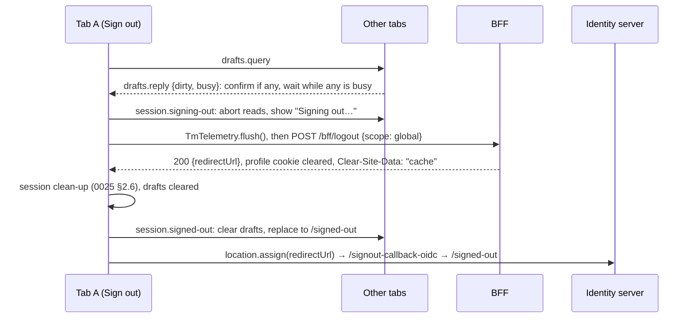

# Spec: Client App Foundation

- **Author:** Ahmad Akra
- **Date:** 20 October 2026

**Status:** Ready for implementation. Frozen once merged: revised only if implementation forces a
design change, then kept as the historical record of what shipped — never updated thereafter as the
code or its dependencies evolve.

## Context

Every Tellma distribution ships an Angular single-page app (SPA). This spec ships the framework
under it: the `@tellma/core` packages, build tool and declaration API (§1, §2), the client metadata
(§3), the boot script (§4), the service worker and updates (§5), SPA hosting (§6), localization and
theme (§7), the browser session (§8), routes (§9), the HTTP layer (§10) and error presentation
(§11). It builds on specs 0002, 0011, 0013 and 0016; specs 0025–0035 build on it.

Distribution code must stay small and mechanical, because coding agents write it at scale. A
distribution scaffolds about 110 lines once, then only declares data; routes, launcher entries,
deep links, pickers, page contexts and telemetry are derived. A warm launch renders the shell and
page chrome with no network wait, and every abandoned read is cancelled.

Other specs that carry parts of this design:

- spec 0010 §A.9, §A.10, §B.2, §B.3, §D.4–§D.6 — the account URL and sign-in language, `TmTheme`,
  the translations seam, live `Directionality`, `TM_TIME_ZONE`, `clearAll({ keep })`, the fetcher;
- spec 0011 §5.1–§5.5, §5.10, §6.1 — SPA endpoints and audit, BFF and profile cookie v2,
  `ITellmaLinks`, `emit-client-assets`;
- spec 0012 §6.1, spec 0015 §14.1 — a client abort cancels reads; a sent persist completes;
- spec 0013 §1.2, §10.4, spec 0014 §10, spec 0020 §3.7, spec 0021 §2.5 — metadata sections and
  string packs;
- spec 0016 §2.2, §3.10, §6, §7.5 — retry classes, fingerprints, headers, problem codes;
- spec 0017 §8.1 — the upload route; spec 0018 §1.4 — Acme's server feature.

## Goals / Non-goals

**Goals**

- A distribution client is about 110 scaffolded lines plus one declaration per entity, page and
  report: no route file, interceptor, guard, store, proxy or worker configuration.
- Deployment facts ship in the bundle; no initializer, guard or resolver waits on the network.
- One HTTP layer: reads are cancellable and retried by class, writes are never aborted, JSON is
  lossless, and a user check wraps every call.
- One error table for inline states and the shared dialogs.
- The browser side of sign-in, step-up, sign-out of every tab, expiry and a changed user.
- An installable PWA whose updates never interrupt; one route grammar; Node tooling that runs on
  Windows and Linux.

**Non-goals (explicitly out of scope)**

- Client state, tab bus, leader tab, hub, preferences and drafts: spec 0025.
- Telemetry, request log, page context and support: spec 0026.
- Shells, tenant picker, launcher, session menu and shortcuts: spec 0027.
- Banners and toasts: spec 0028. The entity model: spec 0029. Search and details: specs 0030, 0031.
- Generic components: spec 0023. Breakpoints, `TmTheme`, live direction and identity changes:
  spec 0010.
- Offline writes: a write needs the network, and drafts keep the work (spec 0025 §11).

## 1. Placement

This spec ships three packages and the distribution app project. `@tellma/core` splits into entry
points along the lazy-loading lines, and one import rule keeps lazy code out of the eager bundle.

Contract blocks are TypeScript and C# sketches: names and shapes are normative; imports,
documentation comments, bodies and cancellation tokens are omitted.

| Package | Folder | Holds |
|---|---|---|
| `@tellma/core` | `client/projects/core/tellma-core/` | The app framework. Peers: `@angular/{core,common,router,platform-browser,service-worker}`, `@angular/cdk`, `@jsverse/transloco`, `@tellma/core-ui`, `rxjs`. |
| `@tellma/core-testing` | `client/projects/core/tellma-core-testing/` | Test providers, fakes and Playwright helpers (below) |
| `@tellma/core-tools` | `client/projects/core/tellma-core-tools/` | Node ESM, bin `tellma-client` (§2.6); presets `/eslint`, `/tsconfig.json`, `/stylelint` (with spec 0010 §B.1's breakpoint rule) |
| The app | `distributions/<slug>/src/Tellma.Distro.<Slug>.Client/` | A member of the repo-root pnpm workspace: one Angular instance for platform and app |

`@tellma/core-testing` holds `provideTellmaTesting()` (a fake `TmApi`, a fake clock in place of
`TM_NOW`, an in-memory store, test metadata), `TmFakeApi` and `tmTestMetadata()`. Its Node entry
point `/e2e`, with the optional peer `@playwright/test`, holds `warmUp`, `holdNetwork`, `goOffline`,
`openTabs`, `signInAs`, `fakeProblem` and `expectNoAxeViolations`.

| `@tellma/core` entry point | Holds (owner) | Loaded |
|---|---|---|
| primary | this spec's API; `tmEntity` (0029), `tmCodedReport` (0034), `tmWidget` (0035), `TmTileDeclaration`, `TmCustomFilterDeclaration`, type-only `TmSearchSnapshot` (0030); the primary services of 0025–0029 | eager |
| `/shell`, `/attention` | shells and app bar (0027); bell, tray, toast policy (0028) | eager, modulepreloaded |
| `/realtime` | `TmHub` (0025) | lazy, by the leader tab |
| `/support` | dump, screenshot, support dialog (0026) | lazy, on demand |
| `/entity` | descriptor data, client Queryex, editors, filter controls, picker binding, `TmEntityActions` (0029) | lazy, shared |
| `/search`, `/details` | the search and details hosts (0030, 0031) | lazy routes |
| `/admin`, `/attention-pages` | stock pages (0032); attention pages (0028) | lazy routes |
| `/reports`, `/report-studio`, `/dashboards` | report pages, studio (0034); dashboards, home (0035) | lazy routes |
| `/private` | shared unstable wiring; no API goldens; never for app code | — |

Import rules:

- **Static imports follow one graph**, always as `@tellma/core/<ep>`, never `../`: the primary
  imports no other entry point, `/attention` only the primary, `/shell` the primary and
  `/attention`. No eager entry point imports a lazy one. An ESLint boundary rule and the package
  build enforce it; the build also refuses cycles.
- **Dynamic imports may cross the graph:** route loaders, declaration members (`details`, `search`,
  `component`, `home`), the picker binding's pages and the `/realtime` loader. `import type`
  crosses any boundary. `/shell` and `/attention` load through `import()` with `modulepreload`
  links (§2.6).
- **Packs:** a pack's primary entry point holds declarations only; layouts ship in secondary entry
  points (`@tellma/module-gl/centers`).

**Vocabulary**

- **Declaration** — a value a feature lists: an entity, page, coded report, widget type, launcher
  section or entry, settings tab or app-bar slot. **Feature** — one `tmFeature` value (§2.2).
- **Pack** — a reusable package of features, such as `@tellma/module-gl`. **String pack** — one
  language's server strings, `strings-<lang>-<h>.json` (§3.2; 0013 §10.4).
- **Client metadata** — the hashed JSON chunks the build emits from the server composition (§3).
- **Boot record** — spec 0025's `localStorage['tm.boot']`, read and patched here as `boot` (0025
  §2.1). **Profile cookie** — `tellma.profile`, the script-readable mirror of the session (§8.1).
- **Launch documents** — the tenant documents the chrome renders from, such as `me` and `settings`
  (0025 §3).
- **Warm** — the worker holds the running version's `shell` group, the cookie's `sub` equals the
  boot record's, and the tenant's launch documents are current (0025 §3.2); else **cold**.
- **Read**, **write** — the two `TmApi` call kinds: a read is cancellable and retried, a write
  neither (§10.1). **Route host** — `TmRouteHost` (§4.4). **Error view** — `TmErrorView` (§11).

## 2. What a distribution writes

A distribution writes data: one feature listing its declarations, plus scaffolded boilerplate.
Everything else is derived, and each uncommon need has a named escape hatch (§2.5).

### 2.1 File tree and scaffold

`tellma-client init <slug>` writes the boilerplate. A platform test asserts that `init acme`
reproduces Acme's files byte for byte, apart from `src/app/**`.

| Path (in `distributions/acme/src/Tellma.Distro.Acme.Client/`) | Scaffolded content |
|---|---|
| `public/` | `manifest.webmanifest` (§5.1), `icons/`, optional `brand/` overrides (§7.6) |
| `src/` | `index.html` (§4.1), `main.ts`, `app.config.ts` (§2.2), `styles.css`, `app/acme.feature.ts` (§2.3) and the layouts |
| `generated/` | gitignored; written by the emit (§3.2) |
| `main.ts` | `bootstrapTellma(appConfig)` |
| `styles.css` | imports of `@tellma/core/styles.css` and `@tellma/locale-ar/styles.css`, then Acme's one delta `@layer tm.theme { :root { --color-primary: var(--teal-700); } }` |
| `package.json` | scripts `start: tellma-client serve`, `build: tellma-client build`, `test: ng test`, `lint: eslint . && stylelint "src/**/*.css"`; `"tellma": { "migrator": "../Tellma.Distro.Acme.Migrator" }` |
| `tsconfig.json` | extends `@tellma/core-tools/tsconfig.json` (strict, strict templates) |
| absent on purpose | `app.routes.ts`, `proxy.conf.js`, `aspnetcore-https.js`, `ngsw-config.json`, `i18n/*.json`, interceptors, guards, stores |

- **`angular.json`** has one application on `@angular/build:application`, prefix `acme`: assets
  `public/**` and `generated/assets/**` (output `tm-metadata/`), `serviceWorker: false` (§5.3),
  `outputHashing: all`, a `test` target on `@angular/build:unit-test`, and no budgets (§12).
- **The esproj** uses `Microsoft.VisualStudio.JavaScript.Sdk`, with `BuildCommand`
  `pnpm run build` and `BuildOutputFolder` `dist/acme/browser`. Its `ProjectReference` to the
  Migrator sets `ReferenceOutputAssembly=false`, so the build runs with `--no-dotnet-build` (spec
  0011 §1.2).
- **`eslint.config.mjs`** re-exports `@tellma/core-tools/eslint`. Its distribution rules are
  `tm/no-raw-http` (no `fetch`, `XMLHttpRequest` or `HttpClient`), `tm/no-web-storage`,
  `tm/lazy-layouts`, `tm/literal-declaration-keys` and the slug as selector prefix.
  `tm/lazy-layouts` requires `details`, `page`, `create`, `search`, `component`, `display`,
  `dialog`, `home` and `settingsEditor` to be `() => import(…)`.

### 2.2 The distribution API

`provideTellma` takes the metadata loaders, the languages and the features; `bootstrapTellma`
starts the app.

```ts
interface TmAppConfig {
  metadata: TmMetadataLoaders;                   // generated/tellma-metadata.ts (§3.2)
  languages: readonly TmLanguageDefinition[];    // first = the distribution default
  features: readonly TmFeature[];                // packs first, the distribution last
  calendars?: readonly TmCalendarDefinition[];   // only a calendar the distribution registered on the server
}
interface TmLanguageDefinition {
  code: string; locale: string; dir: 'ltr' | 'rtl';          // 'ar', 'ar-SA', 'rtl'
  strings: () => Promise<TmStringTable>;                     // the client tables (§7.3)
}
interface TmStringTable { readonly tm: TmStringTree; readonly tmUi: TmStringTree }  // one language's client scopes
type TmStringTree = { readonly [key: string]: string | TmStringTree };
interface TmCalendarDefinition { code: string; labelKey: string; load: () => Promise<TmCalendar> } // @tellma/core-ui/l10n
declare function tmEnglish(options?: { locale?: string }): TmLanguageDefinition; // 'en'; locale default 'en-GB'
declare function provideTellma(config: TmAppConfig): EnvironmentProviders;
declare function bootstrapTellma(appConfig: ApplicationConfig): Promise<ApplicationRef>;

interface TmFeatureDefinition {
  key: string;                                         // 'gl', 'acme': the server feature's name
  sections?: readonly TmNavSection[];                  // launcher sections (0027 §3.1)
  entries?: readonly TmNavEntry[];                     // entries beyond entities, pages, reports (0027 §3.1)
  entities?: readonly TmEntityDeclaration[];           // 0029 §3
  pages?: readonly TmPageDeclaration[];                // §2.4
  reports?: readonly TmCodedReportDeclaration[];       // 0034 §2.2
  widgets?: readonly TmWidgetTypeDeclaration[];        // 0035 §4.3
  settingsTabs?: readonly TmSettingsTabDeclaration[];  // 0032 §7.5
  appBar?: readonly TmShellSlot[];                     // 0027 §7.2
  icons?: Readonly<Record<string, TmIconSource>>;      // added to 0023's TmIconRegistry
  overrides?: readonly TmDeclarationPatch[];           // patches of earlier keys (§2.3)
  hide?: readonly TmDeclarationKey[];                  // earlier keys to drop (§2.3)
  home?: TmLazyComponent;                              // 0035 §2.3
  providers?: readonly (Provider | EnvironmentProviders)[]; // the "anything Angular" hatch
}
type TmDeclarationKey = `${'entity' | 'page' | 'report' | 'widget' | 'section' | 'entry' | 'settingsTab' | 'appBar'}:${string}`;
type TmDeclarationPatch = TmEntityDeclaration | TmPageDeclaration | TmCodedReportDeclaration | TmWidgetTypeDeclaration | TmOverride;
declare function tmFeature(definition: TmFeatureDefinition): TmFeature;
declare function tmOverride(key: TmDeclarationKey, members: Readonly<Record<string, unknown>>): TmOverride; // members replace the key's
type TmLazyComponent = () => Promise<Type<unknown> | { default: Type<unknown> }>;
type TmSecurableRef = readonly [resource: string, action: string];
declare const TM_APP_DECLARATIONS: InjectionToken<TmAppDeclarations>; // the merged declarations of every kind
interface TmAppDeclarations {                    // merged, hide-applied (§2.3)
  entities: ReadonlyMap<string, TmEntityDeclaration>; pages: readonly TmPageDeclaration[];
  reports: readonly TmCodedReportDeclaration[]; widgets: readonly TmWidgetTypeDeclaration[];
  sections: readonly TmNavSection[]; entries: readonly TmNavEntry[];
  settingsTabs: readonly TmSettingsTabDeclaration[]; appBar: readonly TmShellSlot[];
  features: readonly string[];                   // the feature keys, core first
  home: TmLazyComponent | null;                  // the winning home
}
```

- **`TM_APP_DECLARATIONS`** is the one token through which shells and hosts read declarations.
- **`bootstrapTellma`** calls `bootstrapApplication(TmApp, …)` with zoneless change detection,
  `provideBrowserGlobalErrorListeners()` and `appConfig.providers`. It never settles while
  `tm-boot.js` redirects or shows the boot page (§4.3).
- **`provideTellma`** provides:
  - the derived router (§9.2);
  - `provideTellmaUi` with the translation loader (§7.3) and the theme seed (§7.6);
  - `TM_ACTIVE_LOCALE`, `TM_CALENDAR` and `TM_TIME_ZONE` (§7.1), `TM_NOW` (`Date.now`),
    `TM_BLOB_FETCHER` (§10.5), `TM_CLIENT_METADATA` and `TM_APP_DECLARATIONS`;
  - `TmErrorHandler` as Angular's `ErrorHandler` (0026 §4.1);
  - `provideTellmaToasts({ maxVisible: 3, overflow })`, with spec 0028 §8.1's overflow action;
  - the platform's icon names and each feature's `icons`;
  - the boot initializers (§4.3) and the worker (§5.4);
  - each feature's `providers`, in order, then `TmTitleStrategy` (§4.4).
- **The "anything Angular" hatch:** providers listed after `provideTellma(…)` win.
- **Configuration problems:** every rule of §2.2–§2.4 and §3.5 has a code in Appendix A, checked
  by §3.6.

**Example —** Acme's whole `app.config.ts` is one call:

```ts
provideTellma({
  metadata: tellmaMetadata,
  languages: [tmEnglish(), tmArabic({ locale: 'ar-SA' })],
  features: [tmGlFeature(), acmeFeature],
})
```

### 2.3 The merge rule

Features merge in order, and each declaration has one key. A later feature changes an earlier key
only through `overrides` and `hide`. Every violation is a configuration problem (Appendix A).

- **Order.** The implicit `core` feature comes first, then `features` in array order. `core` holds
  the stock pages and sections of specs 0026, 0028, 0032, 0034 and 0035.
- **Keys.** An entity is keyed by name, a page by path, a coded report or widget type by key, a
  section or entry by id, a settings tab by category and an app-bar slot by id. The launcher entry
  derived from an entity, page or report takes its key as id (`entry:acme.Customer`). Adding an
  existing key is `duplicate-key`.
- **Overrides** patch an earlier key member by member. A member the patch sets replaces the
  inherited one whole (arrays are replaced, never concatenated); an unset member inherits. A
  `tmEntity`, `tmPage`, `tmCodedReport` or `tmWidget` value patches its own key; `tmOverride`
  patches a section, entry, settings tab or app-bar slot. Patching a missing key is
  `dangling-override`.
- **Hide** drops by kind. `entity:` drops the entity's routes, launcher entry and picker. `entry:`
  drops only the launcher entry, so the pages stay reachable. `section:` drops a section and its
  entries from the launcher. Other kinds drop the declaration. Hiding a missing key is
  `dangling-hide`.
- **`home` and `appBar`.** The last feature that sets `home` wins. All features together have at
  most three app-bar slots, and `help` and `assistant` are reserved ids (0027 §7.2).

**Example —** in `acmeFeature`:

- `hide: ['entry:core.Role']` removes the Roles launcher entry, for a distribution with one fixed
  role set. `/{t}/roles` still opens.
- `overrides: [centersOverride, tmOverride('section:administration', { order: 10 })]` patches the
  Centers declaration (spec 0032 §6). It also moves the Administration section (order 900, spec
  0027 §3.2) to the front of the launcher.

### 2.4 `tmPage`

`tmPage` declares a page with no entity behind it. The platform gives it a route, a launcher entry,
a title, a page context and the permission gate.

```ts
declare function tmPage(path: string, page: {
  component: TmLazyComponent; titleKey: string;
  section?: string; order?: number; icon?: string; synonymsKey?: string; // launcher members (0027 §3.1)
  securable?: TmSecurableRef;                                             // the permission gate
}): TmPageDeclaration;
```

- **`path`** is kebab-case segments, each matching `^[a-z][a-z0-9]*(-[a-z0-9]+)*$`, optionally
  ending in `:name` parameters (`bank-reconciliation/:accountId`). The first segment is no reserved
  word (§9.1) or `new`, and is an entity segment only when the same feature declares that entity
  (§9.2). A page with parameters takes no `section`, since its launcher entry would have no URL.
- **The route** is `/{t}/{path}`, with skeleton `blank` and page kind `custom` (§4.4). Parameters
  reach the component as inputs.
- **`securable`.** When `TmPermissions.can(resource, action)` (0029 §7) is false, the route renders
  the `forbidden` error view (§11) in place; it never redirects. On a cold entry, the route host
  checks it only after the wait for the launch documents (§4.4).

**Example —** Acme's `tmPage('bank-reconciliation', { component, titleKey, section: 'financials' })`
gives the route `/17/bank-reconciliation` and a launcher entry under Financials.

### 2.5 Escape hatches owned here

| Need | Hatch |
|---|---|
| A page with no entity | `tmPage(path, …)` (§2.4) |
| A hand-mapped endpoint | `inject(TmApi).read(…)` or `.write(…)` (§10.1) |
| A calendar the platform lacks | `calendars: [{ code, labelKey, load }]` in `provideTellma` |
| Relabel, reorder or hide a platform item | `overrides` with `tmOverride`, and `hide` (§2.3) |
| Branding | the manifest, `public/icons/`, `public/brand/`, `@layer tm.theme` (§5.1, §7.6) |
| Anything Angular | `providers` on `tmFeature`, or providers after `provideTellma` |

The other hatches belong to their members' owners: 0027–0032, 0034 and 0035, each in its §2.

### 2.6 `tellma-client` commands

Five Node commands cover the developer loop and the build. The exit code is 0 for success, 1 for a
usage error, 2 for a build failure and 3 for configuration or drift problems. Each problem prints
as one `code key feature` line.

| Command | Does |
|---|---|
| `init <slug>` | Writes §2.1's boilerplate with Tellma's default icons and brand files. |
| `emit [--configuration c] [--no-dotnet-build]` | Runs the Migrator's `emit-client-assets generated` (spec 0011 §6.1). |
| `serve [--port n]` | Runs the development server (below). |
| `build [--no-dotnet-build]` | Runs the production build (below). |
| `check` | Budgets (§12), the manifest lint (§5.1), hashed names (§6), the `index.html` rules (§4.1), brand files (§7.6). |

**`serve`** runs `emit` and exports the ASP.NET Core development certificate. It serves on
`<SLUG>_CLIENT` from `.dev-ports.local`, else 4200, and proxies the server words of
`metadata.routing`, websockets included, to `<SLUG>_WEB`, else 7052. It sets no CSP and registers
no worker. In Acme, it first runs the platform's generated-asset steps (`tokens:build-css`).

**`build`** runs these steps in order:

1. `emit`, the config check (§3.6) and `ng build --stats-json`;
2. copies the brand files (§7.6) and writes `tm-boot.js` (§4.2);
3. injects preloads: fonts for Latin and each offered language's script, from the fragment map
   that moves from `client/scripts/inject-font-preloads.mjs` into `@tellma/core-tools`;
   `<link rel="preload" as="fetch" crossorigin>` for the Core chunk and the default language's
   string pack; `<link rel="modulepreload">` for `/shell`, `/attention` and their static imports;
4. writes the worker config (§5.3);
5. moves the hidden source maps to `dist/<slug>/sourcemaps/`, outside the deployable output; CI
   archives them per UI version (0026 §4);
6. runs `check`.

## 3. Client metadata

The client metadata are the deployment facts the SPA needs before any request. The Migrator emits
them at build time as hashed JSON chunks. This spec owns the container, the emit and the checks;
each section's shape belongs to its domain spec.

### 3.1 The container

```ts
interface TmClientMetadata {                                // the Core chunk
  formatVersion: 1;
  distribution: { slug: string; displayName: string; copyright: string | null; version: string; platformVersion: string };
  features: readonly { key: string; version: string }[];    // composition order
  languages: readonly TmLanguageMetadata[];                 // 0013 §1.2; [0] is the default
  calendars: readonly string[];                             // 0013 §1.2; [0] is the default; 'gc', 'uq', 'et'
  entities: readonly TmEntitySummary[];                     // 0029 §2.2
  securables: readonly TmSecurableMetadata[];               // 0014 §10
  settingKeys: readonly TmSettingKeyMetadata[]; settingCategories: readonly TmSettingCategoryMetadata[]; // 0013 §5.3
  notificationTypes: readonly TmNotificationTypeMetadata[]; // 0021 §2.5, with the next two
  notificationChannels: readonly { key: string; defaultEnabled: boolean }[]; clientEvents: readonly string[];
  jobHandlers: readonly TmJobHandlerMetadata[];             // 0020 §3.7
  widgetTypes: readonly string[];                           // 0035 §4.1
  routing: {                                                // TellmaRoutes (§3.2)
    serverFirstSegments: readonly string[]; serverTenantSegments: readonly string[];
    spaFirstSegments: readonly string[]; spaTenantSegments: readonly string[];
  };
}
interface TmMetadataLoaders {                               // the emitted module
  core: () => Promise<TmClientMetadata>;
  entities: () => Promise<readonly TmEntityMetadata[]>;     // 0029 §2.2
  contracts: () => Promise<Readonly<Record<string, string>>>;                         // route template → fingerprint
  strings: Readonly<Record<string, () => Promise<Readonly<Record<string, string>>>>>; // one string pack per language
}
declare const TM_CLIENT_METADATA: InjectionToken<TmClientMetadata>;
```

- **`distribution.version`** is the UI version (0026 §7): the composition library's informational
  version, `X.Y.Z+<sha>`. Each distribution has one `Version`, in
  `distributions/<slug>/Directory.Build.props`, which makes the Web host's `Tellma-Build` equal it.
- **`platformVersion`** is `Tellma.Core`'s version; each `features[].version` is its feature
  assembly's.
- **`displayName` and `copyright`** come from `Tellma:DisplayName` and `Tellma:Copyright` in the
  Migrator's `appsettings.json`. `DistributionInfo` (spec 0011 §5.9) stays the runtime source.
- **Every section is tenant-independent.** `TmEntities` gates the entity sections by the tenant's
  shape (0029 §4.2).

### 3.2 The emit command (C#)

```csharp
// Tellma.Core.Abstractions.Client — each section owner implements one
public interface IClientAssetContributor { void Contribute(ClientAssetContext context); }

public sealed class ClientAssetContext
{
    public IServiceProvider Services { get; }        // the realised composition; no I/O
    public void Section(ClientMetadataChunk chunk, string name, Action<Utf8JsonWriter> write); // one member of a chunk
    public void File(string relativePath, string content);  // generated code under generated/ (0029 §15)
}

public enum ClientMetadataChunk { Core, Entities, Contracts }

// Tellma.Core.Abstractions.Composition — the one source of reserved route words (§9.1)
public static class TellmaRoutes
{
    public static IReadOnlyList<string> ServerFirstSegments { get; }   // api, bff, health, id, mcp, openapi, signin-oidc, signout-callback-oidc, .well-known
    public static IReadOnlyList<string> ServerTenantSegments { get; }  // api, hub, blobs, mcp
    public static IReadOnlyList<string> SpaFirstSegments { get; }      // tenants, signed-out
    public static IReadOnlyList<string> SpaTenantSegments { get; }     // settings, me, list
    public const string NewSegment = "new";
}
```

`dotnet run --project <Migrator> -- emit-client-assets <dir>` realises the composition with no
database, hosted service or connection (spec 0011 §6.1). It writes:

- `generated/tellma-metadata.ts`, the loaders module:
  `tmMetadataLoaders({ core: 'tm-metadata/core-K3J7Q2M9X1BA.json', … })`;
- `generated/tellma-entities.d.ts` (0029 §15);
- `generated/assets/{core,entities,contracts}-<h>.json` and `strings-<lang>-<h>.json`, where `<h>`
  is the first 12 base32 characters of SHA-256 over the file.

Three rules govern these files:

- **Deterministic output.** Sorted keys, invariant culture, `\n` and no timestamps keep bytes and
  names stable, so an unchanged build busts no cache.
- **Loaders.** A loader fetches with `fetch(url, { credentials: 'same-origin' })` and
  `JSON.parse`. A failure rejects, and the boot page shows (§4.3).
- **Who writes what.** This spec's `CoreFeature` contributor writes `distribution`, `features` and
  `routing`. Every other section and the string packs come from the owners named in §3.1's sketch;
  the Entities chunk and the `.d.ts` come from 0029 §2.1.

### 3.3 Loading

| When | What |
|---|---|
| before first render | the Core chunk and the string packs of the active language and English (§7.3); `/signed-out` loads neither (§6) |
| before the first API call | the Contracts chunk, awaited once by `TmApi` |
| on entity routes | the Entities chunk, through `TmEntities.load()` (0029 §4.1), awaited by the route host beside the page chunk (§4.4) |

Every chunk sits in the worker's `shell` group, so a warm launch reads it from CacheStorage. On a
cold launch, the preload links fetch Core and the default language's string pack with the
JavaScript. `TM_CLIENT_METADATA` is the loaded Core chunk; injecting it earlier throws in
development.

### 3.4 Contracts

The Contracts chunk is spec 0016 §3.10's map from route template to fingerprint; a route template
looks like `POST /{tenantId}/api/web/centers/query`. It is the same map as the checked-in
`contracts.json`, and spec 0016 pins their parity.

- `TmApi` sends the call's fingerprint as `Tellma-Contract` (§10.2).
- The map carries no retry class: the call site picks `read` or `write`, and `long` (§10.1).

### 3.5 Drift rules

`tellma-client build` fails with exit 3 when the declarations disagree with the emitted server
facts. Appendix A lists every code. Drift means any of:

- a language or calendar without a client definition;
- a client feature the server does not compose;
- a declaration naming an unknown entity, path, action, setting category or widget type;
- a page path that takes a reserved word.

### 3.6 The config check

One function checks the merged configuration against the metadata. It runs in Node during the
build, and at startup in development.

```ts
interface TmConfigProblem {
  readonly code: TmConfigProblemCode; readonly severity: 'error' | 'warning'; // Appendix A's closed list
  readonly key: string; readonly feature: string; readonly message: string;   // 'page:centers/map', 'acme', the text
}
declare function tmCheckAppConfig(config: TmAppConfig, metadata: TmClientMetadata, entities: readonly TmEntityMetadata[]): readonly TmConfigProblem[];
declare function tmAppConfigOf(appConfig: ApplicationConfig): TmAppConfig | null; // the config provideTellma received
```

- **In the build.** After the emit, a Node step loads `src/app.config.ts` through `tsx` and takes
  the config with `tmAppConfigOf`. It reads the Core and Entities chunks and calls
  `tmCheckAppConfig`, which also runs 0029's `tmCheckEntityDeclaration`. Declarations are plain
  objects whose lazy members are never called, so no browser and no Angular compiler run. Errors
  fail the build; `label-missing` warnings (0029 §2.4) print and pass.
- **At startup.** In development, the boot initializer runs the same function and throws
  `TmConfigError` listing every problem. In production it emits each problem as
  `tm.config.problem { code }`.

## 4. Boot

Before Angular starts, a blocking script reads the profile cookie and the boot record. With no
network, it decides the session, language, direction, theme and launch target. Angular then awaits
only local reads before its first render.

### 4.1 `index.html`

```html
<!doctype html>
<html lang="en">
  <head>
    <meta charset="utf-8" />
    <meta name="viewport" content="width=device-width, initial-scale=1, viewport-fit=cover" />
    <meta name="color-scheme" content="light dark" /> <meta name="theme-color" content="#001722" />
    <title>Acme</title>
    <link rel="manifest" href="manifest.webmanifest" /> <link rel="icon" href="icons/favicon.svg" type="image/svg+xml" />
    <script src="tm-boot.js"></script>
  </head>
  <body><tm-app></tm-app></body>
</html>
```

The scaffold carries the `tm-boot.js` tag, and `build` generates the file (§4.2).
`tellma-client check` fails when `tm-boot.js` is not the first script in `<head>`, when
`<tm-app>`, the manifest link or the `color-scheme` meta is missing, or when any inline script
exists.

### 4.2 `tm-boot.js`

`tm-boot.js` is a blocking classic script of at most 3 KB gzip. `tellma-client build` generates it
from `@tellma/core/boot/tm-boot.template.js` by replacing one marker with the JSON literal
`TM_BOOT` below. Its logic is a pure function `tmBoot(env)` over an injected environment (cookie
string, storages, location, navigator facts); the generated file calls it with the real globals.

```js
var TM_BOOT = {"v":1,"languages":[{"code":"en","dir":"ltr"},{"code":"ar","dir":"rtl"}],"defaultLanguage":"en",
  "strings":{"en":{"Boot_Title":"Tellma couldn't start", …},"ar":{…}}};  // the boot page's strings per language
```

The script reads:

- `TM_BOOT`;
- the profile cookie, treated as absent when it fails to decode, has `v ≠ 2` or has an empty `sub`;
- the boot record, treated as absent when it is invalid JSON or has `v ≠ 1`;
- the sign-in loop guard `sessionStorage['tm.login'] = { at, expired }`;
- `location`, `navigator.languages`, `navigator.cookieEnabled` and `prefers-color-scheme`;
- the feature gate: `navigator.locks`, `BroadcastChannel` and `indexedDB`.

The script writes:

- `<html lang dir data-theme>` before first paint, where `data-theme` is `light` or `dark`;
- a fresh boot record `{ v: 1, theme, lang, dir, sub: null, lastTenantId: null }` when none exists
  or its `sub` differs from the profile's; the app writes `sub` later (§8.1);
- `window.__tmBoot = { state: 'run' | 'redirect' | 'page', profile, record, cold, at }`, which
  `bootstrapTellma` reads.

The decision steps run in order; the first that applies ends the script:

| Step | When | Then |
|---|---|---|
| 1 | a gated feature is missing | the boot page, reason `unsupported` |
| 2 | the path is `/signed-out` | apply `lang`, `dir` and `theme` from the record, else step 4's cold choice; state `run` (no cookie needed) |
| 3a | no valid cookie, and cookies are disabled | the boot page, reason `cookies` |
| 3b | no valid cookie, and `tm.login` was set less than 60 s ago | the boot page, reason `sign-in-failed` |
| 3c | no valid cookie, and the record names a `sub` (the session expired) | the expiry delete (below); continue to 3d |
| 3d | no valid cookie | set `tm.login = { at: Date.now(), expired }` and `location.replace('/bff/login?returnUrl=' + encodeURIComponent(pathname + search) + '&ui_locales=' + lang)`; state `redirect` |
| 4 | a valid cookie | remove `tm.login`; choose warm or cold, the language, the theme and the target (below); state `run` |

- **The expiry delete (3c).** The script deletes that user's data by spec 0025 §2.2's frozen
  layout, taking at most 1 s in all. It opens `tm-app` without a version, aborting when
  `onupgradeneeded` reports `oldVersion = 0`. It deletes the user's key range and the
  `tm-images-v1` cache. Then it nulls the record's `sub` and `lastTenantId`.
- **A valid cookie (4).** The launch is cold without a record or when `record.sub ≠ profile.sub`.
  - Language, warm: `record.lang`.
  - Language, cold: the profile's `locale` matched by language subtag against the offered list,
    else `record.lang`, else the first offered `navigator.languages` entry, else the default.
  - `dir` follows the language. Theme: `record.theme`, else `system`.
  - Warm at `/` with a `lastTenantId`: `history.replaceState` to `/{lastTenantId}`.

**Example —** Farah returns to `/17/centers` after nine days: step 3c deletes her data and 3d
replaces the page with `/bff/login?returnUrl=%2F17%2Fcenters&ui_locales=ar`.

**The boot page** is one page for every reason. The script builds it at `DOMContentLoaded` inside
`<tm-app>` with DOM APIs and no HTML strings, so Trusted Types need nothing; `.tm-boot-page` styles
it. A `main` landmark holds the `h1` "Tellma couldn't start", one sentence and a Try again button,
with focus on the heading. It renders in the boot language with English fallback, with `lang` and
`dir` set.

| Reason | Sentence | Try again |
|---|---|---|
| `unsupported` | "Update your browser to a current version of Chrome, Edge, Firefox or Safari." | reloads |
| `cookies` | "Turn on cookies for this site, then try again." | reloads |
| `sign-in-failed` | "We couldn't sign you in. Try again in a moment." | clears `tm.login`, runs 3d |
| `load-failed` | "Check your connection and try again." | reloads |

Core's resx carries these strings as `Boot_Title`, `Boot_Unsupported`, `Boot_Cookies`,
`Boot_SignInFailed`, `Boot_LoadFailed` and `Boot_TryAgain`. `build` copies them from the emitted
string packs into `TM_BOOT`.

### 4.3 The startup sequence

1. **Gate.** `bootstrapTellma` returns a promise that never settles unless `__tmBoot.state` is
   `run`.
2. **Initializers.** `bootstrapApplication(TmApp, …)` runs its initializers in parallel:
   - the Core chunk;
   - the active language's tables and string pack, and English's (§7.3); on `/signed-out` only the
     active language's tables load (§6);
   - `TmSession` parses the cookie;
   - `TmClientStore` opens and runs its boot step's one store read: the user partition and, on a
     tenant path, the tenant partition (0025 §2.6).

   A cached calendar other than `gc` imports its entry point next.
3. **First render.** Initial navigation, then first render: `tm-app`, the shell (0027), the route
   host's skeleton, then the page. On a cold entry the page comes after the launch documents (§4.4).
4. **After first render:** worker registration (§5.4), the Contracts chunk, and idle preloads
   through `TmUrls.preload`. Spec 0027 calls `preload` for pins, recents and home.

- **No network before a warm render.** No initializer, guard or resolver awaits `TmApi`, so a warm
  launch has no network wait.
- **At most two waits when cold,** each under a skeleton: the launch redirect at `/` (§9.3) and the
  cold tenant entry (§4.4).
- **Load failure.** A Core or string load that rejects shows the boot page with reason
  `load-failed` and emits `tm.boot.load-failed { chunk }`.
- **Launch timing.** Each launch emits `tm.launch.cold` or `tm.launch.warm`, with the time from
  navigation start to chrome rendered and the `routeKind`.

### 4.4 `TmApp` and the route host

The route host is the component of every page route. It draws the page's skeleton in the click's
frame, loads the page and gives it a page scope.

```ts
interface TmRouteData {
  readonly kind: TmPageKind;                         // 0026 §9.1
  readonly skeleton: 'search' | 'details' | 'report' | 'dashboard' | 'home' | 'blank';
  readonly load?: TmLazyComponent;                   // static pages; entity routes resolve their host
  readonly titleKey?: string; readonly securable?: TmSecurableRef;
}
```

- **`tm-app`.** `TmApp` renders the `<router-outlet>`, the session-ended dialog (§8.6) and the
  signing-out overlay (§8.4); shells are route components (0027). `<html dir>` is the live
  direction host (0010 §B.3), so `tm-app` wraps nothing in `[dir]`.
- **Skeleton.** The host draws it in the click's frame, on 0023's `page-header` layout, with the
  final geometry of the host that replaces it; the page specs pin zero shift. Then the host loads
  the page and creates it with `NgComponentOutlet`.
- **Cold entry.** On a tenant route while `TmLaunchCache.warm()` is false, the host keeps the
  skeleton and awaits the cold refresh of 0025 §3.2 before it creates the page. The page chunk and
  `TmEntities.load()` load meanwhile; the page's data read starts after the refresh. So no page,
  `tmPage` permission gate (§2.4) or home ever runs before the first `me` and `settings`. A failed
  refresh follows 0025 §3.2's failure rows, and a warm entry awaits nothing.
- **Entity routes.** The host finds the entity with `TmEntities.bySegment` and awaits
  `TmEntities.load()` beside the page chunk (cache reads when warm). It then loads `TmSearchHost`
  or `TmDetailsHost`, which host the declaration's `search` and `details` hatches (0030 §2.5, 0031
  §3.7). The tenant root loads 0035's `TmHomeHost`, which picks the `home` hatch or the default.
- **Page scope.** Each page gets `provideTmPageScope()` (0026 §9.2). On a `tmPage` route the host
  adds a `custom` context, unless the page registers its own: the title comes from `titleKey`, and
  `status` is `ready` once rendered.
- **Failure.** A chunk that fails to load runs `TmUpdates.check()`, then shows the error view
  `client-outdated` or `offline` inline (§11).
- **Title and focus.** `TmTitleStrategy` sets `document.title` to `<page title> · <displayName>`.
  On a path change, never a query-only change, focus moves to the page's `[tmPageTitle]` heading
  (`tabindex="-1"`) once it renders, else to `main`.

**Example —** Farah opens a link to `/17/centers/5` from an email. Her launch documents for tenant
17 are not current, so the entry is cold:

1. The details skeleton shows in the first frame.
2. The details chunk and the Entities chunk load while 0025's cold refresh fetches `me` and
   `settings`.
3. Only after the refresh does the host create the details page, which starts its read. Farah never
   sees a forbidden flash or a missing column.

## 5. PWA, service worker and updates

The app is an installable PWA. Angular's service worker caches the whole app except three on-demand
sets, so a warm launch reads everything from CacheStorage. Updates download in the background and
apply at the next reload.

### 5.1 The manifest

`init` scaffolds `public/manifest.webmanifest`. It sets `id`, `start_url` and `scope` to `/`;
`name` and `short_name` to "Acme"; `display: standalone`, `dir: auto` and `lang`;
`background_color` and `theme_color` to `#001722`; and the icons `icons/icon-192.png`,
`icon-512.png` and `icon-maskable-512.png` (`purpose: maskable`). `start_url: /` runs the launch
redirect (§9.3).

`tellma-client check` requires those members, a `short_name` of at most 12 characters, and the
icons at their stated pixel sizes, read from the PNG headers. It refuses
`prefer_related_applications: true`.

### 5.2 The installability gate

A nightly Playwright run in Chromium against Acme's production build is the gate. It requires an
empty list from the DevTools protocol's `Page.getInstallabilityErrors` and no errors from
`Page.getAppManifest`. Lighthouse has no PWA category; the install prompt needs the `fetch` handler
Angular's worker has.

### 5.3 The generated worker config

`tellma-client build` writes `ngsw-config.json` and runs `ngsw-config` (the `@angular/service-worker`
bin) over the final output. It runs after every file is in place, so every hash matches.

| Setting | Value |
|---|---|
| `appData`, strategy | `{ version, platformVersion }`; `navigationRequestStrategy: performance` |
| data groups | none: the API is POST-only, and blobs use the HTTP cache and `tm-images-v1` |
| `navigationUrls` | derived from the `routing` words: `/**` minus `/**/*.*`, `/**/*__*`, `/**/*__*/**`, `/bff/**`, `/api/**`, `/id/**`, `/signin-oidc`, `/signout-callback-oidc`, `/health/**`, `/.well-known/**`, `/openapi/**` and `/*/{api,hub,blobs,mcp}/**` |
| `on-demand` (`lazy`, `lazy`) | the chunks reachable only through the ECharts engine's dynamic import, `@tellma/core/report-studio` or `@tellma/core/support`; the manifest and icons |
| `shell` (`prefetch`, `prefetch`) | everything else: every other chunk (read from `stats.json`), styles, the Latin and offered-script fonts, `brand/*`, every `tm-metadata/*` file |

The metadata chunks need the session cookie (§6), and the first install runs after first render,
signed in. An update attempted while signed out fails on them and retries at the next check.
Angular never activates a half-cached version.

### 5.4 Registration

```ts
provideServiceWorker('ngsw-worker.js', { enabled: !isDevMode(), registrationStrategy: () => tmRegisterWorker() });
```

`tmRegisterWorker()` waits for first render and `ApplicationRef.whenStable()`, at most 30 s. It then
calls `navigator.serviceWorker.register(url, { scope: '/', updateViaCache: 'none' })` with a
`TrustedScriptURL`, and returns an observable that never emits. So Angular never registers with a
plain string, which enforced Trusted Types refuse.

- **The `tellma` policy.** `@tellma/core` creates the Trusted Types policy `tellma` lazily, with
  `createScriptURL` only. It admits exactly the same-origin `/ngsw-worker.js` and throws otherwise.
- **No worker.** Without `navigator.serviceWorker` nothing registers, and every launch is cold. A
  rejected registration emits `tm.sw.register-failed`.

### 5.5 `TmUpdates`

```ts
declare class TmUpdates {
  readonly enabled: boolean;                        // a worker controls this page
  readonly version: Signal<string | null>;          // its appData.version
  readonly available: Signal<string | null>;        // a newer version, ready to apply
  check(): Promise<'ready' | 'none' | 'disabled'>;  // asks the worker; settles when its check does
  reload(): void;                                   // location.reload(); drafts survive (0025 §11)
}
```

| Event | Behaviour |
|---|---|
| checks | the worker checks `ngsw.json` at start and on navigations; `TmUpdates` also checks when the tab becomes visible after an hour or more hidden, every 6 hours while visible, and on demand (§5.6) |
| `VERSION_READY` | sets `available` and shows the banner `tm.update` (0028 §9.5); running tabs keep their version, and a reload or a new tab gets the new one; emits `tm.sw.update-ready { fromVersion }` |
| `unrecoverable` | reloads at once, drafts being in session storage; emits `tm.sw.unrecoverable` |
| `VERSION_INSTALLATION_FAILED` | emits `tm.sw.install-failed`; the next check retries |

### 5.6 An outdated client (412 and route-not-found)

A changed endpoint refuses an old tab's call with `412 client-outdated` before anything runs. A
route the server no longer maps answers `404 route-not-found` (spec 0016 §3.10, §7.5). On either,
`TmApi` asks the worker whether a new version exists and reports one of two codes; §11 owns the
copy.

| `TmUpdates.check()` | Code | A read | A write |
|---|---|---|---|
| `ready` | `client-outdated` | inline, with Reload | the dialog with Reload; the draft survives the reload |
| `none` (an older instance during a slot swap) | `server-outdated` | retried once after 30 s, then inline | the dialog; never retried |
| `disabled` (no worker) | `client-outdated` when the 412's `Tellma-Build` differs from the UI version, else `server-outdated` | as above | as above |

Telemetry: `tm.api.client-outdated { verdict }`.

## 6. SPA hosting rules

These rules fix what the server answers to every browser request that is not an API call. Spec
0011 §5.1 implements them in `MapTellma`.

| Response | `Cache-Control` | Access |
|---|---|---|
| `index.html`, as a file or the fallback | `no-cache`, with an ETag | anonymous |
| Hashed JS, CSS, fonts, string packs (`tm-metadata/strings-*`) | `public, max-age=31536000, immutable` | anonymous |
| Metadata chunks (`tm-metadata/core-*`, `entities-*`, `contracts-*`) | `private, max-age=31536000, immutable` | the session cookie (`Tellma.Web`); 401 without |
| `ngsw.json`, `ngsw-worker.js`, `safety-worker.js`, `tm-boot.js`, `manifest.webmanifest`, icons, `brand/*` | `no-cache` | anonymous |

- **Static files** are endpoint-routed through `MapStaticAssets`, with Brotli and gzip variants
  built at publish and ETags. They are stamped `TenantlessEndpointMetadata("spa-assets")`.
- **Hashed names.** A name is hashed when a `-` and at least eight `[A-Z0-9]` precede the
  extension. `check` fails a JS, CSS, font or `tm-metadata` file without one.
- **Metadata behind the cookie.** The metadata chunks describe every entity, action, securable and
  setting key of the distribution. `private` keeps shared caches from serving them to anyone else.
  `/signed-out` loads none of them: it renders from the bundle's strings and `index.html`'s title.
- **The fallback.** The server answers with `index.html` only for a `GET` or `HEAD` that has
  `Sec-Fetch-Mode: navigate`, or lacks that header and accepts `text/html`. The first segment must
  not be in `ServerFirstSegments`, and under an integer first segment the second must not be in
  `ServerTenantSegments`. Any other unmatched request gets a problem body: `404 route-not-found`
  under an integer first segment, else `404 not-found`.
- **`index.html` headers:** `Referrer-Policy: strict-origin-when-cross-origin`,
  `X-Content-Type-Options: nosniff`, `Cross-Origin-Opener-Policy: same-origin`,
  `Permissions-Policy: camera=(), microphone=(), geolocation=(), display-capture=(self)`, and the
  CSP below.
- **CSP variations.** `connect-src` adds Azure SignalR's origins when
  `Azure:SignalR:ConnectionString` is set. `form-action` adds the authority only in Standalone
  identity mode. Inline styles are allowed because Angular inserts component styles and a cached
  `index.html` cannot carry a nonce.

```text
default-src 'self'; script-src 'self'; style-src 'self' 'unsafe-inline'; img-src 'self' data: blob:;
font-src 'self'; connect-src 'self' <Azure SignalR https:// and wss:// origins>; frame-src 'self' blob:;
frame-ancestors 'none'; form-action 'self' <authority origin>; base-uri 'self'; object-src 'none';
worker-src 'self'; manifest-src 'self'; require-trusted-types-for 'script'; trusted-types angular angular#bundler tellma
```

## 7. Localization and theme

`TmLocalization` decides the active language, locale, direction, calendar, content slot and display
time zone from the launch documents. It switches them in place, with no reload and no request.
String tables ship in the bundle; the theme is a device setting.

### 7.1 `TmLocalization`

```ts
declare class TmLocalization {
  readonly language: Signal<string>;                           // 'ar'
  readonly locale: Signal<string>;                             // 'ar-SA'
  readonly dir: Signal<'ltr' | 'rtl'>;
  readonly calendar: Signal<TmCalendar>;
  readonly calendarCode: Signal<string>;                       // 'gc' | 'uq' | 'et' | …
  readonly contentSlot: Signal<1 | 2 | 3>;                     // which Name slot the active language reads
  readonly timeZone: Signal<string>;                           // IANA; the zone instants display in
  readonly languages: Signal<readonly TmLanguageDefinition[]>; // what the language switch offers here
  readonly calendars: Signal<readonly string[]>;               // what the calendar switch offers here
  setLanguage(code: string): void; setCalendar(code: string): void;
}
```

| Value | Tenantless shell | In a tenant |
|---|---|---|
| `language` | `boot.lang` if offered, else the default | `me.PreferredLanguage` if offered → `boot.lang` if offered → the tenant's primary language → the default |
| `languages` | the offered languages | the tenant's content languages, plus the active one when it is not among them |
| `locale` | the definition's `locale` (`ar` formats as `ar-SA` in Acme) | the same |
| `calendarCode` | `gc` | `me.PreferredCalendar` if in the tenant's pair, else the tenant's primary |
| `calendars` | `['gc']` | the tenant's pair |
| `contentSlot` | 1 | the content language whose language subtag equals the active one's, else 1 (0013 §9.2) |
| `timeZone` | the browser's resolved zone | `me.PreferredTimeZone`, else the settings' `TimeZone` |

- **Inputs follow the launch documents** (0025 §3), so a language changed in another tab
  converges here.
- **Tokens mirror the signals.** `TM_ACTIVE_LOCALE` is `locale`, `TM_CALENDAR` is `calendar` and
  `TM_TIME_ZONE` is `timeZone` (0010 §D.4). Transloco's active language is `language`.
- **Native names.** The language switch shows the native names of `TM_CLIENT_METADATA.languages`.

### 7.2 A language switch

1. **Load.** `setLanguage(code)` refuses a code outside `languages()`, throwing in development.
   The language's strings load if absent (a cache read). Nothing changes until they arrive, so no
   key flashes.
2. **Apply, in one change-detection pass:** Transloco's active language, `<html lang dir>`,
   `locale` and `contentSlot`. Labels, messages, formats and display names re-render in place, and
   open overlays follow the live direction (0010 §B.3).
3. **Save.** `boot.patch({ lang, dir })` (0025 §2.1). In a tenant, also
   `TmApi.write('users/me/locale', { language })` (spec 0018 §3.5); the switch passes its
   `MeLocaleResult` to `TmCacheRefresher.adopt(t, { locale })` (0025 §5.3, §9.5). If the write
   fails, the switch stands, and the write is retried once when `TmApi.online` turns true.

`setCalendar` follows the same steps with the calendar's entry point (§7.4) and `{ calendar }`.
Telemetry: `tm.l10n.language-changed` and `tm.l10n.calendar-changed`, each `{ from, to }`.

### 7.3 Strings

- **Sources.** Each language has the emitted string pack (root keys, `PascalCase_Underscored`)
  and the definition's `tmUi` and `tm` tables. `tmEnglish()` ships English for both scopes, and
  `tmArabic()` (`@tellma/locale-ar`) ships Arabic. A string pack key that begins `tm.` or `tmUi.`
  is `string-key-collision`.
- **Loading.** The active language and English load at boot (§4.3); another language loads on its
  first switch.
- **The seam.** `provideTellmaUi({ translations })` (0010 §B.3) receives a loader that merges a
  language's dictionary: the string pack at the root, then `tmUi`, then `tm`. `availableLangs` is
  the offered list.
- **Fallback.** Each key falls back to English. A server code missing from every pack renders the
  server's `message` (§7.5). Any other missing key renders the key and warns in development.

### 7.4 Calendars

`gc` is built in. `uq` and `et` import `@tellma/core-ui/calendar-umalqura` and
`@tellma/core-ui/calendar-ethiopic` on first use. A distribution calendar comes from
`TmAppConfig.calendars`. All sit in the `shell` group.

Built-in calendars use the label keys `tm.calendar.<code>`. `Tellma-Calendar` carries
`calendarCode` on tenant calls (§10.2).

### 7.5 Server text

```ts
declare class TmServerText {                              // server codes through the string packs (0013 §10.4)
  problem(problem: TmProblem): Signal<{ title: string; detail: string }>;  // Problem_<code>[_Detail] + arguments
  error(error: TmProblemError, entity?: string): Signal<string>;           // the code with . → _ + arguments, else message
  message(key: string, args?: Readonly<Record<string, TmJson>>): Signal<string>; // any server key with raw arguments
  has(key: string): boolean;                                               // the active or English pack holds the key
}
```

Arguments are raw values, formatted in the active locale, calendar and zone. `arguments.property`
resolves to `<Schema>_<Entity>_<Property>` for the entity (0016 §7.3). A language switch re-renders
every message on screen without a request.

### 7.6 Theme and branding

- **Theme.** `TmTheme` (0010 §B.2) is seeded from `boot.theme` without writing back. An effect
  writes `boot.patch({ theme })` when `TmTheme.setting` changes, and another tab's change arrives
  through `boot.changes` (0025 §2.1). `tm-boot.js` already painted the theme, so nothing flashes.
- **`theme-color`.** An effect sets `<meta name="theme-color">` to `--tm-theme-color` under
  `TmTheme.effective`. In both Tellma themes that is the ink app bar's color; `@layer tm.theme` may
  change it.
- **Styles.** `@tellma/core/styles.css` imports the tokens CSS, the core-ui fonts, the directive
  stylesheets (0023's `styles/tm-description-list.css` among them) and the boot-page styles.
  Locale packages such as `@tellma/locale-ar` add their fonts. Distribution deltas live in
  `@layer tm.theme`.
- **Brand files.** `brand/{wordmark,mark}-on-{dark,light}.svg` default to `@tellma/core/brand/`,
  and a same-named file in `public/brand/` replaces one. 0027 renders them. `check` requires a
  `viewBox` and refuses `<script>` and event-handler attributes.
- **Fonts.** `build` preloads them (§2.6); metric-adjusted fallbacks keep the swap shift-free (spec
  0002).

## 8. Session

The profile cookie is the browser's synchronous signed-in signal. `TmSession` reads it around every
call and whenever the tab returns. Sign-in and step-up are same-tab redirects that drafts survive;
sign-out and expiry reach every tab of the user.

### 8.1 `TmSession` and the profile cookie

```ts
interface TmProfile { v: 2; sub: string; sh: string; name: string; email: string; locale: string | null }
interface TmStepUpChallenge { readonly acr: string; readonly maxAge: number | null }  // from WWW-Authenticate
declare class TmSession {
  readonly profile: Signal<TmProfile | null>;
  readonly state: Signal<'active' | 'expired' | 'signing-out'>;
  signIn(options?: { returnUrl?: string; stepUp?: TmStepUpChallenge }): Promise<never>;
  signOut(): Promise<never>;                 // rejects with a TmApiError when the BFF could not be reached (§8.4)
  check(): 'same' | 'missing' | 'changed';   // reads the cookie now
}
declare const tmSessionGuard: CanActivateFn;
declare function tmParseProfileCookie(cookies: string): TmProfile | null;
```

**Example —** the cookie is spec 0011 §5.5's unpadded `base64url` of UTF-8 JSON, readable by script:

```text
tellma.profile=eyJ2IjoyLCJzdWIiOiIwMDAwMDAwMC0wMDAwLTAwMDAtMDAwMC0wMDAwMDAwMDAwMDEiLCJzaCI6Ilk0…
→ { "v": 2, "sub": "00000000-0000-0000-0000-000000000001", "sh": "Y4kQ1x…", "name": "Farah Nasser", "email": "farah@acme.example", "locale": "ar" }
```

- **`sh` is the session handle.** It names the session partition (0025 §2.1) and is never a
  credential: no endpoint accepts it in place of the session cookie.
- **Lifetime.** The cookie expires with the session's idle expiry, capped by the absolute one, and
  is re-issued with the session cookie. Background requests, the hub route group and the telemetry
  relay renew neither (spec 0011 §5.5). So a present cookie means a live server session.
- **`sub` in the boot record.** `TmSession` writes `boot.patch({ sub })` after the store's boot
  step (0025 §2.6).

### 8.2 The guard

`tmSessionGuard` sits on every route except `/signed-out` and never awaits the network. It calls
`check()`: `same` allows; `missing` runs the expiry path (§8.6) and denies; `changed` runs the
changed-user path (§8.7) and denies.

### 8.3 Sign-in and step-up

`signIn()` sets `tm.login` and calls `location.assign('/bff/login?returnUrl=' +
encodeURIComponent(returnUrl ?? current path and query) + '&ui_locales=' + language)`. A step-up
adds `&acr_values=<acr>&max_age=<s>`. Sign-in renders in that language (0010 §A.10).

A step-up (`401 step-up-required`) affects only the calling tab:

1. `TmErrorPresenter` asks "Confirm it's you" / "This needs you to sign in again. You'll come back
   to this page, and your changes are kept." with Continue and Cancel.
2. Continue calls `signIn({ returnUrl: current, stepUp })`. The draft is already in session storage
   (0025 §11), and the details host restores edit mode on return (0031 §11.2).
3. Back on the page, the user presses Save again: a failed write is never replayed.

`TmPermissions.sensitive()` (0029 §7) lets a page warn before the user starts. Telemetry:
`tm.session.step-up`.

### 8.4 Sign-out (every tab)



- **The confirm.** Every tab answers within 300 ms with
  `{ dirty: TmDrafts.dirtyCount(), busy: TmApi.writesInFlight() > 0 }` (0025 §6.2). With dirty
  drafts the dialog reads "Sign out and discard unsaved changes?" / "You have unsaved changes in
  {count, plural, one {# tab} other {# tabs}}." With a busy tab the message adds "A save is still
  running. Sign-out waits for it to finish." Buttons: Sign out, Cancel.
- **Waiting.** After Sign out, the tab re-asks every second until no tab is busy, for at most the
  60 s write watchdog (§10.3). So a running save ends with its outcome on screen.
- **Signing out.** Every tab of that `sub` aborts its reads and shows the blocking "Signing out…"
  overlay (0023 `busy-overlay`). `TmApi` rejects new calls with `cancelled`, except the acting
  tab's `/bff/logout` write and `send` calls.
- **Failure.** On no answer or a non-200, `state` returns to `active`, a toast says "Couldn't sign
  out. Check your connection and try again." (0028 §8.1), and `signOut()` rejects. Other tabs
  re-check the cookie and lift their overlay after 15 s without `session.signed-out`.
- **Clean-up.** Spec 0025 §2.6's session clean-up, then `TmDrafts.clearAll(sub)`.

Telemetry: `tm.session.signed-out { origin: 'self' | 'other-tab' | 'elsewhere' }`.

### 8.5 Signed out elsewhere

The hub's `session.ended { session-terminated }` reaches the leader tab (0025 §8.5), which posts
`session.signed-out`. Every tab then runs §8.4's clean-up (the store sweeps once), deletes the
stale profile cookie (`tellma.profile=; Max-Age=0; Path=/; Secure`) and replaces to `/signed-out`.

### 8.6 Expiry path

1. **Trigger:** `401 unauthenticated`, or `check()` returns `missing` mid-session.
2. **The tab** runs spec 0025 §2.6's session clean-up for the expiry path (drafts kept), deletes a
   stale profile cookie, sets `state` to `expired` and posts `session.expired`.
3. **Every tab of that `sub`** keeps its drafts and shows the session-ended dialog (`alertdialog`,
   focus on the button): "Your session ended" / "Sign in to continue. Your work is kept." with a
   Sign in button.
4. **Sign in** calls `signIn()` from that tab. Back from sign-in, the tab boots cold, restores its
   draft (0031 §11) and posts `session.started`. The other tabs of that `sub` reload and restore
   theirs.

Telemetry: `tm.session.expired { source: 'boot' | 'cookie' | '401' }`. For `boot`, `tm-boot.js`
marks `tm.login` with `expired: true`, and the app reports it after the next sign-in.

### 8.7 Changed-user path

This path runs when the profile cookie's `sub` differs from the tab's: `check()` sees it, or
`session.started` or `session.changed` announces it. The tab discards what it was receiving, clears
its drafts, posts `session.changed` and calls `location.replace('/')`. The boot then sweeps every
other user's data (0025 §2.6). Telemetry: `tm.session.changed-user`.

### 8.8 Re-check triggers

`check()` runs on `visibilitychange` to visible, and on `pageshow` with `persisted`, since the
back-forward cache gets no broadcast. It also runs around every authenticated `TmApi` call (§10.3)
and before every hub negotiate (0025 §8.2).

## 9. Routes and URLs

One route grammar serves the router, `TmUrls`, pins, recents, notification targets and server-built
links. `provideTellma` derives the routes from the declarations. `/tenants` is the picker, `/` the
launch redirect and `/{t}` the tenant home.

### 9.1 Grammar rules

| Rule | Detail |
|---|---|
| Reserved words | one source, `TellmaRoutes` (§3.2), emitted into `metadata.routing`; the router, `tellma-client` (collision check, proxy, worker config) and spec 0011 §5.3's audit read it |
| `new` | reserved below an entity segment |
| Parameters | `{t}` is a positive integer without leading zeros (`/017/centers` is the tenantless not-found page); `{id}` is a positive integer; `{segment}` is the entity's API resource segment |
| Canonical form | lowercase literal segments, no trailing slash (`/17/` replaces to `/17`), no case folding (`/17/Centers` is not found) |
| No dots | the worker skips a last segment with an extension, so page paths and coded-report keys are kebab-case, and a coded-report key contains a hyphen |
| Not in the URL | edit mode and import. Create mode is in the URL: `/{t}/{segment}/new` is a deep link like any other, pinnable and restored on reload. |

**Example —** in Acme's tenant 17, `/17/centers` searches Centers, `/17/centers/5` opens Center 5,
`/17/centers/new` creates one, and `/17/bank-reconciliation` is a `tmPage`.

### 9.2 Route assembly

`provideTellma` builds one route table at provider time, from the declarations alone. Segment
lookups happen at match time, after the boot initializers have loaded the metadata.

```text
''              TmLaunchRedirect              canMatch runs §9.3; renders nothing
'tenants'       /shell: tenant picker         0027 §6.2
'signed-out'    /shell: signed-out page       0027 §6.3; the one route without tmSessionGuard
':t'            /shell: tenant shell          a positive integer; tmSessionGuard
  ''              TmHomeHost                    0035 §15
  'settings', 'settings/:category', 'me', 'me/notifications'   0032 §7, §8; 0028 §10.3
  'list/:segment'                              the drill-through list: the search host with a fixed filter (0030, 0034 §8.3); a stack or child segment
  'reports/:key'                               coded reports (0034 §2.2)
  <page paths>                                 tmPage routes, in feature order (§2.4): 'reports/:id/studio' (0034), 'notifications/:id/open' (0028 §10.2), …
  ':segment'                                   search (0030); canMatch: TmEntities.bySegment(segment)?.kind === 'stack'
  ':segment/new', ':segment/:id'               details: create, view (0031), with the same canMatch; ?clone=, ?child=Collection:id
  '**'            the tenant not-found page
'**'            the tenantless not-found page
```

- **Page routes.** Every page route has `TmRouteHost` as its component, a `TmRouteData` (§4.4),
  and a `canDeactivate` that runs the leave checks registered in its page scope (`tmLeaveGuard`,
  0031 §11.3).
- **Platform pages** such as Jobs, Notifications, Reports and Dashboards are entity routes whose
  declarations set members and hatches (0028, 0032, 0034, 0035).
- **Under an entity segment**, the coded reports come before the generic routes. So do the pages a
  feature declares under the segment of an entity it declares itself (`reports/:id/studio`,
  `notifications/:id/open`). Any other page path starting with an entity segment is
  `reserved-path`.
- **Router options:** shells by `loadComponent: () => import('@tellma/core/shell')`;
  `withComponentInputBinding()`; `paramsInheritanceStrategy: 'always'`;
  `canceledNavigationResolution: 'computed'`, so a cancelled Back restores the URL;
  `TmTitleStrategy`; `withNavigationErrorHandler`, which sends chunk errors to §4.4; and no
  blocking initial navigation.
- **`lastTenantId`.** Entering a tenant route writes `boot.patch({ lastTenantId })`. A
  `404 tenant-not-found` from that tenant clears it (§11).

### 9.3 The launch redirect (`/`)

`tm-boot.js` already rewrote a warm `/` (§4.2). Angular reaches `/` on a cold launch, on an in-app
link to `/`, or with no last tenant.

| Condition | Result |
|---|---|
| `boot.lastTenantId` set and `boot.sub` equals the profile's `sub` | replace to `/{lastTenantId}` |
| otherwise | read 0025's `tenants` document (`/bff/user`, stale while revalidating) under the tenantless shell's skeleton list |
| exactly one membership with `category = Live`, `state = Active` and `isActive` | replace to `/{id}` |
| none, several, or `/bff/user` failed | replace to `/tenants`; the picker shows its own error state |

Sandboxes never count toward the single-membership rule. A `returnUrl` that names a tenant never
reaches `/`: the BFF redirects straight to it (spec 0011 §5.5).

### 9.4 `TmUrls`

```ts
declare class TmUrls {
  readonly tenantId: Signal<number | null>;                       // the tenant the routed page shows
  home(tenantId?: number): string;                                // '/17'
  search(entity: string, query?: TmSearchQuery): string;          // '/17/centers?q=jed'
  parseSearch(params: URLSearchParams): TmSearchQuery;
  details(entity: string, id: number, child?: { collection: string; id: number }): string; // '/17/centers/5?child=Lines:42'
  create(entity: string, options?: { clone?: number }): string;   // '/17/centers/new?clone=5'
  page(path: string, tenantId?: number): string;                  // page('me') → '/17/me'; page('settings/general')
  picker(options?: { notice?: 'tenant-not-found'; from?: number }): string; // '/tenants?notice=tenant-not-found&from=17'
  signedOut(): string;                                            // '/signed-out'
  target(resource: string, id: number): string | null;            // the details page when the entity has one
  blob(kind: string, id: number, options?: { variant?: string; download?: boolean }): string; // '/17/blobs/customer-image/88?variant=thumb'
  describe(url: string): TmRouteMatch | null;                     // classifies a stored URL (pins, recents) by §9.2's routes
  preload(url: string): void;                                     // loads the route's chunks at idle (hover, focus, pins)
}
interface TmRouteMatch {
  readonly kind: 'launch' | 'picker' | 'signed-out' | 'home' | 'search' | 'details' | 'create' | 'page' | 'core' | 'report' | 'list';
  readonly tenantId?: number; readonly entity?: string; readonly id?: number;
  readonly template: string;                                      // '/:t/centers/:id'
  readonly pinnable: boolean;                                     // every tenant route except 'list'
}
```

- **Entity names map to segments** through the Core chunk's summaries. An unknown entity throws in
  development and yields the tenant home in production.
- **`target`** follows the server's `ITellmaLinks.Target` rule (spec 0011 §5.10), so a
  notification opens the same page in the app and from an email.

### 9.5 The `TmSearchQuery` codec

Spec 0030 §4 owns what a search page's query state means and how it combines with page state and
preferences. This codec owns its URL. No spec adds a search-page parameter outside `x.{key}`.

```ts
interface TmSearchQuery {
  tab?: string; q?: string;
  columnFilters?: Readonly<Record<string, string>>;  // the f.{path} parameters: path → '{op}:{value}'
  filter?: string; inactive?: boolean;
  custom?: Readonly<Record<string, string>>;         // the x.{key} parameters
  order?: string; cols?: readonly string[];
  page?: number; size?: number; view?: 'grid' | 'tiles'; list?: boolean;
}
```

| Parameter | Meaning | Example |
|---|---|---|
| `tab` | the page's tab (0030 §2) | `tab=mine` |
| `q` | search text | `q=jed` |
| `f.{path}` | one column filter, `{op}:{value}` | `f.CenterType=in:Service,Sale` |
| `filter` | advanced Queryex text | `filter=CreditLimit%20%3E%20100000` |
| `inactive` | include inactive rows | `inactive=1` |
| `x.{key}` | a distribution's custom filter | `x.overdue=1` |
| `order` | the sort column, `:desc` for descending | `order=Name:desc` |
| `cols` | columns; a navigation means its display name, a multilingual group its active slot | `cols=Code,Name,Parent` |
| `page`, `size` | 1-based page, page size | `page=2&size=100` |
| `view`, `list` | grid or tiles; a tree shown as a flat list | `view=tiles&list=1` |

- **Canonical order.** Parameters follow the table's order, with `f.*` sorted by path and `x.*` by
  key, so a query yields one URL. Defaults are omitted: `page=1`, `inactive=0`, `list=0`, an empty
  `q`, and `tab`, `view`, `cols` and `size` when they equal the page's default.
- **Encoding.** `encodeURIComponent`, then `,`, `:` and `@` restored. Spaces are `%20`, and
  decoding accepts `+`. Values are culture-free: Latin digits, `.` decimals, ISO `yyyy-MM-dd` dates
  in every calendar, `true` and `false`, and ids for navigations.
- **`f.{path}`.** `path` matches `^[A-Za-z][A-Za-z0-9]*(\.[A-Za-z][A-Za-z0-9]*)*$`. `op` is one
  of `contains`, `starts-with`, `ends-with`, `eq`, `ne`, `lt`, `le`, `gt`, `ge`, `between`, `in`,
  `before`, `after`, `is`; 0029 §13 says which apply to which type. Text operators take the whole
  remainder; `in` and `between` split on `,`, with `\,` and `\\` as escapes.
- **Parsing is lenient.** An invalid entry is dropped and reported in development. An invalid
  `filter` is kept, and the server reports it inline (0030 §5.3).

**Example —** parsing three query strings:

| URL query | `TmSearchQuery` |
|---|---|
| `q=jed&f.Name=contains:a,b&order=Code` | `{ q: 'jed', columnFilters: { Name: 'contains:a,b' }, order: 'Code' }` |
| `tab=mine&f.CreatedAt=between:2026-01-01,2026-03-31&view=tiles&list=1` | `{ tab: 'mine', columnFilters: { CreatedAt: 'between:2026-01-01,2026-03-31' }, view: 'tiles', list: true }` |
| `page=0&view=cards` | `{}` (both dropped) |

### 9.6 Server-built links

Server code builds every link it sends through `ITellmaLinks` (spec 0011 §5.10). `Tenant(t)`
gives `{PublicOrigin}/{t}`, and `Target(t, resource, id)` gives §9.2's details route, else the
tenant home. Invitations (spec 0018 §3.3) and notification emails (spec 0022 §4) use them.

## 10. The HTTP layer

Every request the SPA makes goes through `TmApi`, over `fetch`, except uploads over
`XMLHttpRequest`. Reads are cancellable and retried by class; writes are never aborted or retried.
A user check before and after each call keeps one user's data out of another's session.

### 10.1 `TmApi`

```ts
interface TmReadOptions {
  signal: AbortSignal;        // required: every read is cancellable
  background?: boolean;       // sends Tellma-Activity: background; no dialog
  tenantId?: number;          // default TmUrls.tenantId()
  method?: 'GET';             // GET for '/bff/user', '/api/distribution-info'
  long?: boolean;             // a tellma-long operation: the watchdog allows 6 min
}
interface TmWriteOptions { tenantId?: number; long?: boolean }          // no signal: a write is never aborted
interface TmUploadOptions { fileName: string; signal: AbortSignal; onProgress?: (fraction: number) => void; tenantId?: number }
interface TmDownload { readonly fileName: string; readonly contentType: string; readonly blob: Blob }
declare class TmApi {
  read<T>(route: string, body: unknown, options: TmReadOptions): Promise<T>;
  write<T>(route: string, body: unknown, options?: TmWriteOptions): Promise<T>;
  download(route: string, body: unknown, options: TmReadOptions & { onProgress?: (bytes: number) => void }): Promise<TmDownload>;
  upload(kind: string, file: Blob, options: TmUploadOptions): Promise<TmBlobDescriptor>; // 0017 §3.1's BlobDescriptor
  send(route: string, body: unknown, options?: { background?: boolean }): void;         // keepalive, unread, ≤ 16 KB
  readonly online: Signal<boolean>;
  readonly writesInFlight: Signal<number>;                                              // this tab's unsettled writes
}
type TmJson = null | boolean | number | string | TmDecimal | readonly TmJson[] | TmJsonObject;
type TmJsonObject = { readonly [key: string]: TmJson };
declare class TmDecimal {                     // a JSON number beyond 15 significant digits
  constructor(text: string);
  readonly text: string;                      // '123456789012.3456', exactly as the wire had it
  toNumber(): number;                         // lossy, for charts
  toJSON(): unknown;                          // written back exactly (§10.4)
}
type TmApiErrorKind = 'cancelled' | 'offline' | 'unauthenticated' | 'step-up' | 'forbidden' | 'not-found'
  | 'tenant-not-found' | 'tenant-unavailable' | 'read-only' | 'validation' | 'query-invalid' | 'bad-request'
  | 'conflict' | 'limit' | 'client-outdated' | 'unavailable' | 'partial-failure' | 'server';
declare class TmApiError extends Error {
  readonly kind: TmApiErrorKind; readonly status: number;          // 0 for client-side kinds
  readonly code: string; readonly traceId: string; readonly problem: TmProblem | null; readonly retryAfterMs: number | null;
}
type TmProblem = TmJsonObject & { readonly code: string; readonly instance: string; readonly status: number }; // 0016 §7.2's body
type TmProblemError = TmJsonObject & { readonly code: string; readonly message: string };            // one errors[] item (0016 §7.3)
```

- **Routes.** `'centers/query'` becomes `/{t}/api/web/centers/query`. A route with a leading `/`
  is tenantless and sent as is. Every call is a `POST`, except a `read` with `method: 'GET'`.
- **`read` or `write`.** `read` serves reads and `Idempotent` actions (spec 0016 §2.2's retried
  class); `write` serves everything else. A read route called through `write` works, without retry
  or abort.
- **`upload`** is the client's one `XMLHttpRequest`, because `fetch` reports no upload progress.
  It posts the raw file to `/{t}/blobs/{kind}?fileName=` (spec 0017 §8.1) with `Tellma-Client` and
  `traceparent`, and maps `upload.onprogress` to `onProgress`. It aborts on the signal, applies the
  same user check and status mapping, and never retries.
- **`download`** streams the `.xlsx` body, reports bytes, and names the file from
  `Content-Disposition` (`filename*` first).
- **`send`** is `fetch` with `keepalive: true`, for the `pagehide` preference flush and telemetry
  (0026 §3.3). `background` adds `Tellma-Activity: background`. Closing tabs share a 64 KiB
  keepalive budget, so a body over 16 KB throws in development and is dropped in production.

### 10.2 Headers

| Header | Value | On |
|---|---|---|
| `Tellma-Client` | `web/<metadata.distribution.version>` | every call |
| `Tellma-Contract` | the route's fingerprint from the Contracts chunk | tenant calls whose route is in the map |
| `Accept-Language` | `TmLocalization.locale()` (`ar-SA`) | every call |
| `Tellma-Calendar` | `TmLocalization.calendarCode()` | tenant calls |
| `traceparent` | `00-<32 hex>-<16 hex>-01`, fresh per call (`crypto.getRandomValues`) | every call |
| `Tellma-Activity` | `background` | `background` reads and sends |
| `Content-Type` | `application/json`; an upload sends the file's type | calls with a body |

- **No `Tellma-Time-Zone`.** The server's preference-then-tenant rule decides the zone (0016 §6.1),
  and the client formats instants in the same zone (§7.1).
- **The trace id exists before the response**, so a cancelled or failed call still has a reference
  (0026 §8.1).

### 10.3 One call, step by step

1. **User check.** For an authenticated call, `TmSession.check()` runs first. On `missing`, the
   call is not sent, the expiry path runs (§8.6) and the call rejects `unauthenticated`. On
   `changed`, the call is not sent, the changed-user path runs (§8.7) and the call rejects
   `cancelled`.
2. **Offline write.** A write while `navigator.onLine` is false is not sent. It rejects `offline`
   with code `not-sent`.
3. **Send.** `fetch` runs with `credentials: 'same-origin'`. One `AbortController` follows the
   caller's signal and the watchdog: 60 s, or 6 min with `long`. `TmRequestLog.begin` records the
   call as pending (0026 §8.1). The watchdog ends a black-holed call: on a write the outcome is
   unknown, so it rejects `offline` with code `outcome-unknown`, while a persist that reached the
   server completes there (spec 0012 §6.1).
4. **Response check.** `check()` runs again. On `missing`, the expiry path runs and the call
   rejects `unauthenticated`. On `changed`, the body is discarded, the changed-user path runs and
   the call rejects `cancelled`. Only a checked response continues.
5. **Observers.** The request-log handle's `end` records the outcome, status, code and
   `Tellma-Build`. `Tellma-Version-Tags` go to `TmCacheRefresher.observe(t, tags)` (0025 §5.3) one
   task after step 6 delivers the body, so a write's caller adopts its own result first.
6. **Status.** The status maps to a kind per §10.6; a success body parses per §10.4.

### 10.4 Lossless JSON

Ids, amounts and quantities can exceed a JavaScript number's 15 significant digits. The parser keeps
them exact as `TmDecimal` and writes them back exactly.

| Case | Rule |
|---|---|
| Fast path | text with no run of 16 or more digits (regex `\d(?:\.?\d){15}`) goes to plain `JSON.parse` |
| With `JSON.rawJSON` | a reviver reads each number's `context.source` and turns one with more than 15 significant digits into a `TmDecimal`; `toJSON()` returns `JSON.rawJSON(text)` |
| Without it (older Safari) | a linear pre-pass that tracks string literals quotes each such number behind the marker `\u0000tm:`, and the reviver turns marked strings into `TmDecimal`; `toJSON()` writes a marked string that a post-pass on `JSON.stringify`'s output unquotes |
| Strings and nulls | strings are never converted (`modifiedAt` stays the raw string; no `Date` appears); an absent member means null (0016 omits nulls) |
| Vectors | `9007199254740993` and `123456789012.3456` (16 digits) → `TmDecimal`; `1234567890.12345` (15) and `-0.000000000000000001` (1 significant digit) → `number`; `"12345678901234567890"` → `string` |

### 10.5 Cancellation by type and retries

| Request | Signal | Cancelled by | Retried (0016 §2.2) |
|---|---|---|---|
| page data (`resource()`) | its `abortSignal` | navigation away; a new query (text, filter, sort, page) | yes |
| keystroke reads (search field, picker, `queryex/discover`) | one per keystroke | the next keystroke | yes, unless superseded |
| long reads (export download, report run) | the page's and a visible Cancel | Cancel, navigation | yes |
| background reads (polling, refresh) | the owner's lifetime | the owner's destruction | yes |
| uploads | the field's | removing the file, navigation | never |
| writes, persist round trips, `send` | none | never | never |

Only reads retry, on the failures below. An abort ends any wait at once, the page stays in its
loading state meanwhile, and each retry emits `tm.api.retry { reason: network | 429 | 503 }`.

| Read failure | Wait before each retry | Retries |
|---|---|---|
| network failure, while `navigator.onLine` | 1 s, then 3 s (±25 % jitter) | up to 2 |
| `429` | `Retry-After`, capped at 10 s | up to 2 |
| `503` with `Retry-After` | `Retry-After`, capped at 30 s | up to 2 |

- **An abort's path:** `abort()` → `fetch` aborted → Kestrel's `RequestAborted` → the batch's
  token → a SqlClient attention (0016 §8.3). The client rejects `cancelled`, shows nothing and
  never retries.
- **`online`** is false while `navigator.onLine` is false or after a network-level failure. A
  visible tab then probes `GET /health/live` every 5 s, backing off to 30 s; any HTTP answer (even
  a 429) or the next successful call sets it true. 0028 §9.5 shows the `tm.offline` banner from it.
- **`TM_BLOB_FETCHER`** is a `fetch` `GET` with `If-None-Match`, the caller's signal (0010 §D.6)
  and §10.3's user check. It is never retried; blob URLs come from `TmUrls.blob`.

### 10.6 Status to kind

| Response | `kind` (`code`) | Presented by |
|---|---|---|
| `fetch` aborted by the caller | `cancelled` | nothing |
| network failure; the watchdog fired | `offline` (`network`; on a write or the watchdog: `outcome-unknown`) | a read: inline; a write: 5xx dialog |
| 400 `query-invalid` | `query-invalid` | inline (0030 §5.3) |
| 400 `bad-request`; 403 `tenant-read-only`; 413 `limit-exceeded` | `bad-request`; `read-only`; `limit` | 400 dialog |
| 401 `unauthenticated` | `unauthenticated` | the expiry path (§8.6) |
| 401 `step-up-required` | `step-up`, the challenge parsed | the step-up dialog (§8.3) |
| 403 `forbidden` | `forbidden` | a read: inline; a write: 400 dialog |
| 403 `tenant-suspended`; 404 `tenant-not-found` | `tenant-unavailable`; `tenant-not-found` | the tenant-state page; the picker with a notice (§11) |
| 404 `route-not-found`, 412 `client-outdated` | `client-outdated` (`client-outdated` or `server-outdated`) | §5.6 |
| 404 `not-found` | `not-found` | a read: inline (0031 §3.5); a details save: the deletion dialog (0031 §9.2); another write: 400 dialog |
| 409 `concurrency-conflict`, `count-mismatch` | `conflict` | 0031 §9's dialog, else 400 dialog |
| 422 `validation`; `blob-rejected` at any status | `validation` | 0031 §8.5's fields or the uploading field, else 400 dialog |
| 429 `rate-limited`; 503 (any code); 504 `timeout` | `unavailable` (that code) | a read: inline; a write: 5xx dialog |
| 502 `partial-failure` | `partial-failure` | the caller, else 400 dialog |
| 403 `csrf-rejected`, `individual-required`; 405; 415; 500; anything else | `server` | 5xx dialog |

- **Trace id:** `Tellma-Trace-Id`, else `problem.instance`, else the client's `traceparent` id.
- **Non-JSON bodies.** A body that is not JSON (a proxy's HTML page) is `server` with code
  `unexpected-response`.
- **Who knows HTTP.** Only `TmApi` and `TmErrorPresenter`: `TmApi` classifies 401, step-up, 412 and
  503, and `TmErrorPresenter` presents them. Every other component sees only `TmApiError`.

## 11. Error presentation

One table turns a `TmApiError` into an error view. Page frameworks render the view inline for reads;
`TmErrorPresenter` renders it as one of two shared dialogs for writes and actions (§10.6's last
column). Page specs cite this section for these states and define only their own.

```ts
interface TmErrorView {
  readonly tone: 'error' | 'warning' | 'info'; readonly icon: string;      // a registry name (0023 §3)
  readonly title: Signal<string>; readonly message: Signal<string>;
  readonly items: Signal<readonly string[]>;               // server errors, rendered by TmServerText
  readonly traceId: string | null;                         // "Reference …" with Copy
  readonly actions: readonly ('retry' | 'reload' | 'sign-in' | 'continue' | 'switch-tenant' | 'close')[];
}
interface TmErrorContext { readonly kind: 'read' | 'save' | 'action'; readonly entity?: string }
declare class TmErrorPresenter {
  describe(error: TmApiError, context: TmErrorContext): TmErrorView;
  present(error: TmApiError, context: TmErrorContext & { retry?: () => void }): Promise<void>;
}
// <tm-error-state [view]="…" (retry)="…" /> — the inline state: 0023's tm-empty-state with a tm-reference
```

| Kind (code) | Title | Message | Actions |
|---|---|---|---|
| `offline` (`network`) | "You're offline" | "Check your connection. We'll keep trying." | retry |
| `offline` (`not-sent`) | "You're offline" | "Your changes are kept. Save again when you're back online." | close |
| `offline` (`outcome-unknown`) | "We couldn't confirm this" | "The connection dropped before Tellma answered. Check whether it went through before you try again." | close |
| `forbidden` | "You don't have access to {entityPlural}" | "Ask your administrator for access." | — |
| `not-found` | "This {entity} doesn't exist or you can't see it" | — | — |
| `unavailable` | "Tellma is busy" | "Try again in a moment." | retry |
| `client-outdated` (`client-outdated`) | "Tellma was updated" | "Reload to continue. Your changes are kept." | reload |
| `client-outdated` (`server-outdated`) | "Tellma is being updated" | "Try again in a minute." | retry |
| `server` | "Something went wrong" | "Tellma couldn't finish this. Try again. If it keeps happening, send this reference to support." | retry |

- **`present` on reads** handles only the kinds that cross pages. Other read kinds return without
  UI, and the page renders `tm-error-state` from `describe`.
  - `tenant-not-found` runs `TmClientStore.sweep({ tenant: t })` (0025 §2.6), clears a matching
    `lastTenantId` and navigates to `TmUrls.picker({ notice: 'tenant-not-found', from: t })`; 0027
    §6.2 renders the notice.
  - `tenant-unavailable` shows the tenant-state page "{tenant} is suspended" / "Contact your
    administrator." with Switch tenant through `TmShellMain.replace(…)` (0027 §7.5).
- **Silent:** `cancelled`, `unauthenticated`, and any error from a `background` call.
  `TmErrorPresenter` calls `TmTelemetry.error` for the kinds 0026 §4.1 lists.
- **The 5xx dialog** is 0023's `TmErrorDialog` with the table's title and message. It is an
  `alertdialog`: focus starts on the primary button, Escape closes it, and focus returns to the
  invoker.
  - `reference`: the full 32-hex trace id; Copy turns to "Copied" for 2 s, announced politely.
  - `details`: status, code, time, route template, UI version.
  - `actions`: "Copy diagnostics" (`TmSupport.copyDiagnostics()`) and, when `TmSupport.canSend()`,
    "Report this problem" (`TmSupport.open({ error })`), both 0026 §12.1.
  - Buttons: Try again (with `retry`) and Close.
- **The 400 dialog:** the title from the problem (`Problem_<code>`), else "Couldn't complete
  this"; the items through `TmServerText`; the reference, small, with Copy; one Close button.
- **One at a time.** A second error while a dialog is open replaces its content with the latest;
  every error still reaches telemetry and the request log. Dialogs are full width below `sm` (0010
  §D.2), and references stay LTR inside RTL text.
- **Assistant seam.** An open error dialog registers an overlay page context with its
  `TmContextError` (0026 §9.1, §9.2), so the support dump and the future assistant see it.

## 12. Budgets and gates

This spec owns the app's bundle budgets and CI gates. Each package keeps its own entry-point
budgets (`"tellma".budgetsInKb`, spec 0002).

| Budget (gzip level 9) | Warn | Error |
|---|---|---|
| Initial JavaScript, with the modulepreloaded `/shell` and `/attention` | 230 KB | 260 KB |
| Initial CSS, fonts excluded | — | 40 KB |
| The search route beyond the initial set (`/search`, `/entity`, layout chunks) | — | 110 KB |
| The details route beyond the initial set (`/details`, `/entity`, layout chunks) | — | 80 KB |
| The ECharts engine chunk of `@tellma/core-ui/chart` | — | 170 KB |
| The worker's `shell` group | 1.5 MB | — |
| The `@tellma/core` primary's own weight | — | 30 KB |

- **Measuring.** `tellma-client check` measures the budgets from `stats.json` and the output, and
  reports Brotli beside them. A route's figure is the closure of the route host's dynamic import
  plus the distribution's layouts. A `@defer`red chunk is budgeted on its own line.
- **Raising a budget** takes a note in `package.json`, for example
  `"tellma": { "budgets": { "initialJs": { "error": 280, "note": "…" } } }`. A raise without a note
  fails.

| Gate | Runs | Pins |
|---|---|---|
| Lint (ESLint presets with the boundary rule; stylelint), typecheck, API goldens of every `@tellma/core` entry point | PR | the public API; the import rule (§1) |
| `tellma-client build` on Acme; unit, harness and Playwright suites on the Acme host (Chromium; `@cross-engine` subsets on Firefox and WebKit), with axe | PR | §3.5, §3.6, §5.1, §6, the budgets; §13 |
| Installability (§5.2); Lighthouse cold on "Slow 4G" (LCP ≤ 4 s, warn); warm chrome ≤ 300 ms in Playwright with 4× CPU throttling, since Lighthouse resets storage | nightly | §5.2, warm launch |
| Staging smoke | every deployment | abort propagation (the server's cancelled counter moves), headers and CSP per response class, a worker update across a slot swap |

The client job runs on Ubuntu and Windows.

## 13. Testing

| Suite | Tier | Pins |
|---|---|---|
| `tmBoot(env)` vectors | unit, PR | every step of §4.2: the gate, cookies off, the loop guard, the expiry delete with its 1 s box and `oldVersion = 0` abort, the cold language order, the warm `/` rewrite, `/signed-out` |
| Profile cookie parser | unit, PR | v1, v2, padding, bad base64url, an empty `sub` |
| `tmCheckAppConfig`; the Node step | unit; integration, PR | every code of Appendix A, merge order, arrays replaced, each `hide` kind, `tmOverride`; Acme's `app.config.ts` loads through `tsx` with no browser; exit 3 on an injected problem |
| Route assembly, launch redirect, `TmSearchQuery` | unit, PR | §9.2's table; §9.3's conditions; `/017`, `/17/`, `/17/Centers`; §9.5's tables; `search(parseSearch(x))` is canonical `x` |
| Lossless JSON | unit, PR | §10.4's vectors with and without `JSON.rawJSON`; the fast-path regex; `TmDecimal` round trips |
| `TmApi` | unit, PR | headers; the user check at both ends; §10.6 row by row (fake `fetch`); retries and an aborted wait (fake clock); the watchdog; an offline write; `send`'s cap; `upload` progress and abort (fake XHR); `begin`/`end`; `observe` one task after the body |
| `TmLocalization`, `TmUpdates` | unit, PR | §7.1's table; switch atomicity; the locale write's adoption and retry; §5.6's verdicts with a fake `SwUpdate` |
| C# emit and hosting | unit; integration, PR | deterministic bytes and names with no database; `Tellma-Build` equals `distribution.version`; headers per response class; metadata chunks 401 without the cookie and `private` with it; the fallback matrix (navigate or fetch, reserved words, `/17/api/x` → `route-not-found`) |
| Playwright, Acme host | e2e, PR | the flows listed below |
| `init` reproduction; responsive and RTL | unit; e2e, PR | `init acme` equals Acme's boilerplate; the boot page, dialogs and overlays at 390, 768, 992 and 1440 px in `en` and `ar` |
| Installability, Lighthouse, warm timing; staging smoke | nightly; deployment | §12 |

The Playwright flows on the Acme host:

- **Launch:** cold launch (one live tenant → `/1`; two → `/tenants`); a cold deep link; warm
  launch; the theme before first paint; the boot page with `navigator.locks` removed; `/signed-out`
  fetching no metadata chunk.
- **Session:** the expiry delete; sign-out across three tabs with a dirty draft and a running save;
  signed out elsewhere; a changed user beside a hidden tab; a step-up save.
- **Updates and network:** 412 with two builds served; the update banner; the offline banner; a
  hung request that does not block navigation.
- **Language and errors:** a language switch; error dialogs through `fakeProblem`.

## 14. Definition of done

- **Packages.** `@tellma/core`, `@tellma/core-testing` and `@tellma/core-tools` build on Ubuntu and
  Windows with API goldens and §12's budgets; every §13 suite is green and the nightly gates pass.
- **Acme.** `tellma-client build` passes with zero problems; `init acme` reproduces its boilerplate.
- **Server pieces** this spec uses exist: spec 0011's SPA endpoints (§5.1) and `emit-client-assets`
  (§6.1), spec 0016's `IContractFingerprints` (§3.10), and every contributor of §3.2.

| Rule | How this design meets it | Pinning test |
|---|---|---|
| Instant warm launch | the `shell` group holds every chunk, metadata file and string pack; `tm-boot.js` decides session, language, theme and target locally; initializers await only local reads (§4.3) | `warm-launch.spec`: after `warmUp()`, every route family shows chrome within 1 s with every API, BFF and hub request held, and offline; the first request starts after the shell renders |
| Instant feedback | the route skeleton in the click's frame (§4.4); hover and idle preloads; language, calendar and theme switch in place; dialogs open with no request | `route-feedback.spec` (the next frame shows the skeleton); `language-switch.spec` (no request, under 100 ms) |
| Non-blocking | every read carries a signal (§10.5); aborts end retry waits; writes block navigation only during a save | `cancel.spec` (staging: the cancelled counter moves); unit: an aborted retry wait ends at once |
| Stable layout | final-geometry skeletons; a cold entry holds the route skeleton until the launch documents arrive (§4.4); error states inside the content box; dialogs and overlays float; this spec moves no banner (0028 gates them) | `layout-shift.spec`: zero shift from skeleton to chrome and on error states; `cold-deep-link.spec`: a cold deep link to a details page renders the record, never a forbidden flash |
| RTL | `dir` before first paint; `<html dir>` flips live; references isolated LTR; logical CSS in the boot page and dialogs | every §13 e2e also runs in `ar`; `rtl-boot.spec`: the first paint is `dir=rtl` |
| WCAG AA | `alertdialog`s with focus start, return and Escape; focus to the title on a path change; the boot page is a landmark with a heading | axe on dialogs, the boot page and overlays (light, dark, LTR, RTL); `keyboard-errors.spec` |

- **Page context.** The route host publishes a `custom` context for `tmPage` routes (§4.4), and an
  open error dialog an overlay context (§11); every other context is its framework's.
- **Telemetry.** Request outcomes and error records are 0026's, fed by §10.3. This spec's own
  events are defined where they fire: `tm.launch.*` and `tm.boot.load-failed` (§4.3),
  `tm.config.problem` (§3.6), `tm.sw.*` (§5.4, §5.5), `tm.api.*` (§5.6, §10.5), `tm.session.*`
  (§8.3–§8.7) and `tm.l10n.*` (§7.2).
- **What Acme adds** (its server side is spec 0018 §1.4):
  - `en` and `tmArabic({ locale: 'ar-SA' })`; tenant 1 on `gc` and `uq`, tenant 2 a sandbox (spec
    0011 §5.7);
  - `acmeFeature` with the `sales` section, customers, sales invoices, the aging coded report and
    the Centers override from `@tellma/module-gl/centers`;
  - `tmPage('bank-reconciliation')` with the preference key `acme.bankReconciliation.account`
    (0025 §9);
  - one `@layer tm.theme` delta and Tellma's default brand files;
  - the hand-mapped `acme-reports/aging`, called through `TmApi.read` with `long`.

## Decisions record

| # | Decision | Why | § |
|---|---|---|---|
| 1 | **Routes are derived from declarations** | a route file per distribution drifts; runtime registration by features has order bugs | §9.2 |
| 2 | **Deployment facts are hashed JSON chunks the client fetches, emitted through the Migrator** | fast to parse, outside the JS budgets, never waiting on a route; the Migrator composes without ASP.NET, so the esproj references it without a cycle | §3 |
| 3 | **One config check: a Node step in the build, a startup check in development** | declarations are plain data; a headless browser in `dotnet publish` and an AST scan were the alternatives | §3.6 |
| 4 | **Kind-qualified keys for `hide` and `overrides`** | names, paths, keys and ids can collide, and patching sections and entries keeps the ids pins store | §2.3 |
| 5 | **A generated `tm-boot.js` that rewrites a warm `/`, with one boot page and a sign-in loop guard** | it needs the offered languages before Angular, the CSP forbids inline script, and the first route is the real page | §4.2 |
| 6 | **Lossless JSON natively where `JSON.rawJSON` exists, a pre-pass elsewhere; the gate is Web Locks, `BroadcastChannel`, IndexedDB** | older iPhones keep working; `lossless-json` and a `JSON.rawJSON` floor were the alternatives | §10.4 |
| 7 | **The worker registers through a `TrustedScriptURL`** | Angular's registration passes a string, which Trusted Types refuse; a `default` policy would pass every sink | §5.4 |
| 8 | **Read or write is the caller's method; reads require a signal; uploads use `XMLHttpRequest`** | the compiler enforces cancellability, and `fetch` reports no upload progress | §10.1 |
| 9 | **A 60 s write watchdog (6 min when long) ends in `outcome-unknown`** | a black-holed connection must not hold a spinner forever | §10.3 |
| 10 | **One error table serves inline states and both dialogs** | a copy change is one edit | §11 |
| 11 | **Step-up asks once, then redirects; sign-out needs the BFF and waits for running saves** | the user learns why the page leaves; a local sign-out would hide a live session | §8.3, §8.4 |
| 12 | **`en-GB` for English; the preferred language wins when offered, even if not a content language** | dates read "19 Jun 2026", not "Jun 19, 2026"; language and content language are separate axes | §7.1 |
| 13 | **The picker is `/tenants`, and `/` is the launch redirect** | "open the app" and "show me the picker" are different URLs; the picker at `/` with a `?pick=1` bypass would give one URL two meanings and the landing decision two owners | §9.3 |
| 14 | **The tenant home is `/{t}`** | shorter, the wordmark's target, and what invitations and emails link to; `/{t}/home` would be a second spelling and a new reserved word | §9.2 |
| 15 | **One source of reserved route words, `TellmaRoutes`; `displayName` and `copyright` from `appsettings.json` at emit** | one list for router, build, proxy and audit; titles need the name offline | §3.1, §3.2 |
| 16 | **Metadata chunks require the session cookie and are cached `private`** | they disclose the distribution's data model; string packs stay anonymous | §6 |
| 17 | **A cold tenant entry creates the page only after the launch documents arrive** | pages read access and the tenant's shape from them, so an earlier page would render forbidden or drop columns; a warm entry waits for nothing | §4.4 |

## Review flags

| # | The call (§) | Plausible alternative | What would flip it |
|---|---|---|---|
| 1 | **Metadata chunks behind the session cookie**, cached `private` so no shared cache serves them anonymously (§6) | anonymous immutable assets, simpler for boot and `/signed-out` | an anonymous OpenAPI document anyway, or a signed-out page needing metadata |
| 2 | **No `JSON.rawJSON` floor** (§10.4) | require it and drop the pre-pass | field data showing no devices below Safari 18.4 |
| 3 | **Config check as a Node step** (§3.6) | startup checks plus e2e only | `tsx` failing to load a pack's declarations without the Angular compiler |
| 4 | **Write watchdog 60 s / 6 min** (§10.3) | no client timeout | legitimate saves longer than 60 s |
| 5 | **(a) Step-up dialog before the redirect; (b) sign-out needs the BFF** (§8.3, §8.4) | (a) redirect at once; (b) sign out locally and retry later | (a) users finding the click noisy; (b) a need for offline sign-out, such as kiosks |
| 6 | **(a) Custom worker registration; (b) updates by banner and natural reload** (§5.4, §5.5) | (a) a `default` policy; (b) activating on the next clean navigation | (a) Angular registering with a `TrustedScriptURL` itself; (b) users ignoring the banner for days |
| 7 | **(a) The profile cookie expires with the idle session; (b) the single-membership skip lives in the SPA** (§8.1, §9.3) | (a) a 90-day cookie with a client idle stamp; (b) the skip in the BFF | (a) identity-mode limits on re-issuing cookies; (b) non-SPA clients needing the skip |
| 8 | **Locale defaults:** (a) `en-GB`; (b) `ar-SA` digits everywhere; (c) content languages plus the active one in the menu; (d) `PreferredTimeZone`, else the tenant's; (e) a per-device theme (§7.1, §7.6) | (a) `en-US`; (b) Latin digits in data; (c) all offered languages; (d) the browser's zone; (e) a synced theme | market preferences, travelling users, or users expecting one theme everywhere |
| 9 | **`displayName` and `copyright` emitted from `appsettings.json`** (§3.1) | runtime only, from `DistributionInfo` | deployments renaming a distribution without a rebuild |
| 10 | **Session expiry deletes stored data in `tm-boot.js`** (§4.2) | keep the launch documents for a warm relaunch | the relaunch after a week away judged too slow |
| 11 | **(a) Entity routes are API segments; (b) the worker prefetches all but three sets; (c) one repo-root workspace; (d) no npm abstraction packages** (§9.1, §5.3, §1) | (a) client slugs; (b) lazy route caching; (c) Acme inside `client/`; (d) abstraction packages | (a) vanity URLs; (b) metered links; (c) a spike failing to prove one Angular instance; (d) a pack that must build without `@tellma/core` |
| 12 | **Unverified hosting facts:** abort propagation on App Service, Azure SignalR with the raised client timeout (§12) | — | the staging smoke's results |
| 13 | **One error dialog at a time, the latest wins** (§11) | queue the dialogs | users missing an earlier error that mattered |
| 14 | **A cold tenant entry waits for the launch documents before the page** (§4.4) | start the page's read beside the sync, and have pages re-check access and re-plan when `me` and `settings` land | cold-launch timings where the extra round trip costs more than the re-plan |

## Appendix A — Configuration problem codes

Every code is an error that fails `tellma-client build` (exit 3), except the warning
`label-missing`.

| Code | When | Rule |
|---|---|---|
| `duplicate-key`, `dangling-override`, `dangling-hide` | a declaration adds an existing key; an override or `hide` names no earlier declaration | §2.3 |
| `unknown-section` | a `section` member names no section | §2.3 |
| `app-bar-overflow`, `app-bar-reserved-id` | more than three app-bar slots in all features; a slot with the id `help` or `assistant` | §2.3, 0027 §7.2 |
| `invalid-path` | a page path outside the grammar, or a page with parameters and a `section` | §2.4 |
| `reserved-path` | a page path or coded-report key whose first segment is a routing word, `new`, or the segment of an entity another feature declares | §9.1, §9.2 |
| `invalid-report-key` | a coded-report key that is not kebab-case with a hyphen | §9.1 |
| `coded-report-source` | a coded report whose sources are neither exactly one of `route`, `run` and `component` nor `component` with `route` | 0034 §2.2 |
| `feature-not-composed` | a client feature key absent from `metadata.features` (`core` excepted) | §3.5 |
| `unknown-entity` | a declaration or override naming an entity absent from the metadata | §3.5 |
| `language-missing`, `language-not-offered` | an offered language with no `TmLanguageDefinition`; a definition for a language the server does not offer | §3.5 |
| `default-language-mismatch` | `languages[0].code` differs from the server's default | §3.5 |
| `calendar-missing` | a registered calendar with neither a platform entry point (`gc` built in, `uq`, `et`) nor a `calendars` definition | §7.4 |
| `string-key-collision` | a string pack key beginning `tm.` or `tmUi.` | §7.3 |
| `unknown-setting-category` | a settings tab naming no setting category | 0032 §7.5 |
| `widget-missing`, `widget-not-registered` | a server widget type with no client declaration; a client declaration with no server type | 0035 §4.3 |
| `unknown-path`, `unknown-action` | a `columns`, `orderBy`, `tile` or `picker.description` path that does not resolve; an `actions[].name` the metadata does not list | 0029 §3 |
| `operation-missing`, `entity-not-routable` | a member whose operation the entity lacks; `section` on an entity with no segment or no `query` | 0029 §3 |
| `label-missing` (warning) | the emit wrote a label fallback | 0029 §2.4 |
