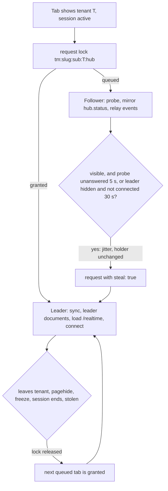

# Spec: Client State and Cross-Tab Sync

- **Author:** Ahmad Akra
- **Date:** 20 October 2026

**Status:** Ready for implementation. Frozen once merged: revised only if implementation forces a
design change, then kept as the historical record of what shipped — never updated thereafter as the
code or its dependencies evolve.

## Context

This spec ships the state layer of the Tellma single-page app:

- **One store.** One IndexedDB store holds the documents the chrome renders from, partitioned by
  user, tenant and session.
- **One sync call.** `client/sync` revalidates those documents, and one refresher decides when.
- **One tab bus** keeps the open tabs coherent.
- **One leader tab** per tenant holds the browser's only SignalR connection.
- **On top:** preferences, page state, drafts, tree expansion memory and recently visited pages.

The design serves three rules, each stated as a goal below: an instant warm launch, at most one
`client/sync` per change, and no data crossing between users. It builds on spec 0024's `TmApi`,
`TmSession` and boot script.

Other specs that carry parts of this design:

- **spec 0010** — §D.5: `TmClientCache.clearAll({ keep })`, called by the session clean-up (§2.6).
- **spec 0011** — §5.5: no `Hub`-group or background request renews a cookie; §5.9: `idleDays`.
- **spec 0013** — §2.5, §2.7, §2.8: `cache.changed` recipients and values, the composite
  `permissions` tag and the header, and bumps only after a run that changed the database. §6.1,
  §6.2, §6.4: the settings bytes and the events of `refresh-caches`.
- **spec 0014** — §3.4: the preference bag, caps and warm-writer rule; §7.3: the connect prologue.
- **spec 0016** — §2.2, §2.4, §3.4, §4.3, §6.2: `client/sync` as a retried read, `MeResult`,
  `NoActivityStampMetadata` and `Tellma-Version-Tags`.
- **spec 0018** — §3.5: the preference actions, key grammar, `PreferencesResult`, `MeLocaleResult`.
- **spec 0021** — §5.4, §6.1, §6.3, §9.2: the leader's inbox protocol, a hub that stamps no
  activity, `cache.changed { tag, value? }` and `session.ended`, and the 150 s client timeout.
- **spec 0024** — §4.2, §8.4–§8.7, §11: the boot script's delete and the paths that run the
  sweeps; §7.8: `TmDeviceZone`, the only writer of the device partition.
- **spec 0026** — §10.1: the dump section.
- **spec 0028** — §5.1: the two leader documents.

## Goals / Non-goals

**Goals**

- A warm launch renders the shell and page chrome from one IndexedDB transaction, with no network.
- One refresh path: headers, hub events and cold entry feed one refresher. It runs at most one
  `client/sync` per tenant per browser at a time and receives only what changed. A change made
  anywhere reaches every open tab for at most one `client/sync` per browser per tenant.
- One hub connection per browser per tenant, with free failover and no heartbeats.
- A preference applies in the same frame, shows in other tabs at once, and saves in the background.
- A returning page restores without a request; a draft survives a reload, not a new tab.
- One user's data never lands in another user's partition, and a session that ends takes its stored
  data with it.

**Non-goals (explicitly out of scope)**

- **Sign-in, sign-out, expiry and the changed-user path** — spec 0024 §8. This spec carries their
  messages and owns the sweeps they call.
- **Search query state** — spec 0030 §4.
- **Draft contents** — spec 0031 §11.
- **Pins and the launcher** — spec 0027 §8, §9.
- **Badges, toasts and banners** — spec 0028.
- **Display names and pickers** — spec 0029 §5, §14.
- **The dump format** — spec 0026 §10.
- **Page data on disk and offline writes** — rows are never persisted (§2.3), and a write needs the
  network.

## 1. Placement and vocabulary

Everything ships in the `@tellma/core` primary entry point, except the SignalR wrapper that only
the leader tab loads. The server adds one service, `ClientSyncService`.

Contract blocks are TypeScript and C# sketches: names and shapes are normative; imports,
documentation comments, bodies and cancellation tokens are omitted.

- **Primary entry point (eager).** `@tellma/core`, folder
  `client/projects/core/tellma-core/src/state/`, at most 9 KB gzip of the primary's 30 KB. Its
  subfolders `store/`, `launch/`, `sync/`, `bus/`, `leader/`, `prefs/` and `memory/` hold
  `TmClientStore`, `TmLaunchCache`, `TmCacheRefresher`, `TmTabBus`, `TmLeader`,
  `TM_LEADER_DOCUMENTS`, `TmPreferences`, `tmPreferenceKey`, `TmPageState`, `tmPageStateKey`,
  `TmDrafts`, `TmTreeExpansion` and `TmRecents`.
- **`@tellma/core/realtime` (lazy, leader tab only).** Same package, 18 KB gzip with the library.
  It holds `tmCreateHub` over `@microsoft/signalr`, which is pinned to the server's ASP.NET Core
  major and imported nowhere else. It is platform-internal, and its API golden says so.
- **Server.** `ClientSyncService` in `Tellma.Core`, namespace `Tellma.Core.Client`, with its records
  in `Tellma.Core.Abstractions.Api`. `CoreFeature` registers it through
  `contribution.ApiService<ClientSyncService>()`.
- **Testing.** `@tellma/core-testing`: `provideTellmaStateTesting()` provides an in-memory store, a
  fake bus, fake locks and `TmFakeHub`. Its `/e2e` entry adds `hubEvents(page)`, `freezeTab(page)`
  and `countRequests(route)`.

Browser storage has four writers: `TmClientStore` (IndexedDB, `tm.boot`), `TmDrafts`
(`tm.draft:*`), `TmSession` (`tm.login`, spec 0024 §8.3) and `tm-boot.js` (spec 0024 §4.2).

**Vocabulary**

- **Chrome** — what renders without page data: the shell (app bar, badges, pinned bar) and each
  page's frame (title, toolbar, columns).
- **Partition** — one slice of the store: the device's, a user's, a user's tenant's or a user's
  session's (§2.1).
- **Document** — one named JSON value in a partition, such as `settings`.
- **Launch documents** — the tenant-partition documents the chrome renders from (§3.1).
- **Warm**, **cold** — a tenant is warm when its `settings`, `me` and `tenant` documents are all
  present (§2.4); otherwise it is cold, and entering it syncs first (§3.2).
- **Mirror** — the in-memory copy of stored documents that `doc()` signals read (§2.1).
- **Boot record** — the small `tm.boot` localStorage value shared with `tm-boot.js` (§2.1).
- **Wire tag** — a version tag as the server sends it: `"{FormatVersion}.{value}"` (spec 0013 §2.7).
- **Held tag** — the wire tag under which a tab's stored document was fetched (§4.2).
- **Sync** — one `client/sync` call and the store writes it causes (§5).
- **Adoption** — storing a write's own result as server truth, so no sync follows the write (§5.3).
- **Leader** — the tab holding a tenant's hub lock; the other tabs are **followers** (§7).
- **Leader document** — one only the leader refreshes on hub events: `inbox`, `assignments` (§8.6).
- **Degraded mode** — realtime disabled, or the hub not connected for 60 s; the leader polls (§8.7).
- **Curated**, **write-behind** — spec 0014 §3.4's two preference kinds: written at once, or
  coalesced (§9.4).
- **Overlay** — values a tab shows before the server's bag holds them (§9.3).
- **Idle window** — the session's idle lifetime, `DistributionInfo.session.idleDays` (spec 0011
  §5.9); 7 days by default (§2.4).
- **`<slug>`** — the distribution's slug (spec 0024 §3.1), part of every channel and lock name.

## 2. The client store

`TmClientStore` is the only owner of IndexedDB and of the boot record. It decides where each cached
value lives, when a stored value counts as absent, who may write it, and what a session's end
deletes.

### 2.1 Contract

```ts
type TmPartition =
  | { kind: 'device' }                                        // survives sign-out and expiry; holds only 'zone' (§2.3)
  | { kind: 'user'; sub: string }                             // tenant list, distribution info
  | { kind: 'tenant'; sub: string; tenantId: number }         // launch documents, cacheable lists
  | { kind: 'session'; sub: string; sessionHandle: string };  // tree expansion; dies with the session
interface TmStoredDoc<T> {
  readonly tag: string | null;                                // the held wire tag, for documents that have one
  readonly savedAt: number;                                   // the writer's Date.now() at put or patch
  readonly formatVersion: number;                             // the client's format constant (§2.4)
  readonly data: T;
}
type TmSweepRule =
  | 'session-ended'                                           // every user partition, and CacheStorage tm-images-v1
  | 'other-users'                                             // every user partition but the profile user's
  | { sessionOtherThan: string }                              // the profile user's other session partitions
  | { tenant: number };                                       // one tenant partition of the profile user
declare class TmClientStore {
  readAll(...partitions: TmPartition[]): Promise<void>;      // one readonly transaction over their key ranges; fills the mirror
  doc<T>(partition: TmPartition, name: string): Signal<TmStoredDoc<T> | undefined>;   // the mirror; follows other tabs
  put<T>(partition: TmPartition, name: string, doc: TmStoredDoc<T>): Promise<void>;    // guarded (§2.5); posts store.changed
  patch<T>(partition: TmPartition, name: string, update: (current: T | undefined) => T | undefined): Promise<void>; // undefined deletes
  sweep(rule: TmSweepRule): Promise<void>;                    // a key-range delete (§2.6)
  readonly mode: 'indexeddb' | 'memory';                      // memory: IndexedDB failed to open (§2.7)
  readonly boot: {
    read(): TmBootRecord;                                     // synchronous; defaults when absent or invalid
    patch(delta: Partial<Omit<TmBootRecord, 'v'>>): void;     // the app's only writer of tm.boot
    readonly changes: Observable<TmBootRecord>;               // another tab's write (the storage event)
  };
}
declare class TmStoreRefusedError extends Error { readonly reason: 'other-user' | 'cookie' | 'session' } // §2.5
interface TmBootRecord {                                      // localStorage 'tm.boot', about 1 KB
  v: 1; theme: 'system' | 'light' | 'dark'; lang: string; dir: 'ltr' | 'rtl'; // device fields
  sub: string | null; lastTenantId: number | null;            // user fields: cleared at sign-out, and by tm-boot.js after an expiry (§2.2)
}
```

- **The mirror** is filled by `readAll`, `put` (before it commits), `patch`, and other tabs'
  `store.changed`, on which the store re-reads the named documents.
- **`patch`** runs in one `readwrite` transaction, so no other tab's write lands between its read
  and its write. Adoptions use it (§5.3).
- **Boot-record writers.** Through `boot.patch`: `TmLocalization` writes `lang` and `dir` (spec 0024
  §7.2), the theme glue writes `theme` (§7.6), the tenant route writes `lastTenantId` (§9.2), and
  `TmSession` writes `sub` (§8.1). Sign-out's clean-up nulls both user fields (§2.6). `tm-boot.js`
  is the only other reader and writer.
- **`changes`** lets a theme chosen in one tab follow in the other tabs.

### 2.2 Layout (frozen: `tm-boot.js` deletes by it)

| Item | Value |
|---|---|
| Database | `tm-app`, schema version `1` |
| Object store | `docs`, key path `['p', 'n']`, no indexes |
| Record | `{ p, n, tag, savedAt, formatVersion, data }` |
| `p` of the device partition | `device` |
| `p` of a user partition | `u:<sub>/` |
| `p` of a tenant partition | `u:<sub>/t<tenantId>`, as in `u:0b4…/t17` |
| `p` of a session partition | `u:<sub>/s<sessionHandle>`, as in `u:0b4…/sY4kQ1x…` |

- **Key ranges.** One partition is `IDBKeyRange.bound([p], [p, []])`, since an array sorts after
  every string. One user is `bound(['u:<sub>/'], ['u:<sub>/\uffff'])`, and every user is
  `bound(['u:'], ['u:\uffff'])`. Every user but one is the two ranges on either side of that user's.
- **The `/` after the `sub`** keeps one `sub` from matching a longer one that starts with it.
- **Opening.** `onupgradeneeded` creates `docs`. A later schema version recreates it, since the
  store is only a cache. Writes set `durability: 'relaxed'`.
- **Closing.** Connections close on `versionchange` and reopen on next access, so `clearAll`'s
  database delete (spec 0010 §D.5) never waits long.
- **`tm-boot.js` deletes by this layout** (spec 0024 §4.2 step 3c), so a change to the layout is a
  change to the boot script. It deletes only the expired user's key range. It copies the boot
  record's `sub` and `lastTenantId` before nulling them, so the sign-in that follows returns to the
  last tenant.

### 2.3 Documents

| Document | Partition | `tag` | Written by | Refreshed |
|---|---|---|---|---|
| `tenants` | user | null | `TmLaunchCache`, from `GET /bff/user` (spec 0011 §5.5) | stale-while-revalidate (below) |
| `distribution` | user | null | `TmLaunchCache`, from `GET /api/distribution-info` (spec 0011 §5.9) | stale-while-revalidate (below) |
| `settings` | tenant | the `settings` wire tag | the refresher; adoptions | §5.3 |
| `me` | tenant | null: its two tags live inside (§4.2) | the refresher; adoptions | §5.3 |
| `tenant` | tenant | null | the refresher | every sync |
| `sync` (below) | tenant | null | the refresher | every sync |
| `inbox`, `assignments` | tenant | null | the leader; a tab that opens a panel (spec 0028 §5.3) | §8.6 |
| `entity:<Name>` | tenant | the `entity:<Name>` wire tag | `TmLaunchCache`, from `{segment}/all` | lazily when stale (§3.3) |
| `tree:<page>` | session | null | `TmTreeExpansion` | §12 |
| `zone` | device | null | `TmDeviceZone`, by `patch` (spec 0024 §7.8) | never: it is local state |

- **`zone`** is `TmZoneDoc` (spec 0024 §7.8). For each user (`sub`) of this device, it holds the
  automatic time-zone option and the device zone last handled in each tenant. It keeps at most 20
  users, dropping the oldest write. No sweep touches it (§2.6), so the option outlives sign-out.
- **Stale-while-revalidate.** The stored `tenants` and `distribution` serve at once while a
  background fetch replaces them. `tenants` refreshes on entering a tenantless route, at the launch
  redirect (spec 0024 §9.3), and once per launch at idle. `distribution` refreshes once per launch
  at idle.
- **`sync`** holds `{ at, entities, entityTags }`: the last sync's time in ms, the held `entities`
  composite tag, and each cacheable list's current wire tag.
- **Page data is never written to disk.** The only rows on disk are cacheable lists.

### 2.4 When a stored document counts as absent

A document can be on disk and still count as absent. An absent document reads as missing, so the
cold path runs for it.

- **Format.** Every document name has a client format constant in `TM_DOC_FORMATS`, all `1` today.
  It is bumped whenever the stored shape changes, a server `FormatVersion` bump included. A document
  with another `formatVersion` is absent, so a new bundle ignores old documents.
- **Idle.** Every document of a tenant is absent when its `sync` document is missing, or when
  `sync.at` is older than the idle window. A `tenants` or `distribution` document is absent when
  its `savedAt` is older than the window. The window comes from the stored `distribution`'s
  `session.idleDays`, else 7. The device partition has no idle rule: `zone` bounds itself (§2.3).
- **No rewrites to stay current.** A confirming sync moves `sync.at`, so no document is re-written
  just to stay fresh.

### 2.5 The write guard

`put` and `patch` refuse a write when any check below fails. A refused write rejects with
`TmStoreRefusedError`, writes nothing and emits `tm.store.refused`.

| `reason` | Refused when |
|---|---|
| `other-user` | the partition is not the device's, and its `sub` is not `TmSession.profile().sub` |
| `cookie` | `TmSession.check()` is not `same` |
| `session` | `TmSession.state()` is not `active` |

A response `TmApi` checked (spec 0024 §10.3) can still land after the cookie changed, so the guard
is the last line between two users' partitions. It checks nothing else: a follower may `put` a
leader document it read itself (spec 0028 §5.3).

### 2.6 Sweeps

A sweep is a key-range delete inside `tm-app`. It posts `store.changed` with the deleted key prefix
and no names, so every tab empties those mirror entries. Every rule deletes user partitions only,
so the device partition survives every sweep.

| Rule | Deletes | Run by |
|---|---|---|
| `session-ended` | every user partition; CacheStorage `tm-images-v1` | the session clean-up; the boot step's backstop |
| `other-users` | every user partition but the profile user's | the boot step's second backstop |
| `{ sessionOtherThan: sh }` | the profile user's session partitions except `s<sh>` | the store, at idle after first render |
| `{ tenant: t }` | `u:<sub>/t<t>` | `TmErrorPresenter` on `tenant-not-found` (spec 0024 §11) |

**The session clean-up**, run by spec 0024 §8.4, §8.5 and §8.6, makes these calls in order:

1. `sweep('session-ended')`.
2. `TmClientCache.clearAll({ keep })` (spec 0010 §D.5). It keeps `tm-app` and `tm.boot`. On the
   expiry path it also keeps every `tm.draft:*` key, so drafts survive expiry (§11).
3. On sign-out only (spec 0024 §8.4, §8.5): `boot.patch({ sub: null, lastTenantId: null })`. The
   expiry path (spec 0024 §8.6) keeps both fields. So when the user closes the tab and later
   launches at `/`, the launch reaches `tm-boot.js` step 3c (spec 0024 §4.2) and returns to the
   last tenant.

**The store's boot step** (an initializer of spec 0024 §4.3) opens `tm-app` and compares
`boot.sub` (B) with the profile's `sub` (P):

1. **Backstops.** Both cases are cold paths:
   - B is null → `sweep('session-ended')`. This backs up `tm-boot.js`'s time-boxed delete.
   - B ≠ P → `sweep('other-users')`. `tm-boot.js` has already reset the boot record.
2. **One `readAll`** of the device partition, P's user partition and, on a tenant path, P's
   tenant partition. This one transaction is the warm path's only store access. `TmSession` then
   patches `sub` (spec 0024 §8.1).

### 2.7 Persistence, quota and fallback

- **Persistent storage.** After the first tenant-partition write, the store calls
  `navigator.storage.persist()` once on Chromium and WebKit, where it never prompts. It never calls
  it on Gecko, which prompts.
- **Quota.** A `QuotaExceededError` drops the write and emits `tm.store.quota`. The value stays in
  this tab's mirror.
- **Memory mode.** When `indexedDB.open` fails, `mode` is `memory`. The mirror then serves this tab
  only, and every launch is cold. When `localStorage` throws, the boot record lives in memory too.

## 3. Launch documents and `TmLaunchCache`

The launch documents are what the chrome renders from on a warm launch. `TmLaunchCache` exposes
them for the tenant the routed page shows, decides whether a launch is warm, and loads cacheable
lists lazily.

### 3.1 Contract

```ts
interface TmLaunchDocs {
  settings: TenantSettingsForClient;                          // spec 0013 §5.6
  me: MeResult;                                               // spec 0016 §3.4; access.tag is the composite permissions tag
  tenant: TmTenantFacts;
  inbox?: InboxSummary;                                       // leader document (spec 0021 §5.2)
  assignments?: AssignmentsSummary;                           // leader document (spec 0028 §4.3)
}
interface TmTenantFacts {                                     // client/sync's TenantFacts (§5.1)
  readonly id: number; readonly category: 'Live' | 'Sandbox'; readonly state: 'Active' | 'ReadOnly';
  readonly liveTenantId?: number; readonly realtime: boolean;
}
interface TmCachedEntitySet<T = TmJson> {
  readonly items: readonly T[];
  readonly byId: ReadonlyMap<TmId, T>;                        // TmId: a number, or a bigint key's string (spec 0024 §10.1)
  readonly stale: boolean;                                    // a newer list is due; items still serve (§3.3)
}
declare class TmLaunchCache {
  readonly docs: { readonly [K in keyof TmLaunchDocs]-?: Signal<TmLaunchDocs[K] | undefined> }; // the routed tenant's
  readonly warm: Signal<boolean>;                             // settings, me and tenant present (§2.4)
  entitySet<T = TmJson>(name: string): Signal<TmCachedEntitySet<T> | undefined>; // starts the lazy load on first read
  readonly tenants: Signal<readonly TmMembership[] | undefined>;  // /bff/user's tenants: spec 0011 §5.5's entry shape, camelCase
  readonly distribution: Signal<TmDistributionInfo | undefined>;  // /api/distribution-info: spec 0011 §5.9's DistributionInfo, camelCase
  revalidateUser(): Promise<void>;                            // refetches tenants and distribution
}
```

- **`state` is `Active` or `ReadOnly` only.** Other tenant states answer `403 tenant-suspended` or
  `404 tenant-not-found` (spec 0011 §3.3), so no sync ever stores them.
- **User documents.** `tenants` and `distribution` load through `TmApi.read(…, { method: 'GET',
  background: true })`. The tenant picker calls `revalidateUser()` on entering `/tenants` (spec
  0027 §6.2).
- **A tenant switch inside the app is not a launch.** It costs one `readAll` for the new tenant
  and, when that tenant is not warm, a cold sync.

### 3.2 Cold and warm entry

Entering tenant `t` takes one of five paths:

- **Warm.** The chrome renders from the stored documents, and no sync is awaited. Two things
  revalidate them later: the leader's sync on election (§7.2) and the header on the page data's
  response (§4.3).
- **Cold: `settings`, `me` or `tenant` absent.** A foreground `refresh(t, ['settings', 'me',
  'tenant'])` (§5.3) starts before the page is created. The page's data request waits for the
  documents (spec 0024 §4.4). Until they are written, the shell shows skeletons in their final
  geometry.
- **Cold, and the sync fails `offline` or `unavailable`.** The tenant shell shows its error state
  with Retry (spec 0027 §7.5), which reruns the sync.
- **Cold, and the sync fails `client-outdated`.** The tenant shell shows spec 0024 §11's view of
  the code in `tm-error-state` (spec 0027 §7.5):
  - code `client-outdated` offers Reload, with its busy, failed and "Reload anyway" states;
  - code `server-outdated` offers Try again, which reruns the sync.
- **Cold, and the sync fails `tenant-not-found` or `tenant-unavailable`.** Spec 0024 §11 applies.
  `tenant-not-found` goes to the picker, with its notice unless the platform chose the tenant
  (spec 0024 §9.3). `tenant-unavailable` shows the tenant-state page.

**Example —** Farah opens `/17/centers` on Monday after using tenant 17 on Friday:

1. `tm-boot.js` finds her cookie and `tm.boot.sub`; the service worker serves every chunk.
2. The boot step reads her user partition and tenant 17's partition in one transaction, cacheable
   lists included.
3. The shell renders the app bar, badges and pinned bar; the search host renders its title, toolbar
   and the columns of `search.gl.Center.columns`; the rows show their loading state.
4. `centers/query` starts. Its response header carries the held tags, so nothing syncs.
5. No other tab is open, so this tab is elected leader: `client/sync` confirms the documents, the
   hub connects, and `inbox/summary` and `assignments/summary` refresh the badges.

### 3.3 Cacheable entity lists

`entitySet(name)` returns the list's signal. When the stored list is absent or stale, the first
read starts a load; a tab runs at most one load per name at a time:

1. Read `sync.entityTags[name]`; when it is missing, sync first, which reports every list's tag.
2. `TmApi.read('{segment}/all', {}, { signal, background: true })` (spec 0016 §2.3), which returns
   every scalar of the cached probe (spec 0013 §4.4).
3. `put` `entity:<Name>` with step 1's tag. A list that changed between steps 1 and 2 is stored
   under an older tag than its rows. The next sync reports it stale again, so the list converges.

- **How a list becomes stale:** a sync's `StaleEntities`, or a valued `cache.changed` (§4.4).
- **Stale lists keep serving** with `stale: true` until the reload lands, so reference data never
  blanks.
- **A `403`** stores nothing, and the signal stays `undefined`; spec 0029 §14.2 searches the server.

## 4. Version tags on the client

The client holds a wire tag for each cached document and compares it with every tag the server
reports, in response headers and hub events. A mismatch is the only trigger of a refresh.

### 4.1 The tags

| Tag | Wire form | Covers |
|---|---|---|
| `settings` | `{TenantSettingsForClient.FormatVersion}.{settings:N}` | `settings` |
| `preferences` | the user's `PreferencesTag` in wire form (spec 0013 §2.7) | `me`'s profile and bag |
| `permissions` | composite: `{UserAccess.FormatVersion}.{tenant permissions:N}{user PermissionsTag:N}` | `me.access` |
| `entities` | `{CachedEntitySet.FormatVersion}.{entities:N}` | `sync.entityTags`: some cacheable list changed |
| `entity:<Name>` | `{CachedEntitySet.FormatVersion}.{entity:<Name>:N}` | one cacheable list |

**Example —** `permissions=1.3f2a9c1d0e7b4a5f8c6d2e1f0a9b8c7dd41e7a0b3c9f4e2d8a6b5c1f0e3d7a92` is
the format version `1.`, then the tenant tag `3f2a…8c7d`, then Farah's user tag `d41e…7a92`. A role
edit changes the first half for everyone. A change to Farah's memberships changes the second half,
for Farah only.

### 4.2 What a tab holds

| Held tag | Read from |
|---|---|
| `settings` | the `settings` document's `tag` |
| `preferences` | `me.preferencesTag` |
| `permissions` | `me.access.tag` |
| `entities` | `sync.entities` |
| `entity:<Name>` | the `entity:<Name>` document's `tag`, for lists held only |

`me.tags` is never a source: its `settings` and `entities` members may be newer than the documents
this tab holds.

### 4.3 Response headers

`TmApi` passes the `Tellma-Version-Tags` header of every checked tenant response to
`TmCacheRefresher.observe(t, tags)` (spec 0024 §10.3 step 5).

- **An absent member means no information.** The header omits `preferences` and `permissions` when
  the last batch carried no connect prologue (spec 0013 §2.7).
- **No jitter.** Only the tab that made the request sees its header, so there is no burst to spread.

### 4.4 `cache.changed` over the hub

The leader handles `cache.changed`; followers never fetch on it. The payload is `{ tag, value? }`
(spec 0021 §6.3), and spec 0013 §2.5 decides who receives which.

| Event | Sent for | Recipients | Leader action |
|---|---|---|---|
| `{ tag: 'settings', value }` | the tenant's settings | tenant group | after a 0–3 s jitter, `observe(t, { settings: value })` |
| `{ tag: 'entity:<Name>', value }` | one cacheable list | tenant group | `sync.entityTags[Name] = value`; a held list is marked stale; no sync |
| `{ tag: 'permissions' }` | a role or permission edit, a language change | tenant group | after a 0–10 s jitter, `refresh(t, ['me'])` |
| `{ tag: 'preferences' }` | `settings/refresh-caches` (spec 0013 §6.4) | tenant group | after a 0–10 s jitter, `refresh(t, ['me'])` |
| `{ tag: 'permissions', value }` | this user's memberships | that user | `observe(t, { permissions: value })` |
| `{ tag: 'preferences', value }` | this user's profile, bag or notification preferences | that user | `observe(t, { preferences: value })` |

- **Valued events refresh only on a mismatch.** A tab that adopted its own write (§9.5), or already
  synced from a header, does nothing.
- **Jitter spreads only tenant-group events,** which reach every browser of the tenant at once.
- **Unknown tags are ignored,** so packs may add tag names.

## 5. `client/sync` and `TmCacheRefresher`

`client/sync` revalidates every launch document of one tenant in one round trip and answers only
what changed. `TmCacheRefresher` is the one client path that calls it: headers, events, cold entry
and the leader all go through it. One browser runs at most one sync per tenant at a time.

### 5.1 Server contract

```csharp
// Tellma.Core.Client; registered by CoreFeature
[ApiRoute("client")]
public sealed class ClientSyncService
{
    // a member-only retried read (spec 0016 §2.2); NoActivityStampMetadata (spec 0016 §4.3)
    [ApiAction("sync", MemberOnly = true, Idempotent = true, Mutation = false)]
    public Task<ClientSyncResult> SyncAsync(ClientSyncRequest request);
}

// Tellma.Core.Abstractions.Api
public sealed record ClientSyncRequest(IReadOnlyDictionary<string, string> Held); // tag name → wire tag held; empty = cold

public sealed record ClientSyncResult(
    TenantFacts Tenant,                            // always
    IReadOnlyDictionary<string, string> Tags,      // always settings, preferences, permissions, entities; plus entity:<Name>
                                                   // for every cacheable entity when Held["entities"] differs or is absent
    TenantSettingsForClient? Settings,             // only when Held["settings"] differs; written from the cache's pre-serialized bytes
    MeResult? Me,                                  // only when Held["preferences"] or Held["permissions"] differs
    IReadOnlyList<string> StaleEntities);          // entity names whose held entity:<Name> tag differs

public sealed record TenantFacts(
    int Id, TenantCategory Category, TenantState State, int? LiveTenantId,
    bool Realtime);                                // TellmaRealtimeOptions.Enabled (spec 0021 §9.2): the hub is mapped
```

- **One `Read` batch** runs through `IGuardedBatchRunner`. It holds the connect prologue (spec 0014
  §7.3), then the user's preference rows.
- **The connect prologue** loads the permission rows and the profile only when stale, and the
  settings only when stale or cold (spec 0013 §5.7).
- **The preference rows** are read unconditionally, because whether `Me` is needed is known only
  after the prologue. They are a primary-key range of at most `MaxPreferenceKeys` rows:

  ```sql
  SELECT [Key], [Value] FROM [core].[UserPreferences] WHERE [UserId] = @tm_UserId;
  ```

- **In memory after the round trip:** the settings bytes and tag from
  `ITenantSettingsCache.GetForClientAsync()`, the list tags from
  `ICacheableEntities.GetWireTagsAsync()`, the access from `IAccessEvaluator.EvaluateAllAsync()`,
  and the tenant facts from `RequestContext.Tenant` with `TellmaRealtimeOptions`.
- **`MeResult`** is composed exactly as spec 0018 §3.5's `Me` composes it.
- **Round trips.** One when warm; a cold call adds one more (spec 0013 §2.10, spec 0014 §7.5). A
  cold call sends `{ "held": {} }` and receives every member, with `tags` listing every
  `entity:<Name>`.
- **Comparison.** Tags compare by ordinal equality. An unknown `Held` name is ignored.

### 5.2 Wire example

```json
// POST /17/api/web/client/sync — a warm tab after a header showed a new preferences tag
{ "held": { "settings": "1.9f04c2…", "preferences": "1.a1b7e3…", "permissions": "1.3f2a…d41e…",
            "entities": "1.77c0d9…", "entity:acme.Currency": "1.5e12aa…" } }

// 200 — only Me changed (nulls omitted, spec 0016 §3.1)
{ "tenant": { "id": 17, "category": "Live", "state": "Active", "realtime": true },
  "tags": { "settings": "1.9f04c2…", "permissions": "1.3f2a…d41e…", "preferences": "1.c9d0f1…", "entities": "1.77c0d9…" },
  "me": { "user": { "id": 42, "name": "Farah Nasser", … }, "preferencesTag": "1.c9d0f1…",
          "preferences": { "nav.pinned": "{\"v\":1,\"items\":[…]}" }, "access": { "tag": "1.3f2a…d41e…", … }, "tags": { … } },
  "staleEntities": [] }
```

### 5.3 `TmCacheRefresher`

```ts
interface TmAdoptedDocs {
  readonly settings?: { readonly data: TenantSettingsForClient; readonly tag: string }; // a settings save's client document (spec 0013 §6.3)
  readonly me?: MeResult;                                     // me/save (spec 0018 §3.5)
  readonly preferences?: PreferencesResult;                   // users/me/preferences/set or delete (§9.5)
  readonly locale?: MeLocaleResult;                           // users/me/locale (spec 0024 §7.2, §7.8)
}
declare class TmCacheRefresher {
  observe(tenantId: number, tags: Readonly<Record<string, string>>): void;  // response headers and valued events
  refresh(tenantId: number, docs: readonly string[]): Promise<void>; // forced: cold entry, value-less events, the leader
  adopt(tenantId: number, docs: TmAdoptedDocs): void;         // a write's own result becomes server truth
  readonly lastSyncAt: Signal<number | null>;                 // the routed tenant's; the bell's "Updated" and the dump
}
```

**`observe(t, tags)`** compares the reported tags with the held ones at once.

- **Ordering.** `TmApi` calls it one task after delivering the body (spec 0024 §10.3 step 5). A
  write's caller has therefore already passed its result to `adopt`.
- **Wanted tags.** Each of `settings`, `preferences`, `permissions` and `entities` that differs
  from the held tag is *wanted*. Anything wanted calls `refresh(t, docs)` with the documents those
  tags cover (`entities` covers `sync`). The names only label the trigger, since the server answers
  by the held tags.
- **List tags.** An `entity:<Name>` member, which only events carry, updates `sync.entityTags` and
  marks the list stale.

**`refresh(t, docs)`** runs these steps:

1. **Coalesce.** A pending refresh of `t` in this tab absorbs this one.
2. **Queue on the lock** `tm:<slug>:<sub>:<t>:sync`: exclusive and queued, never `ifAvailable`.
3. **Re-check inside the lock.** Re-read `settings`, `me` and `sync`. The run ends here when an
   observed trigger's wanted tags are all held now, or when a forced trigger is older than
   `sync.at`.
4. **Throttle.** When `now − sync.at < 2 s`, wait the remainder inside the lock. Triggers arriving
   meanwhile join this run.
5. **Call** `TmApi.read('client/sync', { held }, { signal, background })` with every held tag.
   `background` is false only for cold entry. The signal aborts on leaving the tenant and on
   `pagehide`.
6. **Apply** the result in one `readwrite` transaction (`settings`, `me`, `tenant`, `sync`, the
   held lists' stale flags), and post one `store.changed`.
7. **Errors.** `tenant-not-found` and `tenant-unavailable` go to `TmErrorPresenter.present`, even
   from a background call, because the refresher is the tenant's authority (spec 0024 §11).
   `TmApi` handles `unauthenticated` and `client-outdated`. Anything else emits `tm.sync.failed`,
   and the next trigger retries.

**`adopt(t, docs)`** updates the mirror at once, so the held tags move in the caller's task. Then,
under the sync lock, one `patch` transaction writes the result and posts `store.changed`:

| Member | Writes |
|---|---|
| `settings` | the whole `settings` document |
| `me` | the whole `me` document |
| `preferences` | `me.preferences`, `me.preferencesTag`, `me.tags.preferences` |
| `locale` | `me.user.preferredLanguage`, `.preferredCalendar`, `.preferredTimeZone` and `.modifiedAt`; `me.preferencesTag`; `me.tags.preferences` |

- **One lock for every write.** Every write of `settings`, `me`, `tenant` or `sync` runs under the
  sync lock, so none interleaves with a sync.
- **Out of order.** An out-of-order adoption may store an older bag; the next header repairs it.
- **Cost bound:** one sync per tenant per browser every 2 s, with one follow-up queued.

**Example —** Farah has three tabs on tenant 17. An administrator changes her pins:

1. The leader receives `cache.changed { tag: 'preferences', value: '1.c9d0…' }` and calls
   `observe`. Tab B's `centers/query` header carries the same value 400 ms later.
2. The leader takes the lock and syncs. The result carries only `Me`, and the store writes `me`.
3. Tab B's refresh queued behind the lock. Inside it, B finds `1.c9d0…` held and returns.
4. All three pinned bars re-render from `store.changed`. Total: one `client/sync`.

## 6. The tab bus

The tab bus carries every cross-tab message of the app over two `BroadcastChannel`s. It knows
nothing of what the messages mean; their owners (this spec and spec 0024 §8) do.

### 6.1 Contract and channels

```ts
declare class TmTabBus {
  readonly tabId: string;                                     // crypto.randomUUID() per document load; ready at first injection; never persisted
  post(message: TmBusMessage): void;                          // to every other tab; never echoed to this one
  readonly messages: Observable<TmBusMessage>;                // from other tabs only
}
interface TmBusEnvelope { readonly v: 1; readonly from: string; readonly message: TmBusMessage } // the value on the channel; from = tabId
```

- **Device channel** `tm:<slug>` carries `session.*`, so every user of the browser hears a sign-in
  or a sign-out.
- **User channel** `tm:<slug>:<sub>` carries every other message. It opens once the profile is
  known and is replaced when the user changes.
- **Versioning.** A tab ignores an envelope `v` or a message `type` it does not know, so old and new
  tabs coexist after a deployment. A breaking change bumps `v` and suffixes channel and lock names
  with `.v<n>`.
- **Back-forward cache.** A cached page that receives a message is evicted from the back-forward
  cache. The bus therefore closes both channels on `pagehide` with `persisted`, and reopens them on
  `pageshow`; the store then re-reads every mirrored document.

### 6.2 Message catalogue

```ts
type TmBusMessage =
  | { type: 'store.changed'; partition: string; names: readonly string[] | null } // after a commit (§2.1); null: a sweep's key prefix (§2.6)
  | { type: 'hub.event'; tenantId: number; event: TmClientEvent }                 // the leader relays every event (§8.4); at most 4 KB
  | { type: 'hub.status'; tenantId: number; status: TmHubState; since: number; leaderVisible: boolean } // on a change, a visibility change, a probe (§7)
  | { type: 'leader.probe'; tenantId: number }                                    // from a follower (§7.4); the leader answers, and polls when degraded (§8.7)
  | { type: 'prefs.changed'; tenantId: number; values: Readonly<Record<string, string | null>> } // TmPreferences.set (§9.3); null = reset
  | { type: 'drafts.query'; replyTo: string }                                     // sign-out's wait and confirmation (spec 0024 §8.4)
  | { type: 'drafts.reply'; replyTo: string; dirty: number; busy: boolean }      // dirty = TmDrafts.dirtyCount; busy = TmApi.writesInFlight > 0
  | { type: 'session.signing-out' | 'session.signed-out' | 'session.expired' | 'session.started' | 'session.changed'; sub: string }; // device channel (spec 0024 §8)
```

## 7. Leader election

One tab per browser per tenant holds the hub lock, and with it the realtime connection. The
election needs no timers in the healthy case. Web Locks hand the lock to the next tab when the
leader goes away, and followers check on the leader only when they start or become visible.

### 7.1 Contract

```ts
type TmHubState = 'connecting' | 'connected' | 'reconnecting' | 'offline' | 'disabled'; // disabled: realtime is off on this deployment
interface TmHubStatus { readonly state: TmHubState; readonly since: number; readonly leaderVisible: boolean }
interface TmClientEvent { readonly name: string; readonly tenantId: number; readonly payload: TmJson | null } // spec 0021's ClientEventEnvelope
declare class TmLeader {
  readonly isLeader: Signal<boolean>;                         // for the routed tenant
  readonly hubStatus: Signal<TmHubStatus>;                    // the leader's, mirrored; { connecting, now, true } until the first status
  events(name: string): Observable<TmClientEvent>;            // the routed tenant's hub events, delivered in every tab
}
```

| Lock | Mode | Held by |
|---|---|---|
| `tm:<slug>:<sub>:<t>:hub` | exclusive | the leader of tenant `t`; followers queue on it |
| `tm:<slug>:<sub>:<t>:sync` | exclusive | the tab running a sync or an adoption write (§5.3) |

### 7.2 Lifecycle in one tab

1. **Enter.** While the tenant shell is active for `t` and `TmSession.state()` is `active`, the tab
   requests the hub lock with an `AbortSignal`, posts `leader.probe` and waits for `hub.status`.
2. **Granted.** `isLeader` turns true. The leader posts `hub.status { connecting }`, calls
   `refresh(t, ['tenant'])` (the warm launch's revalidation) and refreshes the leader documents
   (§8.6). When `tenant.realtime` is true, it loads `/realtime` (§8.1) and connects. Otherwise its
   state is `disabled`, and it polls (§8.7).
3. **Release.** The leader releases the lock on leaving the tenant, `pagehide`, `freeze`, a session
   state other than `active`, or a steal. A steal rejects the lock's promise with `AbortError` and
   stops the connection at once. The tab awaits `connection.stop()`, then queues again as a
   follower unless it left the tenant.
4. **Return.** `pageshow` with `persisted`, and `resume`, rerun step 1. Queued requests abort on
   `pagehide`, so a pending request never keeps a page out of the back-forward cache.

**Failover is free.** The browser releases a closed, crashed or discarded leader's lock and grants
it to the next queued tab. WebKit fires no `freeze`, so a suspended hidden leader can keep the
lock. The hung-leader rule (§7.3) recovers it when a follower becomes visible.

### 7.3 Probing and stealing

A follower never times the leader in the background. It steals only while visible, and only from a
leader that is hung, or hidden and disconnected.

1. **Probe.** Post `leader.probe { t }`, and note the hub lock holder's `clientId` from
   `navigator.locks.query()`.
2. **Hung leader:** no `hub.status` within 5 s while the lock is still held → candidate.
3. **Hidden, disconnected leader:** the last `hub.status` has `leaderVisible: false` and has shown
   `connecting`, `reconnecting` or `offline` for over 30 s → candidate. This rule never applies to
   a visible leader, whose backoff runs unthrottled, or to a `disabled` one, which has nothing to
   connect.
4. **Steal.** After a 0–2 s jitter, query the locks again. When the holder's `clientId` is unchanged
   and the condition still holds, request the lock with `{ steal: true }`. A changed holder means
   another follower stole first, so probe again instead.
5. **Hidden followers never steal.**



### 7.4 Visibility

No lock tracks visibility. Followers report it through probes, and the leader reports its own in
`hub.status`.

- **A follower probes** when it starts, whenever it becomes visible, and every 60 s while it stays
  visible and the mirrored state is not `connected`, so degraded polling (§8.7) follows it.
- **The leader answers every probe at once,** since `BroadcastChannel` and WebSocket handlers run in
  hidden tabs too.
- **Nothing moves on a tab switch.** A healthy hidden leader keeps its connection, and spec 0021
  §9.2's 150 s client timeout covers its throttled pings.

## 8. `TmHub` and the realtime connection

`TmHub` is the leader's SignalR connection to `/{t}/hub`. It checks the session before every
negotiate, retries forever on transient failures, relays every event to all tabs, and turns the
hub's terminal signals into spec 0024's standard paths.

### 8.1 Loading

```ts
// @tellma/core (primary): the seam /realtime implements
interface TmHubSink {
  event(event: TmClientEvent): void;                          // every received event
  state(state: Exclude<TmHubState, 'disabled'>): void;       // each state change of the connection
  connected(): void;                                          // after every successful (re)connect
  refused(status: 401 | 403 | 404): void;                     // a terminal negotiate verdict
  ended(reason: 'session-terminated' | 'access-revoked' | 'tenant-unavailable'): void; // session.ended
}
interface TmHubConnection { start(): void; stop(): Promise<void>; nudge(): void } // nudge: cut the current wait short

// @tellma/core/realtime
// returns a TmHub; the injector supplies TmSession, TmApi and TmTelemetry
declare function tmCreateHub(tenantId: number, sink: TmHubSink, injector: Injector): TmHubConnection;
```

After election and first render, `TmLeader` calls `import('@tellma/core/realtime')`, which spec
0024 §1 admits from the primary. `@microsoft/signalr` therefore loads only in the leader tab.

### 8.2 The connection

- **Built** with `HubConnectionBuilder().withUrl('/{t}/hub', { httpClient, withCredentials: true })`
  and the JSON protocol. It omits `withAutomaticReconnect`, because §8.3's loop replaces it.
- **The user check.** `httpClient` is `TmHubHttpClient`, which extends `DefaultHttpClient` and runs
  `TmSession.check()` before every send. A `missing` or `changed` result throws without sending and
  stops the loop. The leader then runs a foreground `client/sync`, whose own check takes spec
  0024's expiry or changed-user path. Every reconnect negotiates, so the check precedes every
  connect.
- **Options:**
  - `serverTimeoutInMilliseconds` 30 s: a hidden page still receives the server's 15 s pings;
  - `keepAliveIntervalInMilliseconds` 15 s: throttled when hidden, and covered by the server's
    150 s timeout;
  - transports in the library's order, following Azure SignalR's negotiate redirect (the CSP lists
    its origins, spec 0024 §6);
  - warnings and errors logged to `TmTelemetry`, never content.
- **Background by route.** A WebSocket handshake carries no custom header, so the server treats
  every `Hub`-group request as background (spec 0011 §5.5, spec 0021 §6.1). No reconnect stamps
  activity or renews the session.
- **No stateful reconnect.** Events are thin and every reconnect syncs (§8.4), so a missed event
  costs nothing.

### 8.3 Reconnect policy

| Attempt after a drop or a failed start | Delay |
|---|---|
| 1 | 0 s |
| 2, 3, 4 | 2 s, 10 s, 30 s |
| 5 onward | the previous delay doubled, capped at 5 min |

- **Jitter** of ±20 % applies to every delay but the first. The attempt counter resets after a
  connection that lasted 60 s.
- **Never gives up** on network errors, `429` and `5xx`.
- **A wait is cut short** (`nudge`) when `TmApi.online` turns true, when a `leader.probe` arrives,
  and right after election. While `TmApi.online` is false, the loop waits in state `offline`.
- **Terminal verdicts stop the loop.** A negotiate answering `401`, `403` or `404` (the library's
  `HttpError.statusCode`) calls `refused`. A `session.ended` event calls `ended`. §8.5 handles both.
- **No banner.** Hub loss shows no banner; the bell panel's status line follows `hubStatus` (spec
  0028 §6.2).

### 8.4 Event relay

For every `event` the leader receives:

1. **Drop it** when its `tenantId` is not `t` or its `name` is not in the metadata's `clientEvents`
   (spec 0024 §3.1).
2. **Deliver it** to this tab's `events()` subscribers and post `hub.event`; followers deliver it to
   theirs.
3. **Act on it:**

| Event | Leader action |
|---|---|
| `cache.changed` | §4.4 |
| an event a leader document lists (`inbox.changed`, `job.changed`, `assignments.changed`) | refresh that document (§8.6) |
| `session.ended` | §8.5 |
| any other | none; pages may react through `events()` in their own tab |

- **Catch-up.** On every successful (re)connect, the leader calls `refresh(t, ['tenant'])` and
  refreshes every leader document (§8.6). This catches up on whatever the gap missed.
- **Duplicates are harmless.** During a steal, two leaders may relay one event twice. Every consumer
  treats an event only as a refresh trigger, and spec 0028 decides toasts from document contents,
  not events.

### 8.5 Terminal signals

The hub never interprets an HTTP outcome beyond "terminal or not". A foreground `client/sync`
decides what a terminal outcome means, so the user sees exactly what a page call would show (spec
0024 §10.6).

| Signal | Leader action | Result in every tab |
|---|---|---|
| `session.ended { session-terminated }` | post `session.signed-out { sub }` and run spec 0024 §8.5 | spec 0024 §8.5: the clean-up, the stale cookie deleted, `/signed-out` |
| `session.ended { access-revoked }` or `{ tenant-unavailable }` | stop the hub; a foreground `client/sync` | decided by the sync (below) |
| negotiate `401` | a foreground `client/sync` | `401 unauthenticated` → spec 0024 §8.6 |
| negotiate `403` or `404` | a foreground `client/sync` | as `access-revoked` |

- **Followers sync too on `access-revoked` and `tenant-unavailable`.** Each follower that receives
  the relayed event also runs a foreground `client/sync`. This is the one exception to "followers
  never fetch on hub events".
- **A sync that fails** with `404 tenant-not-found` or `403 tenant-suspended` takes spec 0024 §11's
  path.
- **A sync that succeeds** means the refusal has cleared. The leader restarts the loop, or enters
  `disabled` when the sync reports `realtime: false`; an unmapped hub answers `404`.

### 8.6 Leader documents

```ts
interface TmLeaderDocument {
  readonly name: string;                                      // tenant-partition document: 'inbox', 'assignments'
  readonly route: string;                                     // 'inbox/summary' (spec 0021 §5.2), 'assignments/summary' (spec 0028 §4.3)
  readonly events: readonly string[];                         // ['inbox.changed', 'job.changed'], ['assignments.changed']
  readonly formatVersion: number;
}
declare const TM_LEADER_DOCUMENTS: InjectionToken<readonly TmLeaderDocument[]>; // multi; spec 0028 §5.1 provides both
```

- **When the leader refreshes them:** on election, on every (re)connect, on each listed event, and
  on every degraded poll (§8.7).
- **How.** `TmApi.read(route, {}, { signal, background: true })`, then `put`. Events coalesce over
  250 ms. Each document has at most one read in flight and one follow-up queued.
- **Every tab renders its badges from the store,** so a warm launch shows them before any call.
- **Followers never call these routes on hub events.** A tab that opens a panel may read fresher
  data and `put` it itself (spec 0028 §5.3).

### 8.7 Degraded mode: polling

- **Enters** when `tenant.realtime` is false (state `disabled`), or when the hub has not been
  `connected` for 60 s. **Leaves** on `connected`.
- **Polls** `refresh(t, ['tenant'])` and every leader document, all in the background, at most once
  per 60 s.
- **Poll triggers:** the leader's 60 s timer while the leader is visible, and a `leader.probe`
  (§7.4) when the last poll is at least 60 s old.
- **Back to realtime.** A `disabled` leader reads `tenant.realtime` after each sync, so turning
  realtime on takes effect within one poll.
- **Cost bound:** one sync and one call per leader document, per minute, per browser and tenant,
  while someone looks. Nothing while every tab is hidden.

## 9. Preferences

`TmPreferences` gives every page typed, per-tenant user preferences that apply at once, show in the
user's other tabs at once, and reach the server per the key's kind. The server bag (spec 0014
§3.4) stays an opaque string map. The client owns the encoding, the kinds and the flush policy.

### 9.1 Contract

```ts
type TmPreferenceKind = 'curated' | 'write-behind';
interface TmPreferenceKey<T> {
  readonly key: string; readonly kind: TmPreferenceKind; readonly fallback: T;
  readonly validate?: (value: unknown) => value is T;        // a stored value failing it reads as the fallback
}
declare function tmPreferenceKey<T>(key: string, kind: TmPreferenceKind, fallback: T,
  validate?: (value: unknown) => value is T): TmPreferenceKey<T>;
declare class TmPreferences {                                 // the routed tenant's
  get<T>(key: TmPreferenceKey<T>): Signal<T>;
  set<T>(key: TmPreferenceKey<T>, value: T): void;            // applied and broadcast at once; flushed per kind
  reset(key: TmPreferenceKey<unknown>): void;                 // deletes the key: get() returns the fallback
}
```

**Example —** Acme's credit-review page remembers the user's last "% of limit" filter:

```ts
const thresholdKey = tmPreferenceKey<number>('acme.creditReview.threshold', 'write-behind', 90);

// inside the page component
private readonly prefs = inject(TmPreferences);
readonly threshold = this.prefs.get(thresholdKey);           // Signal<number>
setThreshold(percent: number) { this.prefs.set(thresholdKey, percent); }
```

- **Key grammar** is spec 0018 §3.5's. In development, `tmPreferenceKey` checks it. It also checks
  that the first segment is a platform segment (Appendix A) or a composed feature key (`acme`).
- **A value deep-equal to the fallback deletes the key.** The bag stays small, and a changed
  fallback (a new column default) reaches users who never customized.
- **Size.** A stored form over 32 KB (`MaxPreferenceValueBytes`, spec 0014) is refused before it
  applies, with `tm.prefs.dropped { reason: 'too-large' }`. In development it throws.
- **Outside a tenant,** `get` returns the fallback and `set` is ignored.

### 9.2 Encoding

Both kinds store `JSON.stringify(value)`. For example, `nav.pinnedBarVisible` stores `false`, and
`search.gl.Center.view` stores `{"view":"tiles"}`. An administrator's tool that writes through
`users/preferences/set` (spec 0018 §3.5) therefore needs no client convention.

Each distinct stored string is parsed once. Invalid JSON, or a value failing `validate`, reads as
the fallback and emits `tm.prefs.invalid { family }`, where `family` is the key's first segment.

### 9.3 Applying and broadcasting

What `get` returns, highest first:

1. **The overlay:** the last value set for the key in this browser that this tab has seen, through
   its own `set` or a received `prefs.changed`.
2. **The stored bag:** `me.preferences[key]`, server truth (§2.3).
3. **The fallback.**

- **`set`** updates the overlay and this tab's *dirty* map (keys set here and not yet saved)
  synchronously, so the signal changes in the same frame. It then posts `prefs.changed { tenantId,
  values: { [key]: stored string | null } }` and schedules the flush (§9.4). It writes nothing to
  the store, which holds server truth only.
- **Receiving `prefs.changed`.** Each value replaces the key's overlay entry and drops this tab's
  unsent dirty value for that key. The later choice wins, and only its tab flushes it.
- **An overlay entry ends** when the stored bag holds the same string, which means its writer's
  flush landed.
- **A dropped write** (§9.4) ends its keys' overlay entries and posts `prefs.changed` with their
  stored strings, so every tab returns to server truth.

**Example —** Farah hides the pinned bar in tab A while tab B is open:

1. A's `set` puts `false` in its overlay and dirty map, so A's bar hides in the same frame.
2. A posts `prefs.changed { tenantId: 17, values: { 'nav.pinnedBarVisible': 'false' } }`. B puts
   `false` in its overlay, and B's bar hides.
3. The key is curated, so A flushes at once and adopts the result (§9.5).
4. Both tabs now find `false` in the stored bag, so both overlay entries end.

### 9.4 Flush policy

The two kinds differ only in when they flush:

| Kind | Flushed |
|---|---|
| Curated | at once; sets within one task coalesce |
| Write-behind | 2 s after the key's last change, at most once per 10 s per tab; at once on `visibilitychange: hidden`, or when the stored form exceeds 8 KB |

- **Routes.** Both kinds flush through `TmApi.write('users/me/preferences/set', { items: [{ key,
  value }] })`. Resets go through `users/me/preferences/delete` with `{ keys }` (spec 0018 §3.5).
- **Only this tab's dirty keys.** Tabs never coordinate: the server sets keys one by one, and the
  last writer wins.
- **On `pagehide`.** Every dirty and in-flight key goes through `TmApi.send` to the same routes,
  newest first, and the response is never read. Both bodies together carry at most 16 KB; the rest
  is dropped with `reason: 'pagehide-cap'`. An in-flight key is resent because the unload aborts
  its write.
- **Transient failures.** `offline`, `unavailable` and `server` keep the keys dirty for the next
  schedule, and for `TmApi.online` turning true.
- **Key cap.** `Users.TooManyPreferenceKeys` (spec 0014's 1,024-key cap) drops the write with
  `reason: 'key-cap'`.
- **Other validation codes** drop the key with `reason: 'rejected'`.
- **Session and version errors.** `unauthenticated`, `step-up` and `client-outdated` take spec
  0024's paths. The expiry path's reload loses unflushed keys.
- **Never blocking.** Writes are never cancelled and never block navigation.

### 9.5 Adopting the result

1. The flush passes its `PreferencesResult(Preferences, PreferencesTag)` (spec 0018 §3.5) to
   `adopt(t, { preferences })` (§5.3). `Preferences` is the whole bag after this write.
2. Each sent key whose dirty value is still the one sent leaves the dirty map.
3. The response header's new `preferences` tag now equals the held one. So does the user's valued
   `cache.changed { preferences }`, so no tab syncs. In a race, another tab's refresh may reach the
   lock before the adoption's write, which costs one sync.

**Locale is not a preference.** `users/me/locale` sets `PreferredLanguage`, `PreferredCalendar` and
`PreferredTimeZone`.

- **Writers.** The language and calendar switches (spec 0024 §7.2), the time-zone prompt and the
  automatic time-zone update (spec 0024 §7.8).
- **Adoption.** Each caller passes the `MeLocaleResult` to `adopt(t, { locale })`.
- **Region and digits** are profile fields. They are saved through `me/save` and adopted as `me`.

## 10. Page state

`TmPageState` keeps, per tab and in memory only, what a page needs to look as it did when the user
returns within the app. It is a bounded container; each host decides what to remember.

```ts
type TmPageStateKey = string & { readonly __tmPageStateKey: true };
declare function tmPageStateKey(path: string): TmPageStateKey;  // the canonical path, no query or fragment: '/17/centers'
declare class TmPageState {
  remember<T>(key: TmPageStateKey, state: T): void;           // replaces; most recently used; clears isStale
  recall<T>(key: TmPageStateKey): T | undefined;
  isStale(key: TmPageStateKey): boolean;                      // the rows must be refetched; the rest restores
  markStale(scope: { tenantId: number; entity?: string }): void; // after a write or a permissions move
  forget(key: TmPageStateKey): void;
}
```

- **Key.** The page's canonical path (spec 0024 §9.1), such as `/17/centers` or `/17/centers/5`.
  The query is state, not identity; spec 0030 §4.2 decides what a return applies.
- **Hatch keys.** A `page` hatch that remembers apart from its host adds a segment, as in
  `/17/reports/42/run`. `markStale` maps the key without that segment.
- **Bound.** 20 entries, least recently used evicted. Values are immutable and held by reference. A
  host remembers at most its rendered window, never a whole table.
- **Writes mark entries stale.** A host that saves, deletes, imports or runs an action calls
  `markStale` (specs 0030, 0031). With `entity`, it marks the entries that `TmUrls.describe` maps to
  that entity: its search and details pages. Without `entity`, it marks every entry of the tenant.
- **A permissions move marks entries stale.** When tenant `t`'s held `permissions` tag changes,
  `TmPageState` calls `markStale({ tenantId: t })`, so every entry of `t` refetches on return.
- **A settings move forgets entries.** When `t`'s held `settings` tag changes, `TmPageState`
  forgets every entry of `t`.
- **Display names** follow the same split (spec 0029 §5.3).
- **A stale entry** renders its held state at once, then refetches its data.
- **A refused refetch** (`forbidden` or `not-found`) leaves none of the refused data in the entry,
  so no later return renders it.
- **Hosts.** Each host in the table below defines the two rules above for its own state.
- **A language switch** changes nothing.

| Host | Remembers (the host decides) |
|---|---|
| search (spec 0030 §15) | query, row window, total, scroll, selection, active row, expanded ids |
| details (spec 0031 §13) | the entity and its related rows, extras, selected tab, scroll of the page and every panel |
| report (spec 0034 §3.7), dashboard (spec 0035 §11.4) | parameters, results, scroll |

**Example —** Farah edits center 5 from `/17/centers`, saves, and presses Back:

1. After the save, the details host calls `markStale({ tenantId: 17, entity: 'gl.Center' })`.
2. Back on `/17/centers`, `recall` returns the query, scroll and selection, and `isStale` is true.
3. The page renders its remembered rows and position in the first frame, then refetches.
4. Center 5's row updates in place.

## 11. Drafts

`TmDrafts` keeps a tab's unsaved form copies in session storage, so a reload or re-authentication
returns the user to edit mode with nothing lost, while a new tab starts clean.

```ts
declare class TmDrafts {
  key(tenantId: number, entity: string, id: TmId | 'new'): string; // 'tm.draft:<sub>:17:gl.Center:5'
  save(key: string, value: TmJson): void;                     // debounced and flushed (below)
  load(key: string): TmJson | undefined;                      // undefined for another user's key
  clear(key: string): void;
  clearAll(sub: string): void;                                // spec 0024 §8.4, §8.7
  readonly dirtyCount: Signal<number>;                        // this tab's drafts of the profile user
}
```

- **Stored value:** `{ v: 1, at, data }`, written with `JSON.stringify` and read with `JSON.parse`.
  Decimals and longs are already strings (spec 0024 §10.4), so every value round-trips exactly.
- **One user's drafts.** The key embeds the `sub`, and `load` refuses another user's key.
- **Written continuously.** Spec 0031 calls `save` on every model change. The write is debounced
  300 ms, and flushed synchronously on `pagehide` and `visibilitychange: hidden`.
- **Lifetime.** A draft has no age limit. It lasts until `clear` (save, cancel, discard),
  `clearAll` (sign-out, a changed user), or the end of the tab's session storage. Drafts survive
  the expiry path and every store sweep.
- **Which tabs keep it.** A reload, Back from another site and "reopen closed tab" keep a draft; a
  new tab does not. "Duplicate tab" copies it, and spec 0031's concurrency check covers both saves.
- **Quota.** A `QuotaExceededError` (about 5 MB per tab) deletes this tab's oldest other drafts and
  retries once. If that fails, the draft lives in memory only, with `tm.drafts.quota-exceeded`.
- **Session storage holds only drafts and `tm.login`,** the sign-in mark (spec 0024 §4.2).

## 12. Tree expansion memory

`TmTreeExpansion` remembers a tree search page's expanded nodes for the sign-in session, in every
tab, so the next visit fetches them expanded in one call (spec 0030 §16.2).

```ts
declare class TmTreeExpansion {
  expanded(page: string): Signal<ReadonlySet<TmId>>;          // page = the search page's canonical path: '/17/centers'
  toggle(page: string, id: TmId, open: boolean): void;
  replace(page: string, ids: Iterable<TmId>): void;           // one write: a collapse that drops descendants, or pruning unknown ids
}
```

- **Storage.** The session partition, document `tree:<page>`, value `{ ids: TmId[] }` in
  expansion order, oldest first. Writes debounce 250 ms. A new sign-in starts collapsed.
- **Bound.** 500 ids per page: a 501st drops the oldest.
- **Loading.** Spec 0030 sends at most `limits.maxIds` of the newest ids, and reads the signal once
  per load, so an open tree never re-expands under the user.

## 13. Recently visited pages

`TmRecents` lists the last ten pages the user visited in this tenant, for the launcher (spec 0027
§9.3) and the home page (spec 0035 §15.3). It lives in the write-behind key `nav.recent`.

```ts
interface TmRecentPage {
  readonly url: string;                                       // '/17/centers'; no query: the page restores its own state
  readonly kind: TmPageKind;                                  // 'search' | 'report' | 'dashboard' | 'settings' | 'custom' (spec 0026 §9.1)
  readonly title: Signal<string>;                             // the launcher entry's label, else the title as displayed
  readonly icon: string | null;                               // the launcher entry's icon, else null: the consumer picks one by kind
  readonly visitedAt: number;
}
declare class TmRecents { readonly pages: Signal<readonly TmRecentPage[]> } // the routed tenant's, newest first, at most 10
```

- **What counts as a visit.** All three must hold:
  - the routed page's context (`TmPageContexts.current`, spec 0026 §9.2) has kind `search`,
    `report`, `dashboard`, `settings` or `custom`;
  - its route is not the drill-through list (`/:t/list/:segment`);
  - it stays current for 2 s while the document is visible.
- **Never counted:** home, details and studio pages.
- **Order.** A revisit of the same tenant-relative path (`centers`, `reports/42`) moves the entry to
  the front, and the eleventh entry falls off.
- **Stored value**, with `t` in epoch seconds and `n` the title as displayed at the visit:

  ```json
  [{ "p": "reports/42", "k": "report", "t": 1792400000, "n": "Monthly sales by region" },
   { "p": "centers", "k": "search", "t": 1792399000, "n": "Centers" }]
  ```

- **Title and icon** come from the launcher entry that `TmNavigation.byHref(url)` finds (spec 0027
  §3.1), following the active language. Without an entry, the title is `n` and the icon is null.
- **Across tabs.** A visit's `set` reaches every tab through `prefs.changed` (§9.3), and the next
  visit in any tab builds on that list.

## 14. Testing

Most suites run on every PR. The hidden-leader soak runs nightly, and the staging smoke runs on
deployment.

| Suite | Tier | Pins |
|---|---|---|
| Store layout golden | unit, PR | §2.2's database, store, key paths and ranges, as vectors shared with `tm-boot.js` (spec 0024 §4.2) |
| Store | unit in browser mode, real IndexedDB, PR | each guard row; each sweep leaves exactly the right keys; the expiry path's clean-up keeps the boot record's `sub` and `lastTenantId`, and sign-out's clears them; the device partition's `zone` survives every sweep and the boot script's expiry delete, holds at most 20 users, and is in the mirror after the boot step's `readAll`; the format and idle rules; the quota drop; memory mode; the `versionchange` close |
| Refresher | unit, fake clock and API, PR | an own write's header never syncs; lock serialization across two instances; the re-check skips; the 2 s throttle; foreground errors presented; each adoption member's patch |
| `client/sync` (C#) | integration, real SQL, PR | each `Held` combination and the members it returns; one round trip warm; the composite tag; a cold call; unknown names ignored; `Realtime` |
| Bus | unit, PR | the channel per type; unknown `v` and `type` ignored; close and reopen around the back-forward cache |
| Leader | unit, two instances, real Web Locks, PR | grant and every release reason; the steal rules (hung, hidden and disconnected, never a visible leader, never `disabled`); the holder re-check; the degraded follower's 60 s probe |
| `TmHub` | unit, fake connection, PR | §8.3's schedule and jitter bounds; nudges; terminal verdicts stop the loop; relay and drop rules; the `TmHubHttpClient` check |
| Preferences | unit, PR | the read order; a same-frame `set`; flush timings; the `pagehide` bodies and cap; adoption; a received value drops the dirty one; the overlay's end; the key-cap drop and restore |
| Page state, drafts, tree, recents | unit, PR | page state: LRU of 20, `markStale` on search and details entries, a permissions move marking every entry of the tenant stale, a settings move forgetting them; drafts: debounce, `pagehide` flush, quota, `sub` refusal; tree: the cap and `replace`; recents: kinds, dwell, de-duplication, cap and title source |
| Multi-tab (Playwright, Acme host) | e2e, PR | the scenarios below |
| Multi-tab on WebKit (`@cross-engine`) | e2e, PR | a hidden leader that stops answering is replaced through the hung-leader rule when a follower becomes visible |
| Hidden-leader soak | nightly | a hidden leader keeps one connection for 15 min under Chromium's intensive throttling, with no leadership change |
| Staging smoke | deployment | the 150 s client timeout through Azure SignalR |
| Server side | spec 0013 §12, spec 0021 §12 | `cache.changed` publication; a hub that stamps no activity and renews no cookie |

**Multi-tab** pins these scenarios:

- Close the leader → a follower connects within 2 s.
- Pause the leader in the debugger → a visible follower steals.
- An administrator edits Farah's pins from another context → three tabs update for one
  `client/sync` in total.
- A preference set in tab A shows in tab B within 100 ms.
- A new tab sees the tree expansion.
- A draft survives a reload, not a new tab.
- Realtime disabled → the leader polls every 60 s, only while a tab is visible.
- A role change reaches an idle tab.

## 15. Definition of done

- **Ships.** Every part of §1 with its golden and budget; every §14 suite green on Ubuntu and Windows.
- **Instant warm launch.** Boot reads one readonly IndexedDB transaction (§2.6) and renders the
  chrome from the stored documents with no sync awaited (§3.2). Pinned by `store-boot.spec` (one
  transaction, no `fetch`) and spec 0024's `warm-launch.spec`.
- **Instant feedback.** `set` changes `get()` in the same frame (§9.3), and a returning page
  restores without a request (§10). Pinned by `prefs-apply.spec` and `page-state-return.spec`: Back
  to a search page shows its rows in the first frame, with zero requests.
- **Non-blocking.** Syncs, leader documents and list loads are background reads, aborted with their
  owner. Flushes and the hub never block navigation. Pinned by `refresher.spec` (leaving the tenant
  aborts the sync) and `hub-hang.spec` (a hung negotiate never delays navigation).
- **Stable layout.** Badges, columns and view render from the store before first render, and
  trees restore in one call. Pinned by spec 0024's `layout-shift.spec` on a warm tree page.
- **RTL, WCAG AA.** No UI of its own; specs 0027 and 0035 render and test recents.
- **Page context and dump.** No page context. The dump section `state` (spec 0026 §10.1) holds
  names and tags, never values. `preferences.dirty`, `drafts` and `pageState` list key names only,
  and `partition` is the partition's kind:

  ```ts
  { store: { mode, docs: [{ partition, name, tag, savedAt, formatVersion }] },
    leader: { isLeader, hubStatus }, refresher: { lastSyncAt },
    preferences: { dirty }, drafts, pageState }
  ```

- **Telemetry** (spec 0026 §3.2's naming; closed values):

| Event | Kind | Properties |
|---|---|---|
| `tm.store.unavailable`, `tm.store.quota`, `tm.store.refused` | event | `reason` |
| `tm.drafts.quota-exceeded` | event | none |
| `tm.store.sweep` | timing | `rule` |
| `tm.sync.completed` | timing | `trigger`: `cold`, `header`, `event`, `leader`, `poll`; `changed`: `none`, `settings`, `me`, `entities`, `several` |
| `tm.sync.failed` | event | `kind` |
| `tm.realtime.leader-acquired` | event | `how`: `granted`, `stolen-hung`, `stolen-disconnected` |
| `tm.realtime.leader-released` | event | `why`: `tenant`, `pagehide`, `freeze`, `session`, `stolen` |
| `tm.realtime.connected` | timing, attempt start to connected | `attempt`: `1`, `2-4`, `5+` |
| `tm.realtime.disconnected` | event | `reason` |
| `tm.realtime.refused` | event | `status` |
| `tm.realtime.polling` | event | `cause`: `disabled`, `hub-down` |
| `tm.prefs.flush` | timing | `kind`; `keys`: `1`, `2-5`, `6+` |
| `tm.prefs.flush-failed` | event | `kind` |
| `tm.prefs.dropped` | event | `reason`: `too-large`, `pagehide-cap`, `key-cap`, `rejected` |
| `tm.prefs.invalid` | event | `family` |

- **Acme** adds no code of this spec. The cacheable `acme.Currency` (spec 0018 §1.4), the key
  `acme.creditReview.threshold` (§9.1) and its two tenants exercise it.

## Decisions record

1. **One database and store, key `[p, n]`, partitions prefixed `u:<sub>/`** — any user, tenant or
   session is one key-range delete; a database per user blocks `deleteDatabase` on open tabs —
   (§2.2).
2. **The store holds server truth only; the idle rule reads the last sync time** — a crash leaves
   no unsent values on disk, and nothing is re-written to stay current — (§2.4, §9.3).
3. **`client/sync` is one `Read` batch keyed by tag name** — one round trip answers only what
   changed, where `users/me`, `settings/client` and `settings/entity-tags` cost three — (§5.1).
4. **The refresher queues on the sync lock and re-checks inside it; own writes adopt before the
   comparison** — `ifAvailable` loses wake-ups, and adoption needs no superseded-tag sets or settle
   windows — (§5.3).
5. **Events carry values: a user-addressed `cache.changed` carries the user's tag, `prefs.changed`
   the stored strings, and the last value wins** — tabs already current do nothing, and receivers
   apply the value without a fetch — (§4.4, §9.3).
6. **Steal only while visible, from a hung or a hidden disconnected leader; probes carry
   visibility** — no ping-pong between visible windows, no move on a tab switch, no second
   visibility signal — (§7.3, §7.4).
7. **`TmHub` runs its own reconnect loop, and its traffic is background** — waits can be cut short,
   and a forgotten tab never keeps a session alive — (§8.2, §8.3).
8. **Refused negotiates and `session.ended` go through a foreground `client/sync`** — `TmApi` stays
   the one HTTP classifier — (§8.5).
9. **Leader documents are a registry that spec 0028 fills; `/realtime` is a dynamic import** — no
   attention route or token is hard-wired here — (§8.1, §8.6).
10. **Plain JSON for both preference kinds; the key cap drops the write** — 1,024 keys is ample, and
    eviction would need a timestamp on every value — (§9.2, §9.4).
11. **Page state is keyed by canonical path; recents by tenant-relative path, pages only** — the
    query is state, not identity; a route-template key would collapse stored reports into one; and
    records would flood ten slots — (§10, §13).
12. **On `cache.changed`, the leader also refreshes settings, permissions and entities, with no
    machinery of its own** — it hands the event to the refresher every tab uses for headers, and
    followers re-render from `store.changed`. Considered: every tab refreshing (N calls), content
    in events (against spec 0021's thin events), headers only (idle tabs stay stale) — (§4.4, §5.3).
13. **No IndexedDB means memory mode** — every launch is cold, and nothing breaks — (§2.7).
14. **The device partition holds one document, `zone`, that outlives sign-out and expiry** — the
    automatic time-zone option is per user and per device, and a user partition would forget it at
    every sign-out — (§2.3; spec 0024 §7.8).
15. **A permissions move marks the tenant's page state stale; a settings move forgets it** — the
    held rows were read while the user had access, and the refetch corrects them; a settings change
    can change the rows' shape — (§10).

## Review flags

1. **`client/sync` as one composite endpoint** (§5.1). Alternative: fix `settings/client`,
   `settings/entity-tags` and `users/me` and call all three. Flips on a preference for no
   composite routes.
2. **The composite `permissions` tag and valued `cache.changed` to users** (§4.1, §4.4).
   Alternative: a separate user permissions tag, no push for permissions. Flips if hub fan-out
   proves costly (a bulk membership import sends one event per user).
3. **No heartbeats; steals only from a hung or a hidden disconnected leader** (§7.3). Alternative:
   timer heartbeats. Flips if a browser throttles `BroadcastChannel` or WebSocket handlers in
   hidden tabs, or Azure SignalR ignores the 150 s client timeout.
4. **Unflushed preferences live in memory** (§9.3). A crashed tab loses up to 10 s of write-behind
   changes, and its peers show the lost value until they reload. Alternative: a persisted pending
   overlay. Flips if users report lost column choices.
5. **Hub traffic never keeps a session alive** (§8.2). A user who only watches a tab for the whole
   idle window is signed out. Alternative: reconnects renew the session. Flips if wall displays
   (dashboards left open) matter.
6. **The warm window is the session's idle lifetime** (§2.4). A shared computer left without
   signing out keeps `me`, badges and reference lists on disk for up to 7 days by default.
   Alternative: a separate, shorter client window. Flips if warm data must expire before the
   session; `Tellma:Session:IdleLifetime` already shortens both.
7. **Own-write detection by ordering** (§5.3). `TmApi` calls `observe` one task after the body.
   Alternative: per-tab sets of recently replaced tags. Flips if a consumer must await something
   between its write and `adopt`.
8. **Recents hold pages, ten per tenant; tree expansion lasts one sign-in session, 500 ids per
   page** (§12, §13). Alternatives: include records; keep expansion across sessions. Flips if
   users ask for recent records, or expect trees to stay open after signing in again.
9. **`settings/entity-tags` stays for API callers; the SPA never calls it** (spec 0013 §6.2).
   Alternative: remove it. Flips if no API caller needs it.
10. **At the 1,024-key cap a preference write is dropped** (§9.4). Alternative: evict the oldest
    write-behind keys, with a timestamp on every value. Flips if `key-cap` telemetry shows real
    users reaching the cap.
11. **Degraded polling every 60 s while someone looks; sync throttle 2 s; jitter 0–3 s and 0–10 s**
    (§4.4, §5.3, §8.7). Alternatives: 30 s, or polling hidden tabs too. Flips on the server cost of
    fleets without realtime, or on measured burst load after tenant-wide changes.
12. **Theme is device-level; session expiry deletes stored data** (§2.1, §2.6; shared with spec
    0024). Alternatives: a synced theme key; keeping the launch documents across expiry. Flips if
    users expect their theme on every device, or find the relaunch after a week slow.

## Appendix A — Platform preference keys

| Key | Kind | Value | Fallback | Owner | Bound |
|---|---|---|---|---|---|
| `nav.pinned` | curated | `TmPinsDoc` (spec 0027 §8.2) | `{ v: 1, items: [] }` | spec 0027 | one key |
| `nav.pinnedBarVisible` | curated | boolean | `true` | spec 0027 §8.11 | one key |
| `nav.recent` | write-behind | §13's list | `[]` | this spec | one key, at most 10 entries |
| `notifications.toasts` | curated | boolean | `true` | spec 0028 §8.1 | one key |
| `search.<entity>.columns` | write-behind | `TmColumnPreference[]` (spec 0030 §11.4) | the declaration's `columns` | spec 0030 | one per entity customized |
| `search.<entity>.view` | write-behind | `{ view?: 'grid' \| 'tiles'; list?: boolean }` | spec 0030's per-entity default | spec 0030 §3.4 | one per entity |
| `search.<entity>.pageSize` | write-behind | 20, 50, 100 or 200 | spec 0030's default | spec 0030 §14 | one per entity |
| `report.<id\|key>.params` | write-behind | `{ v: 1, args }`: supplied, non-defaulted values | `{ v: 1, args: {} }` | spec 0034 §4.5 | one per report run |
| `dashboard.<id>.params` | write-behind | `{ v: 1, args }`: supplied, non-null values | `{ v: 1, args: {} }` | spec 0035 §10.3 | one per dashboard used |
| `announcements.dismissed` | reserved | — | — | a later spec | — |

- **Platform first segments,** reserved from distributions: `nav`, `search`, `report`, `dashboard`,
  `home`, `announcements`, `notifications`, `tm`. A later platform key uses one of them, and its
  owner lists it.
- **`<entity>`** is the entity name verbatim (`search.acme.Customer.view`), legal under spec 0018
  §3.5's grammar.
- **Not preferences:** the theme (the boot record); language, calendar, time zone, region and digits
  (§9.5); the automatic time-zone option (the device partition's `zone`, §2.3).
