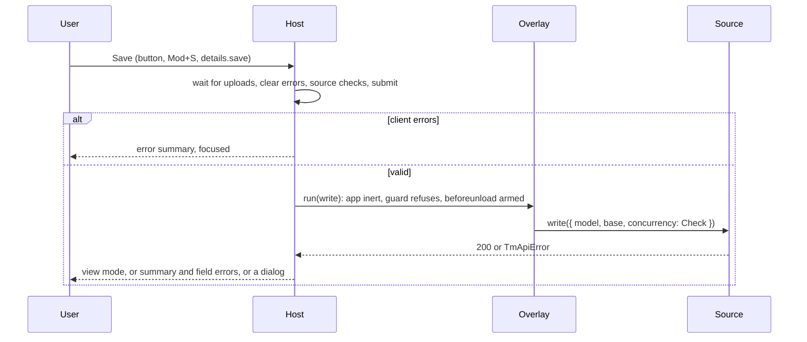

# Spec: Details Page

- **Author:** Ahmad Akra
- **Date:** 20 October 2026

**Status:** Ready for implementation. Frozen once merged: revised only if implementation forces a
design change, then kept as the historical record of what shipped — never updated thereafter as the
code or its dependencies evolve.

## Context

Every entity whose declaration has a `details` member gets one details page. The page views, edits,
creates and clones a record over one layout. A save is one blocking write, and the page has a
designed answer for every outcome.

This spec ships the host, the layout kit, the save flow and its dialogs, entity actions, drafts, the
leave guard, paging through search results, state restoration and the child-row deep link. It
builds on specs 0029 (entity model), 0025 (page state, drafts), 0026 (page context), 0024 (HTTP,
error presentation), the component library (0004, 0005, 0023) and the CRUD wire (0015–0017).

Other specs that carry parts of this design:

- spec 0010 §C.8 — `scrollToRow` with `flash` and `column`, for the deep link and the error summary.
- spec 0015 §8, §11.2 — the `Check` and `Override` concurrency modes; action-argument errors under
  `arguments`.
- spec 0016 §3.3, §7.3 — what the page sends in `SaveRequest`; the error-path grammar it splits.
- spec 0018 §1.4 — Acme's `Attachments`, `related-documents`, `close` and `set-credit-limit`.
- spec 0023 §5.4, §7.2, §8.1 — live overlay labels and the `immediate` start, reserved header
  widths, the capped item pager.
- spec 0024 §9.2, §11 — `canceledNavigationResolution: 'computed'` and the page route's
  `canDeactivate`; the shared states and dialogs.
- spec 0025 §10, §11 — the page-state entries and drafts this page fills.
- spec 0026 §9.3 — the `details` row of the page-context table.
- spec 0027 §4.3 — the admitted page keys `F2`, `Mod+S`, `Alt+PageUp`, `Alt+PageDown`.
- spec 0028 §8.1 — the "{Entity} deleted." and "Started in the background." toasts.
- spec 0029 §2.2, §3, §12.1 — action fields, the declaration members' shape, `TmUploads`.
- spec 0030 §4.2, §15 — `TmSearchSnapshot`, its `supersedes` member and the adoption rule.

## Goals / Non-goals

**Goals**

- A new entity's details page is one declaration member and a 17-line markup layout.
- Only the record's data waits. Every click answers in its frame, and nothing moves when the user
  clicks or types.
- Every save outcome has one designed answer. No edit is lost to a reload or an in-app navigation.
- The toolbar, the Actions menu, shortcuts and the future assistant run the same page actions.

**Non-goals (explicitly out of scope)**

- **The search page** — spec 0030.
- **Display names, descriptors, value controls, the picker binding and blob policies** — spec 0029.
- **Stock layouts** — spec 0032. **A report in a card** — spec 0034.
- **Generic components** — spec 0023. **Changes to existing components** — spec 0010.
- **Toast policy** — spec 0028.
- **The 400, 5xx, step-up and outdated-client dialogs** — spec 0024 §11.
- **Deferred:** a field-level merge on conflict; per-row capability flags beyond a stack's
  `permissions` extra (§4.1); workflow state beyond the title-extra slot; edit history; autosave;
  extras loaded after the record.

## 1. Placement and vocabulary

`@tellma/core/details` is a lazy route entry point that holds the host, the kit and the dialogs. The
entity-action runner lives in `@tellma/core/entity`, so the search page's bulk actions share it.

Contract blocks are TypeScript and C# sketches: names and shapes are normative; imports,
documentation comments, bodies and cancellation tokens are omitted.

| Part | Exports | Loaded |
|---|---|---|
| host | `TmDetailsHost` (internal selector), `injectTmDetails`, `TmDetailsContext`, `TmDetailsSource`, `tmEntitySource`, `TmRelated` | with the route |
| kit | `TmDetailsKit` and its parts (listed below) | with the route |
| source page | `TmDetailsPage` (§3.1) | with the route |
| editor parts | `tmLeaveGuard`, `TmDetailsDialogs` (§9, §11.3) | with the route; dialogs on use |
| picker page | `TmDetailsPickerPage` (§15) | by spec 0029 §14.4's `import()` |
| in `@tellma/core/entity` | `TmEntityActions`, `injectTmActionDialog`, the generated action dialog (§10.4) | shared lazy |
| `@tellma/core` (primary), types only | `TmDetailsSnapshot`, `TmDetailsDraft` | zero bytes |

- **The kit's parts.** `TmDetailsKit` bundles `TmDetailsCard`, `TmField`, `TmFieldView`,
  `TmFieldEdit`, `TmFieldGroup`, `TmChildGrid`, `TmChildFiles`, `TmDetailsTabs`, `TmDetailsTab`,
  `TmDetailsTabContent`, `TmDetailsAside`, `TmDetailsExtra`, `TmDetailsAudit` and
  `TmDetailsTitleExtra` (§6).
- **Imports.** `/details` imports only the primary entry point and `/entity` (spec 0024 §1). Layouts,
  `/admin`, `@tellma/module-gl/centers`, `/dashboards` and `/report-studio` import `/details`
  statically; the picker binding imports it dynamically.
- **Folder and scope.** `client/projects/core/tellma-core/details/`; scope `tm.details`.
- **Budget.** `/details` weighs at most 22 KB gzip on its own, and each dialog at most 4 KB, loaded
  on use. The editable grid sits behind `@defer` in `tm-child-grid` (§6.4) and has its own budget
  line (spec 0024 §12). The whole route fits in 80 KB.
- **Testing exports** (`@tellma/core-testing`): `TmDetailsPageHarness`, `TmFieldHarness`,
  `TmChildGridHarness`, and `tmFakeDetails()`, a `TmDetailsContext` for layout unit tests.

**Vocabulary**

- *Record* — what the page shows, identified by entity and id; `new` in create mode.
- *Source* — where the host reads and writes the record (§3.1). A *source page* is a page over a
  non-entity source, kind `settings`.
- *Server copy* — the record as the last read, save or action returned it (`entity()`).
- *Working copy* — the value the form edits (`model()`); in view mode, the server copy itself.
- *Base* — the server copy when edit or create began. Its `modifiedAt` is the *stamp* a save sends.
- *Dirty* — the working copy is a different object from the base (§4.2).
- *Layout* — the distribution's markup component for the body.
- *Hatch* — a `page` or `create` component that replaces the layout (§3.7).
- *Extra* — a named result set the server's details plan adds to every read (spec 0015 §5.3).
- *Band* — the scrolling body region under the header, holding the cards (§5.3).
- *Status strip* — the one-row overlay under the toolbar for the error summary and notices (§5.3).
- *Promoted action* — an entity action declared with `button: true`, shown on the toolbar (§10.1).
- *Snapshot* — the record's remembered page-state entry (§13). The *search snapshot* is spec 0030's
  `TmSearchSnapshot`.

## 2. What a distribution writes

The common case is one declaration member and a markup-only layout; everything else is optional.

**Example —** Acme's customer page, named by `details: () => import('./customer-details')`:

```ts
// customers/customer-details.ts — markup only; lifecycle, modes, save, errors, drafts are the host's
import { Component } from '@angular/core';
import { TmDetailsKit } from '@tellma/core/details';

@Component({
  selector: 'acme-customer-details',
  imports: [TmDetailsKit],
  template: `
    <tm-details-card>
      <tm-field path="Name" />          <!-- the multilingual group: one field per tenant language -->
      <tm-field path="Code" />
      <tm-field path="CustomerType" />
      <tm-field path="Currency" />      <!-- navigation: picker in edit mode, link in view mode -->
      <tm-field path="CreditLimit" />
    </tm-details-card>
    <tm-details-card titleKey="Acme_Customer_Contacts">
      <tm-child-grid collection="Contacts" [columns]="['Name', 'Email', 'Mobile']" />
    </tm-details-card>`,
})
export default class CustomerDetails {}
```

| Need | What the distribution writes (members per spec 0029 §3) | § |
|---|---|---|
| Values for a new record | `defaults: () => ({ customerType: 'Retail' })` | §3.6 |
| A clone that resets more | `clone: (copy, source) => ({ ...copy, code: null })` | §3.6 |
| Cross-field validation | `validate: (p) => { … }`, a Signal Forms schema | §7.2 |
| Payload shaping before a save | `beforeSave: (entity) => entity`, sync or async | §8.1 |
| A value computed while editing | `injectTmDetails<AcmeSalesInvoice>().update(…)` in an `effect` | §4.1 |
| A field the kit cannot render | `tmFieldEdit` and `tmFieldView` templates inside `tm-field` | §6.2 |
| A component of several fields | `hostDirectives: [TmFieldGroup]` on that component | §6.2 |
| An action as a toolbar button | `actions: [{ name: 'close', button: true, icon: 'circle-check' }]` | §10 |
| An action with its own dialog | `actions: [{ name, dialog: () => import(…) }]` | §10.4 |
| A body that is not a form | `details: { page: () => import(…), create?: … }` | §3.7 |
| A page over a non-entity source | `<tm-details-page [source]="…" [layout]="…" />` | §3.1 |

## 3. The host and its lifecycle

`TmDetailsHost` renders one record's header (§5) and body, and holds its state. It moves the record
between view, edit and create modes. It reads and writes through a source, so entity pages and
settings pages share one lifecycle.

### 3.1 Routes, sources and instances

The URL picks the record and the mode on entry. A source does the reads and writes.

| URL (spec 0024 §9.2) | Mode on entry | Request |
|---|---|---|
| `/{t}/{segment}/{id}` | view; edit when this tab holds an edit draft of the record (§11.2) | `get`, unless page state holds the record (§13) |
| `/{t}/{segment}/{id}?child=Lines:42` | view, then the child target (§14) | `get` |
| `/{t}/{segment}/new` | create: defaults, or this tab's create draft | none |
| `/{t}/{segment}/new?clone=5` | create from a clone of record 5 (§3.6) | `get` of 5, unless held |

```ts
// @tellma/core/details
interface TmDetailsSource<T> {
  readonly kind: 'details' | 'settings';             // page-context kind and action-id prefix (spec 0026 §9.3)
  readonly entity: string;                            // the descriptor the kit resolves paths against
  readonly id: Signal<TmId | null>;                   // null: create mode; a change re-keys the record
  readonly titleKey?: string;                         // a fixed title; absent: the record's display name
  readonly draftKey: Signal<string | null>;           // a TmDrafts.key(…) value; null keeps no draft
  read(signal: AbortSignal): Promise<TmDetailsRecord<T>>;
  write(change: { readonly model: T; readonly base: T | null; readonly concurrency: 'Check' | 'Override' }):
    Promise<TmDetailsRecord<T>>;                      // the save (§8.2); rejects with TmApiError
  readonly can: { readonly edit: Signal<boolean>; readonly create: Signal<boolean>;
                  readonly delete: Signal<boolean>; readonly activate: Signal<boolean> };
  validate?(model: T): readonly TmValidationProblem[]; // client checks a schema cannot express; run before write (§8.1)
  readonly saveSecurable?: Signal<TmSecurableRef | null>; // spec 0024 §2.2's pair, for the step-up notice (§5.3); absent or null: none
  readonly category?: Signal<string>;                 // kind 'settings': the page context's category (§16)
  readonly errorSegments?: (path: string) => readonly (string | number)[] | null; // a 422 path to model segments; default §8.5
  readonly changes?: Signal<unknown>;                 // a change re-reads in view mode; ignored while editing
}
interface TmDetailsRecord<T> {
  readonly entity: T;                                                       // the record, wire-shaped
  readonly related?: Readonly<Record<string, readonly TmJsonObject[]>>;     // related rows by entity
  readonly extras?: Readonly<Record<string, TmJson>>;                       // extras by name
}
interface TmValidationProblem {                       // a 422 errors[] item (spec 0016 §7.2)
  readonly path: string;                              // in the write's path grammar
  readonly code: string; readonly arguments?: TmJsonObject;
}
declare function tmEntitySource<T>(descriptor: TmEntityDescriptor, id: Signal<TmId | null>): TmDetailsSource<T>;
@Component({ selector: 'tm-details-page' })          // the host over a given source and layout
declare class TmDetailsPage {
  readonly source: InputSignal<TmDetailsSource<unknown>>;
  readonly layout: InputSignal<TmLazyComponent | Type<unknown>>;
}
```

- **The entity source** is what `tmEntitySource` returns:
  - it reads `{segment}/get` (§3.3) and writes `{segment}/save` (§8.2);
  - `can.edit` and `can.create` are `TmPermissions.allows(entity, 'save')`, and `can.delete` and
    `can.activate` use `delete` and `activate` (spec 0029 §7);
  - its `draftKey` is `TmDrafts.key(t, entity, id ?? 'new')`;
  - its `saveSecurable` is `[entity, 'Save']`.
- **A source page** (`kind: 'settings'`, spec 0032 §7, §8) has no crumb, pager, New, Clone, Delete,
  entity actions or page state. Its actions are `settings.edit`, `.save`, `.cancel` and `.refresh`.
- **Route host.** Spec 0024 §4.4's route host creates the host after `TmEntities.load()`. On a cold
  entry, it also waits for the launch documents.
- **One instance per record.** The body is keyed on `entity + (id ?? 'new')`. A key change, such as
  paging or a create's first save, recreates the form, extras and registrations. The header stays.
- **Operations gate the toolbar, not the route.** A stack without `save` opens with no Edit, New or
  Clone. A user without `Read` sees the `forbidden` state (§3.5).

### 3.2 States

The host's `status` and `mode` together decide what the header and the body show.

| `status` | `mode` | Header | Body |
|---|---|---|---|
| `loading` | view | crumb; the title (§3.3); toolbar at final geometry, Edit and Actions disabled; pager | the layout with value skeletons (§3.3) |
| `ready` | view | the display name; badges; full toolbar | the layout with values |
| `ready` | edit, create | "Unsaved changes" badge while dirty; Save, Cancel; pager disabled | the layout with controls |
| `error` | view | crumb; the cached title, else the entity label; New and the pager stay | `tm-error-state` (§3.5) |

### 3.3 Loading

Only the record's data waits: everything else renders at its final size before the read returns.

1. **Read.** The host starts the read in its constructor, through one `resource()` keyed by the
   record and a refresh generation. It calls `TmApi.read('{segment}/get', { id, include:
   descriptor.extras }, { signal })`. The read asks for every declared extra and sends no `select`,
   since writes mark lists stale instead of echoing rows.
2. **Skeletons.** Meanwhile the layout renders its labels with value skeletons, plus child-grid
   placeholders and extra skeletons, all at final geometry. The band carries `aria-busy="true"` and
   one polite "Loading" status.
3. **Title.** The title renders at once when `TmDisplayNames.label(entity, id)` knows the record
   (spec 0030 §5.2). Otherwise a fixed-width skeleton bar holds its place.
4. **Success.** `entity` and `model` take `entities[0]`. `related` and the record feed
   `TmDisplayNames`, `extras` are set, and `status` becomes `ready`. Leaving aborts the read.

### 3.4 View → edit, instantly

- **Edit** (`details.edit`) sets `base` to `entity()` and `mode` to `edit`. It copies and sends
  nothing (§4.2). Focus moves to the first registered editable field, and the status says "Editing
  {name}".
- **Cancel** (`details.cancel`), when dirty, first asks through `TmConfirm.ask`:
  "Discard changes?" / "Your changes to this record will be lost.", with Discard changes (ghost)
  and Keep editing (primary). The host then clears server errors (§8.5), resets the form to `base` and returns to
  view mode. It clears the draft and focuses Edit.
- **Cancel in create mode** leaves the page instead of returning to view mode: Back, else the
  search page.

### 3.5 Read failures

A failed read replaces the body with an error state; the header stays usable.

- **The error state.** The body renders `tm-error-state` from `TmErrorPresenter.describe(error, {
  kind: 'read', entity })`. Spec 0024 §11 owns its copy and actions.
- **A way out.** On `not-found` and `forbidden`, the page adds a primary link "{Plural}" to the
  search page. New and the pager stay live, so the user can step past a missing record (§12.2).
- **Tenant errors.** `tenant-not-found` and `tenant-unavailable` go to `TmErrorPresenter.present`,
  which leaves the page.

### 3.6 Create and clone

- **New** (`details.create`) is a link to `TmUrls.create(entity)`, so Mod+click opens a new tab. The
  model starts with every child collection `[]` and every non-nullable `bool` `false`, with
  `declaration.defaults?.()` merged over it. The title is the entity's `newLabelKey` (spec 0029
  §2.4).
- **Clone** (`details.clone`) pushes `TmUrls.create(entity, { clone: id })`. The new instance takes
  the source record from its snapshot (§13), else reads it. It then strips the copy in this order:
  1. a structured copy (`structuredClone`);
  2. remove the key and every `server-owned`, `database-owned` and `derived` property by descriptor,
     which drops `modifiedAt`, the audit columns and `isActive`;
  3. set every blob reference to `null`: a blob has one owner (spec 0017 §4.1);
  4. in every child collection, recursively: the same, plus the parent key, and a fresh negative id;
  5. `declaration.clone?.(copy, source)`, both wire-shaped.
- **Kept values.** `write-once` and `unique` values stay; a duplicate `Code` returns as `Unique`.

### 3.7 The `page` hatch

`details: { page, create?, edit? }` (spec 0029 §3) replaces the layout. The host keeps
the header, toolbar, pager, page actions, drafts, leave guard and page context.

- **`page`** renders as the whole body region, with its own scroll, in view and edit mode. It also
  renders create mode, unless a `create` hatch is given.
- **Inputs.** Both hatches read `injectTmDetails()`. The route's query reaches them by component
  input binding (spec 0024 §9.2); the report studio reads `root` this way (spec 0034 §12.1).
- **`edit: 'page'`** is declared by a hatch whose page is itself the editor, such as the report page
  (spec 0034 §2.3). The host then registers no `details.edit` action and has no in-place edit mode.
  Create mode is unchanged, and `can.edit` still reaches the page through `injectTmDetails()`.
- **Own toolbar buttons** are page actions with `group: 'primary'` (spec 0026 §9.4).
- **Its own page-context kind.** A hatch may register `dashboard`, `report` or `studio`. The
  registry keeps the host's actions after the hatch's own (spec 0026 §9.2), and
  `TmDetailsContext.actions` lists them.

## 4. `TmDetailsContext`

`injectTmDetails()` is the one contract a layout, a hatch, a panel or a layout test sees. Layouts
need it only for custom logic; the kit reads it for them.

### 4.1 Contract

```ts
declare function injectTmDetails<T = TmJsonObject>(): TmDetailsContext<T>;   // inside the host's injector

interface TmDetailsContext<T> {
  readonly descriptor: TmEntityDescriptor; readonly source: TmDetailsSource<T>;
  readonly id: Signal<TmId | null>;                            // null in create mode
  readonly mode: Signal<'view' | 'edit' | 'create'>;
  readonly status: Signal<'loading' | 'ready' | 'error'>;      // the read's state (§3.2)
  readonly error: Signal<TmApiError | null>;                   // the read's failure
  readonly entity: Signal<T | undefined>;                      // the server copy
  readonly model: Signal<T>;                                   // the working copy; entity() itself in view mode
  readonly form: FieldTree<T>;                                 // Signal Forms over model (§4.2)
  readonly dirty: Signal<boolean>; readonly busy: Signal<boolean>; // busy: a write in flight
  readonly related: TmRelated;                                 // related rows, by entity and id
  readonly extras: Signal<Readonly<Record<string, TmJson>>>;   // by extra name
  readonly can: { readonly edit: Signal<boolean>; readonly create: Signal<boolean>;
                  readonly delete: Signal<boolean>; readonly activate: Signal<boolean> };
  readonly actions: Signal<readonly TmPageAction[]>;           // §10.1's actions, for a hatch's own toolbar
  readonly childTarget: Signal<{ readonly collection: string; readonly id: TmId } | null>; // §14
  edit(): void; cancel(): Promise<boolean>;                    // cancel → false: the user kept editing
  save(): Promise<boolean>;                                    // true: saved, back in view mode
  refresh(): void;                                             // view: re-read; edit: related and extras only
  update(recipe: (model: T) => T): void;                       // a programmatic write; edit and create only
  registerField(path: string, field: TmDetailsFieldRef, destroyRef?: DestroyRef): void;
  registerCollection(name: string, collection: TmDetailsCollectionRef, destroyRef?: DestroyRef): void;
}
interface TmRelated { get(entity: string, id: TmId | null | undefined): TmJsonObject | undefined }
interface TmDetailsFieldRef {                                  // path: PascalCase, relative to the record ('Name2')
  readonly labelKey: string; readonly label: Signal<string>; readonly editable: Signal<boolean>;
  focus(): void;                                               // opens its tab, expands its card, focuses the control
}
interface TmDetailsCollectionRef {                             // name: the child collection ('Lines')
  readonly ready: Signal<boolean>;                             // the deferred grid rendered its rows
  readonly visible: Signal<TmVisibleData>;                     // columns and rows as displayed (spec 0026 §9.1)
  reveal(rowId: TmId, options?: { flash?: boolean; column?: string }): boolean; // scrolls; focuses with column
}
```

- **`T`** comes from the generated `TmEntityTypes` (spec 0029 §15). Ids are `TmId` (spec 0024
  §10.1): a `number` for an `int` key, a `TmDecimal` for a `bigint` one.
- **`update`** writes through `model`, marks the record dirty and feeds the draft. Calling it in
  view mode is a development error.
- **`refresh` in edit mode** keeps the working copy and the base stamp, so a conflict still surfaces
  (§9.1).
- **`can`** covers permissions only; §10.1 adds the mode checks. A member holds when the source's
  member holds and, if the record's extras include `permissions`, that extra's matching `save`,
  `delete` or `activate` member holds too. Report definitions (spec 0033 §5.2) and the Schedule
  stack (spec 0020 §7.8) have this extra.
- **Registration.** The kit registers every rendered field and child grid. A platform component
  that edits paths itself, such as spec 0032's `tm-setting-field`, registers the same way.

### 4.2 The form

```ts
// inside the host, once per record (§3.1); initial is the create model (§3.6), or {} until the read lands
const model = signal<T>(initial);
const tree = form(model, (p) => { tmDetailsPlatformSchema(p, descriptor); declaration.validate?.(p); }); // §7
```

- **One form, three modes.** View mode renders `tm-value` from the nodes and binds no control. Edit
  and create mode bind controls to the same nodes.
- **Dirty by reference.** A Signal Forms write copies only the objects along its path. So `base`
  keeps its reference, and `dirty` is `model() !== base`.

**Example —** Farah clicks Edit on customer 5: `base` and `model()` are the same object, so the
record is clean. She types in `Code`: the write copies the root object, `model() !== base`, and the
"Unsaved changes" badge shows. Cancel resets `model` to `base`, and the record is clean again.

## 5. Page anatomy and the layout language

The page has the search page's two header rows and a body band of cards. The header, the band and
the status strip are the platform's; what sits in the cards is the layout's.

### 5.1 Row 1: crumb, title, badges

Row 1 is spec 0023 §7.2's `tm-page-header`.

- **Crumb.** `[tmPageBack]` shows the plural label ("Customers"). It links to the search snapshot's
  canonical URL when the page was opened from the list (§12), else to `TmUrls.search(entity)`.
- **Title.** `h1[tmPageTitle]` shows the display name, ellipsized; in create mode, the new-record
  label. It is the route's focus target. Followed by the distribution's `{displayName}`, it is also
  the document title (spec 0024 §4.4).
- **Badges** sit in `[tmPageTitleExtra]`, each in a fixed box, in this order:
  - "Active" or "Inactive" with an icon, on activatable entities;
  - "Unsaved changes" (warning, dot and text) while dirty;
  - the layout's own, from `<ng-template tmDetailsTitleExtra>`, such as a workflow state chip.

### 5.2 Row 2: the toolbar

| Group | View mode | Edit and create mode |
|---|---|---|
| leading | Edit (primary), New, promoted actions (secondary), Actions menu | Save (primary, in Edit's box), Cancel |
| trailing | Refresh; the pager "3 / 293" with previous and next | Refresh's box kept empty; the pager, disabled |

- **Views of page actions.** Every button calls `TmPageActions.invoke(id, {}, 'user')`. It shows
  `running` as its busy state in the click's frame (spec 0026 §9.5).
- **Responsive**, by container queries:
  - at `xl`, every button is labelled;
  - from `lg`, only Edit and Save are labelled; the rest are icon-only, with tooltips and names;
  - below `lg`, New and promoted actions move into the Actions menu's first group;
  - below `sm`, controls take the 44 px touch height.
- **Stable layout.** Save takes Edit's box, and Cancel the next one. The trailing group never moves,
  since the header keeps Refresh's width while it is hidden (spec 0023 §7.2).

### 5.3 Row 3: the body band and the status strip

- **The band** fills the rest of `main` and scrolls on its own with `scrollbar-gutter: stable`. It
  is a `region` labelled by the title, styled with `--surface-subtle`, a top hairline, 14 px padding
  (10 px below `sm`) and 10 px between cards.
- **Cards** stack. `width="half"` cards pair up while the column is at least `md` wide.
- **The aside.** When the layout has a `tm-details-aside`, the band gains a sticky column at the
  inline end from `lg` up: 272 px wide (320 px from `xxl`), as tall as the band's visible height,
  with its own scroll. Below `lg` the aside renders as a card after the main cards. In RTL the
  column sits on the left.
- **The status strip** is one row, 36 px high (44 px below `sm`). It is anchored under the toolbar
  and layered over the band's top edge, with a bottom shadow.
  - It takes no layout space, so showing or hiding it moves nothing.
  - The band's `scroll-padding-block-start` equals its height, so focus never hides under it.
- **The strip holds one message**, in priority order: the error summary (§8.4), the draft notice
  (§11.2), a deep-link notice (§14.1), the step-up notice.
- **The step-up notice** shows in edit and create modes while `TmPermissions.sensitive` (spec 0029
  §7) holds for the source's `saveSecurable`: "Saving asks you to confirm it's you."
- **A notice** is spec 0005 §13's `tm-alert` (`kind="info"`). The strip adds its own icon button
  "Dismiss" after it, since `tm-alert` has none. A notice is never focused.

## 6. `TmDetailsKit`

The kit is the layout language. Each element reads the host's context, so a layout passes paths,
never values.

**Extras.** Every extra the descriptor lists is eager: it arrives with every `get` and with every
save or action read-back, through `include`. A panel shows an extra through a structural directive.

```ts
@Directive({ selector: '[tmDetailsExtra]' })              // structural; the input is the extra's name
declare class TmDetailsExtra { readonly tmDetailsExtra: InputSignal<string> }
// template context { $implicit, value }:
//   $implicit — a QueryRowSet extra's rows as objects keyed by column name; any other extra's value
//   value     — the extra's value
```

Three skeleton lines show while the record loads. A missing extra renders nothing, and an
undeclared name is a development error.

**Example —** `<acme-related-documents *tmDetailsExtra="'related-documents'; let rows" [rows]="rows" />`.

### 6.1 `tm-details-card`

```ts
@Component({ selector: 'tm-details-card' })               // on spec 0023's tm-card
declare class TmDetailsCard {
  readonly titleKey: InputSignal<string | undefined>;     // the heading; absent: no header
  readonly id: InputSignal<string | undefined>;           // required when collapsible or scrollable (§13)
  readonly width: InputSignal<'full' | 'half'>;           // default 'full' (§5.3)
  readonly columns: InputSignal<1 | 2 | 'auto'>;          // the field grid; auto: 2 while the card is ≥ sm, else 1
  readonly collapsible: InputSignal<boolean>; readonly collapsed: InputSignal<boolean>; // collapsed: the initial state
  readonly scrollable: InputSignal<number | undefined>; readonly flush: InputSignal<boolean>; // a fixed body size in px; no body padding
}
```

- **Body grid.** The body is a CSS grid of `columns`, with 10 × 18 px gaps and 11 px padding. Each
  `tm-field` takes one cell, or two with `span`. Any other child spans every column.
- **Remembered state.** Collapsible cards use spec 0023's disclosure. Their state, and a scrollable
  body's scroll, are remembered per record (§13).

### 6.2 `tm-field`

```ts
@Component({ selector: 'tm-field' })
declare class TmField {
  readonly path: InputSignal<TmPath<string>>;             // spec 0029 §3's typed path, relative to the record
  readonly labelKey: InputSignal<string | undefined>;     // default: the path's label (spec 0029 §4.3)
  readonly hintKey: InputSignal<string | undefined>;      // help text under the field, both modes
  readonly helpKey: InputSignal<string | undefined>;      // reserved (spec 0026 §9.8); renders nothing
  readonly span: InputSignal<1 | 2>;                      // default 1, or 2 for a textarea (maxLength absent or > 255)
  readonly readonly: InputSignal<boolean>;                // read-only in edit mode too
  readonly filter: InputSignal<string | null>;            // navigations: the picker's Queryex predicate (spec 0029 §14.1)
  readonly create: InputSignal<boolean>;                  // navigations: offer Create… (default true)
}
@Directive({ selector: 'ng-template[tmFieldEdit]' }) declare class TmFieldEdit {}  // context { $implicit: FieldTree<unknown>, property }
@Directive({ selector: 'ng-template[tmFieldView]' }) declare class TmFieldView {}  // context { $implicit: value, property }
```

The path resolves through `TmEntities.resolve(root, path)` (spec 0029 §4.3); its end kind decides
the rendering:

| End kind | View mode | Edit and create mode |
|---|---|---|
| `value` (a scalar or a twin) | `tm-value` (spec 0029 §12): formatted, "—" for null | `tm-value-editor` in a `tm-form-field`, bound to the node |
| `text` (a group anchor, `Name`) | one cell per admitted slot, labelled "Name (E)", "Name (ع)", each in its content direction | one control per slot, `dir` from its slot |
| `navigation` (`Currency`) | the display name, a link when `allows(target, 'details')`; with an avatar column, `tm-avatar` and the name; the avatar's `colorKey` is the record key (spec 0029 §12.2) | `tm-entity-field` (spec 0029 §14) on the foreign key (`currencyId`), with `filter` and `create` |
| `image` (`Image`) | `tm-image`, 72 × 72, the `thumb` variant when listed | `tm-image` in edit mode: pick, crop, upload, replace, remove (§6.3) |
| `file` (`File`) | the file name as a download link, and its size | `button[tmFilePicker]` and the file chip with remove (§6.3) |
| a path through navigations (`Customer.Code`) | the related projection's value (`TmRelated`) | read-only |

- **Read-only fields.** A field is read-only in edit mode when its ownership says so (spec 0029
  §12.2), when it sets `readonly`, or when its path is dotted. It shows the value with a 12 px lock
  and the accessible text "Read only", with no control and no tab stop.
- **Unadmitted slots.** A slot the tenant's shape does not admit renders nothing: `Name3` on a
  two-language tenant.
- **Equal geometry in both modes.** A view-mode value box has the control's height (30 px, 44 px
  below `sm`) and the same label row, so switching modes moves nothing.
- **Semantics.** In view mode, the card's grid is a `dl[tmDescriptionList]` (spec 0023 §7.1), and
  each field a `div` with `dt` and `dd`. In edit mode, `tm-form-field` labels the control and shows
  the hint and the focus-only error popover (spec 0002 §5).
- **Assisted fields.** While `TmFormContext.assisted()` holds the path (§16), a 12 px `sparkles`
  glyph titled "Filled in by the assistant" follows the label.
- **Registration.** A rendered field registers its path (§4.1); a group anchor registers each
  admitted slot. `TmFieldGroup`, a host directive with `display: contents`, forwards the
  registration, so a component of fields (spec 0032's `tm-gl-center-fields`) joins the card's grid.

**Example —** a custom control that keeps the cell, its label and its errors:

```html
<tm-field path="Color">
  <ng-template tmFieldEdit let-field><acme-color-picker [formField]="field" /></ng-template>
  <ng-template tmFieldView let-value><acme-color-swatch [value]="value" /></ng-template>
</tm-field>
```

### 6.3 Images and files

`tm-value-editor` checks, uploads and stages files (spec 0029 §12.1, §16) through `TmApi.upload`
(spec 0024 §10.1). The host provides `TmUploads` and owns what happens around the save. Downloads
use `TmUrls.blob(kind, id, { download: true })`.

1. **Pick.** A wrong type or size fails at once as a field error ("This file is too large. The limit
   is {max}."). `cover-square` images are cropped first.
2. **Upload** starts at once, with a progress ring. While the path is in `TmUploads.running`, the
   field is `pending` (§7.1) and Save waits. Replacing or removing the file aborts the upload.
3. **Staged.** The staged blob's id becomes the value (`imageId`). The preview loads through
   `TmUrls.blob(kind, id)`, since spec 0017 §5.1 serves a staged blob to its uploader. The draft
   keeps the blob descriptor, so the preview survives a reload.
4. **Save** attaches the blob (spec 0017 §4.1). `Blob.NotAttachable` lands on the field ("This file
   expired. Choose it again."). Clearing a value sends `null`, which releases the old blob.
5. **Upload errors** (`blob-rejected`) render on the field through `TmServerText`. A 5xx shows
   "Upload failed" with a retry button.

### 6.4 Child grids: `tm-child-grid`

```ts
@Component({ selector: 'tm-child-grid' })
declare class TmChildGrid {
  readonly collection: InputSignal<string>;                 // 'Lines' (spec 0029's TmChildMetadata.name)
  readonly columns: InputSignal<readonly TmColumnInput<string>[]>; // keys relative to the child entity (spec 0029 §6.1)
  readonly totals: InputSignal<readonly string[]>;          // numeric columns summed in a footer row
  readonly defaults: InputSignal<(() => TmJsonObject) | undefined>; // a new row's values
  readonly readonly: InputSignal<boolean>;                  // never editable
  readonly maxRows: InputSignal<number>;                    // the height cap, default 12
}
```

- **One grid in every mode.** One `tm-grid` binds to `form.<collection>` with spec 0004's editable
  binding and is `readonly` in view mode, so a mode switch changes rule colours only. Columns come
  from `tmGridColumnFor(column, { editable })` (spec 0029 §12.1).
- **Per-record memory.** `gridId` is `details:<entity>:<collection>` and `contentKey` is the record
  id, so scroll and column widths are kept per record.
- **New rows** come from the placeholder row as `{ id: −n, ...defaults() }`, where `n` is a per-page
  counter. The server inserts them (§8.2). Rows delete with spec 0004's commands.
- **Height** is set when the record loads and at each mode change, and is fixed in between. It fits
  the rows plus the placeholder (at least 4 rows, at most `maxRows`), plus the header. Beyond that,
  the grid scrolls inside.
- **Totals** sum the `TmDecimal` values exactly with `TmDecimals.add` (spec 0024 §10.1), and stay
  live in edit mode.
- **Loading.** The grid renders inside `@defer (on viewport; prefetch on idle)`. A placeholder of
  the same geometry stands in, also while the record loads. The grid registers once its rows render.
- **Links.** View-mode navigation cells are links; Enter follows one (spec 0004's readonly Enter).

### 6.5 Child files: `tm-child-files`

```ts
@Component({ selector: 'tm-child-files' })
declare class TmChildFiles {
  readonly collection: InputSignal<string>;               // 'Attachments'
  readonly file: InputSignal<string>;                     // the child's file navigation, 'File'
  readonly caption: InputSignal<string | undefined>;      // a text path
}
```

- **View mode:** a `list` of file chips. Each chip is a download link that previews on click, and
  shows a thumbnail or a type icon, the name and the size.
- **Edit mode:** a `tm-dropzone` "Add files" (multiple) sits above the list.
  - Each file adds a row `{ id: −n, fileId: null }` at once, with a progress ring. The row's
    `fileId` is set when the file is staged (§6.3).
  - Each row has a remove button, and `caption` edits inline. Links and remove buttons are tab stops.

### 6.6 Tabs: `tm-details-tabs`

```ts
@Component({ selector: 'tm-details-tabs' })               // renders spec 0005's tm-tab-group
declare class TmDetailsTabs {
  readonly id: InputSignal<string>;                       // default 'main'; unique per layout (development error)
  readonly selected: ModelSignal<string | undefined>;     // the selected tab's id; default the first
}
@Component({ selector: 'tm-details-tab' })
declare class TmDetailsTab {
  readonly id: InputSignal<string>;
  readonly labelKey: InputSignal<string | undefined>;     // default: the collection's label
  readonly collection: InputSignal<string | undefined>;   // the child collection the tab shows
}
@Directive({ selector: 'ng-template[tmDetailsTabContent]' }) declare class TmDetailsTabContent {}
```

- **Rendering.** The tabs render as `tm-tab-group` with `preserveContent` on every tab. A tab
  renders on its first visit and then stays, hidden and `inert` while unselected, in every mode. A
  tab never visited never renders.
- **`collection`** gives the tab its default label, a count (`tm-counter`, live in edit mode), its
  error dot and its deep-link target (§14). The tab needs it because its grid does not exist until
  the tab opens.
- **`selected`** lets a page drive the tab; spec 0032's Settings binds it to the URL. The selection
  per `tm-details-tabs` id is remembered (§13), drafted (§11.1) and published as `state.tab` (§16).
- **Error dot.** A tab holding an error shows a 6 px dot and adds ", has errors" to its name.

**Example —** Acme's invoice lines and attachments:

```html
<tm-details-card flush>
  <tm-details-tabs>
    <tm-details-tab id="lines" collection="Lines"><ng-template tmDetailsTabContent>
      <tm-child-grid collection="Lines" [columns]="['Center', 'Description', 'Amount']" [totals]="['Amount']" />
    </ng-template></tm-details-tab>
    <tm-details-tab id="attachments" collection="Attachments"><ng-template tmDetailsTabContent>
      <tm-child-files collection="Attachments" file="File" />
    </ng-template></tm-details-tab>
  </tm-details-tabs>
</tm-details-card>
```

### 6.7 The aside: `tm-details-aside`

```ts
@Component({ selector: 'tm-details-aside' })              // its content renders in the host's aside column
declare class TmDetailsAside { readonly titleKey: InputSignal<string | undefined> }
```

The host renders the element's content in the aside column (§5.3), with the layout's injector. The
column is a `complementary` region whose scroll is remembered (§13). A second aside is a development
error.

### 6.8 `tm-details-audit`

`<tm-details-audit />`, one line in the layout, renders the collapsed "Audit info" card. It shows
Created by (a link), Created at, Modified by and Modified at, with instants in the display zone and
spec 0029 §12.2's zone label. It renders nothing on entities without audit columns.

## 7. Validation

The client checks what the metadata knows, plus the distribution's schema. The server stays the
authority for the rest: uniqueness, references and business rules.

### 7.1 The platform schema

`tmDetailsPlatformSchema(p, descriptor)` applies these rules to every editable property, and to
every child entity through `applyEach`:

| Rule | When | Signal Forms |
|---|---|---|
| required | not nullable, not `bool` (a `false` counts as empty), not a twin | `required(p.x)` |
| maximum length | `maxLength` set | `maxLength(p.x, n)` |
| digits | `precision` set: at most `precision − scale` integer digits (`tmNumber` caps decimals) | `validate(p.x, …)`, kind `precision` |
| read-only | `server-owned`, `derived`, `database-owned`; `write-once` outside create mode | `readonly(p.x, { when })` |
| upload pending | the path is in `TmUploads.running` (§6.3) | an async validator, pending until the upload settles |
| server and source errors | §8.5; §8.1 step 3 | one tree validator over `p` |

Messages come from spec 0002's `tmResolveFieldErrors` and show in the focus-only error popover. An
error shows once its field is touched or dirty. Save marks every interactive field touched.

### 7.2 The distribution's schema

`validate` (spec 0029 §3) is a Signal Forms schema function over the wire-shaped record. It runs
after the platform schema, so it adds rules and never weakens one.

**Example —** a corporate customer needs a credit limit:

```ts
validate: (p) => required(p.creditLimit, { when: ({ valueOf }) => valueOf(p.customerType) === 'Corporate' }),
```

## 8. The save flow

Save checks the form on the client, then runs one blocking write and answers every outcome.

### 8.1 Steps



1. **Trigger:** the Save button, `Mod+S` or `details.save`. A second invoke while one runs is
   refused.
2. **Uploads.** While `TmUploads.running` is not empty, the overlay reads "Finishing uploads…".
3. **Validation.** The host clears its server errors and runs `source.validate?.(model())`. It
   records each problem the way §8.5 records a server error. It then calls `submit(tree, { action,
   onInvalid })`. Any error makes `onInvalid` open the summary (§8.4), and nothing is sent.
4. **Payload.** `action` applies `declaration.beforeSave?.(model())` and builds the body (§8.2). It
   flushes the draft, marked with `savingAt` (§11.1).
5. **Write.** The host runs `TmBusyOverlay.run(source.write(…), { label })`, with the label now
   "Saving…". The Save button's `running` spinner is the click's feedback. The page turns inert at
   once, and the scrim follows only after 200 ms (spec 0023 §5.4). Meanwhile `busy` holds the
   navigation lock (§8.7). A write is never aborted. A 422's errors are recorded on their fields
   (§8.5).

### 8.2 The body

**Example —** Acme's sales invoice, edited (spec 0018 §1.4):

```json
POST /17/api/web/sales-invoices/save
{ "entities": [ { "id": 1284, "serialNumber": 1284, "postingDate": "2026-10-20", "customerId": 77,
                  "isClosed": false, "modifiedAt": "2026-10-19T08:14:02.1234567+00:00",
                  "lines": [ { "id": 5501, "centerId": 12, "description": "Steel pipes", "amount": "1032.0000" },
                             { "id": -1, "centerId": 14, "description": "Delivery", "amount": "800" } ],
                  "attachments": [ { "id": 801, "fileId": 9921 }, { "id": -2, "fileId": 10433 } ] } ],
  "returnEntities": true, "include": ["related-documents"], "concurrency": "Check" }
```

- **The working copy as is.** Server-owned members travel back and the server ignores them (spec
  0016 §3.1). Decimals are strings: a read value goes back as read, and a typed one as its
  editor's text (`"800"`).
- **The stamp.** `modifiedAt` is the base's raw string. Create mode sends no `id` and no
  `modifiedAt`.
- **Children** are the full arrays the read returned, as edited. New rows carry negative ids, which
  the server inserts; deleted rows are absent (spec 0016 §3.7). A loaded collection is never sent as
  `null`.
- **`include`** lists every extra; there is no `select`. **`concurrency`** is `Check`, and
  `Override` only after the user chose Overwrite (§9.1).

### 8.3 Success (200)

1. **Adopt.** `entity` takes `entities[0]`, the committed read-back, with its extras and related
   rows. The form resets to `entity`, `mode` becomes `view`, and the draft clears.
2. **Create mode.** The host replaces the URL with `TmUrls.details(entity, id)`, so Back skips
   `/new`. The body re-keys on the new id with the saved copy, and sends no request.
3. **Lists.** `TmPageState.markStale({ tenantId, entity })` (spec 0025 §10) makes remembered lists
   refetch on return.
4. **Feedback.** The polite status region says "Saved", and focus goes to Edit. There is no toast:
   the page itself shows the outcome.

### 8.4 The error summary (422 and client errors)

The summary lists every problem that blocks a save, in the status strip (§5.3). It is spec 0005's
`tm-alert` (`kind="error"`).

- **Collapsed**, it is one row: the heading "Fix {count, plural, one {# problem} other {# problems}}
  to save" and a Show problems button (`aria-expanded`).
- **Expanded**, its list drops down over the band. It is at most half the band's height and scrolls
  inside.
- **Opening and closing.** A failed Save opens it expanded and focuses the heading
  (`tabindex="-1"`). Escape, Tab past its end, or activating an item collapses it.
- **Items** number at most 10, then "and {n} more":

| Error | Item | Activating it |
|---|---|---|
| a registered field | button "{label}: {message}" | the field's `focus()`: its tab opens, its card expands, its control takes focus |
| a child-row cell | button "{collection} · row {n} · {column}: {message}" | opens the tab naming the collection, waits for the grid, then `reveal(rowId, { column })` |
| a field never rendered (a tab not yet visited), or the root | plain text "{label}: {message}" | — |

- **Stable while typing.** An item never leaves while the user edits: once its error clears, it
  shows a check and "Fixed" in its box. The next Save replaces the summary; success or Cancel
  removes it.

### 8.5 Mapping server errors to fields

Each 422 error lands on the field it names, through one tree validator the host holds.

1. **Split** each `errors[].path` into `name` and `[digits]` segments, by spec 0016 §7.3's grammar:
   `entities[0].lines[1].amount` → `entities`, 0, `lines`, 1, `amount`. The leading `entities[0]`
   is the record; anything else (`body`) is a root error. A source may map paths itself (§3.1).
2. **Walk** the `FieldTree` by json names; each child collection's descriptor gives the next step's
   entity. A segment that does not resolve stops the walk: the error attaches to the deepest node
   reached and lists as not rendered. Registered paths are the PascalCase property names.
3. **Record** the node's value as sent. The tree validator reports the error only while the value is
   the one sent, so editing the field clears it and undoing brings it back. The overlay blocks edits
   during the write, so indices into the payload still match.
4. **Message.** The text is `TmServerText.error(item, entity)` (spec 0024 §7.5), for the path's own
   entity. All server errors clear on the next Save, on Cancel and on success.

**Example —** `{ "path": "entities[0].lines[1].amount", "code": "Range", "arguments": { "property":
"Amount", "min": 0 } }` lands on row 2's Amount cell as "Lines · row 2 · Amount: Must be at least 0."

### 8.6 Other outcomes

The user stays in edit mode after every outcome below, unless they choose Reload in the concurrency
dialog.

| Response (`kind`, `code`) | Handling |
|---|---|
| 409 `conflict` (`concurrency-conflict`) | the concurrency dialog (§9.1) |
| 404 `not-found` on an update | the deletion dialog (§9.2) |
| `bad-request`, `limit`, `forbidden`, `read-only` | `TmErrorPresenter.present(e, { kind: 'save', entity })`: the 400 dialog |
| `step-up` | spec 0024 §8.3's dialog. After sign-in, edit mode returns from the draft (§11.2) and the user saves again |
| `client-outdated` | spec 0024 §5.6's write dialog; its Reload keeps the draft |
| `offline` (`not-sent`) | `present`: nothing was sent |
| `offline` (`outcome-unknown`), `unavailable`, `server` | `present`, with `retry` re-running `save()`. A save that did commit meets its own stamp (§9.1) |
| 422 `validation` with `blob-rejected` items | field errors on the blob field (§6.3) |

### 8.7 The navigation lock

While a write is in flight, nothing can leave the page.

- **Overlay and router.** `TmBusyOverlay` makes the app `inert`. The leave guard (§11.3) refuses
  while `busy`, and a refused Back keeps the history index (spec 0024 §9.2).
- **Browser.** A `beforeunload` listener lives only while the write is in flight. The Save click gave
  it sticky activation. It is not a dirty-form prompt (§11.4).

## 9. Concurrency and deletion dialogs

When a save meets a newer stamp or a deleted record, the page asks the user what to do. The dialogs
use `TmConfirm.ask`: an `alertdialog` with focus on the primary choice. Any editor page may reuse
them:

```ts
// @tellma/core/details
declare class TmDetailsDialogs {                                           // root service
  conflict(conflict: TmConflictInfo | null): Promise<'reload' | 'overwrite' | null>; // §9.1; null: dismissed
  deleted(): Promise<'discard' | null>;                                    // §9.2; null: keep editing
  leave(): Promise<'discard' | 'stay'>;                                    // §11.3; Escape: 'stay'
}
interface TmConflictInfo {                                                 // spec 0016 §7.4
  readonly modifiedById?: number; readonly modifiedByName?: string; readonly modifiedAt?: string;
}
```

### 9.1 The concurrency dialog (409 `concurrency-conflict`)

The title is always "This record changed while you were editing". The message and choices depend on
who saved:

| Who saved | Message | Choices |
|---|---|---|
| another user | "{name} saved a newer version {relative time}. Reload to take theirs, or overwrite with yours." | Overwrite (ghost), Reload theirs (primary) |
| this user, elsewhere: the *self* case (`modifiedById` is the current user) | "You saved this record in another tab or window {relative time}. Reload that version, or overwrite it with this one." | Overwrite, Reload saved version |
| no author known | "Reload to take the saved version, or overwrite it with yours." | Overwrite, Reload |

- **Data.** `errorDetails.conflicts[0]` gives `modifiedByName` (in the request's language),
  `modifiedById` and `modifiedAt`. `modifiedAt` is parsed only for `tm-relative-time`. A settings
  conflict carries no author.
- **Reload** re-reads under the overlay and adopts the record. It resets the form, returns to view
  mode and clears the draft. The overlay shows at once, since the dialog has closed (§10.1).
- **Overwrite** resends the same body with `"concurrency": "Override"`, under the same immediate
  overlay. Its outcomes follow §8, and a 404 opens the deletion dialog (§9.2).
- **Dismiss** keeps edit mode; the next Save sends `Check` again.
- **Every origin** sees this dialog: an assistant-invoked save leaves the choice to the human.

### 9.2 The deletion dialog (404 on save)

The dialog reads "This record was deleted" / "Someone deleted it while you were editing, so your
changes can't be saved." Its one choice, Discard changes (primary), clears the draft, forgets the
snapshot and replaces the URL with the search page's. Escape keeps edit mode, so the user can copy
values out.

## 10. Actions: the Actions menu, delete, activate, custom actions

Every command on the page is a page action (spec 0026 §9.4); the toolbar and the Actions menu are
views of them. This section lists them and decides delete, activation and entity actions.

### 10.1 The page actions

| Id | Group (view mode) | Enabled when | Destructive | Shortcut |
|---|---|---|---|---|
| `details.edit` | primary | view, `ready`, `can.edit`; never registered with `edit: 'page'` (§3.7) | no | `F2` |
| `details.create` | primary | `can.create`, also in the error state | no | — |
| `details.save`, `details.cancel` | primary (edit, create) | edit or create; Save not while busy | no | `Mod+S` (Save) |
| `details.refresh` | primary (icon) | view | no | — |
| `details.previous`, `details.next` | primary, rendered by the pager | view, a neighbour exists (§12) | no | `Alt+PageUp`, `Alt+PageDown` |
| `details.clone` | menu | view, `ready`, `can.create` | no | — |
| `details.activate`, `details.deactivate` | menu, one by `isActive` | view, `ready`, `can.activate` | no | — |
| `details.delete`, `details.delete-with-descendants` | menu, last group; the second on trees | view, `can.delete` | yes | — |
| `<schema>.<entity-kebab>.<action>` | menu; primary with `button: true` | view, `ready`, `allows(entity, 'action:<name>')`, `visible` | per metadata | — |

- **Menu groups**, in order (spec 0010 §C.10): the page (New and promoted actions, below `lg`); the
  record (Clone, and Activate or Deactivate); entity actions (declaration order, then metadata
  order); delete.
- **In edit and create modes**, every action other than Save and Cancel answers `refused: disabled`.
- **Shortcuts** are spec 0027 §4.3's admitted page keys, so a grid that handles `F2` wins. `Mod+S`
  acts in edit and create modes only, and prevents the browser's save dialog.
- **`visible(entity, { userId })`** (spec 0029 §3) hides an action, built-in `activate` included.
- **The overlay's start** (spec 0023 §5.4) depends on whether the trigger is still on screen
  during the write:
  - *On screen.* The trigger shows its busy state in the click's frame, and the scrim follows
    after 200 ms. A toolbar button shows `running`; the action button of a dialog that stays open
    shows `pending`.
  - *Closed.* The command passes `immediate: true`. This covers a menu item, a confirmation and
    the conflict dialog.

### 10.2 Delete

1. **Confirm.** The dispatcher asks (spec 0026 §9.5): "Delete this {entity}?" / "{name} will be
   deleted. This can't be undone.", with Cancel and Delete (danger); for descendants, "Delete {name}
   and everything under it?".
2. **Write.** `TmApi.write('{segment}/delete' | 'delete-with-descendants', { ids: [id] })` under the
   overlay "Deleting…". The overlay shows at once, since the confirmation has closed (§10.1).
3. **Success.** The host calls `markStale`, forgets the snapshot and replaces the URL with the
   crumb's target. The toast "{Entity} deleted." shows, since the page is gone (spec 0028 §8.1).
4. **Failure.** A 404 shows the not-found state. Anything else, `Fk.InUse` included, goes to
   `present(e, { kind: 'action', entity })`.

### 10.3 Activate and deactivate

Activate and deactivate run with no confirmation, under the overlay:
`TmApi.write('{segment}/activate' | 'deactivate', { ids: [id], returnEntities: true, include })`.
The overlay shows at once, since their menu has closed (§10.1). The result replaces the server
copy, then the host calls `markStale`.

### 10.4 Entity actions and their dialogs

`TmEntityActions` builds requests from metadata, so this page and spec 0030 §12.3's bulk actions run
actions alike. An action with arguments opens a dialog generated from their schema. A declared
`dialog` replaces the generated one.

```ts
// @tellma/core/entity — shared by /details and /search
declare class TmEntityActions {
  run(entity: string, action: string, ids: readonly TmId[],
      options?: { arguments?: TmJsonObject; include?: readonly string[] }): Promise<TmEntityActionOutcome>;
  dialog(entity: string, action: string, ids: readonly TmId[],
      options?: { arguments?: TmJsonObject; include?: readonly string[] }): Promise<TmEntityActionOutcome | null>; // null: dismissed
}
type TmEntityActionOutcome =
  | { readonly kind: 'entities'; readonly result: TmEntitiesResult }  // spec 0016 §3.6's envelope
  | { readonly kind: 'own'; readonly result: TmJson }                 // the action's own result
  | { readonly kind: 'job'; readonly jobId: number }                  // a 202 JobAccepted
  | { readonly kind: 'none' };
interface TmEntitiesResult<T = TmJsonObject> {                       // spec 0016 §3.4; null members are omitted
  readonly ids: readonly TmId[];                                      // in the stack's key type (spec 0016 §3.2)
  readonly entities: readonly T[];
  readonly related?: Readonly<Record<string, readonly TmJsonObject[]>>; // related rows by entity
  readonly extras?: Readonly<Record<string, TmJson>>;                 // extras by name
  readonly rows?: TmQueryRowSet;                                      // the row echo (spec 0029 §6.2)
}
interface TmActionDialogContext<A> {                                  // what a declared dialog injects
  readonly entity: string; readonly action: TmEntityActionDescriptor; readonly ids: readonly TmId[];
  readonly initial: Partial<A>;                                       // arguments the invoker supplied, else {}
  run(args: A, options?: { form?: FieldTree<A>; keepOpen?: boolean; ids?: readonly TmId[] }):
    Promise<TmEntityActionOutcome | null>;                            // null: errors shown
  close(outcome?: TmEntityActionOutcome | null): void;
}
declare function injectTmActionDialog<A = TmJsonObject>(): TmActionDialogContext<A>;
```

- **The body** follows spec 0016 §2.3 and posts to `{segment}/{name}` through `TmApi.write`:

  | Action | Body |
  |---|---|
  | `result: 'entities'` | `{ ids, returnEntities: true, include, arguments? }` |
  | `singleTarget` | `{ id, arguments? }` |
  | any other | `{ ids, arguments? }` |

- **Which actions appear.** A non-built-in `entity` action appears when the user `allows` it,
  `visible` admits it, and it either takes no arguments, lists `fields` with a control for each
  (spec 0029 §2.2, §12.2), or declares a `dialog`. Other actions, and every `api` action, never
  appear; a development warning names them.
- **The generated dialog** is a `TmModal` (`md`, full screen below `sm`), titled with the action's
  label.
  - Each field, in order, gets one `tm-form-field` and `tm-value-editor`, labelled by `labelKey`,
    `required` per the field, and a picker when `value.target` is set.
  - The footer holds Cancel and the action's label (primary, or danger when destructive).
- **A declared dialog** builds its own form from `initial`.
- **`run`** executes under the busy overlay. The dialog stays open while it runs, so its action
  button shows `pending` (spec 0005 §3) in the click's frame (§10.1). A 422 whose paths start with
  `arguments` maps onto `form` by §8.5's walk; other errors list in a `tm-alert` atop the dialog.
  `keepOpen` keeps the dialog to show the outcome; `ids` retries a subset (spec 0032's invitations).
- **Without arguments,** an action runs at once, unless it declares a `dialog`. A destructive one
  runs after the dispatcher's confirmation. The assistant origin opens the dialog filled from its
  arguments.
- **After success,** an `entities` result replaces the server copy; any other kind re-reads the
  record; then the host calls `markStale`. A `job` outcome toasts "Started in the background." with
  Track, which opens the job's details page (spec 0028 §8.1).

**Example —** Acme's `set-credit-limit` (spec 0018 §1.4) needs no client code. Its metadata lists one
field, `{ name: 'creditLimit', labelKey: 'Acme_Customer_CreditLimit', required: true, value: { type:
'decimal', nullable: false, scale: 4 } }`. So "Set credit limit" opens a dialog with one number
field, and entering 250,000 on customer 77 posts:

```json
POST customers/set-credit-limit
{ "ids": [77], "returnEntities": true, "include": [], "arguments": { "creditLimit": "250000" } }
```

## 11. Drafts, the leave guard, and refresh versus leaving

Edit mode survives a reload through a session-storage *draft*, and leaving inside the app asks
first. This section decides what a draft holds, when it restores, and when the guard asks.

### 11.1 What a draft holds

```ts
// @tellma/core (types only); stored by TmDrafts under the source's draftKey (spec 0025 §11)
interface TmDetailsDraft {
  readonly v: 1; readonly mode: 'edit' | 'create';
  readonly model: TmJson;                             // the working copy, plain JSON (spec 0024 §10.4)
  readonly baseModifiedAt: string | null;             // the stamp the save will send; null in create mode
  readonly clonedFrom?: TmId;                         // a create from ?clone=
  readonly savingAt?: number;                         // set just before a write, cleared by its answer
  readonly uploads?: readonly TmBlobDescriptor[];     // staged blobs the model references, for previews
  readonly tabs?: Readonly<Record<string, string>>;   // tabs id → selected tab id
}
```

- **Written** on every change of `model` while dirty, through `TmDrafts.save`. Writes are debounced
  and flushed on `pagehide`.
- **Cleared** on save success, Cancel, Discard, Reload in the conflict dialog, delete and sign-out.
  Picker modals keep no draft (§15).
- **One create draft per entity per tab.** A clone shares the `new` key; `clonedFrom` tells them
  apart.

### 11.2 When edit mode returns

| On opening | Draft in this tab | Result |
|---|---|---|
| `/{segment}/5` | `mode: 'edit'` | read the record (related, extras), then edit mode with the draft's model and `baseModifiedAt`, and the notice |
| `/{segment}/new` | `mode: 'create'`, no `clonedFrom` | create mode with the draft |
| `/{segment}/new?clone=5` | `clonedFrom: 5` | create mode with the draft; record 5 is not read |
| `/{segment}/new?clone=5` | another or no `clonedFrom` | the draft is discarded; a fresh clone |

- **The notice** shows in the status strip, in one of three versions:
  - by default: "Your unsaved changes were restored.";
  - when the server's `modifiedAt` differs from `baseModifiedAt`: "This record changed since you
    started editing. Saving will ask how to resolve it." The old stamp is kept, so Save meets the
    concurrency dialog (§9.1);
  - with `savingAt`, after a reload or close during a write: "Your last save may have finished.
    Check the record before saving again." A committed save meets its own stamp, which §9.1's
    self case explains.
- **Covered:** a reload, step-up and expiry sign-in (spec 0024 §8.3, §8.6), the outdated-client
  reload, Back from another site, and "reopen closed tab".
- **Not covered:** a new tab on the same URL.

### 11.3 The leave guard (in-app)

```ts
// @tellma/core/details — the host calls it, for every page it hosts (the report studio's included, spec 0034 §12.1)
declare function tmLeaveGuard(check: { readonly dirty: Signal<boolean>; readonly busy?: Signal<boolean> },
  destroyRef?: DestroyRef): void;   // registers with the routed page's scope while the caller lives
```

- **When.** The page route's `canDeactivate` (spec 0024 §9.2) runs the checks registered in its
  page scope on every router navigation away: links, the launcher, pins, Back and Forward. Clean
  pages leave silently, and `busy` refuses (§8.7).
- **The dialog** is `TmDetailsDialogs.leave()`: "Leave without saving?" / "This record has unsaved
  changes. They're lost if you leave now.", with Discard changes (ghost) and Stay (primary,
  focused). Discard clears the draft and allows the navigation. Stay or Escape refuses it, and
  history stays put.
- **Exempt:** the host's own navigations (after a create's save, clone, delete, §9.2's Discard). Also
  exempt are full-page navigations (step-up, sign-in), which the draft covers. Sign-out asks through
  spec 0024 §8.4.

### 11.4 Refresh versus leaving

The browser cannot tell a reload from leaving, so the page never prompts while dirty. The draft
returns a reload to edit mode instead (§11.2).

- **Why no prompt.** `beforeunload` fires alike for a reload, a close and a navigation away. It
  shows only browser text and needs sticky activation.
- **The one loss** is closing the tab. `beforeunload` is armed only during a write (§8.7).

## 12. Paging through search results

A record opened from the search page steps to its neighbours in the list's order, across page
boundaries. Returning to the list shows the page the user ended on.

### 12.1 The source

1. **Link.** The search page opens a row with router `state: { tmFrom: <page-state key> }` (spec
   0030 §4.4). The key is kept in `history.state`, so it survives a reload but not a new tab.
2. **Recall.** The host recalls the search snapshot with
   `TmPageState.recall<TmSearchSnapshot>(tmFrom)`. When there is none, or it does not hold the id,
   the pager's slot stays empty at its width.
3. **Position** is `(page − 1) × size + index + 1`. Spec 0023 §8.1's `tm-pager mode="item"` shows
   it, with `[index]` the position, `[total]="result.total"` and
   `[totalIsLowerBound]="result.capped"`: "52 / 293", or "52 / 10,000+". An unpaged tree counts its
   rows.

### 12.2 Stepping

- **Within the page.** The host calls `router.navigate(TmUrls.details(entity, neighbour), {
  replaceUrl: true, state: { tmFrom } })`. The body re-keys, and the search snapshot is remembered
  with `highlight` set to the neighbour.
- **At an edge**, when `snapshot.request` is not null and a neighbour page exists:
  1. the current record stays on screen and the action shows `running`; another press is refused;
  2. the host reads `snapshot.request.route` with `{ ...request.body, skip, take: size,
     includeCount: true }` under its signal, so the list's own select, filters and order apply;
  3. an empty answer or a failed read disables the arrow. Otherwise the host remembers a new search
     snapshot under the same key: `query.page ± 1`, the new `canonical`, `result` and `ids`,
     `highlight` set to the target, and `supersedes` set to the old `canonical` (spec 0030 §4.2);
  4. it navigates to the new page's first id (next) or last id (previous), as within the page.
- **Without a request.** With `request: null` (spec 0030 §15.1), paging stays within `ids`. The
  arrow at either end is disabled.
- **Back to the list.** The crumb links to the new canonical URL. Browser Back lands on the old
  page's entry instead. Spec 0030 §4.2 then adopts the snapshot whose `supersedes` equals that URL's
  canonical query and replaces the URL. So the list shows the new page with no request.
- **Gaps.** A neighbour deleted since the search shows the not-found state, with the pager live.

**Example —** Farah opens customer 52 of 293 from page 2 (size 50) and presses next 49 times: the
last press reads `skip: 100, take: 50`, writes page 3 into the snapshot and opens its first row. Back
shows the list on page 3 with that row highlighted.

## 13. State restoration

Returning to a record within the app shows it as the user left it: data, tabs, collapsed cards, and
the scroll of the band, the aside and every scrollable card.

```ts
// @tellma/core (types only); TmPageState value under tmPageStateKey('/17/sales-invoices/1284')
interface TmDetailsSnapshot {
  readonly v: 1;
  readonly entity: TmJsonObject; readonly related: Readonly<Record<string, readonly TmJsonObject[]>>;
  readonly extras: Readonly<Record<string, TmJson>>;
  readonly tabs: Readonly<Record<string, string>>;    // tabs id → selected tab id
  readonly cards: Readonly<Record<string, boolean>>;  // card id → expanded
  readonly scroll: { readonly body: number; readonly aside: number;
                     readonly panels: Readonly<Record<string, number>> }; // panels: scrollable card id → scroll
}
```

- **Remembered** when the host is destroyed or re-keyed with `status` `ready`, and before a clone.
  It holds the server copy. Source pages remember nothing.
- **Restored** when `recall(key)` holds a snapshot. The record renders at once with no request. Tabs
  and cards apply before the first render, and scroll after it. Child grids restore their own scroll.
- **Stale** (`isStale(key)`, spec 0025 §10): the held record renders at once, and a read refreshes
  it.
- **Refused.** A read that fails with `forbidden` or `not-found` forgets the snapshot (spec 0025
  §10), so the next return loads the record as §3.3 does.
- **A draft wins** for the working copy (§11.2). The read still runs, for the stamp check.

## 14. The child-row deep link

A child-row deep link, `/{t}/{segment}/{id}?child={Collection}:{childId}`, opens a record at one
child row. The page opens the tab that shows the collection, scrolls to the row and flashes it once.
A layout takes part only by naming each tab's collection.

### 14.1 Flow

1. The host parses `child` (`Lines:42`) into `childTarget`. A malformed value is ignored.
2. After the record loads, the host selects the `tm-details-tab` whose `collection` is `Lines`.
   Without one, it finds a `tm-child-grid collection="Lines"` outside tabs.
3. Once the grid registers, the host calls `reveal(42, { flash: true })` (spec 0010 §C.8). It
   politely announces "Showing line 42", or the row's display name. Focus stays on the title.
4. The host removes `child` from the URL (`replaceUrl`) and clears `childTarget`. So a reload, pin
   or recent never flashes again.

| Case | Result |
|---|---|
| no tab or grid for the collection | the record opens; the strip notice "This page doesn't show {collection label}." |
| the row is not in the collection | the tab opens; the strip notice "That line no longer exists." |
| the record is not found | the not-found state (§3.5) |

### 14.2 Who builds the link

`TmUrls.details(owner, ownerId, { collection, id })` (spec 0024 §9.4). A drill-through from a report
rooted at a child entity selects the child's parent key to know `ownerId` (spec 0034 §8.3).

### 14.3 Hatch pages

A `page` hatch reads `childTarget()` and reveals the row; the host clears `child` after that render.

## 15. The picker pages (Create… and Edit…)

`TmDetailsPickerPage` is the entity picker's create and edit page (spec 0029 §14.4, spec 0006 §6).
It runs the same host and layout in a `TmModal` of size `lg` (full screen below `sm`), over
`tmEntitySource` with no draft. A picker inside it opens a second modal.

| Aspect | Routed page | Picker modal |
|---|---|---|
| entry, mode | the route; view first | spec 0029 §14.4's `context { entity, filter, kind: 'create' \| 'edit' }`; create, or edit at once |
| create defaults | §3.6 | §3.6, then the typed text in the display-name source's active slot (`name2` for an Arabic user) |
| header | crumb, title, toolbar, pager | the modal's title ("New customer", or the display name); Cancel and Save in the footer |
| success | view mode | `close({ id, label, item })`: the display name and the saved entity |
| record gone (edit, 404) | the not-found state | `close(null)` |
| dismiss while dirty | the leave guard | `canDismiss` asks `TmDetailsDialogs.leave()` |
| drafts, page state, paging, `child` | yes | none |
| page context | routed `details` | an overlay `details` context (spec 0026 §9.2) |

## 16. Page context, the form context and page actions

The host publishes the `details` context (spec 0026 §9.3) from state it already holds, so a layout
writes nothing. A source page publishes kind `settings` the same way, with `category` from the
source (§3.1). In the table, quoted values are those of Acme's sales-invoice page.

| Member | Value |
|---|---|
| `kind`, `routeTemplate`, `entity` | `'details'`, `'/:t/sales-invoices/:id'` (or `…/new`), `'acme.SalesInvoice'` |
| `title`, `status` | the display name (create: "New sales invoice"); the host's `status` |
| `state` | spec 0026 §9.3's `details` minimum; `tab` maps a tabs id to its selected tab, `child` is `'Lines:42'` |
| `visible` | the selected tab's child grid, else the first rendered one: its `visible()` (§4.1) |
| `errors` | the summary's items (`source: 'validation'`, `path` PascalCase: `Lines[1].Amount`); the read failure or the last write failure (`source: 'request'`, with `traceId`) |
| `actions` | §10.1's actions |

- **`form`** exists in edit and create modes. `TmFormContext.fields` lists every registered field and
  every cell of a registered child grid as `{ path, labelKey, label, value, errors, editable }`.
- **`propose(path, value)`** writes the value through the field's node and adds the path to
  `assisted` until the user edits that field. It never saves. It returns false in view mode or on a
  read-only node.
- **Dialogs** (conflict, deletion, leave, action dialogs, the picker modal) register overlay contexts.

## 17. Testing

Every suite runs on PR.

- **Unit (vitest):** the path splitter and `FieldTree` walk (children, unknown segments, the root,
  `arguments`); the clone strip; create defaults; dirty by reference; §11.2's table; paging
  arithmetic and edge reads; snapshot rules; §10.4's body selection; exact totals with
  `TmDecimals`.
- **Harness** (`TmDetailsPageHarness`, fake `TmApi`, fake clock):
  - load; Edit; Cancel with and without changes; Save 200, where create replaces the URL;
  - 422 with field, child-row, unrendered and root errors, and "Fixed" items;
  - 409 with each choice, and the self and no-author cases; 404 Discard; §8.6's presenter calls;
    the step-up draft;
  - delete; activate; entity actions with the generated and a declared dialog, argument errors,
    `keepOpen` and a 202;
  - the overlay's start (§10.1): Save and a dialog's action button busy in the click's frame with
    the scrim after 200 ms; immediate after a menu item, a confirmation and the conflict dialog;
  - paging within and across pages with `supersedes`, and within `ids` with `request: null`;
  - leave guard Discard and Stay; a source page with `validate` problems and the step-up notice; a
    hatch with `edit: 'page'`; picker create and edit.
- **E2e on Acme** (Playwright; Chromium, `@cross-engine` on Firefox and WebKit): warm launch with
  requests held; reload during edit restores the draft; reload during a save (the `savingAt`
  notice, then the self conflict); Back during a save refused, history intact; a two-context
  conflict and Overwrite; step-up return; `?child=Lines:42` flash; paging across a page, then Back;
  image upload, preview, save, replace; attachments; the keyboard-only path; geometry; 390, 768, 992
  and 1440 px in `en` and `ar`.
- **Axe:** view, edit, loading and error states; the strip collapsed and expanded; every dialog; the
  aside; tabs with error dots; light and dark, LTR and RTL.
- **Budgets:** §1's budget lines.

## 18. Definition of done

- **Behaviour.** §3–§16 behave as stated and every §17 suite is green.
- **UI rules:**

| Rule | How this design meets it | Pinning test |
|---|---|---|
| Instant warm launch | the header, toolbar, pager and the layout's labels render from descriptors, access, the display-name cache and the search snapshot; only the record's read waits (§3.3) | spec 0024's `warm-launch.spec` on `/17/customers/5` and `/17/sales-invoices/1284` with every request held: title row, toolbar, labels and skeletons within 1 s |
| Instant feedback | Edit, Cancel, New and paging within a page change the screen in the click's frame; Save spins in the click's frame and the page turns inert at once; commands whose trigger has closed show the overlay at once (§3.4, §5.2, §8.1, §10.1) | `details-feedback.spec` (a rAF probe after Edit, Cancel, New, next); harness: Edit sends nothing |
| Non-blocking | reads abort on leave and are superseded by paging; writes block only while in flight (§3.3, §8.7) | `paging-aborts.spec`: three fast nexts, two aborted reads, one applied |
| Stable layout | equal field geometry in both modes; Save in Edit's box; a fixed trailing group; fixed child-grid heights; fixed badge and counter boxes; the overlaying strip; summary items that never leave (§5, §6, §8.4) | `details-geometry.spec`: boxes of the header controls, every field and the grid identical across load, Edit, typing, adding a row, a failed Save, fixing fields and Cancel |
| RTL | logical properties; the aside at the inline end; mirrored chevrons; isolated "52 / 293"; slot fields in their content direction | every §17 e2e in `ar`; `details-rtl.spec` |
| WCAG AA | focus moves and one polite region (next bullet); icon and text cues; 24 px targets | `details-keyboard.spec`: F2, a field and a grid cell, Mod+S, a 422 fixed from the summary, the conflict dialog, delete; the axe battery |

- **WCAG AA in detail.** Focus moves: Edit → the first field; Save and Cancel → Edit; a failed Save
  → the summary; dialogs → the primary choice and back. One polite region announces "Editing
  {name}", "Saved", "Showing line 42", and the record's name after paging.
- **Page context.** `details` per §16, `settings` from source pages, overlays for every dialog.
- **Telemetry** (closed properties, spec 0026 §3.2):
  - timings: `tm.details.load { source: network | state | stale, outcome: ok | not-found |
    forbidden | error }`, `tm.details.save { mode: edit | create | clone, outcome: ok |
    client-invalid | validation | conflict | deleted | step-up | error, errors: 0 | 1-3 | 4+ }`,
    `tm.details.upload { outcome: ok | rejected | error }`;
  - events: `tm.details.edit { via }` (sampled), `tm.details.conflict { choice: reload | overwrite |
    dismiss, self }`, `tm.details.draft-restored { mode, stale, saving }`, `tm.details.leave-guard {
    choice: discard | stay }`, `tm.details.page { direction, crossedPage }` (sampled),
    `tm.details.child-link { outcome: found | row-missing | no-target }`, `tm.details.action {
    action, outcome }`.
- **What Acme adds** (server side: spec 0018 §1.4):
  - `customer-details` (§2, plus `Image`) with §7.2's rule and the generated `set-credit-limit`
    dialog;
  - `sales-invoice-details` with a header card, §6.6's tabs, `related-documents` in the aside, the
    audit card and the promoted `close`;
  - `my-center-details` (spec 0032 §6) with `TmGlCenterFields` and `Manager` (`TmFieldGroup`, a
    tree's two deletes).

## Decisions record

1. **The host owns the lifecycle; a layout is 17 lines of markup** — rejected: a base class
   layouts extend (coupled to internals), a service each layout wires (boilerplate in every
   layout), a generated form (a layout is the distribution's own markup) (§3, §4).
2. **One host over a source** — an entity route and Settings share one lifecycle (§3.1).
3. **One form per record, alive in every mode** — Edit copies nothing and `dirty` is a reference
   test; re-keying per record leaks no state (§3.1, §4.2).
4. **The layout renders while loading** — nothing moves when the record lands (§3.3).
5. **Save blocks; reads never do** — no optimistic write to roll back (§8).
6. **Errors in an overlaying status strip plus field errors, not a modal** — fixed in place, with
   nothing shifting (§5.3, §8.4).
7. **Server errors reach fields through one tree validator held by the host** — Signal Forms
   submission errors clear only on a value change and have no public reset (§8.5).
8. **A conflict offers Reload or Overwrite; a deletion offers Discard** — `Override` exists; a merge
   view and "Save as new" wait for evidence (§9).
9. **Continuous drafts, no prompt while dirty, `beforeunload` only during a write** — the
   browser cannot tell a reload from leaving. Rejected: a prompt whenever dirty (it fires on
   reload), `localStorage` drafts (they leak into new tabs) (§11).
10. **Paging replaces the history entry and crosses pages with the list's own request** — Back
    returns to the list, which `supersedes` brings to the page reached (§12).
11. **Returning restores the remembered record with no request** — unless spec 0025 §10 marked it
    stale (§13).
12. **The deep link opts in by naming each tab's collection** — rejected: a per-entity drill
    callback (code in every distribution), the parent only (no flash), rendering every tab (§14).
13. **Every extra is eager** — no extra in sight is heavy; lazy ones need a new operation (§6).
14. **Actions are page actions, run by one runner with a generated dialog in `/entity`** — every
    origin shares one path, and arguments need no client code (§10).
15. **A visible trigger carries the click's feedback; a closed one asks for the immediate overlay**
    — a fast save never blinks the page, and a command from a menu or a closed dialog still answers
    in its frame. Rejected: the scrim at once for every write, which blinks on every fast save
    (§10.1).

## Review flags

1. **An inline error summary, not a 422 modal** (§8.4). Alternative: a modal listing the errors.
   Flips on a preference for a blocking acknowledgement.
2. **The status strip overlays the band's top edge** (§5.3). Alternative: insert the summary above
   the cards, moving them. Flips if users miss content under the strip.
3. **No `beforeunload` prompt while dirty** (§11.4). Alternative: prompt whenever dirty. Flips on
   data-loss reports from closed tabs.
4. **Clone keeps `unique` values** (§3.6). Alternative: clear them. Flips if the `Unique` error
   annoys.
5. **Paging replaces the history entry** (§12.2). Alternative: push per record. Flips if users expect
   Back to step records.
6. **Delete returns to the list** (§10.2). Alternative: step to the neighbour. Flips if users delete
   in series.
7. **The aside sits beside the form from `lg`, not 768** (§5.3). Alternative: from `md` (768 px).
   Flips with a design review.
8. **Reload discards my edits; no merge** (§9.1); **deletion offers Discard only** (§9.2).
   Alternatives: a field merge; "Save as new". Flip on conflict or deletion frequency in real use.
9. **Unvisited tabs stay unrendered in edit mode** (§6.6), so errors on their fields list as text.
   Alternative: render every tab at idle. Flips if layouts put many fields in tabs.
10. **Every extra is eager** (§6). Alternative: a lazy extras operation. Flips when an extra slows
    every read.
11. **Child grids keep one height per mode** (§6.4). Alternative: grow with rows. Flips if users
    dislike scrolling inside long documents.
12. **Promoted actions are secondary; view values take the control height** (§5.2, §6.2).
    Alternatives: a filled workflow button; 26 px view values. Flips with a design review.
13. **No toast on save** (§8.3). Alternative: a "Saved" toast. Flips if users miss the switch.
